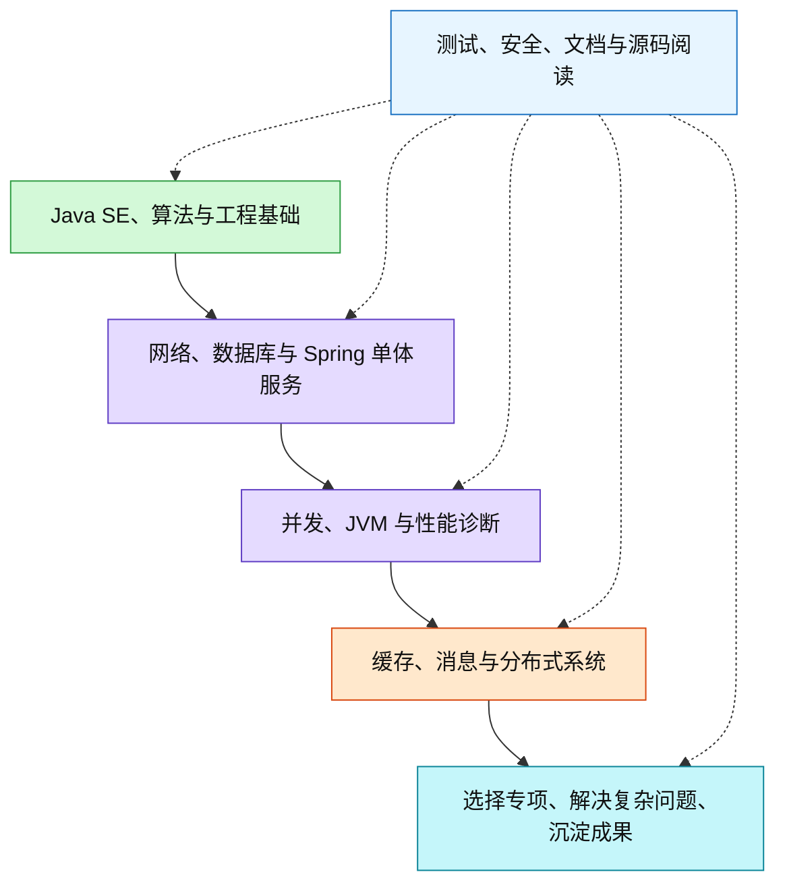

# 2026-09-22 · 成为 Java 专家的完整学习路线

- **问**：我如果希望成为 Java 领域的专家，学习路线是怎么样的？需要学习哪些领域，每个领域需要学习哪些知识点，例如 Java SE 的集合、反射、注解等？追问：整理 javaSE的学习路线，以及涉及的全部知识点。
- **答**：建议覆盖下列 18 个主干领域，并在运行时与性能、框架与基础设施、分布式系统或安全等方向选择一个专项深入。按“会实现 → 能解释原理 → 能诊断故障 → 能论证取舍”逐步验收；以下领域划分、顺序和验收要求是基于一手资料的学习建议，不是官方统一认证标准。
- **信源**：[一手] [Dev.java 学习目录](https://dev.java/learn/)；[Java 语言与虚拟机规范](https://docs.oracle.com/javase/specs/)；[Spring Framework](https://docs.spring.io/spring-framework/reference/overview.html)；[PostgreSQL 文档](https://www.postgresql.org/docs/current/index.html)；各领域的补充一手资料见下文。核实日期：2026-09-22。
- **更新**：2026-09-23（将 Java SE 细化路线拆分为专题）
- **关联**：[[条目/q-20260921-002|2026-09-21 · Cookie/Session/JWT 算不算认证技术]]；[[条目/q-20260921-004|2026-09-21 · k8s 和 Docker 的关系（承接上条）]]；[[条目/q-20260922-005|2026-09-22 · 数据结构与算法的完整学习路线及已有知识点对应]]；[[条目/q-20260923-003|2026-09-23 · Java SE 的学习路线与完整知识点]]；[[条目/q-20260923-004|2026-09-23 · Spring 框架的完整学习路径与知识地图]]

### 使用方式与学习顺序

通用主干适用于各类 Java 开发；服务端部分结合当前 Java、Spring Boot / Cloud 工作背景展开。标记含义：A＝先掌握，B＝完成单体服务后深入，C＝按专项选学。A 与 B 是阶段，不代表能力上限。练习可以沿用当前 JDK 21，再用 JDK 25 对照版本差异；语言特性、API、预览状态和框架兼容性均以对应版本文档为准。

### 1．Java SE：语言与标准库（A，机制向 B 深入）

Java 标准版（Java Platform, Standard Edition，Java SE）是后续 Java 工程学习的基础。其独立路线、分阶段验收与知识点清单见 [[条目/q-20260923-003|2026-09-23 · Java SE 的学习路线与完整知识点]]。本总路线在后文继续展开并发与 JVM 专项。

### 2—5．计算机基础与 Java 运行机制

| 领域与阶段 | 知识点 | 验收目标 |
| --- | --- | --- |
| 2．数据结构与算法（A → B） | 时间与空间复杂度；摊还分析；数组、链表、栈、队列、哈希表、堆、树、图；二分、排序、递归、遍历、分治、贪心、动态规划；进一步理解红黑树、B+ 树、跳表、布隆过滤器 | 根据数据规模、访问方式和内存预算选结构；解释集合与数据库索引为何这样设计 |
| 3．操作系统与硬件基础（A → B） | 进程、线程、调度、上下文切换；用户态与内核态；虚拟内存、分页、文件系统、页缓存；文件描述符、系统调用；CPU 缓存、局部性、原子指令、缓存行与伪共享 | 区分计算、内存、磁盘与网络瓶颈；解释线程增加后性能可能下降的原因 |
| 4．并发编程（A 基础，B 深入） | 线程状态；中断、取消、超时；synchronized、volatile、wait/notify、Lock、Condition；Java 内存模型（Java Memory Model，JMM）、happens-before、安全发布；比较并交换（Compare-and-Set，CAS）、原子类；线程池、队列、拒绝策略；Future、CompletableFuture、ForkJoinPool；ConcurrentHashMap；Semaphore、CountDownLatch；ThreadLocal；死锁、饥饿；虚拟线程；抽象队列同步器（AbstractQueuedSynchronizer，AQS）源码 | 实现有界并发任务处理；证明共享状态的正确性；模拟超时、取消、拒绝和死锁并定位原因 |
| 5．Java 虚拟机（B） | Java 虚拟机（Java Virtual Machine，JVM）规范与 HotSpot 实现的区别；class 文件、字节码；类加载、链接、初始化与类加载器；栈、堆、方法区与 HotSpot 元空间；对象分配与引用类型；垃圾回收（Garbage Collection，GC）、可达性、安全点；G1、ZGC；即时编译（Just-In-Time Compilation，JIT）、内联、逃逸分析、反优化；直接内存、类卸载、内存泄漏 | 从线程转储、堆转储、GC 日志和性能记录分析内存不足、锁竞争与延迟问题；明确结论适用的 JDK 与实现 |

依据：[一手] [MIT 算法课程](https://ocw.mit.edu/courses/6-006-introduction-to-algorithms-spring-2020/)、[OSTEP 原作者教材](https://pages.cs.wisc.edu/~remzi/OSTEP/)、[并发 API](https://docs.oracle.com/en/java/javase/25/docs/api/java.base/java/util/concurrent/package-summary.html)、[JLS 线程与锁](https://docs.oracle.com/javase/specs/jls/se25/html/jls-17.html)、[虚拟线程](https://dev.java/learn/new-features/virtual-threads/)、[JVM 规范](https://docs.oracle.com/javase/specs/jvms/se25/html/jvms-2.html)、[GC 选择](https://docs.oracle.com/en/java/javase/25/gctuning/available-collectors.html)。

### 6—11．服务端工程主干

| 领域与阶段 | 知识点 | 验收目标 |
| --- | --- | --- |
| 6．开发工具与构建（A） | IDE 调试、条件断点、调用栈；Git 分支、合并、回退与审查；Maven 生命周期、依赖传递、版本冲突、scope、BOM、插件、多模块、Wrapper；按需学习 Gradle；日志、配置、文档、依赖升级、可重复构建 | 新环境能够构建、测试并运行项目；定位一次依赖冲突 |
| 7．网络与 Web（A → B） | TCP/IP、DNS；连接建立、超时、重传；HTTP 方法、状态码、报文头、缓存、幂等语义；TLS；Cookie、Session；跨域与浏览器同源策略；Servlet 生命周期、Filter、Listener、容器；接口契约、分页、版本、错误响应；WebSocket、HTTP/2、远程过程调用（Remote Procedure Call，RPC）按需深入 | 说明一次请求从客户端到数据库再返回的完整路径；用抓包和日志定位超时 |
| 8．关系数据库（A → B） | 关系建模、主外键、约束、范式；SQL、JOIN、聚合、子查询、窗口函数；索引、执行计划、统计信息；事务原子性、一致性、隔离性、持久性（ACID）；隔离级别、多版本并发控制（Multi-Version Concurrency Control，MVCC）、锁、死锁；预写日志（Write-Ahead Logging，WAL）、恢复；复制、备份、表结构迁移 | 使用 MySQL 或 PostgreSQL 完成建模；解释并修复慢查询与并发写冲突；不将某个数据库的实现泛化到所有数据库 |
| 9．Java 数据访问（A → B） | Java 数据库连接（Java Database Connectivity，JDBC）；DataSource、连接池、PreparedStatement、批处理、事务与资源关闭；MyBatis 映射、动态 SQL、插件；或 Jakarta Persistence / Hibernate 的实体状态、关联、脏检查、延迟加载；N+1 查询、分页、乐观锁、数据库迁移工具 | 从业务方法追到实际 SQL、连接和事务；解释框架隐藏了什么、哪些问题仍由应用负责 |
| 10．Spring 体系（A → B） | 控制反转（Inversion of Control，IoC）、依赖注入（Dependency Injection，DI）；Bean 生命周期与作用域；构造器注入；面向切面编程（Aspect-Oriented Programming，AOP）与代理；Spring MVC 请求处理、校验、异常处理；事务传播、隔离、回滚和代理边界；Spring Boot 自动配置、条件装配、配置绑定、Starter、Actuator；Spring Security；WebFlux、响应式背压与 Spring Cloud 按需深入 | 完成可测试的单体服务；解释自动配置生效原因、一次请求的调用链及事务未生效的原因 |
| 11．软件设计与架构（A 持续练习，B 深入） | 职责、内聚、耦合、封装、依赖方向；接口与错误模型；不变量、状态机；策略、工厂、适配器、装饰器、代理、观察者等模式；分层、模块化单体、领域边界；领域驱动设计（Domain-Driven Design，DDD）的实体、值对象、聚合、限界上下文；架构决策记录（Architecture Decision Record，ADR）；兼容性、演进与迁移 | 对一个真实需求给出简单设计；说明边界、约束、替代方案与成本；用测试验证变更影响 |

依据：[一手] [Maven 构建生命周期](https://maven.apache.org/guides/introduction/introduction-to-the-lifecycle.html)、[HTTP 语义](https://www.rfc-editor.org/rfc/rfc9110.html)、[PostgreSQL 文档](https://www.postgresql.org/docs/current/index.html)、[并发控制](https://www.postgresql.org/docs/current/mvcc.html)、[MyBatis](https://mybatis.org/mybatis-3/)、[Hibernate](https://hibernate.org/orm/documentation/)、[Spring Framework](https://docs.spring.io/spring-framework/reference/overview.html)、[Spring Boot](https://docs.spring.io/spring-boot/reference/index.html)、[Spring Modulith 模块边界](https://docs.spring.io/spring-modulith/reference/fundamentals.html)。模式、优先级与验收项是课程组织建议。

### 12—18．生产系统能力

| 领域与阶段 | 知识点 | 验收目标 |
| --- | --- | --- |
| 12．缓存（B） | 本地缓存与 Redis；数据结构、键设计、过期、淘汰；缓存命中率；缓存穿透、击穿、雪崩；更新与失效策略、数据一致性；热点、大键；持久化、复制、故障切换、集群；分布式锁的租约与失效条件 | 解释什么能缓存、允许多久不一致、缓存失效后系统如何承受流量 |
| 13．消息与事件（B） | 队列与发布订阅；生产、存储、消费；确认、重试、死信、积压；分区、消费者组与顺序；至少一次等投递语义；去重与幂等；事务消息的适用范围；Outbox 与业务事务；消息格式演进 | 验证重复投递、消费失败、重启与乱序；说明业务结果能保证到哪一层 |
| 14．分布式系统（B → C） | 部分失败；超时、重试、退避与抖动；幂等；一致性模型；网络分区下的一致性与可用性取舍；复制、分片、选主、Raft；发现、配置、负载均衡、网关；限流、熔断、隔离、降级；两阶段提交、Saga、补偿、Outbox；时钟、租约、隔离令牌；分布式 ID；微服务边界 | 通过故障实验说明网络超时、节点重启和重复请求的结果；在有明确收益时拆分服务 |
| 15．测试与质量（A 起贯穿） | 单元、集成、接口契约、端到端测试；JUnit、断言、参数化；测试替身与边界；Testcontainers；数据库与消息集成测试；属性测试；并发与性能测试；静态检查、覆盖率的局限；失败用例与回归；测试数据隔离 | 测试能发现真实业务错误，且结果稳定；关键事务和失败路径有可重复验证 |
| 16．可观测性与性能（A 基础，B 深入） | 结构化日志、指标、链路追踪、上下文传播；OpenTelemetry；延迟分位数、吞吐量、错误率、饱和度；服务等级指标（Service Level Indicator，SLI）与服务等级目标（Service Level Objective，SLO）；jcmd、JDK Flight Recorder（JFR）、线程与堆分析、火焰图；JMH 微基准的预热、死代码消除与重复测量；负载测试、容量评估、故障复盘 | 建立负载与性能基线；形成“现象—证据—原因—修改—复测”的诊断报告 |
| 17．应用安全（A 起贯穿，C 可专精） | 认证、授权、会话管理的边界；Spring Security；OAuth 2.0、OpenID Connect、JWT 校验；访问控制、越权；SQL 注入、跨站脚本、跨站请求伪造、服务端请求伪造；反序列化、路径和文件上传安全；密码存储、随机数、密钥管理、TLS、证书信任；依赖漏洞、敏感日志、审计；Java 密码服务与 Provider 按需深入 | 用失败用例验证越权、非法输入与令牌校验；审查密钥和敏感信息的生命周期 |
| 18．部署与交付（A 单机，B 容器与集群） | Linux 进程、权限、网络与日志排查；应用配置、打包、健康检查、优雅停机；持续集成（Continuous Integration，CI）与持续交付（Continuous Delivery，CD）；镜像、容器、资源限制；Kubernetes 的 Pod、Deployment、Service、配置、探针、扩缩容；滚动发布、回滚、备份恢复 | 在干净环境交付服务；验证重启、资源不足、发布和回滚；说明应用与平台各自负责什么 |

依据：[一手] [Redis](https://redis.io/docs/latest/develop/)、[Kafka 设计](https://kafka.apache.org/42/design/design/)、[Raft 作者项目](https://raft.github.io/)、[Spring Cloud](https://spring.io/projects/spring-cloud/)、[JUnit](https://docs.junit.org/current/user-guide/)、[Testcontainers](https://java.testcontainers.org/)、[OpenTelemetry](https://opentelemetry.io/docs/concepts/)、[JDK 诊断工具](https://docs.oracle.com/en/java/javase/25/troubleshoot/diagnostic-tools.html)、[JMH](https://github.com/openjdk/jmh)、[Spring Security](https://docs.spring.io/spring-security/reference/index.html)、[Java 安全编码指南](https://www.oracle.com/java/technologies/javase/seccodeguide.html)、[Kubernetes](https://kubernetes.io/docs/concepts/)。

### 专项方向（C）：选择一个深入，不要求全部精通

| 方向 | 深入内容与成果 |
| --- | --- |
| JVM 与性能 | 编译与 GC、内存与并发、操作系统与硬件；定位跨层瓶颈；形成带条件与数据的诊断、优化报告 |
| 框架与基础设施 | Spring 扩展点、注解处理、字节码增强、Java Agent、网络框架、库的兼容性；实现并维护可复用组件 |
| 分布式与数据系统 | 共识、存储、复制、恢复、调度、消息、容量与可用性；实现故障注入实验并解释正确性边界 |
| 安全与业务领域 | Java 密码 API、证书信任、密钥生命周期、签名验证与审计；结合当前国密、电子签章、PKI 工作深入标准和实现 |
| 启动与部署优化 | 提前编译（Ahead-of-Time Compilation，AOT）、GraalVM Native Image、运行时裁剪、启动与内存预算；比较兼容性和运维成本 |

搜索引擎、文档数据库、批处理、任务调度、工作流、大数据、桌面 JavaFX、Android 等属于按产品需求追加的分支。进入分支后另查对应官方资料，不将品牌清单作为主干完成标准。[一手] [GraalVM Native Image](https://www.graalvm.org/latest/reference-manual/native-image/)；[JDK 工具与技术目录](https://docs.oracle.com/en/java/javase/25/)。

### 阶段验收与学习方法

| 阶段 | 学习重点 | 可验证产出 |
| --- | --- | --- |
| 第一阶段 | Java SE、基本算法、Git、Maven、JUnit | 不依赖 Spring 的命令行文件处理工具，包含正常、异常与边界测试 |
| 第二阶段 | HTTP、数据库、数据访问、Spring、基础安全 | 模块化单体服务，包含权限、事务、迁移、错误处理和集成测试 |
| 第三阶段 | 并发、JVM、操作系统、可观测性 | 在测试环境制造内存泄漏、锁竞争和线程池耗尽，保存证据并完成修复 |
| 第四阶段 | 缓存、消息、分布式、部署 | 为明确需求引入缓存或消息；验证重复、丢连接、重启、积压与回滚 |
| 第五阶段 | 一个专家专项、源码与规范 | 完成可复现的深入分析、组件改进或开源贡献，接受他人审查 |

每个知识点按五步学习：明确要解决的问题 → 编写最小实验 → 查 API、规范和实现 → 注入边界或故障 → 写明适用条件与取舍。源码沿问题阅读，例如 HashMap 查找与扩容、ThreadPoolExecutor 任务提交与拒绝、Spring Bean 创建与事务代理；不要求从仓库第一行通读。架构、测试、安全和文档从第一阶段开始，不等后期补做。

既有记录的衔接：认证与会话的知识用于第 7、17 领域；Docker 与 Kubernetes 的分工用于第 18 领域。本次新增的是完整 Java 能力地图，不展开或修正上述领域的历史演化结论。

### 首要资料

- [一手] [Dev.java：语言与标准库学习入口](https://dev.java/learn/)
- [一手] [Java 语言与虚拟机规范](https://docs.oracle.com/javase/specs/)
- [一手] [JDK 文档：工具、GC、安全与诊断](https://docs.oracle.com/en/java/javase/25/)
- [一手] [Spring Framework 官方文档](https://docs.spring.io/spring-framework/reference/overview.html)
- [一手] [Spring Boot 官方文档](https://docs.spring.io/spring-boot/reference/index.html)
- [一手] [PostgreSQL 官方文档](https://www.postgresql.org/docs/current/index.html)
