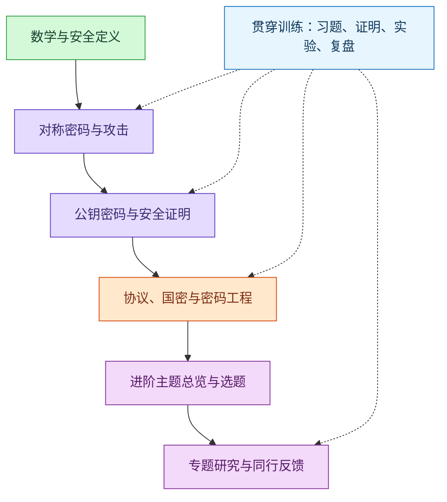

# 2026-09-22 · 成为密码学专家的系统性学习路线

- **问**：我希望成为密码学领域的专家，帮我整理系统性学习路线。补充：工程与研究兼顾；数学较扎实；每周 10 小时以上。
- **答**：采用公共基础与专题深入相结合的路线，将安全定义、构造证明、攻击实验、工程验证和研究复现贯穿学习过程；建议利用国密、PKI 与电子签章背景建立工程主线，再选择一个研究方向。按每周 10 至 12 小时估算，先安排 24 至 36 个月训练，并以独立分析能力、可复现成果和同行反馈评估进展。
- **信源**：[一手] [Boneh–Shoup 教材](https://toc.cryptobook.us/)；[The Joy of Cryptography](https://joyofcryptography.com/)；[Dan Boneh 课程](https://crypto.stanford.edu/~dabo/courses/OnlineCrypto/)；[Cryptopals](https://cryptopals.com/)；[Wycheproof](https://github.com/C2SP/wycheproof)；[RFC 8446](https://www.rfc-editor.org/rfc/rfc8446.html)；[RFC 5280](https://www.rfc-editor.org/rfc/rfc5280.html)；[NIST 密钥管理指南](https://csrc.nist.gov/pubs/sp/800/57/pt1/r5/final)；[OpenSSL 3.5 SM2 文档](https://docs.openssl.org/3.5/man7/EVP_PKEY-SM2/)；[NIST 后量子密码项目](https://csrc.nist.gov/projects/post-quantum-cryptography)；[IACR 出版物说明](https://iacr.org/publications/)。
- **更新**：2026-09-22（补充数学学习路线关联；原自评与原规划保留为历史条件；补充数据结构与算法路线关联）
- **关联**：[[条目/q-20260921-001|2026-09-21 · 用户身份认证技术的演化过程]]；[[条目/q-20260922-003|2026-09-22 · 从小学算术到数学研究的完整学习路线与领域关系]]；[[条目/q-20260922-005|2026-09-22 · 数据结构与算法的完整学习路线及已有知识点对应]]

### 目标与评估

以下安排是基于已核实资料和用户背景提出的教学建议，不是教材作者规定的学制。

专家能力应在以下成果中体现：

1. 给出攻击者能力、可见信息、安全目标和适用假设。
2. 解释算法、模式与协议的选择，写出安全归约（Security Reduction）或具体反例。
3. 复现至少一类攻击，量化其前提、成功率、复杂度与限制。
4. 检查实现的随机数、密钥生命周期、编码、错误路径与侧信道。
5. 在选定专题中完成可审查的证明、复现、实现分析或改进，并根据同行反馈修正。

### 学习顺序

### 六个阶段

| 阶段与建议时间 | 学习重点 | 验收成果 |
| --- | --- | --- |
| 第 1 至 2 个月：数学与安全语言 | 离散概率、条件概率、生日界；模运算、群与有限域；随机算法、复杂性、可忽略函数；信息论安全与计算安全；安全游戏和归约 | 证明一次一密的完美保密性；写出一个区分攻击；独立完成一个简单归约，并列明适用假设 |
| 第 3 至 5 个月：对称密码 | 伪随机生成器、函数与置换；AES 与 SM4；工作模式；密码杂凑函数、消息认证码（Message Authentication Code，MAC）、密钥派生函数（Key Derivation Function，KDF）；带关联数据的认证加密（Authenticated Encryption with Associated Data，AEAD） | 复现密钥流复用、填充预言机、长度扩展等典型错误用法攻击；解释攻击前提及修复为何有效 |
| 第 6 至 9 个月：公钥密码 | 因数分解与离散对数；RSA、Diffie–Hellman；椭圆曲线密码（Elliptic Curve Cryptography，ECC）；公钥加密、数字签名和密钥交换；ECDSA、SM2 的结构比较 | 推导并演示某个签名方案随机数复用导致密钥恢复；验证公开测试向量；写出一个签名或加密方案的证明结构 |
| 第 10 至 15 个月：协议与工程 | 传输层安全协议（Transport Layer Security，TLS）1.3；公钥基础设施（Public Key Infrastructure，PKI）；证书路径验证；随机数、密钥生成与销毁、编码、异常路径、侧信道攻击（Side-channel Attack）；国密与签章标准 | 用成熟密码库完成签名验签与证书验证项目；具备篡改、错误身份标识、过期证书、错误用途、撤销及异常编码等失败用例；明确支持的验证策略和边界 |
| 第 16 至 18 个月：进阶总览 | 零知识证明（Zero-Knowledge Proof，ZKP）、安全多方计算（Secure Multi-Party Computation，MPC）、门限密码、后量子密码（Post-Quantum Cryptography，PQC）；初步接触差分、线性及格攻击 | 每个主题写出问题、威胁模型和核心构造；选定一个专题，完成一份相关工作比较表 |
| 第 19 至 36 个月：专题深入 | 按所选方向补充数学、系统或形式化方法；阅读原始论文、复现基线、提出可检验问题 | 完成 2 至 3 份深入复现报告和一个专题成果；报告环境、假设、失败条件、可重复步骤与局限；接受外部审阅并修改 |

可以通过阶段验收后提前推进；若证明或实验未过关，则延长该阶段。研究训练从第一阶段开始，第六阶段只是集中深入。

安全定义需掌握：选择明文攻击下的不可区分性（Indistinguishability under Chosen-Plaintext Attack，IND-CPA）、选择密文攻击下的不可区分性（Indistinguishability under Chosen-Ciphertext Attack，IND-CCA），以及选择消息攻击下的存在性不可伪造性（Existential Unforgeability under Chosen-Message Attack，EUF-CMA）。不仅记缩写，还要能画出安全游戏、解释攻击者接口和成功条件。[一手：[The Joy of Cryptography](https://joyofcryptography.com/)]

### 教材与训练安排

- 主教材：Boneh–Shoup《A Graduate Course in Applied Cryptography》。以当前作者页面提供的 v0.6 为章节依据：附录补数学，第 2 至 9 章学对称密码，第 10 至 16 章学公钥，第 18 至 21 章学鉴别与协议，第 17、22、23 章按研究方向深化。[一手：[作者页面](https://toc.cryptobook.us/)]
- 证明桥梁：Mike Rosulek《The Joy of Cryptography》。先读一次一密、安全证明基础和计算安全，再按主线选读。该书以本科层次介绍可证明安全（Provable Security）。[一手：[作者在线版](https://joyofcryptography.com/)]
- 视频：Dan Boneh 课程按当前章节选看；将时间留给习题与实验。[一手：[教师课程页](https://crypto.stanford.edu/~dabo/courses/OnlineCrypto/)]
- 攻击训练：Cryptopals 第 1 至 4 组配合对称密码，第 5 至 6 组配合公钥密码；后续按方向选做。题目中的历史构造用于理解攻击，不直接作为生产选型。[一手：[原作者题库](https://cryptopals.com/)]
- 工程验证：为所选库加载 Wycheproof 中适用的测试向量，再补业务失败用例；通过测试不能替代安全证明或覆盖所有实现问题。[一手：[项目仓库](https://github.com/C2SP/wycheproof)]
- 协议阅读：TLS 1.3 先读第 2、4、7 节和安全分析附录；X.509 证书先读第 4、6 节。掌握证书签名验证与完整证书路径验证的区别。[一手：[RFC 8446](https://www.rfc-editor.org/rfc/rfc8446.html)、[RFC 5280](https://www.rfc-editor.org/rfc/rfc5280.html)]
- 密钥管理：结合 NIST SP 800-57 Part 1 Rev.5 研究密钥生命周期和保护要求；这份指南是学习材料，不据此推断中国业务合规结论。[一手：[发布页](https://csrc.nist.gov/pubs/sp/800/57/pt1/r5/final)]

### 国密、PKI 与电子签章实践主线

建议按“算法 → 用法与编码 → 证书与协议 → 文档签章”的顺序阅读。

| 层次 | 学习材料 | 项目中的问题 |
| --- | --- | --- |
| 算法 | GB/T 32918 系列；GB/T 32905-2016；GB/T 32907-2016 | 对照通用密码学知识解释 SM2、SM3、SM4 的目标与边界 |
| SM2 实现 | OpenSSL 3.5 SM2 文档及所用库的官方接口说明 | 身份标识、消息处理、签名编码和随机数如何影响互操作 |
| 证书 | RFC 5280 与项目适用的国密证书规范 | 信任锚、证书用途、有效期、路径约束、撤销策略如何共同影响接受结果 |
| 电子签章 | GB/T 38540-2020《信息安全技术 安全电子签章密码技术规范》；GM/T 0112-2021《PDF格式文档的密码应用技术要求》 | 明确实际签名对象，设计文档篡改与签章验证失败用例 |

标准编号和名称已在官方题录或发布页核实；本次未逐条核验这些国密标准全文，不据此声称项目满足标准。SM2 身份标识的接口行为来自 OpenSSL 3.5 文档，不能直接外推到其他库或版本。

[一手：[SM2 数字签名标准题录](https://openstd.samr.gov.cn/bzgk/std/newGbInfo?hcno=6F1FAEB62F9668F25F38E0BF0291D4AC)、[SM3 标准题录](https://openstd.samr.gov.cn/bzgk/gb/newGbInfo?hcno=45B1A67F20F3BF339211C391E9278F5E)、[SM4 标准题录](https://openstd.samr.gov.cn/bzgk/std/newGbInfo?hcno=7803DE42D3BC5E80B0C3E5D8E873D56A)、[GB/T 38540-2020 题录](https://openstd.samr.gov.cn/bzgk/std/newGbInfo?hcno=EBF1360C272E40E7A8B9B32ED0724AB1)、[GM/T 0112-2021 发布页](https://www.oscca.gov.cn/sca/xxgk/2021-10/19/content_1060890.shtml)、[OpenSSL SM2 文档](https://docs.openssl.org/3.5/man7/EVP_PKEY-SM2/)]

建议保留两个学习产物：用 Python 或 SageMath 表达数学与攻击实验，用 Java 和成熟密码库完成集成与验证。研究实现与生产依赖分别管理；底层实现安全方向选定后，再学习 C、汇编和微架构。

### 专题选择与研究方法

优先候选是协议安全、实现安全或后量子迁移，因为这些方向便于把已有国密与 PKI 经验转成研究问题。这是个性化建议，不是已确定的最终选题。

| 方向 | 需要深化的能力 | 可起步的问题 |
| --- | --- | --- |
| 协议与 PKI 安全 | 认证密钥交换、安全模型、组合分析、形式化验证 | 不同身份绑定或证书验证策略会改变哪些安全保证 |
| 实现安全 | 常数时间编程、编译器、微架构、统计实验、故障模型 | 一个实现的泄漏是否与秘密相关，缓解措施在什么条件下有效 |
| 后量子迁移 | 格、编码或杂凑签名基础；密钥封装；协议集成 | 在固定安全目标下，比较证书、签名、握手体积与验证成本 |
| 原语与密码分析 | 对称方向的差分及线性分析，或公钥方向的数论及格算法 | 复现一个缩减轮数攻击，解释其复杂度与完整算法的差距 |

后量子学习应区分密钥封装与签名：FIPS 203 规定 ML-KEM；FIPS 204 规定 ML-DSA。开始实现时读取官方勘误，不把草案名称和最终标准混用。[一手：[FIPS 203](https://csrc.nist.gov/pubs/fips/203/final)、[FIPS 204](https://csrc.nist.gov/pubs/fips/204/final)]

每篇论文先提取：问题、攻击者能力、假设、核心结论、证明或实验、未覆盖条件。随后复现一个关键引理或实验，改变一个条件，再检查结论是否仍成立。建议进入专题阶段后每两周精读一篇，每季度完成一个复现报告，并邀请研究者或维护者审阅。

通过 IACR 出版物页查找对应研究方向。ePrint 适合获取作者版本，但收录本身不经过科学同行评审；需继续核对正式发表版本、修订和勘误。[一手：[IACR 出版物说明](https://iacr.org/publications/)]

### 每周与首月安排

每周 12 小时的建议分配：4 小时教材与推导、3 小时习题与证明、4 小时实验、1 小时复盘。若只有 10 小时，则从阅读和实验各减 1 小时。

- 第 1 周：自测概率、模运算、群与有限域；读一次一密；证明完美保密性。
- 第 2 周：读安全游戏；实现密钥复用实验；写清攻击者已知条件。
- 第 3 周：学习计算安全与伪随机性；写出一个区分器及优势计算。
- 第 4 周：完成一个简单安全归约；整理一份“构造—定义—攻击—修复”报告，并据结果调整后续节奏。

### 首要资料

- [一手] [Boneh–Shoup 主教材](https://toc.cryptobook.us/)与[Rosulek 证明教材](https://joyofcryptography.com/)。
- [一手] [Cryptopals](https://cryptopals.com/)与[Wycheproof](https://github.com/C2SP/wycheproof)。
- [一手] [TLS 1.3 原文](https://www.rfc-editor.org/rfc/rfc8446.html)与[X.509 证书及路径验证原文](https://www.rfc-editor.org/rfc/rfc5280.html)。
- [一手] [GB/T 38540-2020 官方题录](https://openstd.samr.gov.cn/bzgk/std/newGbInfo?hcno=EBF1360C272E40E7A8B9B32ED0724AB1)与[GM/T 0112-2021 官方发布页](https://www.oscca.gov.cn/sca/xxgk/2021-10/19/content_1060890.shtml)。
- [一手] [NIST 后量子密码项目](https://csrc.nist.gov/projects/post-quantum-cryptography)与[IACR 出版物说明](https://iacr.org/publications/)。
