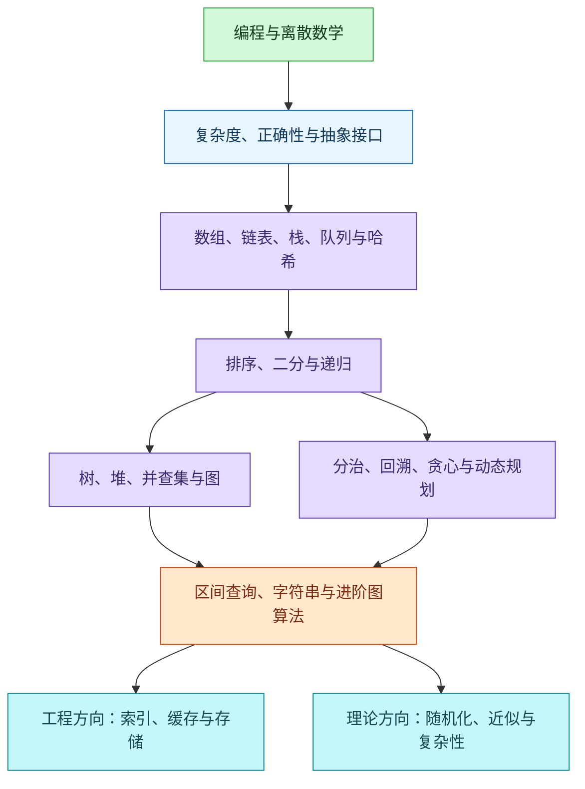

# 2026-09-22 · 数据结构与算法的完整学习路线及已有知识点对应

- **问**：整理数据结构和算法学习路线，已经涉及的全部知识点。澄清：需要完整学习路线及各阶段知识点，并标出已有记录。
- **答**：先完成基础结构、复杂度、递归与排序，再将树图结构和贪心、回溯、动态规划结合学习，最后按工程、竞赛或理论目标选进阶专题。每个主题用“定义问题 → 朴素方案 → 改进 → 正确性证明 → 复杂度 → 边界验证”验收。
- **信源**：[一手] [MIT 6.006 讲义](https://ocw.mit.edu/courses/6-006-introduction-to-algorithms-spring-2020/pages/lecture-notes/)；[MIT 6.046J 讲义](https://ocw.mit.edu/courses/6-046j-design-and-analysis-of-algorithms-spring-2015/pages/lecture-notes/)；[Open Data Structures 作者网站](https://opendatastructures.org/)；[Princeton Algorithms 作者网站](https://algs4.cs.princeton.edu/cheatsheet/)。专项来源见各表后。核实日期：2026-09-22。
- **关联**：[[条目/q-20260922-001|2026-09-22 · 成为 Java 专家的完整学习路线]]；[[条目/q-20260922-003|2026-09-22 · 从小学算术到数学研究的完整学习路线与领域关系]]；[[条目/q-20260922-002|2026-09-22 · 成为密码学专家的系统性学习路线]]

**范围与标记。** “完整”指通用主干和主要进阶分支，不是枚举全部研究算法。下列顺序和验收任务是教学设计，不是官方统一学制。J＝已有 Java 记录；M＝已有数学记录；C＝已有密码学记录。“本次展开”表示在现有提问记录中未找到该具体主题；此前出现“树”“图”“动态规划”不等于其全部子主题均已记录。

**已有内容的对应关系：**

| 原领域 | 此前与本路线有关的内容 | 本次承接 |
| --- | --- | --- |
| J：Java | 时间与空间复杂度、摊还分析；数组、链表、栈、队列、哈希表、堆、树、图；二分、排序、递归、遍历、分治、贪心、动态规划；红黑树、B+ 树、跳表、布隆过滤器 | 展开操作、变体、适用条件、证明与练习 |
| J：Java 集合与工程 | Collection、Map、List、Set、Queue、Deque；ArrayList、LinkedList、HashMap、LinkedHashMap、TreeMap、HashSet、TreeSet、ArrayDeque、PriorityQueue；equals/hashCode、Comparable/Comparator；索引、缓存与性能 | 把抽象接口、具体结构和实际 API 对应起来 |
| M：数学 | 逻辑、集合、关系、映射、归纳与反例；计数、递推、容斥、抽屉原理；图、路径、树、匹配、着色；整除、Euclid 算法、同余、模逆、中国剩余定理；概率、归约、时间与空间复杂性、P 与 NP、算法下界 | 作为算法证明、分析与专题先修；原记录的极值组合、Ramsey 理论等仍属数学专项 |
| C：密码学 | 离散概率、生日界、随机算法、复杂性；模运算、群与有限域；因数分解、离散对数；安全归约及数论、格算法方向 | 衔接随机化与数论计算；密码原语及安全证明细节继续保留在密码学领域 |

**学习顺序。** 实线表示推荐推进顺序；树图与算法设计可以交替学习。各分支仍按具体算法补先修，例如先理解贪心，再深入最小生成树的正确性。

**阶段 0：编程与数学准备。** 目标是能表达问题、执行算法并理解基本证明。可以沿用 Java；不把完成微积分、抽象代数等全部课程作为入门门槛。

| 模块 | 知识点 | 已有记录 |
| --- | --- | --- |
| 编程与表示 | 变量、条件、循环、函数、数组、引用、对象；递归调用栈；整数溢出、字符编码；调试、输入输出、边界测试 | J：语言与数组、编码、测试；其余按算法场景展开 |
| 初等数学 | 整数、分数、余数、不等式；指数、对数、求和、等差与等比数列；向上和向下取整 | M：算术、代数、函数；分析用途本次展开 |
| 离散数学（Discrete Mathematics） | 集合、关系、函数、逻辑与量词；直接证明、反证、归纳、构造与反例；排列组合、容斥、抽屉原理、递推；概率、条件概率、期望 | M；概率也见 C |
| 抽象数据类型（Abstract Data Type，ADT） | 区分接口与实现；序列、集合、映射、栈、队列、优先队列的操作契约；逻辑结构与存储表示 | J：已有集合接口；ADT 视角本次展开 |

验收：独立写出线性查找、数组最大值和频次统计；说明输入、输出、空输入约定，并用归纳解释一个简单递归。先修依据：[一手] [MIT Mathematics for Computer Science](https://ocw.mit.edu/courses/6-042j-mathematics-for-computer-science-spring-2015/pages/readings/)、[Open Data Structures](https://opendatastructures.org/)。

**阶段 1：复杂度与正确性。** 后续每个算法都回到这两件事，不单独背复杂度表。

| 模块 | 知识点 | 已有记录 |
| --- | --- | --- |
| 复杂度（Complexity） | 时间、辅助空间、递归栈；输入规模与多参数；O、Ω、Θ；最好、最坏、平均与期望；常数、对数、线性、线性对数、多项式、指数与阶乘增长 | J：时间与空间复杂度；M、C：复杂性 |
| 分析工具 | 求和与递推式；代入法、递归树、主定理及适用条件；摊还分析（Amortized Analysis）的聚合法、记账法、势能法；区分摊还与概率平均 | J：摊还分析；M：递推；具体方法本次展开 |
| 正确性（Correctness） | 前置与后置条件；循环不变量、递归归纳、终止性；交换论证、割性质；反例；问题归约（Reduction） | M：证明与归约；C：安全归约；具体算法证明本次展开 |
| 计算模型 | 固定字长运算与大整数运算的区别；比较模型、随机存取模型；输入数值与输入编码长度；伪多项式时间 | 本次展开 |

验收：推导二分查找与归并排序的复杂度；解释动态数组扩容为什么按一串操作做摊还分析；给出循环不变量，而不只列测试结果。依据：[一手] [Princeton 分析速查](https://algs4.cs.princeton.edu/cheatsheet/)、[MIT 6.046J](https://ocw.mit.edu/courses/6-046j-design-and-analysis-of-algorithms-spring-2015/pages/lecture-notes/)。

**阶段 2：线性结构与基本处理技巧。** 核心是比较访问、插入、删除、查找和空间成本。

| 模块 | 知识点 | 已有记录 |
| --- | --- | --- |
| 数组与字符串 | 数组（Array）、动态数组（Dynamic Array）、二维数组；索引、扩缩容、搬移；字符与子串；双指针（Two Pointers）、快慢指针、滑动窗口（Sliding Window）、前缀和、差分、离散化 | J：数组、ArrayList、字符串、扩容；技巧本次展开 |
| 链表（Linked List） | 单链表、双链表、循环链表、哨兵；反转、合并、找中点、判环；区别“已知节点”与“先查找节点”的成本 | J：链表、LinkedList；操作展开 |
| 栈与队列 | 栈（Stack）、队列（Queue）、双端队列（Deque）、循环队列；括号匹配、表达式求值；单调栈、单调队列 | J：栈、队列、Deque、ArrayDeque；单调结构与应用本次展开 |
| 哈希表（Hash Table） | 集合与映射；哈希函数、冲突、链地址法、开放寻址、负载因子、再散列；相等契约与可变键；频次、去重与索引 | J：哈希表、HashMap/HashSet、equals/hashCode；细节展开 |
| 位表示 | 与、或、异或、取反、移位；位图（Bitmap）、位集合（Bitset）、子集编码和枚举 | J：运算符基础；位结构和算法本次展开 |

验收：实现动态数组、链表、循环队列和简单哈希表；解释一次选型；用双指针或窗口解决一个问题并说明其适用条件。依据：[一手] [Open Data Structures](https://opendatastructures.org/)、[Competitive Programmer’s Handbook](https://cses.fi/book/book.pdf)，第 4、8、9、10 章。

**阶段 3：排序、查找与递归设计。** 从线性过程过渡到递归分解；回溯先练小规模问题。

| 模块 | 知识点 | 已有记录 |
| --- | --- | --- |
| 排序（Sorting） | 冒泡、选择、插入、希尔、归并、快速、堆排序；计数、桶、基数排序；稳定性、原地性；比较排序下界与非比较排序前提 | J：排序；具体算法与条件本次展开 |
| 查找与选择 | 线性查找、二分查找（Binary Search）、左右边界、单调判定与二分答案；第 k 小、Quickselect、Top-K | J：二分；其余展开 |
| 递归与分治 | 递归（Recursion）的基例、规模缩小、返回值与栈；分治（Divide and Conquer）的分解、递归求解、合并；归并、快速排序及选择问题 | J：递归、分治；具体推导本次展开 |
| 枚举与回溯 | 穷举（Brute Force）、回溯（Backtracking）、状态恢复、去重与剪枝；子集、组合、排列；折半搜索（Meet in the Middle）按需深入 | 本次展开 |

验收：实现二分左右边界、归并排序和快速排序；独立生成无重复组合；解释剪枝为何不会删去合法解。依据：[一手] [Princeton 排序与查找总览](https://algs4.cs.princeton.edu/cheatsheet/)、[Jeff Erickson《Algorithms》](https://jeffe.cs.illinois.edu/teaching/algorithms/)。

**阶段 4：树、堆、图与连通性。** 先理解表示和遍历，再学习为某种操作优化的结构。

| 模块 | 知识点 | 已有记录 |
| --- | --- | --- |
| 树与二叉树 | 树（Tree）、根、父子、叶、高度与深度；二叉树（Binary Tree）、满与完全二叉树；前序、中序、后序、层序；递归与显式栈；序列化 | J、M：树；J：遍历；细节展开 |
| 有序结构 | 二叉搜索树（Binary Search Tree，BST）；查找、增删、前驱后继、范围查询、退化；旋转、AVL、红黑树（Red-Black Tree）；跳表（Skip List） | J：树、红黑树、跳表、TreeMap/TreeSet；AVL 与操作细节本次展开 |
| 堆与优先队列 | 二叉堆（Binary Heap）、最小堆、最大堆；上浮、下沉、自底向上建堆；优先队列（Priority Queue）；Top-K、多路归并 | J：堆、PriorityQueue；具体实现展开 |
| 字典树与并查集 | 字典树（Trie）的前缀检索；并查集（Disjoint Set Union，DSU）的查找、合并、按秩或大小合并、路径压缩 | 本次展开 |
| 图的表示与遍历 | 图（Graph）的方向、权重、度、路径、环、连通性；邻接表、邻接矩阵；深度优先搜索（Depth-First Search，DFS）、广度优先搜索（Breadth-First Search，BFS）；连通分量、判环、二分图判定 | J、M：图与路径；具体表示和算法本次展开 |
| 图的核心问题 | 有向无环图（Directed Acyclic Graph，DAG）、拓扑排序；最短路的松弛、BFS、Dijkstra、Bellman–Ford、Floyd–Warshall；最小生成树（Minimum Spanning Tree，MST）的 Prim、Kruskal | 本次展开；最小生成树与下一阶段贪心交替学习 |

验收：实现堆、BST、并查集及图遍历；用拓扑排序检测依赖环；根据边权条件选择最短路算法。标准 Dijkstra 要求非负边权，不能把它直接用于一般负权图。依据：[一手] [MIT 6.006](https://ocw.mit.edu/courses/6-006-introduction-to-algorithms-spring-2020/pages/lecture-notes/)、[Princeton 图算法与性能](https://algs4.cs.princeton.edu/cheatsheet/)、[Open Data Structures](https://opendatastructures.org/)。

**阶段 5：贪心、动态规划与综合建模。** 重点从“识别题型”转向“说明方案为什么成立”。

| 模块 | 知识点 | 已有记录 |
| --- | --- | --- |
| 贪心（Greedy Algorithm） | 局部选择、可行性、最优子结构；交换论证与反例；区间调度、Huffman 编码、最小生成树 | J：贪心；证明与应用展开 |
| 动态规划（Dynamic Programming，DP） | 状态、选择、转移、初始与边界条件、计算顺序、答案位置；重叠子问题、最优子结构；记忆化搜索、自底向上、空间压缩、方案还原 | J：动态规划；建模步骤展开 |
| DP 常见结构 | 线性与网格；0/1 背包、完全背包、多重背包；最长公共子序列（Longest Common Subsequence，LCS）、最长递增子序列（Longest Increasing Subsequence，LIS）、编辑距离；区间、树形、DAG、状态压缩 DP | 本次展开 |
| 方法组合 | 排序后贪心；哈希去重；堆加图搜索；二分答案加判定；前缀统计加 DP；比较穷举、回溯、记忆化与迭代 DP | 已有方法的本次综合 |

验收：从穷举推导一个背包或编辑距离算法；说明状态为何足够、转移为何完整；证明一个贪心策略，并为错误策略给反例。依据：[一手] [Jeff Erickson《Algorithms》](https://jeffe.cs.illinois.edu/teaching/algorithms/)、[MIT 6.006 DP 讲义目录](https://ocw.mit.edu/courses/6-006-introduction-to-algorithms-spring-2020/pages/lecture-notes/)、[Princeton 数据压缩](https://algs4.cs.princeton.edu/55compression/)。

**阶段 6：进阶分支。** 下列内容按目标选学；不把“全部完成”设为工程应用的前置条件。

| 分支 | 知识点 | 已有记录 |
| --- | --- | --- |
| 区间查询与离线处理 | 树状数组（Fenwick Tree）、线段树（Segment Tree）、懒传播、稀疏表（Sparse Table）、区间最小值查询（Range Minimum Query，RMQ）；分块、扫描线、莫队算法（Mo’s Algorithm） | 本次展开 |
| 树上查询与动态结构 | 最近公共祖先（Lowest Common Ancestor，LCA）、倍增、Euler 序、树链剖分；Treap、伸展树（Splay Tree）、可持久化结构（Persistent Data Structure）；动态树、动态连通性 | 本次展开 |
| 高级图算法 | 强连通分量（Strongly Connected Component，SCC）、Tarjan、Kosaraju；桥、割点；Euler 路径；二分图匹配、增广路、网络流、最大流最小割、费用流；2-SAT | M：匹配概览；具体算法本次展开 |
| 字符串与文本索引 | Knuth–Morris–Pratt（KMP）、Boyer–Moore、Rabin–Karp、Z-algorithm；Aho–Corasick 多模式匹配；后缀数组、后缀树、最长公共前缀；正则表达式与有限自动机；Huffman、LZW 压缩 | J：正则表达式用法；M：自动机入口；算法本次展开 |
| 数论与组合算法 | 最大公约数（Greatest Common Divisor，GCD）、扩展 Euclid、筛法、快速幂、模逆、中国剩余定理；组合数、容斥、计数 DP；矩阵快速幂、卷积、快速 Fourier 变换（Fast Fourier Transform，FFT） | M：Euclid、同余、模逆、中国剩余定理、计数；C：数论与代数背景 |
| 计算几何（Computational Geometry） | 点积、叉积、方向判断、线段相交、多边形面积；凸包、扫描线、最近点对；退化情况与精度处理 | M：几何与线性代数基础；几何算法本次展开 |
| 随机算法（Randomized Algorithm） | 随机化快速排序与选择、通用哈希；期望与失败概率、概率放大；抽样与随机化分析 | C：随机算法、生日界；M：概率；具体算法展开 |
| 存储与缓存结构 | B 树（B-tree）、B+ 树（B+ Tree）的分裂、合并、页与范围扫描；外部排序、输入输出（Input/Output，I/O）复杂度；日志结构合并树（Log-Structured Merge-Tree，LSM-tree）；最近最少使用（Least Recently Used，LRU）缓存 | J：B+ 树、索引、缓存；具体机制与 LSM-tree 本次展开 |
| 近似集合与流式处理 | 布隆过滤器（Bloom Filter）的误报、容量和哈希数量；Count-Min Sketch；单遍处理、内存预算、误差界 | J：布隆过滤器；其余展开 |
| 复杂性与算法设计进阶 | P、NP、NP-hard、NP-complete；多项式归约、比较与数据结构下界；近似算法、近似比、线性规划与对偶、参数化算法；在线算法与竞争分析、并行及分布式算法按任务继续补 | M：P/NP、复杂性、归约、下界；C：复杂性；其余展开 |
| 更深的数据结构与竞赛专题 | 二项堆、Fibonacci 堆、整数索引、紧凑数据结构；高级 DP 优化；博弈状态、Nim、Sprague–Grundy；具体细分随目标继续扩展 | 本次展开；不列为共同必修 |

区间、数论、几何、博弈与竞赛技巧依据：[一手] [Laaksonen 作者手册](https://cses.fi/book/book.pdf)。高级结构与树上查询依据：[一手] [MIT 6.851](https://courses.csail.mit.edu/6.851/spring12/lectures/)、[Princeton 堆的比较](https://algs4.cs.princeton.edu/cheatsheet/)。字符串依据：[一手] [Princeton 子串搜索](https://algs4.cs.princeton.edu/53substring/)、[CMU 多模式匹配](https://www.cs.cmu.edu/~15451-s15/LectureNotes/lecture24.pdf)、[Princeton 压缩](https://algs4.cs.princeton.edu/55compression/)。
图、随机化、近似、参数化、线性规划与分布式算法依据：[一手] [MIT 6.046J](https://ocw.mit.edu/courses/6-046j-design-and-analysis-of-algorithms-spring-2015/pages/lecture-notes/)、[Erickson 进阶讲义](https://jeffe.cs.illinois.edu/teaching/algorithms/)。存储与流式处理依据：[一手] [CMU B+ 树讲义](https://15445.courses.cs.cmu.edu/fall2024/notes/08-indexes1.pdf)、[RocksDB 原理](https://github.com/facebook/rocksdb/wiki/RocksDB-Overview)、[Filtering and Streaming](https://jeffe.cs.illinois.edu/teaching/algorithms/notes/06-bloom.pdf)。在线与并行算法入口依据：[一手] [MIT 6.854J](https://ocw.mit.edu/courses/6-854j-advanced-algorithms-fall-2005/pages/lecture-notes/)、[MIT 6.172](https://ocw.mit.edu/courses/6-172-performance-engineering-of-software-systems-fall-2018/pages/lecture-slides/)。

**与你的 Java 背景衔接。** 以下是练习建议，API 事实以 JDK 21 文档为准。

| 要解决的问题 | 建议对应的结构与练习 |
| --- | --- |
| 顺序存储、端点操作、去重与频次 | 对照 ArrayList、LinkedList、ArrayDeque、HashSet、HashMap；比较访问位置、对象开销和遍历方式 |
| 有序键与范围检索 | 学红黑树后对照 TreeMap；解释排序关系及其与 equals 的一致性。[一手：[TreeMap](https://docs.oracle.com/en/java/javase/21/docs/api/java.base/java/util/TreeMap.html)] |
| Top-K 与任务优先级 | 用 PriorityQueue；区分访问队首、删除任意元素及遍历顺序。[一手：[PriorityQueue](https://docs.oracle.com/en/java/javase/21/docs/api/java.base/java/util/PriorityQueue.html)] |
| LRU 缓存 | 先理解哈希加双向链表，再对照 LinkedHashMap 的访问顺序和淘汰钩子。[一手：[LinkedHashMap](https://docs.oracle.com/en/java/javase/21/docs/api/java.base/java/util/LinkedHashMap.html)] |
| 数据库与存储引擎 | 先比较 B+ 树和哈希的查询需求，再分析 LSM-tree 的读、写、空间取舍。[一手：[CMU 索引](https://15445.courses.cs.cmu.edu/fall2024/notes/08-indexes1.pdf)、[RocksDB](https://github.com/facebook/rocksdb/wiki/RocksDB-Overview)] |

**贯穿全程的验收方法。**

1. 写清输入、输出、约束及规模，先给可验证的朴素算法。
2. 从重复计算、重复扫描或不合适的结构中找到改进点。
3. 说明状态或结构不变量，证明正确性与终止性。
4. 分析时间与空间，注明最坏、期望或摊还条件；大整数须考虑位数。
5. 手写小例子，覆盖空输入、单元素、重复值、极值、已排序和逆序等适用边界；小规模结果与朴素算法对照。
6. 解释为什么选择该方法；指出换了条件后何时不再适用。

建议优先完成阶段 0 至 5，再进入 B+ 树、LRU、布隆过滤器和 LSM-tree 等工程主题。竞赛路线再提高区间查询、进阶图算法、字符串和数论的深度；理论路线再提高证明、随机化、近似、归约和下界的深度。数学路线仍可从算术系统重建，算法学习只按当前主题补足需要的先修，不预设已掌握。

**首要资料（本次已核实的一手资源）：**

- [Open Data Structures](https://opendatastructures.org/)：结构的实现与分析，有 Java 版本。
- [Princeton《Algorithms, 4th Edition》配套网站](https://algs4.cs.princeton.edu/cheatsheet/)：Java 实现、排序、查找、图与字符串。
- [MIT 6.006](https://ocw.mit.edu/courses/6-006-introduction-to-algorithms-spring-2020/pages/lecture-notes/)：基础算法与动态规划主干。
- [Jeff Erickson《Algorithms》](https://jeffe.cs.illinois.edu/teaching/algorithms/)：算法设计与证明；作者明确要求先具备离散数学、递归和基础结构知识。
- [MIT 6.046J](https://ocw.mit.edu/courses/6-046j-design-and-analysis-of-algorithms-spring-2015/pages/lecture-notes/)：进阶设计、随机化、网络流、复杂性与近似。
- [MIT 6.851](https://courses.csail.mit.edu/6.851/spring12/lectures/)：高级数据结构；2012 年课程作为经典主题入口，不当作当前研究前沿清单。
