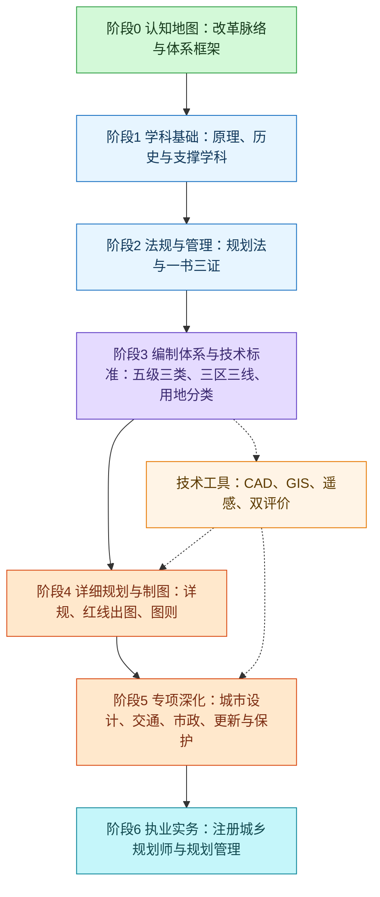

# 2026-10-08 · 城乡规划领域的完整学习路线

- **问**：规划领域的完整学习路线。
- **答**：按“认知地图 → 学科基础 → 法规与管理 → 编制体系与技术标准 → 详细规划与制图 → 技术工具 → 专项深化 → 执业实务”推进。以国土空间规划新体系为主线，用《城市规划原理（第四版）》打原理底；执业目标对应注册城乡规划师四科考试。红线出图位于详细规划与制图阶段。
- **信源**：[一手] [中发〔2019〕18号《关于建立国土空间规划体系并监督实施的若干意见》全文（共产党员网）](https://www.12371.cn/2019/05/24/ARTI1558654423262365.shtml)；[研究生教育学科专业目录（2022年）· 0833 城乡规划学（中国研究生招生信息网）](https://yz.chsi.com.cn)；[自然资发〔2023〕234号《国土空间调查、规划、用途管制用地用海分类指南》转发（湖南省人民政府）](http://www.hunan.gov.cn)；[《中华人民共和国城乡规划法（2019 修正）》（国家法律法规数据库检索入口）](https://flk.npc.gov.cn)；[注册城乡规划师职业资格考试（中国人事考试网，每年报考通知）](https://www.cpta.com.cn)。核实日期：2026-10-08。文中其余条目未经逐项核实的随文标注“未核实”。

**范围与标记。** “完整”指学科主干与当前中国国土空间规划体系的主要分支，不是枚举全部研究专题。下列顺序为教学设计，不是官方统一学制。“未核实”表示本轮未找到一手来源，学习该模块前须先核实现行版本。

**学习顺序。** 实线为推荐推进顺序；技术工具贯穿详细规划与专项深化。

**阶段 0：认知地图。** 目标是先看清“规划”一词在当前中国的所指，再进入细节。

| 模块 | 知识点 |
| --- | --- |
| 体系改革 | “多规合一”：主体功能区规划、土地利用规划、城乡规划融合为国土空间规划；中发〔2019〕18号 |
| 体系框架 | 五级（国家、省、市、县、乡镇）三类（总体规划、详细规划、相关专项规划）四体系（编制审批、实施监督、法规政策、技术标准） |
| 主管部门 | 规划编制与监管由自然资源部主管（由 234 号、43 号文发文单位佐证）；机构改革沿革未逐项核实 |
| 学科与职业 | 城乡规划学（0833）工学一级学科；注册城乡规划师执业资格 |
| 现状入口 | 国土空间规划“一张图”信息平台（各级自然资源部门门户可见） |

验收：用自己的话讲清“五级三类”各指什么；说明详细规划与总体规划的服从关系。

**阶段 1：学科基础。** 原理是主干，历史给脉络，支撑学科给解释力。

| 模块 | 知识点 |
| --- | --- |
| 城市规划原理 | 《城市规划原理（第四版）》（吴志强、李德华，中国建筑工业出版社，2010，22 章）：城市与城市化、规划思想发展、规划体制、各层次规划、专项与实施 |
| 规划思想史 | 霍华德田园城市、雅典宪章、马丘比丘宪章等思想演进（原理书内含） |
| 中外城市建设史 | 中国与外国城市营建演进（教材版本未核实，线索：董鉴泓《中国城市建设史》、沈玉麟《外国城市建设史》） |
| 支撑学科 | 城市地理学、城市经济学、城市社会学、城市生态学（各选一本导论教材，版本未核实） |
| 制图基础 | 工程制图、投影原理、建筑识图（衔接阶段 4 红线出图） |

验收：读完原理书并整理各章一张概念图；说明城市化阶段与规划范式的关系。

**阶段 2：法规与管理。** 规划是法定行为，脱离法规读不懂流程。

| 模块 | 知识点 |
| --- | --- |
| 城乡规划法 | 2008-01-01 施行、2019 修正；规划区、规划制定、实施管理、监督检查 |
| 一书三证 | 选址意见书（限划拨用地）、建设用地规划许可证、建设工程规划许可证、乡村建设规划许可证 |
| 土地制度 | 土地管理法关联条款（未逐条核实）；土地所有权、用途管制、征收供地 |
| 法规体系 | 国土空间规划法规政策体系（18 号文第四部分）；地方规划条例 |
| 实施监督 | 规划条件、规划核实、动态监测（18 号文“实施监督体系”） |

验收：画出建设项目从选址到竣工验收的许可流程图，并标出各证签发节点。

**阶段 3：编制体系与技术标准。** 这是新体系的核心，旧教材在此已过时。

| 模块 | 知识点 |
| --- | --- |
| 三区三线 | 三区＝生态、农业、城镇空间（功能区）；三线＝生态保护红线、永久基本农田、城镇开发边界（底线，用途管制区）；三区范围大于等于三线；源自十九大“三条控制线”要求 |
| 用地分类 | 《国土空间调查、规划、用途管制用地用海分类指南》（自然资发〔2023〕234号，取代 2020 试行版）；三级分类（试行版 24 一级、106 二级、39 三级）；GB 50137-2011 现行状态未核实 |
| 总体规划 | 市县国土空间总体规划编制；双评价（资源环境承载能力与国土空间开发适宜性评价）（编制指南系列文号未核实，以自然资源部官网为准） |
| 详细规划 | 自然资发〔2023〕43号：原控制性详细规划整合纳入国土空间详细规划；以国土调查、地籍调查、不动产登记等法定数据为基础 |
| 专项规划 | 交通、市政、生态修复等专项规划服从总体规划 |

验收：对照 234 号指南默写一级类；说明三线为什么“不交叉不重叠”。

**阶段 4：详细规划与制图（红线出图所在）。** 从原理进入图纸。

| 模块 | 知识点 |
| --- | --- |
| 详细规划编制 | 单元—地块两级；控制指标：用地性质、容积率、建筑密度、绿地率、建筑高度、配建设施 |
| 规划红线 | 用地红线（地块权属与许可边界）、道路红线（道路用地边界）、建筑红线（退线控制）；具体退让距离依地方标准（未核实，须查当地技术规定） |
| 修建性详细规划 | 总平面、竖向、管线综合、日照分析（线索性内容） |
| 制图与图则 | CAD 制图规范、控规图则表达、报建图深度 |
| 规划条件 | 以规划条件为核发工程规划许可证的依据（衔接阶段 2） |

验收：找一份公开的控制性详细规划图则，指出红线、指标与图例的对应关系。

**阶段 5：技术工具。** 与阶段 4 至 6 并行使用。

| 模块 | 知识点 |
| --- | --- |
| CAD | AutoCAD 或国产替代；规划制图、红线标注、出图打印 |
| GIS | ArcGIS 或 QGIS；空间分析、用地统计、一张图（有软件工程背景可较快切入） |
| 遥感与调查 | 遥感影像判读；国土调查成果使用 |
| 数据方法 | 双评价技术流程；城市大数据与智慧规划、CIM（线索） |

**阶段 6：专项深化。** 按目标选学，不设共同必修。

| 分支 | 知识点 |
| --- | --- |
| 城市设计 | 城市形态、公共空间、设计导则 |
| 交通规划 | 道路等级、交通影响评价、TOD（线索） |
| 市政基础设施 | 给排水、电力、通信、综合管廊（原理书内含基础） |
| 更新与保护 | 城市更新、历史文化名城保护 |
| 乡村振兴 | 村庄规划编制（市县以下详细规划的重要场景） |
| 国土整治 | 国土综合整治与生态修复、全域土地综合整治（线索） |

**阶段 7：执业实务。** 若目标是注册城乡规划师，四科与各阶段对应如下。

| 考试科目 | 对应阶段 |
| --- | --- |
| 城乡规划原理 | 阶段 1 |
| 城乡规划相关知识 | 阶段 1、5、6 |
| 城乡规划管理与法规 | 阶段 2、3 |
| 城乡规划实务 | 阶段 3、4、6 |

成绩 4 年为一个滚动周期；报名与大纲以中国人事考试网当年通知为准。有软件背景者可另走“规划信息化”路线：一张图平台、CIM、审批系统开发（线索，未核实岗位要求）。

**首要资料（本次已核实的一手资源）：**

- [中发〔2019〕18号全文（共产党员网）](https://www.12371.cn/2019/05/24/ARTI1558654423262365.shtml)：国土空间规划体系顶层设计。
- [研究生教育学科专业目录（2022年）](https://yz.chsi.com.cn)：0833 城乡规划学一级学科。
- [自然资发〔2023〕234号分类指南（湖南省政府转发）](http://www.hunan.gov.cn)：现行用地用海分类。
- [国家法律法规数据库](https://flk.npc.gov.cn)：《城乡规划法（2019 修正）》现行文本。
- [中国人事考试网](https://www.cpta.com.cn)：注册城乡规划师考试通知与大纲。
