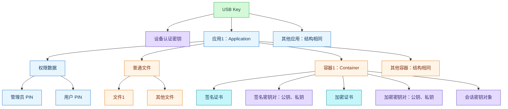

# 2026-10-09 · 加密锁中签名证书与加密证书的存放和使用规范

- **问**：加密锁中签名证书和加密证书的存放和使用规范。追问：绘制锁内文件目录结构。
- **答**：在国密 SM2 双证书、SKF 接口模型下，同一容器可分别存放签名密钥对、加密密钥对及对应证书；签名密钥内部生成，加密密钥外部安全导入，证书可以导出，容器内私钥不得以任何形式导出。业务签名使用签名私钥，数据解密使用加密私钥；使用前应检查证书用途、信任路径和状态，并按实际 CA 策略处理密钥恢复与历史数据解密。
- **信源**：[一手] [GB/T 35291-2017 官方现行题录](https://openstd.samr.gov.cn/bzgk/std/newGbInfo?hcno=F969F4765DFEE1CD475201A2D55B10ED)；[一手·标准原文转载] [GB/T 35291-2017 扫描原文](https://raw.githubusercontent.com/gurecn/Specification/master/SKF%E8%A7%84%E8%8C%83%E6%96%87%E6%A1%A3/GB%E2%88%95T%2035291-2017%20%E4%BF%A1%E6%81%AF%E5%AE%89%E5%85%A8%E6%8A%80%E6%9C%AF%20%E6%99%BA%E8%83%BD%E5%AF%86%E7%A0%81%E9%92%A5%E5%8C%99%E5%BA%94%E7%94%A8%E6%8E%A5%E5%8F%A3%E8%A7%84%E8%8C%83.pdf)，已核对第 5.2、7.5.8、7.5.9、7.6.11 至 7.6.16、8.2.1、8.2.2、8.2.4、8.3 节相关页；[一手] [国家密码管理局第 45 号公告](https://www.nca.gov.cn/sca/xxgk/2023-12/23/content_1061160.shtml)；[一手] [RFC 5280](https://www.rfc-editor.org/rfc/rfc5280.html)；[一手] [BJCA 电子认证业务规则 2.1.2 版](https://service.bjca.cn/private/businessRules.html)，第 6.1、6.2、6.3 节。

- **更新**：2026-10-09（补充锁内逻辑目录结构；区分普通文件、容器及权限数据）

### 适用条件与存放

用户未提供加密锁型号、接口与算法。以下结论限于智能密码钥匙的标准容器模型，不外推到软件授权加密狗、PKCS#11 对象模型或服务器密码机。

- 证书包含主体、公钥等信息及签发者签名，不包含主体私钥。复制证书不能迁移对应私钥。
- 设备可有多个应用，应用可有多个容器；应用各自维护用户 PIN 和管理员 PIN 对应的权限状态。两类密钥可以同容器存放，不能据用途分离推断必须使用两把锁。
- GB/T 35291-2017 第 5.2 节允许容器存放对应签名、加密证书；GM/T 0016-2023 第 5.2 节要求对应 SM2 数字证书也应存放在该容器中。后者相关原文节选已核对：[一手·标准原文节选转载](https://www.gb-gbt.com/PDF/Chinese.aspx/GMT0016-2023)，本次未逐条核对该版全文。
- `SKF_ImportCertificate` 与 `SKF_ExportCertificate` 的 `bSignFlag=TRUE` 表示签名证书，`FALSE` 表示加密证书。这是容器位置选择；应用仍应核对证书公钥和容器同用途公钥是否匹配，并核验用途扩展。
- `SKF_GenECCKeyPair` 生成内部签名密钥对并输出公钥；`SKF_ImportECCKeyPair` 接收 `ENVELOPEDKEYBLOB` 保护的加密密钥对。不得把普通文件读写当作私钥管理接口。

### 使用、恢复与删除

- 签名私钥产生签名，签名证书公钥用于验签。加密证书公钥用于公钥加密或保护会话密钥，对应加密私钥用于解密；大块业务数据通常由 SM4 等对称算法处理。
- 容器内私钥的使用需要用户权限；用户 PIN 验证成功取得该应用的用户权限。管理员权限与用户权限是不同状态，不能据管理员 PIN 已验证推断已取得签名权限。
- RFC 5280 第 4.2.1.3 节定义 Key Usage；第 4.2.1.12 节要求 Key Usage 与 Extended Key Usage 同时存在时，用途必须同时满足两者。不能只按证书文件名、主体名称或容器标志选择用途。
- GB/T 35291-2017 第 8.3 节禁止容器内私钥以任何形式导出；删除容器时应销毁其中所有密钥。该限制同时适用于容器内签名私钥和加密私钥。
- BJCA CPS 2.1.2 第 6.1.1、6.1.2 节规定通用介质签名密钥由订户设备产生并保管，加密密钥由密钥管理中心生成并安全传递；第 6.2.3 至 6.2.5 节规定托管、备份和归档加密私钥，不托管或备份订户签名私钥。这是 BJCA 的政策实例，不概括为所有 CA 的统一政策。
- 由上述用途和恢复机制可推出：签名锁损坏后通常需要生成新签名密钥并重新申请证书；历史签名验签无需原签名私钥。更换加密密钥后，新私钥不能解密原公钥保护的历史数据，必须保留旧私钥的受控使用或恢复途径。
- 截至 2026-10-09，官方题录将 GB/T 35291-2017 标为现行；GM/T 0016-2023 自 2024-06-01 实施，GM/T 0016-2012 同日起废止。国标与行业标准需分别核对，不能把旧行业标准编号继续当成现行依据。

### 追问：锁内逻辑目录结构

按 GM/T 0016-2023 第 5.2 节绘制下图，展开一个应用和一个容器。箭头表示包含关系；图中的名称是对象类型，不是厂商实际文件名。[一手·标准原文节选转载：[GM/T 0016-2023](https://www.gb-gbt.com/PDF/Chinese.aspx/GMT0016-2023)]

普通文件和容器是应用下的并列对象。权限数据为解释而分组，不表示必须存在同名目录；私钥也不是可以用普通文件接口读取的文件。本图不规定芯片操作系统的底层目录、文件标识或物理地址。
