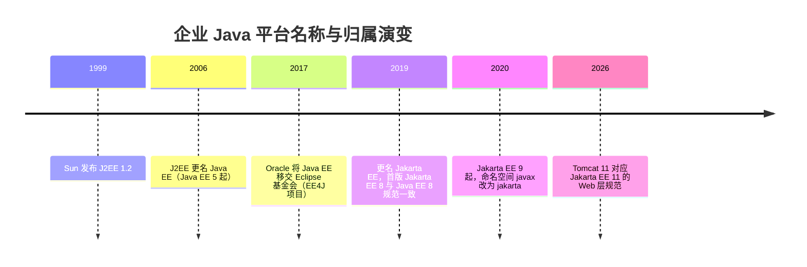

# 2026-10-14 · Java EE 与 Tomcat 的关系及名称演变

- **问**：Java EE 和 Tomcat 之间是什么关系？为什么 Tomcat 听得多而很少听到 Java EE？
- **答**：Java EE（现 Jakarta EE）是一组规范，不是软件；Tomcat 是实现其中 Web 层子集（Servlet、JSP、EL、WebSocket）的开源 Servlet 容器。完整实现全部规范的软件叫应用服务器（GlassFish、WildFly、WebLogic 等）。Tomcat 高频出现是因为它是可安装运行的具体产品、Web 子集的事实标准且被 Spring Boot 默认内嵌；"Java EE"之名已停用（J2EE → Java EE → Jakarta EE），完整平台话题又被 Spring 分流。
- **信源**：[一手] [Apache Tomcat 版本与规范对应](https://tomcat.apache.org/whichversion.html)；[Jakarta EE 官网](https://jakarta.ee/)；[Jakarta EE About](https://jakarta.ee/about/)；[Eclipse Foundation 博客：Java EE Moves to the Eclipse Foundation（2017-09-12）](https://eclipse-foundation.blog/2017/09/12/java-ee-moves-to-the-eclipse-foundation)。核实日期：2026-10-14。
- **关联**：[[条目/q-20260922-001|2026-09-22 · 成为 Java 专家的完整学习路线]]

### 名称与归属演变

Tomcat 与规范版本对应（[一手](https://tomcat.apache.org/whichversion.html)）：Tomcat 9 ↔ Java EE 8（Servlet 4.0，最后一个支持 `javax` 命名空间的大版本）；Tomcat 10.1 ↔ Jakarta EE 10（Servlet 6.0）；Tomcat 11 ↔ Jakarta EE 11（Servlet 6.1）。
