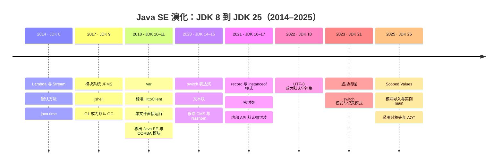

# 2026-10-15 · JDK 8 与 JDK 25 差别有多大

- **问**：总结 JDK 25 和 JDK 8 差别有多大。
- **答**：跨 11 年、17 个版本，三层换代：语言写法（var、record、密封类、模式匹配、文本块、模块导入、实例 main）、平台结构与默认行为（模块系统与强封装、移出 EE／CORBA／Nashorn／CMS、UTF-8 默认字符集、标准 HttpClient）、运行时（G1 起步到新一代 GC、虚拟线程、Scoped Values、紧凑对象头与 AOT）。向后兼容成立：8 的代码大多可在 25 编译运行；主体知识结构不变，但 8 基线资料需按 25 翻译语法与默认行为。
- **信源**：[一手] [JDK 8 项目页（GA 2014-03-18，Project Lambda）](https://openjdk.org/projects/jdk8/)；[Java 语言特性演进表（Oracle，JDK 9–21）](https://docs.oracle.com/en/java/javase/21/language/java-language-changes-summary.html)；[JEP 索引（JEP 与版本归属）](https://openjdk.org/jeps/0)；[JDK 25 项目页（LTS）](https://openjdk.org/projects/jdk/25/)。核实日期：2026-10-15。
- **关联**：[[条目/q-20260923-003|2026-09-23 · Java SE 的学习路线与完整知识点]]

### 演化时间线

### 三层对照

| 层 | JDK 8（2014） | JDK 25（2025） |
| --- | --- | --- |
| 语言 | Lambda／Stream 刚引入（Project Lambda 是 8 的核心特性） | var（10）、switch 表达式（14）、文本块（15）、record（16）、instanceof 模式（16）、密封类（17）、switch／记录模式（21）、模块导入与实例 main（25） |
| 平台与 API | 类路径世界；EE 模块（JAXB 等）内置；平台默认字符集；HttpURLConnection | 模块系统（9，JEP 261）与内部 API 默认强封装（16／17，JEP 396／403）；EE／CORBA 移出（11，JEP 320）；UTF-8 默认字符集（18，JEP 400）；标准 HttpClient（11，JEP 321）；SecurityManager 弃用（17，JEP 411） |
| 运行时 | Parallel GC 默认；永久代刚改为元空间 | G1 默认（9 起，JEP 248）；CMS 移除（14，JEP 363）、Nashorn 移除（15，JEP 372）；虚拟线程（21，JEP 444）；Scoped Values（25，JEP 506）；紧凑对象头（25，JEP 519）与 AOT 缓存（25，JEP 514／515） |
| 工具链 | javac／java／jar | 加 jshell（9，JEP 222）、单文件源码直接运行（11，JEP 330）、jlink（9）与 jpackage（16） |

### 8 基线资料的翻译清单

1. **语法糖重写**：示例用 var、record、switch 表达式、文本块、instanceof／switch 模式改写，行为不变、表达更短。
2. **默认行为**：字符集——8 按平台默认（中文 Windows 即 GBK，读文件经典乱码源），18 起默认 UTF-8；反射访问 JDK 内部 API——17 起默认拒绝。
3. **已移出／移除**：JAXB／JAX-WS（11 起独立库）、CORBA（11）、Nashorn（15）、CMS GC（14）——8 资料相关章节作废；SecurityManager（17 起弃用）不再新学。
4. **网络示例**：HttpURLConnection 换 HttpClient（11）。
5. **并发补充**：Thread-per-request 思路在 21 起可用虚拟线程；ThreadLocal 部分场景可换 Scoped Values（25）。
