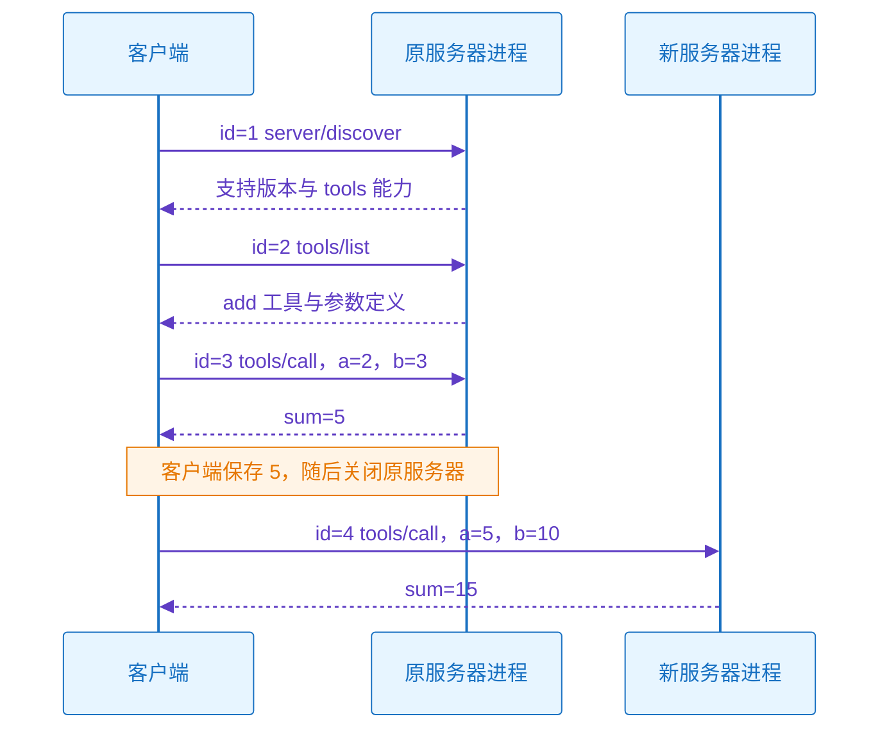

# 2026-10-27 · MCP 数据层无状态的完整报文与重启实验

- **问**：mcp 协议数据层是无状态的，模拟一次完整的 mcp 数据传输，我实际观察一下。
- **答**：在 2026-07-28 规范中，每次请求自带协议版本和客户端能力；服务器处理请求时不依赖前一次请求建立的协议会话。实传演示依次完成发现、工具列表、加法调用，再启动全新服务器进程，直接传入上一结果和新参数，仍能得到正确结果。
- **信源**：[一手] [基础消息与每请求元数据](https://modelcontextprotocol.io/specification/2026-07-28/basic)；[一手] [版本与兼容](https://modelcontextprotocol.io/specification/2026-07-28/basic/versioning)；[一手] [服务器发现](https://modelcontextprotocol.io/specification/2026-07-28/server/discover)；[一手] [工具](https://modelcontextprotocol.io/specification/2026-07-28/server/tools)；[一手] [stdio](https://modelcontextprotocol.io/specification/2026-07-28/basic/transports/stdio)；[一手] [架构与宿主职责](https://modelcontextprotocol.io/docs/2026-07-28/learn/architecture)。
- **核实**：2026-10-27；核实每请求元数据、发现可选性、工具列表与调用报文、stdio 分帧和进程退出、旧握手的版本边界。适用 MCP 2026-07-28；下述运行结果来自本地教学实现，不代表完整实现了 MCP，也没有调用真实模型或外部服务。
- **关联**：[[条目/q-20261025-003|2026-10-25 · 系统学习 MCP 的完整路线与知识点]]。
- **更新**：2026-10-29

## 无状态的准确边界

模型上下文协议（Model Context Protocol，MCP）的新版请求在 `params._meta` 中必须包含 `io.modelcontextprotocol/protocolVersion` 与 `io.modelcontextprotocol/clientCapabilities`。客户端应附带 `io.modelcontextprotocol/clientInfo`；没有可选客户端能力时，能力字段仍传 `{}`。因此，服务器不需要从上一请求中取回版本和能力。[一手：基础消息](https://modelcontextprotocol.io/specification/2026-07-28/basic)

服务器必须实现 `server/discover`；客户端可以跳过发现，直接调用已知方法。本演示先发现服务器，再列工具，是为了观察完整发现过程。发现请求不建立协议会话。2025-11-25 及更早版本的 `initialize` 握手属于旧版兼容机制，不能混入本演示。[一手：发现](https://modelcontextprotocol.io/specification/2026-07-28/server/discover)、[一手：版本与兼容](https://modelcontextprotocol.io/specification/2026-07-28/basic/versioning)

“无状态”不表示客户端和服务器进程不能保存任何数据。本实验中，客户端明确保存计算结果 `5`，再把 `5` 写入下一请求；这不要求服务器记住前一次调用。MCP 不规定宿主如何管理模型上下文。[一手：架构](https://modelcontextprotocol.io/docs/2026-07-28/learn/architecture)

## 追问：`_meta` 字段是什么意思

- **追问**：`_meta` 字段是什么意思？
- **本节核实**：2026-10-27；本次复核基础规范中 `_meta` 定义、必需字段与工具调用参数结构；本节未重新验证进程实验结果。

`_meta` 是 MCP 约定的元数据（Metadata）容器，用于附带协议版本、客户端能力等描述通信的信息。它可以出现在请求参数中，也可以出现在响应结果等规范允许的位置。在刚才的工具调用中，`params.arguments` 提供计算输入 `a`、`b`，`params._meta` 则提供处理本次通信所需的协议信息。[一手：基础规范 `_meta`](https://modelcontextprotocol.io/specification/2026-07-28/basic#_meta)、[一手：工具调用](https://modelcontextprotocol.io/specification/2026-07-28/server/tools#calling-tools)

本例中两个主要字段：

- `io.modelcontextprotocol/protocolVersion`：本次请求使用的 MCP 规范版本。
- `io.modelcontextprotocol/clientCapabilities`：客户端声明的能力；`{}` 表示未声明可选能力。

在 2026-07-28 版中，每次请求必须携带上述两个字段。`clientInfo` 用于提供客户端名称和软件版本，属于应附带的可选字段。元数据是附带信息，不表示其中所有字段都可以删除；随请求携带必需信息使服务器无需从历史请求取回版本和能力。[一手：每请求协议字段](https://modelcontextprotocol.io/specification/2026-07-28/basic#_meta)

## 实际运行的消息顺序

本实验使用标准输入／输出（Standard Input/Output，stdio）。父进程充当客户端，启动子进程充当服务器。JSON-RPC 2.0 消息实际经过进程管道；每条消息占一行，以换行符分帧。界面为了阅读而把捕获的 JSON 缩进展示，缩进换行不属于线上报文。服务器收到输入结束后退出。[一手：stdio](https://modelcontextprotocol.io/specification/2026-07-28/basic/transports/stdio)



`add` 是本演示定义的业务工具，不是 MCP 内置工具。`tools/list` 返回该工具的 `inputSchema`，要求输入整数 `a` 和 `b`；`tools/call` 按 `name` 和 `arguments` 调用。`id` 用于配对请求和响应，不是会话编号。[一手：工具](https://modelcontextprotocol.io/specification/2026-07-28/server/tools)、[一手：基础消息](https://modelcontextprotocol.io/specification/2026-07-28/basic)

新服务器收到的第一条请求如下。它未收到原服务器的三条历史请求，也未收到 `initialize`。

```json
{
  "jsonrpc": "2.0",
  "id": 4,
  "method": "tools/call",
  "params": {
    "name": "add",
    "arguments": {"a": 5, "b": 10},
    "_meta": {
      "io.modelcontextprotocol/protocolVersion": "2026-07-28",
      "io.modelcontextprotocol/clientInfo": {
        "name": "learning-client",
        "version": "1.0.0"
      },
      "io.modelcontextprotocol/clientCapabilities": {}
    }
  }
}
```

新服务器响应中的 `id` 为 `4`，`resultType` 为 `complete`，`content` 包含文本 `15`，`structuredContent` 为 `{"sum":15}`，`isError` 为 `false`。完整原始行保存在本地轨迹中。

## 实验结果与重放

初次记录：2026-10-27 本地运行发送了 4 条请求，收到 4 条响应。原服务器进程 PID 为 `16348`，新服务器进程 PID 为 `14028`；PID 只标识本次本地进程，不是 MCP 报文字段。原进程计算 `2 + 3 = 5`；新进程首次收到 `tools/call(a=5,b=10)`，返回 `15`。

**已被 2026-10-27 修正**：初版发现与工具列表响应遗漏必填的 `ttlMs` 和 `cacheScope`，不能作为这两类完整规范响应的范例。官方 `DiscoverResult`、`ListToolsResult` 都继承 `CacheableResult`；现已补齐并重跑，仍得到 `5` 和 `15`，当前八条捕获报文均通过所保存官方 Schema 的结构关键词校验。原捕获保留在 [修正前轨迹](../演示/q-20261027-005/trace-before-cache-fix.json)，供核对遗漏；当前轨迹与界面已刷新。新进程 PID 分别为 `13816` 和 `12560`。无状态实验的计算结果未改变。[一手：类型源码](https://raw.githubusercontent.com/modelcontextprotocol/modelcontextprotocol/main/schema/2026-07-28/schema.ts)、[一手：版本变更](https://modelcontextprotocol.io/specification/2026-07-28/changelog)

2026-10-29 复跑：重新核实 2026-07-28 版发现、工具及 stdio 规范，并运行现有教学脚本。收到 4 条请求对应的 4 条响应；原服务器进程 PID 为 `14904`，新进程 PID 为 `13588`。原进程返回 `5`；新进程首次收到 `tools/call(a=5,b=10)`，返回 `15`。轨迹与观察界面已刷新；本次没有重新执行官方 Schema 结构校验，不扩展此前校验结论。[一手：发现](https://modelcontextprotocol.io/specification/2026-07-28/server/discover)、[一手：工具](https://modelcontextprotocol.io/specification/2026-07-28/server/tools)、[一手：stdio](https://modelcontextprotocol.io/specification/2026-07-28/basic/transports/stdio)

- [教学脚本](../演示/q-20261027-005/simulate_mcp.py)：仅实现本实验使用的三个方法；服务端请求处理函数不读取历史请求。
- [捕获的完整轨迹](../演示/q-20261027-005/trace.json)：保存实传的八条 JSON 原始行及一次重启事件。
- [逐条观察界面](../演示/q-20261027-005/mcp-stateless-flow.html)：展示已捕获轨迹；点击按钮不会再次发送请求。

重跑命令：

```powershell
python 提问记录/演示/q-20261027-005/simulate_mcp.py
```

重跑会刷新轨迹和观察界面，进程 PID 会变化。这个实验验证的是：当本次调用所需的协议字段和业务参数都明确提供时，全新服务器进程可以处理调用。它没有验证所有工具都无需持久化业务数据，也没有验证失败重试的幂等性。

首要资料：[一手：基础消息](https://modelcontextprotocol.io/specification/2026-07-28/basic)、[一手：服务器发现](https://modelcontextprotocol.io/specification/2026-07-28/server/discover)、[一手：工具](https://modelcontextprotocol.io/specification/2026-07-28/server/tools)、[一手：stdio](https://modelcontextprotocol.io/specification/2026-07-28/basic/transports/stdio)。

## 追问：整个 MCP 的完整 JSON 与逐字段说明

- **追问**：创建一个完整的数据 JSON，尽量包含每一个字段，并对每个字段说明；用户确认范围是整个 MCP 的各种消息类型。
- **本节核实**：2026-10-27；采集并核对 2026-07-28 官方 schema.ts、生成的 schema.json、消息模式、MRTR、补充输入与版本变更。完整原件、采集时间及 SHA-256 保存在 [采集说明](../来源/mcp-2026-07-28-schema-20261027/采集说明.json)；未用采集哈希替代事实核查。

MCP 各种消息具有不同结构，不能合成一条同时包含所有字段的有效报文。本次建立 [完整 JSON 参考册](../演示/q-20261027-005/mcp-message-atlas.json) 和 [逐字段说明附录](../附录/q-20261027-005.md)，覆盖所采集官方核心 Schema 的全部 155 个定义、21 个固定方法名和 517 项声明属性位置；包含 56 个带具体数据的独立示例。覆盖计数包含继承后在多个类型中重复出现的属性，不代表 517 个互异字段名。

- **顶层客户端请求**：10 种方法，含发现、工具、资源、提示模板、参数补全与订阅。
- **内嵌补充输入**：3 种方法，其中 elicitation 分 form 与 url 示例；roots 与 sampling 在本版已弃用，不能按旧版作为独立服务器 JSON-RPC 请求发送。
- **通知**：8 个方法名；实际可用方向、所属请求和传输限制分别说明。
- **响应与嵌套数据**：最终结果、中间结果、协议错误、工具执行失败、五类普通内容块及采样工具调用内容。
- **字段解释**：中文概括、类型引用、直接父对象内必填性与原始 Schema 约束；任意业务字段、供应商能力及独立扩展是开放集合，不能声称穷尽。

参考册的 `examples[].data` 是具体示例，内嵌输入与内容块需放入对应父结构；`$defs` 和 `fieldGuide` 是查阅材料。`x-description-zh`、`x-required-in-parent`、`x-status` 是参考册注解，不是线上字段。JSON 键 `io.modelcontextprotocol/protocolVersion` 是一个完整名称，斜杠不产生对象嵌套。原 `description` 与约束原样保留，中文说明不取代完整适用条件。[一手：官方类型](https://raw.githubusercontent.com/modelcontextprotocol/modelcontextprotocol/main/schema/2026-07-28/schema.ts)

结构检查验证 56 个示例、修订后的八条实传报文、全部方法名覆盖、注解移除后官方约束不变、MRTR 的新请求 id 和补充输入关联。缺少缓存必填字段、缺少客户端能力的反例均被拒绝。自带校验器不把媒体解码、format 注解、外部服务业务语义或任意通信时序当成已验证，见 [验证记录](../演示/q-20261027-005/atlas-verification.json)。

首要资料：[一手：核心类型源码](https://raw.githubusercontent.com/modelcontextprotocol/modelcontextprotocol/main/schema/2026-07-28/schema.ts)、[一手：核心 JSON Schema](https://raw.githubusercontent.com/modelcontextprotocol/modelcontextprotocol/main/schema/2026-07-28/schema.json)、[一手：消息模式](https://modelcontextprotocol.io/specification/2026-07-28/basic/patterns)、[一手：MRTR](https://modelcontextprotocol.io/specification/2026-07-28/basic/patterns/mrtr)、[一手：版本变更](https://modelcontextprotocol.io/specification/2026-07-28/changelog)。
