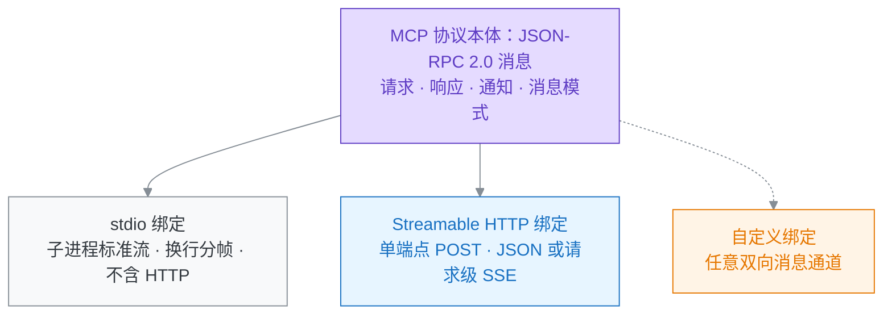

# 2026-10-27 · MCP 与 HTTP 的关系：消息层本体与传输绑定

- **问**：mcp 本质上还是 http 协议吗？
- **答**：不是。MCP 本体是 JSON-RPC 2.0 消息层：请求、响应、通知三类消息与消息模式属于核心协议，语义在所有传输上相同。HTTP 只是两种标准传输绑定之一（Streamable HTTP）；stdio 传输全程不经过 HTTP；规范还允许自定义传输。
- **信源**：[一手] [基础消息](https://modelcontextprotocol.io/specification/2026-07-28/basic)；[一手] [传输](https://modelcontextprotocol.io/specification/2026-07-28/basic/transports)；[一手] [stdio](https://modelcontextprotocol.io/specification/2026-07-28/basic/transports/stdio)；[一手] [Streamable HTTP](https://modelcontextprotocol.io/specification/2026-07-28/basic/transports/streamable-http)。
- **核实**：2026-10-27；核实消息格式（JSON-RPC 2.0）、传输即绑定、两种标准传输、自定义传输条款、授权框架的传输适用范围。适用 MCP 2026-07-28。
- **关联**：[[条目/q-20261025-003|2026-10-25 · 系统学习 MCP 的完整路线与知识点]]；[[条目/q-20261027-005|2026-10-27 · MCP 数据层无状态的完整报文与重启实验]]；[[条目/q-20261022-003|2026-10-22 · RPC 的含义、调用过程与协议边界]]。
- **更新**：2026-10-27

## 协议本体在消息层

MCP 规范规定：客户端与服务器之间的所有消息必须遵循 JSON-RPC 2.0。基础协议（Base Protocol）定义请求、响应（结果或错误）、通知三类核心消息，所有实现必须支持。消息模式（请求响应、MRTR、订阅通知）与每请求元数据也属于核心协议。这一层不依赖任何网络协议。[一手：基础消息](https://modelcontextprotocol.io/specification/2026-07-28/basic)

## 传输是绑定，不是本体

规范把传输定义为绑定（Binding）：传输只规定消息如何分帧、如何投递、取消与终止如何表达，不规定消息含义。原文明确"协议语义在每种传输上相同"，且协议与传输无关（transport-agnostic），可以在任何支持双向消息交换的通道上实现。[一手：传输](https://modelcontextprotocol.io/specification/2026-07-28/basic/transports)

两种标准绑定：

- **stdio**：客户端启动子进程，JSON-RPC 消息按换行分帧，走子进程的标准输入与标准输出。全程不出现 HTTP。[一手：stdio](https://modelcontextprotocol.io/specification/2026-07-28/basic/transports/stdio)
- **Streamable HTTP**：每条消息是对单个 MCP 端点的 HTTP POST，响应为 JSON 对象或请求级 SSE 流。HTTP 只在这一绑定进入协议栈。[一手：Streamable HTTP](https://modelcontextprotocol.io/specification/2026-07-28/basic/transports/streamable-http)

客户端与服务器可以另建自定义传输；自定义传输必须保留 JSON-RPC 消息格式、消息模式与每请求元数据模型。运行在可靠双向字节流上的自定义传输应复用 stdio 分帧。[一手：传输](https://modelcontextprotocol.io/specification/2026-07-28/basic/transports)

## 为什么容易被当成 HTTP

远程部署普遍使用 Streamable HTTP；授权框架（OAuth 2.x）也只面向 HTTP 传输——规范要求 HTTP 传输应遵循该框架，而 stdio 传输应从进程环境取凭据、不使用该框架。加上 SSE 流式响应，远程 MCP 看起来像"又一个 HTTP API"。但这些内容都位于传输绑定层，不在消息层本体。[一手：基础消息中的授权一节](https://modelcontextprotocol.io/specification/2026-07-28/basic#auth)



## 追问：JSON-RPC 2.0 是什么

- **追问**：JSON-RPC 2.0 是什么？
- **本节核实**：2026-10-27；核实协议定位、三类消息结构、参数形式、错误码划分、批处理与版本信息。适用 JSON-RPC 2.0（2010-03-26 定稿）。

JSON-RPC 2.0 是无状态、轻量级的远程过程调用（Remote Procedure Call，RPC）协议：用 JSON 编码"调用远程方法"的消息，规范本身不规定传输层，同一进程、套接字、HTTP 均可承载。[一手：JSON-RPC 2.0 规范](https://www.jsonrpc.org/specification)

三类消息：

- **请求（Request）**：`method` 为方法名（`rpc.` 前缀保留），`params` 可省略，可为按位置的数组或按名称的对象，`id` 由客户端建立、用于配对响应。
- **响应（Response）**：带与请求相同的 `id`；`result` 与 `error` 二选一，不得并存。检测不到请求 id 时（如解析错误），响应 `id` 为 null。
- **通知（Notification）**：省略 `id` 的请求，服务器不得回复。1.0 用 `id: null` 表示通知，2.0 弃用该写法。

一次最小调用的请求与响应：

```json
{"jsonrpc": "2.0", "method": "add", "params": [2, 3], "id": 1}
{"jsonrpc": "2.0", "result": 5, "id": 1}
```

错误对象为 `{code, message, data?}`；-32700 至 -32603 为预定义错误（解析错误、无效请求、方法不存在、参数无效、内部错误），-32000 至 -32099 保留给实现定义的服务器错误。MCP 在此范围内划出 -32020 至 -32099 为规范专用码。[一手：JSON-RPC 2.0 规范](https://www.jsonrpc.org/specification)、[一手：MCP 基础消息](https://modelcontextprotocol.io/specification/2026-07-28/basic)

批处理（Batch）：客户端可一次发送请求数组，服务器返回响应数组；响应顺序任意，靠 `id` 配对。

版本信息：2.0 定稿于 2010-03-26，由 JSON-RPC Working Group 维护，是社区规范，不是 IETF RFC；消息中的 `"jsonrpc":"2.0"` 成员用于与 1.0 区分。[一手：JSON-RPC 2.0 规范](https://www.jsonrpc.org/specification)

MCP 选择它的原因：传输无关、结构极简、无状态，与 MCP"每请求自带元数据、不依赖会话"的模型一致。MCP 在其上加了自身规则：`id` 不得为 null、`result` 必须含 `resultType`。[一手：MCP 基础消息](https://modelcontextprotocol.io/specification/2026-07-28/basic)

首要资料：[一手：基础消息](https://modelcontextprotocol.io/specification/2026-07-28/basic)、[一手：传输](https://modelcontextprotocol.io/specification/2026-07-28/basic/transports)、[一手：stdio](https://modelcontextprotocol.io/specification/2026-07-28/basic/transports/stdio)、[一手：Streamable HTTP](https://modelcontextprotocol.io/specification/2026-07-28/basic/transports/streamable-http)、[一手：JSON-RPC 2.0 规范](https://www.jsonrpc.org/specification)。
