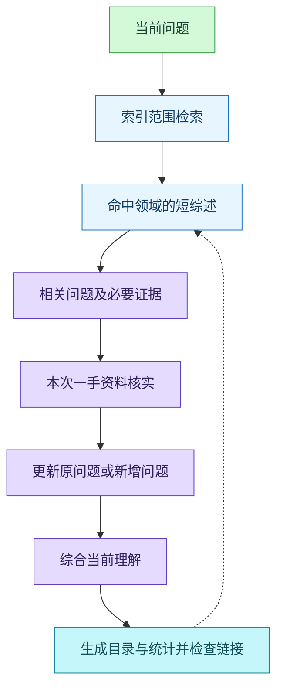

# 2026-10-27 · 提问记录长期维护改造

目标是让每次问答的读取和修改范围随当前问题变化，同时保留累积理解、证据和恢复能力。此文件记录维护设计，不计入知识问题。

## 参考依据与取舍

- [一手] [Karpathy：LLM Wiki](https://gist.github.com/karpathy/442a6bf555914893e9891c11519de94f)：采用原始资料、综合知识和维护规则的分层，以及查询、纳入新知识和体检三个操作；保留内容索引与维护日志的区别。
- [一手] [nashsu/llm_wiki：作者 README](https://github.com/nashsu/llm_wiki#what-we-kept-from-the-original)：参考来源追溯、增量加工、持久化与审查机制。这里以现有教学目标作为用途定义，以文本规范和离线脚本实现所需能力。

以上资料于 2026-10-27 查看。下面的阈值和结构是本项目的工程选择；参考项目的功能描述不构成本项目长期质量保证。

保留 Markdown 与现有 Obsidian 链接习惯。当前 54 个领域、116 个问题，采用普通文件和文本检索；向量库、图数据库、桌面应用及自动网页抓取暂不引入。只有实际检索反复遗漏或维护耗时明显增加时，才依据具体问题增加工具。学习目标沿用 AGENTS.md，不另设重复的用途文件。

## 检索与更新流程

## 已处理的增长问题

| 原状 | 调整 | 长期作用 |
| --- | --- | --- |
| Java 230 行、Java SE 221 行；长文与多个问题混放 | 116 个问题各自独立保存 | 追问只读取命中问题，稳定 id 避免标题改动影响链接 |
| 19 个综述超过 600 字符，最长 2723 字符 | 综述保留主线、条件与待解项 | 历史过程留在条目和迁移前快照中，减少重复读取 |
| 条数、日期、目录靠手工同步 | 单一脚本从问题生成 | 统计错误有明确的检查与修复入口 |
| 按领域文件的标题链接依赖位置 | 固定问题路径，旧标题保留兼容入口 | 新关联使用稳定身份，原入口仍可打开 |
| 双向关联需要编辑多处，可能产生关联占位问题 | 必要引用只写一次，入链离线检索 | 避免为链接制造内容和重复关系 |
| 迁移容易混淆维护日期与核实日期 | 保留所有原始记录日期和核实状态 | 结构变化不会增加虚假的知识新鲜度 |

## 验证与限制

迁移前保存了原始文件 ZIP 和逐文件 SHA-256 清单。迁移核对记录见 `迁移核对.json`；核对标准为问题数量相同、正文在链接规范化前逐字符相同、链接变换可解释、原记录日期不变。

`records.py check` 检查本地结构；正文正确性、证据等级、网页可用性和综述语义仍需针对性核实。历史问题中的旧日期和未核实说明均保留。本次没有对 116 个历史问题重新联网求证。

最终检查：54 个领域、116 个问题、3 个详细路线附录，0 个结构错误、0 个长度提示。58 个原始文件的备份哈希通过核对；116 个问题的正文经链接规范化和附录重组后与原文一致，原更新日期不变，116 个旧标题入口保留。9 项隔离集成测试通过，覆盖重建幂等、分页、断链阻止写入、附录检索和入链、示例代码忽略、身份与领域校验、并发写入锁、过期目录和异常生成区。当前规模单次结构检查实测约 0.3 秒；此值不作为未来性能保证。

日常由智能体执行维护命令，用户继续直接提问即可。需要人工操作时，维护者说明具体失败项；目录损坏可以重建，源文件恢复使用快照。快照与记录位于同一磁盘，不能替代异地备份。

同日后续架构审查发现，最初 9 项测试未覆盖普通 Markdown 引用、旧标题引用和附录自引用。现已让检查与入链使用共同的引用解释，回归测试扩至 15 项；具体范围和验证见 [维护日志](日志/2026-10.md)。原迁移快照及迁移核对结果保留原义。
