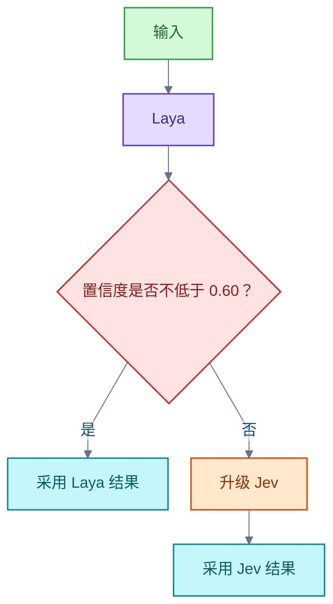

# AI 模型

<!-- domain: AI 模型 -->
**范围**：AI 模型基准成绩、能力比较、评测条件、Jev/Laya 本地部署与智谱模型研发动向。

**综述**：模型比较必须保留实际型号、基准版本、工具条件、语言方向和评测环境；榜单不能直接证明个人任务的表现或性价比。现有 GLM 对比图仅部分数值经一手资料核实，原始发布者与其余数值仍待确认。翻译选型不能把旧型号、其他语言方向或订阅服务名当作当前模型证据。Jev 与 Laya 的部署、许可和校准能力不同，现有小样本结果不能代替同条件的大样本测试。智谱产品线和研发动向按对应问题的核实日期理解，未获官方确认的后续型号、参数和发布日期保持未核实。
<!-- /domain -->

本领域核实 AI 模型对比与选型的证据。主线有四条：对比图与榜单的可信度、翻译选型的评测条件、Jev 与 Laya 的部署和能力差异、智谱研发动向。结论按各问题的核实日期理解；未核实项保持未核实，不升级为事实。

## GLM 5.3 Flash、Haiku 5.5 与 GPT-6 Luna 对比图

结论：对比图中 Claude Haiku 5.5 在多数项目领先；图本身不能当作定论，因为原始发布者与链接未核实，且图注提醒各评测环境可能不同。

图中关键数值：

- GDPval-AA v2.1：GLM 5.3 Flash 得 1641，略高于 Haiku 的 1620。
- HLE 使用工具：GLM 55.3%，接近 Haiku 的 57.4%。
- 视觉推理：GLM 16.3%，低于 Haiku 的 46.4% 和 GPT-6 Luna 的 29.1%。
- 另一项知识工作测试、推理与编程测试：GLM 低于 Haiku。
- 电脑操作：GLM 成绩缺失。

核实状态分三档，不能混为一谈：

- Haiku 与 Luna 的数值：已经 Anthropic 官方发布页核实。
- GLM 数值：官方模型卡核实存在，并说明 HLE 使用工具的评测设置；各项数值位于图表，未逐项核实。
- Artificial Analysis 评测页：已核实页面与基准版本；当前提取的页面未展示各项数值。

信源：[一手：Anthropic 发布 Claude Haiku 5.5](https://www.anthropic.com/claude-haiku-5-5)、[一手：GLM-5.3-Flash 官方模型卡](https://huggingface.co/zai-org/GLM-5.3-Flash)、[一手：Artificial Analysis 的 GLM 5.3 Flash 页](https://artificialanalysis.ai/models/glm-5-3-flash)。

### 证据与时效 · q-20261008-003

- **信源**：用户提供的对比图（原始发布者与链接未核实）；[一手] [Anthropic：Introducing Claude Haiku 5.5](https://www.anthropic.com/claude-haiku-5-5)（已核实图中 Haiku、Luna 数值）；[一手] [Z.ai：GLM-5.3-Flash 模型卡](https://huggingface.co/zai-org/GLM-5.3-Flash)（已核实官方模型卡存在并说明 HLE 使用工具的评测设置，数值位于图表，未逐项核实）；[一手] [Artificial Analysis：GLM 5.3 Flash](https://artificialanalysis.ai/models/glm-5-3-flash)（已核实评测页面及基准版本，当前提取的页面未展示各项数值）。

## 英译中选型的评测条件

结论：现有资料不足以给截图中十款翻译服务排出英译中第一名。要比较，必须先固定四项条件：翻译方向（英译中还是中译英）、内容类型、模型版本、评测日期与质量指标。

三类常见证据都不够用：

- 同系列其他型号的成绩，不能代替该型号本身。
- 综合能力榜，不能代替翻译方向上的成绩。
- 对旧型号的评测，不能支持当前排名。

两个具体陷阱：

- DeepL Pro 是订阅服务名，不是模型名。不能据此确定底层模型年份；官方文档说明 DeepL 持续部署新模型，但插件实际调用哪个模型未核实。
- HardMTBench 覆盖中英双向专业领域评测，但未覆盖截图中的全部服务，因此给不出十款的第一名。

关联问题「截图中的翻译模型哪款英译中表现最好」（属机器翻译领域）结论相同：资料不足以点名第一名。其旧结论「默认先试 DeepL Pro」已于 2026-10-08 修正：所依据的厂商盲测发布页标注 2024-07-16，竞争型号过旧，不能支持当前推荐。

信源：[一手：HardMTBench 原始论文](https://arxiv.org/html/2605.28315v1)、[一手：DeepL 模型类型说明](https://developers.deepl.com/docs/translate/understanding-model-types)、[一手：DeepL 2024 年模型与盲测发布页](https://www.deepl.com/en/blog/next-gen-language-model)、[一手：DeepL 发布商说明](https://www.deepl.com/zh/publisher)。

### 证据与时效 · q-20261008-004

- **信源**：[一手] [HardMTBench 原始论文](https://arxiv.org/html/2605.28315v1)；[一手] [DeepL：Understanding Model Types](https://developers.deepl.com/docs/translate/understanding-model-types)；[一手] [DeepL 发布商说明](https://www.deepl.com/zh/publisher)；[一手] [DeepL 2024 年模型与盲测发布页](https://www.deepl.com/en/blog/next-gen-language-model)。

## Jev 与 Laya 的部署差异

结论：Jev 本体闭源、仅提供 API、未发布权重，不能本地部署。可本地部署的是开源复刻 Laya，许可证 Apache 2.0。

Laya 的规模与硬件数据（官方未标最低显存）：

- 检查点（checkpoint）三个：421M／421M／322M 参数；下载体积约 808／808／647 MB。
- CPU fp32 可跑：28 线程约 110 ms／题。
- CUDA 混合精度下 421M 权重约 0.9 GB，据此推算 4 GB 显存足够（推算值，非官方标注）。
- 官方 GPU 基准 T4（16 GB）约 33 至 40 ms／题；Apple／AMD MPS 约 30 至 37 ms／题。
- Windows 官方支持；微调可在 Kaggle 2×T4 完成。

协议兼容：`laya-serve` 提供与 Jev 相同的 POST /v1/systemone 协议。Jev 客户端只需改 baseUrl 即可切换。

二手参考未核实：ZiCode 称 8 GB 显卡可实测运行；36kr 称 MLX 约 1 GB 内存可运行。

信源：[一手：TypeSafe AI 发布 System One Models 与 Jev](https://typesafe.ai/blog/introducing-system-one-models-and-jev)、[一手：laya GitHub 仓库](https://github.com/NandhaKishorM/laya)、[一手：Laya 模型卡](https://huggingface.co/convaiinnovations/laya)。

### 证据与时效 · q-20261015-006

- **信源**：[一手] [TypeSafe AI：Introducing System One Models and Jev](https://typesafe.ai/blog/introducing-system-one-models-and-jev)（已核实：无权重发布、仅 API 控制台）；[一手] [GitHub：NandhaKishorM/laya README](https://github.com/NandhaKishorM/laya)（已核实：检查点规模、各设备延迟、协议兼容）；[一手] [Hugging Face：convaiinnovations/laya 模型卡](https://huggingface.co/convaiinnovations/laya)（已核实：下载体积、T4 基准、Apache 2.0）；二手参考未核实：ZiCode 8 GB 显卡实测、36kr MLX 约 1 GB 内存运行

## Jev 与 Laya 的能力对比

前提：没有同条件、大样本、中立方的实测。现有数字来自三处，各有偏差：

- Laya 作者汇总的基准：Laya 侧为自测；Jev 侧为第三方公布，样本与提示词不同，作者自注「仅作参考」。
- TypeSafe 自评：使用自定义工作流，参考答案是 LLM 均值而非真值。
- 社区同输入实测：40 例中文工单，样本小，作者自标答案。

方向上 Jev 占优的维度：

- 同输入准确率：78% 对 57%（40 例社区实测）。
- 高选项数：banking77 上 0.870 对 0.492；选项上限 Jev 为 255，Laya 约 20 选项后崩溃。
- 开箱校准：期望校准误差（Expected Calibration Error，ECE）0.246 对 0.466。
- 选项顺序稳定性：翻转率 0.13 对 0.15 至 0.23。

Laya 占优或不落下风的维度：

- 速度：T4 上 33 ms 对 Jev 的 236 至 276 ms，约快 6 至 7 倍。
- 成本：本地免费、可微调、可自托管。
- 英文分类：AG News 0.95 对 0.91；Emotion 0.60 对 0.48。

一个条件不对等的例子：Laya 零样本（zero-shot）typed-decisions 得 0.362，低于多数类基线 0.461；微调至 0.766 后才与 Jev 的 0.727 可比。直接引用这对数字必须同时说明微调条件。

级联（cascade）方案复现了 Jev 的准确率，平均延迟约减半：

信源：[一手：laya 仓库 BENCHMARKS.md](https://github.com/NandhaKishorM/laya/blob/main/BENCHMARKS.md)、[一手：TypeSafe AI 发布 System One Models 与 Jev](https://typesafe.ai/blog/introducing-system-one-models-and-jev)、[一手：yibie/laya-jev-lab 同输入实测](https://github.com/yibie/laya-jev-lab)。

### 证据与时效 · q-20261015-007

- **信源**：[一手] [NandhaKishorM/laya：BENCHMARKS.md](https://github.com/NandhaKishorM/laya/blob/main/BENCHMARKS.md)（Laya 侧全套自测数字与诚实限制；Jev 侧为第三方公布，作者自注"仅作参考"）；[一手] [TypeSafe AI：Introducing System One Models and Jev](https://typesafe.ai/blog/introducing-system-one-models-and-jev)（Jev 官方声明：70–500 ms、255 选项上限、自评条件与偏差声明）；[一手] [yibie/laya-jev-lab](https://github.com/yibie/laya-jev-lab)（第三方同输入 40 例中文工单实测与级联；样本小、作者自标答案）

## 智谱下一代模型动向

以下按核实日期 2026-10-26 理解。

已核实的事实：

- 下一代基座已在训练。官方方向为：更大有效规模、更长原生上下文、原生多模态、长程自主任务（数天级），以及模型参与数据、环境与基础设施建设的完全自训练。
- 「完全自训练」属研发愿景；当前流程仍有大量人工环节。
- 2026-09-13 配售与可转债公告：约 60% 净募资计划投向下一代基座、自训练与算力基础设施；未给出新旗舰型号或发布日期。
- 当前官方旗舰仍为 GLM-5.3；FlashX 官方称推理速度达 200 tokens／s。

保持未核实的部分：

- GLM-5.5／GLM-6.0 的正式型号、具体参数量与发布日期，未从一手资料核实。
- 2026-10-07 唐杰在新加坡国立大学的讲座：已核实活动日期与摘要，未获得完整录像或讲稿；不能据此确认媒体所称的万亿参数或 GLM-5.4／5.5 命名。

二手寻源线索（其中具体型号、日期与参数规模未在一手材料中核实）：[每经业绩会报道](https://www.nbd.com.cn/articles/2026-09-01/4568516.html)、[快科技转载](https://www.hstong.com/news/hk/detail/26100818550373922)。

信源：[一手：智谱 2026 年中期业绩公告（印刷页 18 至 20）](https://www.hkexnews.hk/listedco/listconews/sehk/2026/0831/2026083101540_c.pdf)、[一手：智谱 2026-09-13 配售与可转债公告（印刷页 20 至 22）](https://www1.hkexnews.hk/listedco/listconews/sehk/2026/0913/2026091300025.pdf)、[一手：NUS 唐杰讲座摘要](https://ai.nus.edu.sg/glms-road-to-agi-from-chat-to-agents/)、[一手：GLM-5.3 文档](https://docs.bigmodel.cn/cn/guide/models/text/glm-5.3)、[一手：GLM-5.3-Flash／FlashX 文档](https://docs.bigmodel.cn/cn/guide/models/vlm/glm-5.3-flash)、[一手：Z.ai GLM-5.3-Flash 发布说明](https://z.ai/blog/glm-5.3-flash?trk=article-ssr-frontend-pulse_little-text-block)、[一手：Z.ai 发布记录](https://docs.z.ai/release-notes/new-released)、[一手：zai-org 官方模型仓库](https://huggingface.co/zai-org)。

### 证据与时效 · q-20261026-001

- **信源**：[一手] [智谱 2026 年中期业绩公告](https://www.hkexnews.hk/listedco/listconews/sehk/2026/0831/2026083101540_c.pdf)（印刷页 18 至 20：下一代基座训练、数天任务目标、自训练愿景及人工环节）；[一手] [智谱 2026-09-13 配售与可转债公告](https://www1.hkexnews.hk/listedco/listconews/sehk/2026/0913/2026091300025.pdf)（印刷页 20 至 22：约 60% 净募资计划投向下一代基座、自训练与算力基础设施，未给出新旗舰型号或发布日期）；[一手] [新加坡国立大学：2026-10-07 唐杰讲座摘要](https://ai.nus.edu.sg/glms-road-to-agi-from-chat-to-agents/)（已核实活动日期与摘要，未获得演讲完整录像或讲稿，不能据此确认媒体所称万亿参数或 GLM-5.4/5.5 命名）；[一手] [智谱：GLM-5.3 文档](https://docs.bigmodel.cn/cn/guide/models/text/glm-5.3)；[一手] [智谱：GLM-5.3-Flash/FlashX 文档](https://docs.bigmodel.cn/cn/guide/models/vlm/glm-5.3-flash)；[一手] [Z.ai：GLM-5.3-Flash 发布说明](https://z.ai/blog/glm-5.3-flash?trk=article-ssr-frontend-pulse_little-text-block)（新基座、混合注意力架构及向更大模型扩展的声明）；[一手] [Z.ai 发布记录](https://docs.z.ai/release-notes/new-released)；[一手] [zai-org 官方模型仓库](https://huggingface.co/zai-org)。二手寻源线索：[每经 2026-09-01 业绩会报道](https://www.nbd.com.cn/articles/2026-09-01/4568516.html)、[快科技转载 2026-10-08](https://www.hstong.com/news/hk/detail/26100818550373922)；其中具体型号、发布日期与参数规模未在本次一手材料中核实。

## 提问记录

### q-20261008-003

- **原题**：2026-10-08 · GLM 5.3 Flash 与 Haiku 5.5、GPT-6 Luna 对比图总结
- **问**：用中文总结这张图。
- **领域**：AI 模型
- **首次**：2026-10-08
- **更新**：2026-10-08
- **正文**：[GLM 5.3 Flash、Haiku 5.5 与 GPT-6 Luna 对比图](#glm-53-flashhaiku-55-与-gpt-6-luna-对比图)

### q-20261008-004

- **原题**：2026-10-08 · 英译中模型比较应保留哪些评测条件
- **问**：关联问题：如何判断截图中的服务哪款英译中最好？
- **领域**：AI 模型
- **首次**：2026-10-08
- **更新**：2026-10-08
- **正文**：[英译中选型的评测条件](#英译中选型的评测条件)
- **关联**：[2026-10-08 · 截图中的翻译模型哪款英译中表现最好](机器翻译.md#q-20261008-001)

### q-20261015-006

- **原题**：2026-10-15 · Jev 能否本地部署与硬件要求
- **问**：Jev 这个模型可以本地部署吗？硬件要求是什么？
- **领域**：AI 模型
- **首次**：2026-10-15
- **更新**：2026-10-15
- **正文**：[Jev 与 Laya 的部署差异](#jev-与-laya-的部署差异)

### q-20261015-007

- **原题**：2026-10-15 · Laya 与 Jev 能力对比
- **问**：Laya 和 Jev 的能力对比？
- **领域**：AI 模型
- **首次**：2026-10-15
- **更新**：2026-10-15
- **正文**：[Jev 与 Laya 的能力对比](#jev-与-laya-的能力对比)

### q-20261026-001

- **原题**：2026-10-26 · 智谱下一代模型的最新动向
- **问**：智谱下一代模型的最新动向。
- **领域**：AI 模型
- **首次**：2026-10-26
- **更新**：2026-10-26
- **正文**：[智谱下一代模型动向](#智谱下一代模型动向)
