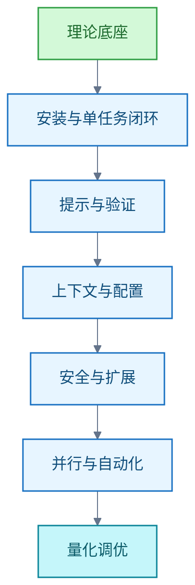
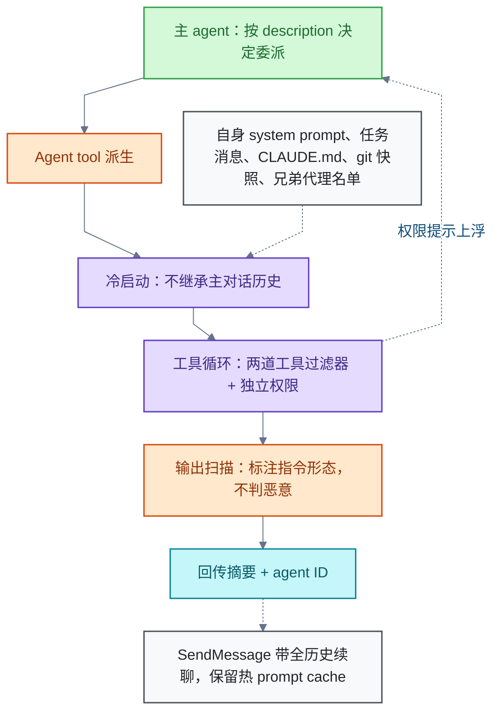

# Claude Code

<!-- domain: Claude Code -->
**范围**：Claude Code 的机制、用法、系统学习路线、性能调优、Windows／WSL 配置与上下文、Agent SDK 文档工作流、源码研究与官方文档批量获取。

**综述**：学习主线是理论基础、单任务闭环、上下文与扩展、多任务编排、量化调优；先明确目标、范围和可运行验收，再按任务需要增加工具。subagent、会话 fork、角色配置、恢复实例和持久记忆分别理解；独立上下文不自动隔离文件，也不保证降低总用量。内置工具与随产品提供的技能可作为基线，没有通用必装扩展，也不能断言零扩展永远最佳。插件按重复缺口增加，描述、调用正文和自动流程各有成本，关注度不代表实测收益。Windows 与 WSL 均可集中运行 Claude Code；用户配置共用，项目规则、自动记忆和会话分别组织。两边同侧开发无通用性能排名；Linux 容器源码挂载、Rust 目标系统及命令沙箱支持决定取舍。局部命令倍率不能直接外推完整任务，效率取决于模型等待、本地操作和重试各占多少时间。PDF 翻译由智能体负责术语和修订，工具负责解析、排版和完整性，现有组合仍需实测。源码存档、第三方架构研究和独立实现必须区分，公开可见不代表获得开源许可。官方正文导出也不等于完整站点源码。地区政策锚定用户所在地而非 IP：大陆不在支持列表，经海外 VPS 接入仍是限制对象，VPS 仅降低检测概率，不构成合规路径。具体配置、数量和版本见对应问题；待解是在实际 Java／React 项目中验证委派、扩展和调优收益。
<!-- /domain -->

记录 Claude Code 的使用与原理：学习路线、subagent 机制、插件取舍、Windows／WSL 布局、PDF 翻译流程、源码与文档获取、地区合规。主线是先建基线，再按任务缺口扩展。待解：在实际 Java／React 项目中验证委派、扩展与调优收益。

## 学习地图：从单任务闭环到量化调优

学习顺序：



每阶段用一个可检验的项目练习收尾。专家能力不是记住全部功能，而是为任务选用合适的模型、努力档位、权限、上下文与编排方式，并用通过率、人工干预次数、端到端耗时、每个通过任务的 token／费用比较方案。

各机制分工：

- `CLAUDE.md`／`AGENTS.md`：常驻项目约定。
- skill：按需加载。
- hook：确定性动作。
- 模型上下文协议（Model Context Protocol，MCP）：接入外部工具。
- subagent：隔离上下文。
- worktree／并行会话：复杂或独立任务再用。
- `claude -p`／CI／Agent SDK：重复流程再用。

Windows 原生 Git Bash 可以运行 Claude Code；但内置 Bash 沙箱只支持 macOS、Linux、WSL2。

信源（均一手）：[Anthropic Agent 原理](https://www.anthropic.com/engineering/building-effective-agents)、[Claude Code 工作原理](https://code.claude.com/docs/en/how-claude-code-works)、[最佳实践](https://code.claude.com/docs/en/best-practices)、[扩展功能选择](https://code.claude.com/docs/en/features-overview)、[模型配置](https://code.claude.com/docs/en/model-config)、[费用管理](https://code.claude.com/docs/en/costs)、[沙箱](https://code.claude.com/docs/en/sandboxing)。

### 证据与时效 · q-20260921-006

- **信源**：[一手] [Anthropic Agent 原理](https://www.anthropic.com/engineering/building-effective-agents)；[一手] [Claude Code 工作原理](https://code.claude.com/docs/en/how-claude-code-works)；[一手] [最佳实践](https://code.claude.com/docs/en/best-practices)；[一手] [扩展功能选择](https://code.claude.com/docs/en/features-overview)；[一手] [模型配置](https://code.claude.com/docs/en/model-config)；[一手] [费用管理](https://code.claude.com/docs/en/costs)；[一手] [沙箱](https://code.claude.com/docs/en/sandboxing)

## subagent：委派、配置与执行原理

subagent 是拥有独立上下文、指令和工具配置的委托执行实例。先分清五种形态：普通 subagent、继承历史的会话 fork、skill 的隔离执行、恢复同一实例、持久记忆。上下文隔离不等于文件隔离，也不保证降低总费用。

### 执行流程



### 委派与调用

- 自动委派最常用，由各代理 description 驱动；交互式 CLI 中自然语言命名由模型决定是否委派。
- `@` 选择 agent 保证调用该角色；`claude --agent <name>` 把主会话整机替换为该角色；`claude --agents` 定义本次会话可用角色。
- `/agents` 从 v2.1.198 起只打印创建／维护提示；v2.1.197 及以前提供交互界面。
- 内置代理：Explore（只读探索）、Plan（计划调研）、general-purpose。

### 启动上下文

- 冷启动注入自身 system prompt、任务消息、CLAUDE.md、git 快照与兄弟代理名单；不继承主对话历史。
- Explore 与 Plan 跳过 CLAUDE.md 和 git status；自定义代理可用 `omitClaudeMd` 跳过用户、项目与本地 CLAUDE.md。
- 不继承主对话已读文件、已调用 skill 的内容、主会话 auto memory、output style 与父上下文窗口尺寸；扩展思考自 v2.1.198 起继承。关键任务背景必须明确传递。
- `cd` 不跨 Bash 调用保留。

### 前台与后台

- 前台执行阻塞主会话；后台执行允许继续工作。交互式 fork mode 当前默认开启，新派生在后台运行。
- 后台权限请求显示在主会话；`/tasks` 查看与管理。后台不是取消权限检查。
- 后台 subagent 仅保留精简内置工具集（Read、Grep、Glob、LSP、Bash、PowerShell、Edit、Write、NotebookEdit、WebFetch、WebSearch、TodoWrite、Skill、ToolSearch、EnterWorktree、ExitWorktree、Monitor、TaskStop、SendMessage、Artifact、SubagentHandback）加 MCP 工具；Ctrl+B 把前台任务转后台。

### 限额与模型

- 默认嵌套深度 3、同时运行上限 20，分别由 `CLAUDE_CODE_MAX_SUBAGENT_SPAWN_DEPTH` 与 `CLAUDE_CODE_MAX_CONCURRENT_SUBAGENTS` 控制。并发限制只约束 Agent tool 新派生；手动 fork、恢复实例、ultracode 等存在例外，不是绝对上限。
- 所有代理 description 合计超过 15,000 tokens 触发启动警告——description 是委派路由表，数量与长度都有代价。
- 模型依次取：本次调用参数 → 代理定义 → `CLAUDE_CODE_SUBAGENT_MODEL` → 主会话模型；`CLAUDE_CODE_SUBAGENT_MODEL_FORCE=1` 可强制覆盖，fork 等仍有例外。Explore 不固定为 Haiku；当前文档按主模型与接入方式定义其模型。

### 输出与安全

- 输出扫描转义部分仿冒标记并标注指令形态；不判定内容是否恶意，不能代替权限或沙箱。（早期“防提示注入”表述过强，已修正。）
- 报告应带文件位置、触发条件、验证结果与未核实项；摘要不是正确性证明。

### 恢复与记忆

- 每次新调用建立新实例；恢复带 ID 的原实例保留其历史。Explore 与 Plan 当前是一次性代理，不能恢复。
- `memory` 用于跨会话持续记录；角色文件本身不保存历次任务历史。
- 会话 fork 命令现名 `/subtask`（v2.1.212 起；v2.1.161 至 v2.1.211 为 `/fork`），继承完整历史；skill 的 `context: fork` 创建独立上下文且不继承历史。
- 子代理 transcript 位于 `~/.claude/projects/{project}/{sessionId}/subagents/agent-{agentId}.jsonl`，按 cleanupPeriodDays（默认 30 天）清理。

### 配置文件与字段

- 定义位置五层，优先级：托管 `.claude/agents/` → `--agents` 会话级 → 项目 → 用户 → 插件 `agents/`。目录递归扫描；嵌套项目目录中同名定义以离工作目录最近者为准。
- 仅 name、description 必填；缺两者的文件被静默跳过，可用 `claude plugin validate <dir>` 检查。
- 字段要点：`disallowedTools` 先于 `tools` 应用，`Bash(git push *)` 类条目移除整个工具；`permissionMode` 在主会话处于 bypassPermissions／acceptEdits／auto 时被忽略，子代理不能自声明 bypassPermissions；`maxTurns` 截断输出并标记 partial、可续；`effort`（low／medium／high／xhigh／max）；`memory`（user／project／local，注入 MEMORY.md 前 200 行或 25 KB）；`mcpServers`（内联定义需目录信任）；`hooks`（Stop 映射为 SubagentStop）；`isolation: worktree`；`background`；`initialPrompt`；`experimental.cacheTtl`（5m／1h）；`skills` 预载完整 skill 内容，但不能预载 `disable-model-invocation: true` 的技能，也不等于可访问 skill 的白名单。

### 文件与工具隔离

- 默认共用工作目录；并行写代码应划分文件所有权，必要时用 `isolation: worktree`。
- worktree 默认从仓库默认分支创建；`worktree.baseRef: head` 从当前提交创建；未提交改动不会自动复制。
- 只读审查示例：`tools: Read, Grep, Glob`。仅移除 Write／Edit 仍可能通过 Bash 或 MCP 写入；启用 `memory` 会自动增加 Read／Write／Edit。工具可用性、权限审批与文件隔离应分别考虑。

### 编排模式

- coordinator 模式：`tools: Agent(worker, researcher), Read, Bash` 以白名单限制可再派生的代理，仅适用于 `--agent` 主线程。
- agent teams 为实验特性：`CLAUDE_CODE_EXPERIMENTAL_AGENT_TEAMS=1` 开启；一个会话一个团队，队友不能再派队友，lead 固定，subagent 定义中的 `skills` 字段不作用于队友。官方对比：subagent 适合“只需要结果”的任务且更省；teams 适合需要讨论协作的工作且成本更高。

信源（均一手）：[Subagent 配置与执行](https://code.claude.com/docs/en/sub-agents)、[命令参考](https://code.claude.com/docs/en/commands)、[CLI 参数](https://code.claude.com/docs/en/cli-reference)、[环境变量](https://code.claude.com/docs/en/env-vars)、[费用与子代理用量](https://code.claude.com/docs/en/costs)、[Skill 隔离执行](https://code.claude.com/docs/en/skills#run-skills-in-a-subagent)、[Worktree](https://code.claude.com/docs/en/worktrees)、[独立审查与验收](https://code.claude.com/docs/en/best-practices#add-an-adversarial-review-step)、[Agent teams 对比](https://code.claude.com/docs/en/agent-teams#compare-with-subagents)、[自动记忆](https://code.claude.com/docs/en/memory)。

- **历史结论（已被 2026-10-07 修正，具体修正见下）**：subagent 是由主对话派生、拥有独立上下文窗口的专职 agent，核心动机是隔离上下文污染（挤占预算、稀释注意力、推高成本）。执行：主 agent 依据各代理 description 决定委派 → Agent tool 派生 → 子代理冷启动（自身 system prompt + 任务消息 + CLAUDE.md + git 快照，不继承对话历史）→ 工具循环（两道工具过滤器 + 独立权限，提示上浮主会话）→ 输出扫描防提示注入 → 回传摘要 + agent ID（可用 SendMessage 带全历史续聊，保留热 prompt cache）。默认 3 层嵌套、20 并发；fork（/subtask）是唯一继承父历史的例外。配置：.claude/agents/（项目）与 ~/.claude/agents/（用户）下的 Markdown + frontmatter，仅 name、description 必填，description 驱动自动委派，model 解析顺序为 调用参数 → frontmatter → CLAUDE_CODE_SUBAGENT_MODEL → 主对话模型；缺 name/description 的文件被静默跳过。使用：自动委派（最常用）、@-mention（保证触发）、claude --agent <name>（整机替换）；内置 Explore（只读探索）/Plan（计划调研）/general-purpose。

### 证据与时效 · q-20260921-005

- **信源**：[一手] [Subagent 配置、执行与上下文](https://code.claude.com/docs/en/sub-agents)；[一手] [命令参考](https://code.claude.com/docs/en/commands)；[一手] [CLI 参数](https://code.claude.com/docs/en/cli-reference)；[一手] [环境变量](https://code.claude.com/docs/en/env-vars)；[一手] [费用与子代理用量](https://code.claude.com/docs/en/costs)；[一手] [Skill 隔离执行](https://code.claude.com/docs/en/skills#run-skills-in-a-subagent)；[一手] [Worktree](https://code.claude.com/docs/en/worktrees)；[一手] [独立审查与验收](https://code.claude.com/docs/en/best-practices#add-an-adversarial-review-step)；[一手] [Agent teams 与 subagent 的区别](https://code.claude.com/docs/en/agent-teams#compare-with-subagents)；[一手] [自动记忆](https://code.claude.com/docs/en/memory)

## 插件与 skill：没有通用必装

结论：没有通用必装插件或外部 skill，也没有证据支持“不装任何扩展永远最佳”。先用原生能力、简短项目约定和可执行验收建立基线，再按反复出现的缺口增加扩展。保留标准：减少返工，且总耗时／用量可接受。

### 原生已覆盖什么

- 内置文件操作、搜索、Shell 执行与网页工具覆盖多数编程任务，能支撑读代码、修改、运行已有测试和构建的闭环。
- 随产品提供的技能包括 `/debug` 与 `/code-review`；“不另装 skill”不等于运行环境没有任何预设流程。
- 语言服务器（Language Server）属可选扩展：Java 用 `jdtls-lsp`，TypeScript／JavaScript 用 `typescript-lsp`，Python 用 `pyright-lsp`；插件不附带服务器程序，需另装并放入启动 Claude 的 shell 的 PATH；云会话不启动插件语言服务器。

### 成本机制

- 插件是技能、子代理、hook 和工具连接的包装；数量不直接等于开销。
- 启用插件的组件名称与描述通常常驻上下文；skill 默认先加载描述，调用时加载正文，正文进入会话后跨后续轮次保留——既不是“全部正文始终加载”，也不是“装了没用就零成本”。
- `disable-model-invocation: true` 禁止模型自行调用并移除常驻描述，仍允许用户手动调用；第三方或共享 skill 可用 `skillOverrides` 设 `user-invocable-only`，无需改原文件。
- MCP 工具搜索默认开启，完整 schema 按需加载；未调用工具仍贡献名称与服务器指令。hook 在模型上下文外执行，返回输出才占上下文，但执行时间仍有代价。
- 上下文过多带来噪声、触发不准、遗漏项目约定的风险。

### 历史选型清单（2026-10-12 记录，未重新复核版本与数据）

- [Superpowers](https://github.com/obra/superpowers)：设计确认、计划、测试驱动开发（Test-Driven Development，TDD）、审查与完成前验证；适合多步骤开发，确认与验证步骤增加交互。约 29.8 万 stars，只反映关注度。
- [ECC](https://github.com/affaan-m/ECC)（现 `affaan-m/ECC`、`ecc@ecc`）：skills、agents、commands、hooks，含 Spring Boot 模式、安全、TDD 与验证技能；约 27.7 万 stars。原生插件与完整手工安装不可重复叠加。
- [Context7](https://github.com/upstash/context7)：从来源文档提取版本相关说明与示例；应明确库名和版本，检索结果不视为测试证明。
- [Frontend Design](https://raw.githubusercontent.com/anthropics/claude-plugins-official/main/plugins/frontend-design/README.md)：字体、配色、动画与界面实现。
- [Playwright MCP](https://github.com/microsoft/playwright-mcp)：浏览器操作与交互验证；Microsoft 的 CLI＋Skills 路径通常更省上下文，MCP 适合持续浏览器状态与探索操作。
- [PR Review Toolkit](https://raw.githubusercontent.com/anthropics/claude-plugins-official/main/plugins/pr-review-toolkit/README.md)：6 个专项代理，覆盖注释、测试、错误处理、类型、代码质量与简化，可按方面选用。
- [Feature Dev](https://raw.githubusercontent.com/anthropics/claude-plugins-official/main/plugins/feature-dev/README.md)：7 阶段流程，含代码探索、需求澄清、架构与审查；多代理与确认步骤适合较大的功能任务。

### 操作建议

- 先确保实际项目工具、依赖和构建／测试命令可用，用真实小任务建立原生表现基线。
- 项目约定只记录模型无法从仓库得知或反复需要重新发现的信息（测试环境变量、禁止沿用的旧模式、准确验收命令）；`CLAUDE.md` 保持简短，它本身也是常驻上下文。
- 按重复缺口添加：反复粘贴固定操作步骤时提炼窄范围 skill；符号导航与类型诊断不足时考虑语言服务器；需要外部系统信息或浏览器交互时补对应连接。不要仅因语言叫 Java／Spring／Rust 就认为必须安装同名 skill。
- 新插件先选 local scope，只为本人在当前仓库启用；`claude plugin details <name>` 查看估计的常驻与调用成本，会话内 `/context` 查看当前占用。
- 每次只引入能单独评估的改变；观察人工纠正与返工是否减少，检查总耗时与用量；无明确收益则停用。

信源（均一手）：[扩展选择](https://code.claude.com/docs/en/features-overview)、[内置工具与执行闭环](https://code.claude.com/docs/en/how-claude-code-works)、[Skill 加载与生命周期](https://code.claude.com/docs/en/skills)、[插件上下文成本](https://code.claude.com/docs/en/plugins/measure)、[最佳实践](https://code.claude.com/docs/en/best-practices)、[插件目录](https://claude.com/marketplace/plugins)、[官方语言服务器插件](https://code.claude.com/docs/en/plugins/code-intelligence)。

### 2026-10-29 追问：安装后必须装 Skill／插件，还是零扩展最佳？

**结论**：先不装额外扩展，是建立可比较基线的建议；零扩展不是对所有项目和任务都成立的最终最优配置。官方直接说明内置工具覆盖多数编程任务，并建议先写项目约定，在具体需求出现时再添加扩展。[一手：扩展选择](https://code.claude.com/docs/en/features-overview)

### 原生已经具备什么

内置文件操作、搜索、Shell 执行和网页工具可以支撑读代码、修改、运行项目已有测试和构建的闭环；代码智能所需的语言服务器属于可选扩展，不能把它与基础文件搜索混为一谈。[一手：工具与执行闭环](https://code.claude.com/docs/en/how-claude-code-works)

官方当前文档还列出随产品提供的技能，例如 `/debug` 和 `/code-review`。所以“不另装 Skill”也不等于运行环境没有任何预设流程；不需要为了通用调试或审查而先安装同名第三方能力。具体可用项以所用版本及相关功能为准。[一手：Bundled skills](https://code.claude.com/docs/en/skills#bundled-skills)

### Skill 与插件的作用和成本

- 技能（Skill）提供可复用的知识、指令或流程。插件（Plugin）是把技能、子代理、Hooks、MCP 等组件打包分发的方式；安装一个插件不等于模型获得了新的训练权重。[一手：扩展定义](https://code.claude.com/docs/en/features-overview)
- 默认可自动调用的 Skill 通常先加载描述，调用时再加载正文；正文进入会话后会跨后续轮次保留。因此不能说“安装的全部正文始终加载”，也不能说“装了但没用就完全没有上下文成本”。[一手：Skill 加载与生命周期](https://code.claude.com/docs/en/skills)
- 启用插件的组件描述有常驻成本；自动化脚本、额外审查和多代理流程还可能增加执行时间或模型调用。实际成本取决于内容、触发方式和执行行为，不由插件个数单独决定。上下文过多还会带来噪声、触发不准或遗漏项目约定的风险。[一手：插件成本](https://code.claude.com/docs/en/plugins/measure)、[一手：上下文取舍](https://code.claude.com/docs/en/features-overview#understand-context-costs)

- **选型依据与限制**：
  - Superpowers 作者文档规定设计确认、计划、测试驱动开发（Test-Driven Development，TDD）、审查与完成前验证；适合多步骤开发，但确认与验证步骤会增加交互。2026-10-12 作者仓库显示约 29.8 万 stars，此数只反映关注度。
  - ECC 作者仓库显示约 27.7 万 stars，提供 skills、agents、commands 和 hooks，包含 Spring Boot 模式、安全、TDD 与验证技能。当前仓库名和原生安装名已变为 `affaan-m/ECC`、`ecc@ecc`；原生插件和完整手工安装不可重复叠加。
  - Context7 从来源文档提取版本相关说明与示例，适合库 API 与升级任务；应明确库名和版本，不能将检索结果视为测试证明。
  - 官方 LSP 插件：Java 为 `jdtls-lsp`，TypeScript／JavaScript 为 `typescript-lsp`，Python 为 `pyright-lsp`；插件不附带服务器程序，需另装并放入启动 Claude 的 shell 的 PATH。当前官方文档说明云会话不启动插件语言服务器。
  - Frontend Design 指导字体、配色、动画与界面实现；Playwright 提供浏览器操作，可用于交互验证。Microsoft 当前还提供 CLI＋Skills 路径，并说明该路径通常更节省上下文；MCP 适合持续浏览器状态与探索操作。
  - PR Review Toolkit 含 6 个专项代理，覆盖注释、测试、错误处理、类型、代码质量与简化，可以按方面选用。Feature Dev 采用 7 阶段流程，含代码探索、需求澄清、架构与审查；多代理和确认步骤使它更适合较大的功能任务。
  - 安装面板可显示常驻与调用时的上下文成本；选择前应结合任务复杂度，而非只看插件数量。

- **追问深化**：
  - 官方说明内置文件操作、搜索、执行与网页工具覆盖多数编程任务；应先在 CLAUDE.md 中写清项目约定和构建／测试命令，并提供可执行的验收条件，外部插件和 skill 可按具体问题再加。
  - 插件是技能、代理、hooks 和工具连接的包装，插件数量不直接等于开销。启用插件的技能／代理／命令名称与描述通常常驻上下文；默认 skill 正文调用时才进入对话，并跨后续轮次保留，不能理解为调用后立即卸载。
  - 普通会话中，skill 的 `disable-model-invocation: true` 禁止模型自行调用并移除其常驻描述，仍允许用户手动调用；第三方或共享 skill 可通过 `skillOverrides` 设置 `user-invocable-only`，无需直接改原文件。
  - 当前 MCP 工具搜索默认开启，完整工具 schema 按需加载；未调用工具仍可贡献名称及服务器指令，不能概括为所有工具全文常驻。hooks 可在模型上下文外执行，返回输出才占上下文；执行时间仍可能产生代价。
  - 推荐按重复缺口增量配置：符号定位／诊断选语言 LSP；版本文档查询选 Context7；反复重复的项目流程沉淀为窄范围 skill；需要设计、计划、测试与审查约束时再选 Superpowers 等主流程。
  - 新插件可以先选 local scope，只为本人在当前仓库启用；在 shell 中用 `claude plugin details <name>` 查看估计的常驻与调用成本，在会话中用 `/context` 查看当前工具等占用。保留标准应是减少返工且总耗时／用量可接受，不设任意“最多几个”的统一限制。

- **补充信源**：[一手] [扩展选择与加载策略](https://code.claude.com/docs/en/features-overview)；[一手] [Skill 调用控制与正文生命周期](https://code.claude.com/docs/en/skills)；[一手] [插件上下文成本测量](https://code.claude.com/docs/en/plugins/measure)；[一手] [内置工具与执行闭环](https://code.claude.com/docs/en/how-claude-code-works)；[一手] [项目约定与可执行验证](https://code.claude.com/docs/en/best-practices)

### 证据与时效 · q-20261012-002

- **信源**：[一手] [Anthropic 官方插件目录](https://claude.com/marketplace/plugins)；[一手] [插件安装、范围与上下文成本](https://code.claude.com/docs/en/discover-plugins)；[一手] [Superpowers 作者仓库](https://github.com/obra/superpowers)；[一手] [ECC 作者仓库](https://github.com/affaan-m/ECC)；[一手] [Context7 作者仓库](https://github.com/upstash/context7)；[一手] [官方语言服务器插件](https://code.claude.com/docs/en/plugins/code-intelligence)；[一手] [Frontend Design 文档](https://raw.githubusercontent.com/anthropics/claude-plugins-official/main/plugins/frontend-design/README.md)；[一手] [Playwright MCP 作者仓库](https://github.com/microsoft/playwright-mcp)；[一手] [PR Review Toolkit 文档](https://raw.githubusercontent.com/anthropics/claude-plugins-official/main/plugins/pr-review-toolkit/README.md)；[一手] [Feature Dev 文档](https://raw.githubusercontent.com/anthropics/claude-plugins-official/main/plugins/feature-dev/README.md)
- **核实**：2026-10-29；本次只复核 Claude Code 官方的内置能力、扩展选型、Skill 加载、插件上下文成本与最佳实践。未重查上述 2026-10-12 产品清单和统计，未对用户项目测量某插件的质量、耗时或用量收益。

## Windows 与 WSL：统一配置与性能

不必装两套。两条路都能只维护一套用户配置：

1. Claude Code 统一运行在同一个 WSL 发行版、同一个 Linux 用户下，经 `/mnt/<盘符>/...` 修改保留在 Windows 的笔记。
2. 全部工作项目和 Claude Code 迁到 Windows 原生环境。

取舍由工具链和执行环境决定：源码挂载进 Linux 容器或依赖 Linux 工具链时优先保留 WSL；Docker 只运行数据库等服务且本地构建跨平台时，可考虑统一 Windows。没有本机同任务实测，不能量化两种方案的统一性能差距。

推荐布局（`/mnt/e` 示例以默认自动挂载启用为条件；`claude` 命令应指向 WSL 安装，而不是经 PATH 找到 Windows 程序）：

| 对象 | 位置 | 访问方式 |
| --- | --- | --- |
| 工作仓库 | WSL 的 `/home/<Linux用户名>/...` | WSL 本地路径 |
| 笔记库与 Windows 项目 | Windows，如 `E:\code\personal\知识学习` | 默认挂载 `/mnt/e/code/personal/知识学习` |
| Obsidian | Windows | 继续打开 Windows 笔记库 |
| Claude Code | 同一 WSL 发行版的同一 Linux 用户 | 两类项目各启会话，同一套用户配置 |

“一套上下文”分层理解：

- 用户配置与通用规则共用：`~/.claude/settings.json` 管个人设置，`~/.claude/CLAUDE.md` 管个人规则。
- 项目规则随项目保存：项目目录下的 `CLAUDE.md`、`.claude/settings.json` 等；统一运行环境不要求合并两类项目的规则。
- 自动记忆按项目保存：默认目录 `~/.claude/projects/<project>/memory/`；项目身份从 Git 仓库推导，非 Git 目录用项目根目录；机器本地数据，不自动跨机器／云端共享。
- 会话上下文独立：每个会话新开上下文窗口；跨会话延续靠持久规则与自动记忆。

迁移边界：已有 Windows 配置迁入 WSL 时逐项选择，检查绝对路径、hook 与 MCP 启动命令能否在 WSL 执行。`CLAUDE_CONFIG_DIR` 整目录跨系统共用的支持与兼容性未核实，不作推荐；该变量改变设置、会话历史和插件的存放位置。

### 全迁 Windows 的差别

- Claude Code 官方同时支持 Windows 原生与 WSL；模型推理与工具执行分开说明。同一模型和服务下，不能因运行在 Windows 就判定推理能力变弱（推断）；任务质量和耗时仍受可用工具、命令结果与环境影响。
- 确定差异：内置命令沙箱支持 macOS、Linux、WSL2，Windows 原生不支持；WSL2 支持不代表默认已启用。沙箱只覆盖相应命令及子进程；文件工具、MCP 和 hook 运行在命令沙箱之外。
- 同侧开发（Windows 工具访问 Windows 文件、WSL 工具访问 Linux 文件）符合“文件与主要工具同侧”建议；不能用 WSL 访问 `/mnt/c` 的开销证明任一侧同侧开发更慢。
- Java／Spring 和 React 迁移有可行基础（Maven、Node.js、Vite 均有官方 Windows 路径），前提是依赖支持 Windows 且脚本可移植——工程判断，不是实测结论。
- Docker 源码绑定挂载（bind mount）到 Linux 容器做构建或开发时，官方建议源码放 Linux 文件系统（性能与文件变更通知更优）——该条件优先保留 WSL；不能把该结论泛化到全部 Windows 项目。Docker Desktop 的 WSL 2 后端让 Windows 终端也能运行 Docker 命令。
- Rust 按目标系统选：面向 Linux 或依赖 Linux 专用库偏 WSL；面向 Windows 原生能力偏 Windows。Windows 默认文件名不区分大小写，Linux 默认区分；路径、脚本与平台依赖需要检查。
- Windows 项目需要大量依赖扫描、构建或热重载时，另行验证速度与监听行为；不把历史 inotify 问题当作当前已复测结果。
- 建议：不为消除第二套配置而直接全量迁移——统一 WSL 已解决配置集中。若 Docker 只跑配套服务、Rust 无 Linux 限制，Windows 可作主环境候选；先用一个代表仓库验证安装依赖、测试、构建、开发服务与实际容器流程。

### 性能差距能测到什么

Josh Salway 个人实测（2026-04-03 测试，04-08 发布，04-21 更新；同一台 Ryzen 9 9950X3D、64 GB 内存 Windows 11，比较 Windows Git Bash 与 WSL2；单位毫秒）：

| 测项 | Windows Git Bash | WSL 2 | 仅针对该记录的差值 |
| --- | ---: | ---: | --- |
| 50 次 `git --version` | 791 ms | 36 ms | Windows 多 755 ms |
| 50 次 `node -e 'process.exit()'` | 1703 ms | 576 ms | Windows 多 1127 ms |
| `git status` | 48 ms | 121 ms | Windows 少 73 ms |


能证明该环境的部分本地操作存在差异；不能证明最新 Claude Code 或全部 Windows 项目有相同比例。其“整体约 4.3 倍”结论不采用：原始汇总两侧测项不一致（Windows 用 `git grep`、WSL 用 ripgrep）；脚本默认不测 Claude Code；计时把命令失败也吞掉；未报告逐项重复次数、方差和软件版本。

近似模型（条件推导，非实测）：同一远程模型、同一网络出口、相同工具调用次数、不计并行与重试时，若本地工具占 WSL 任务总耗时的比例为 `p`，Windows 本地工具耗时为 WSL 的 `k` 倍，则总耗时相对增加约为 `p × (k − 1)`。

```text
假设示例（非实测）：
WSL 任务 100 s = 模型/网络等待 80 s + 本地操作 20 s
Windows 本地操作 20 s * 2 = 40 s
总耗时 120 s，增加 20%（不是 100%）
```

少量文件编辑、主要等待模型的任务，本地速度差不易主导总耗时；频繁调用命令、扫描大量文件、反复构建测试时更可能影响效率。没有数据支持“日常必然只差 5%”或“所有 Java／Rust 构建在 WSL 必然更快”。要给自家定量：比较代表仓库的相同搜索／Git 操作、增量构建与测试，再比较完整 Claude Code 任务总耗时；保持版本、依赖、缓存与任务条件一致，多次记录。不能用单条命令倍率替代完整工作流结论。

信源（均一手）：[Microsoft 文件系统](https://learn.microsoft.com/en-us/windows/wsl/filesystems)、[Node.js 环境选择](https://learn.microsoft.com/en-us/windows/dev-environment/javascript/nodejs-on-windows)、[Claude Code 安装](https://code.claude.com/docs/en/setup)、[沙箱](https://code.claude.com/docs/en/sandboxing)、[工作原理](https://code.claude.com/docs/en/how-claude-code-works)、[设置作用域](https://code.claude.com/docs/en/settings)、[记忆机制](https://code.claude.com/docs/en/memory)、[Docker Desktop WSL 2 后端](https://docs.docker.com/desktop/features/wsl/)、[Docker WSL 2 最佳实践](https://docs.docker.com/desktop/features/wsl/best-practices/)、[Rust 安装与链接工具](https://doc.rust-lang.org/book/ch01-01-installation.html)、[大小写语义](https://learn.microsoft.com/en-us/windows/wsl/case-sensitivity)、[Maven 安装](https://maven.apache.org/install.html)、[Vite 指南](https://vite.dev/guide/)；个人原始记录：[Windows 结果](https://raw.githubusercontent.com/JoshSalway/dev-workflow-benchmark/master/results-DESKTOP-2RVUL12.txt)、[WSL 结果](https://raw.githubusercontent.com/JoshSalway/dev-workflow-benchmark/master/results-WSL.txt)、[测试脚本](https://raw.githubusercontent.com/JoshSalway/dev-workflow-benchmark/master/dev-workflow-benchmark.sh)、[作者测试说明](https://joshsalway.com/articles/windows-vs-mac-for-claude-code-the-benchmark-that-changed-how-i-work/)。

### 原因与推荐布局

应用运行位置与文件存放位置不必相同。Microsoft 文档说明 WSL 能访问 `/mnt/c/...` 等 Windows 挂载路径；同样也能运行 Windows 可执行文件。这不要求将 Obsidian 本身搬到 Linux，也不要求建立两份笔记副本。[一手：Microsoft 文件系统与互操作说明](https://learn.microsoft.com/en-us/windows/wsl/filesystems)

前提：已在 WSL 安装 Claude Code；`claude` 命令应指向该 WSL 安装，而不是经 PATH 找到 Windows 端程序。上述命令是操作示例，本次未执行。

### 取舍与迁移边界

Microsoft 推荐文件与主要工具同侧存放，以获得更好的性能。因此工作仓库继续留在 WSL；针对终端中修改 Windows 笔记或少量代码，可先采用挂载访问方案。这是针对用户工作方式的建议，不是跨系统访问无性能代价的承诺。[一手：性能建议](https://learn.microsoft.com/en-us/windows/wsl/filesystems#file-storage-and-performance-across-file-systems)

如果 Windows 项目需要大量依赖扫描、构建或热重载，应另行验证速度和监听行为；本次不把旧记录里的历史 inotify 问题当作当前已复测结果。若以后确实需要 Windows 原生执行环境，再评估保留第二个入口。

已有 Windows 配置迁入 WSL 时，应逐项选择通用设置与规则，并检查绝对路径、Hooks 和 MCP 启动命令能否在 WSL 执行。本次未核实 Windows／WSL 两个进程同时共享整个 `CLAUDE_CONFIG_DIR` 的支持与兼容性，因此不把整目录共用作为推荐方案。官方说明该变量改变设置、会话历史和插件存放位置，并不构成跨系统所有状态兼容的保证。[一手：配置目录说明](https://code.claude.com/docs/en/settings#find-or-create-your-settings-files)

### 2026-10-29 追问：全部迁到 Windows，与工作项目和 Claude Code 都在 WSL 有多大差别？

**用户补充**：主要使用 Java、Docker、React、Rust 和 Spring。Docker 是否挂载源码、Rust 的最终目标系统未说明；不据语言清单假定两者。

**核实范围**：2026-10-29 复核 Claude Code 安装、沙箱与工作原理，Microsoft 文件系统、Node.js 环境与大小写说明，Docker Desktop 的 WSL 2 后端和源码挂载建议，Maven、Rust、Vite 官方文档。没有读取或迁移用户工作项目，没有测试构建时间、热重载或内存；不刷新前文未重查的配置与自动记忆细节。

### Claude Code 本体与系统环境分别比较

官方支持 Windows 原生和 WSL；原生 Windows 可使用 PowerShell，安装 Git for Windows 后也可用 Bash 工具。官方将模型推理与工具执行分开说明。**推断**：在同一模型和服务下，不能因为运行在 Windows 就判定推理能力变弱；最终任务质量和耗时仍受可用工具、命令结果及环境影响。[一手：安装支持](https://code.claude.com/docs/en/setup)、[一手：工作原理](https://code.claude.com/docs/en/how-claude-code-works)

确定的功能差异：内置命令沙箱在 macOS、Linux 和 WSL 2 支持，在 Windows 原生不支持；WSL 2 支持不代表默认已启用。沙箱只覆盖相应命令及子进程，文件工具、MCP 和 Hooks 运行在这个命令沙箱之外，不能把有沙箱理解成所有操作均已隔离。[一手：沙箱范围与平台](https://code.claude.com/docs/en/sandboxing)

### 两边全部同侧时，不能套用跨系统访问的性能结论

Windows 原生工具访问 Windows 文件，以及 WSL 工具访问 WSL Linux 文件，都符合“文件与主要工具同侧”的建议。不能用 WSL 访问 `/mnt/c` 的开销，证明 Windows 原生的同侧开发一定比 WSL 慢。Microsoft 的 Node.js 指南也把同侧存放列为关键，并按命令行偏好与部署目标选择 Windows 或 WSL。[一手：Microsoft 文件系统](https://learn.microsoft.com/en-us/windows/wsl/filesystems)、[一手：Node.js 环境选择](https://learn.microsoft.com/en-us/windows/dev-environment/javascript/nodejs-on-windows)

### 对用户技术栈的条件判断

**建议**：不为消除第二套 Claude Code 配置而直接全量迁移，因为统一在 WSL 本身已能解决配置集中。若 Docker 只跑配套服务、Rust 也无 Linux 限制，Windows 可以作为主环境候选；先用一个代表仓库验证安装依赖、测试、构建、开发服务与实际容器流程，再决定是否批量迁移。此前“推荐 WSL”基于已有工作仓库大多在 WSL 和 Windows 侧主要编辑笔记的条件，不是“WSL 在所有工作负载上更快”的结论。

### 2026-10-29 追问：两边都同侧存放，性能到底差多少，是否影响效率？

**范围**：只比较 Windows 原生 Claude Code＋Windows 文件，与 WSL Claude Code＋WSL Linux 文件；不把 WSL 访问 `/mnt/c` 的开销混入。2026-10-29 重新核实 Microsoft 文件系统建议、Claude Code 工作原理、Docker 最佳实践，并检查个人作者 Josh Salway 的原始文章、脚本与 Windows／WSL 两份结果；未在用户机器复测，没有查到能直接量化用户当前 Java／React／Rust 工作流的完整 Claude Code 同条件任务数据。该检索结果不表示此类数据绝对不存在。

### 可以核实的数值及其边界

Josh Salway 的个人实测记录日期为 2026-04-03，文章发布于 2026-04-08，更新于 2026-04-21。作者说明使用同一台 Ryzen 9 9950X3D、64 GB 内存的 Windows 11 电脑，比较 Windows Git Bash 和 WSL 2；两份原始结果标有相同主机名。以下单位均为毫秒，累计启动指顺序执行 50 次命令：

**不能采用其“整体约 4.3 倍”作为 Claude Code 结论**：原始汇总是 Windows 11942 ms、WSL 2777 ms，但 Windows 搜索使用 `git grep`、WSL 使用 `ripgrep`，测项不完全一致。脚本默认不测 Claude Code，只在 `--with-claude-code` 时增加启动和简单提示测试；已发布两份结果没有这些条目。脚本计时把命令失败也吞掉，未报告逐项重复次数、方差和全部软件版本，无法作为严格控制基准。博客对每种内置工具是否启动进程的概括，本次未核实，不采用。[一手：测试脚本](https://raw.githubusercontent.com/JoshSalway/dev-workflow-benchmark/master/dev-workflow-benchmark.sh)

### 从局部速度推导工作效率

Claude Code 在获取上下文、调用工具和验证之间循环；所以完整任务耗时既包含模型／网络等待，也包含本地搜索、命令、构建和测试。[一手：工作原理](https://code.claude.com/docs/en/how-claude-code-works)

用于理解的近似模型：在同一远程模型、同一网络出口、相同工具调用次数且暂不考虑并行和额外重试时，任务总耗时约等于模型／网络等待时间加本地工具时间。若本地工具在 WSL 任务中占比为 `p`，Windows 本地工具耗时为 WSL 的 `k` 倍，则总耗时相对增加约为 `p × (k − 1)`。这个公式是条件推导，不是实测比例，也不假定所有工具有相同倍率。

**假设示例，非实测**：WSL 完整任务为 100 s，其中模型／网络等待 80 s、本地操作 20 s；若 Windows 本地操作变成 40 s，完整任务为 120 s，增加 20%，并非增加 100%。真实模型输出、上下文缓存、工具调用顺序及错误重试变化都会影响结果。

**建议／推断**：少量文件编辑且主要等待模型的任务，本地速度差较不容易主导总耗时；频繁调用命令、扫描大量文件、反复构建测试时，更可能影响效率。但没有数据支持“日常必然只差 5%”或“所有 Java／Rust 构建在 WSL 必然更快”。Linux 容器挂载源码则有 Docker 官方的定向性能建议，可优先保留 WSL；它仍不是全部同侧开发的通用排名。[一手：Docker WSL 2 最佳实践](https://docs.docker.com/desktop/features/wsl/best-practices/)、[一手：Microsoft 同侧存放建议](https://learn.microsoft.com/en-us/windows/wsl/filesystems)

若要给用户自己的效率差距定量，应比较代表仓库的相同搜索／Git 操作、增量构建和测试，再比较完整 Claude Code 任务总耗时；保持版本、依赖、缓存与任务条件尽量一致，并记录多次结果。不能用一次模型响应或单条命令的倍率替代完整工作流结论。

### 原因与推荐布局

```bash
cd /mnt/e/code/personal/知识学习
claude
```

- **用户配置和通用规则共用**：该 WSL 用户的 `~/.claude/settings.json` 管个人设置，`~/.claude/CLAUDE.md` 管所有项目使用的个人规则。[一手：设置作用域](https://code.claude.com/docs/en/settings)、[一手：用户规则位置](https://code.claude.com/docs/en/memory#choose-where-to-put-claudemd-files)

- **项目规则随项目保存**：项目目录下的 `CLAUDE.md`、`.claude/settings.json` 等继续属于该项目。统一运行环境不要求把工作仓库规则和笔记规则合并。[一手：项目配置](https://code.claude.com/docs/en/settings)

- **自动记忆按项目保存**：默认目录为 `~/.claude/projects/<project>/memory/`；当前官方文档说明项目身份从 Git 仓库推导，非 Git 目录使用项目根目录。自动记忆是机器本地数据，不会自动跨机器／云端共享。[一手：自动记忆存储](https://code.claude.com/docs/en/memory#storage-location)

- **会话上下文独立**：共享用户配置不代表不同任务自动共享当前对话内容。官方说明每个会话开始时有新的上下文窗口，持久规则和自动记忆负责跨会话延续理解。[一手：记忆机制](https://code.claude.com/docs/en/memory)

- **Java／Spring 和 React 本地开发**：迁到 Windows 有可行基础。Maven 官方提供 Windows 安装，Microsoft 提供 Windows Node.js 开发指南，Vite 官方提供 React 模板；本次未验证用户具体 Spring 依赖、脚本与构建配置是否跨平台。“通常迁移阻力较低”仅适用于依赖已支持 Windows 且脚本可移植的项目，是工程判断，不是实测结论。[一手：Maven 安装](https://maven.apache.org/install.html)、[一手：Windows Node.js](https://learn.microsoft.com/en-us/windows/dev-environment/javascript/nodejs-on-windows)、[一手：Vite React 模板](https://vite.dev/guide/)

- **Docker 仅运行数据库、缓存等服务**：判断为 Windows 本地开发也值得考虑，是否适用仍需看项目。Docker Desktop 文档说明 Windows 终端能使用 WSL 2 后端运行 Docker 命令；Windows 上操作 Docker 不等于 Linux 后端消失，也不一定需要用户自己的 WSL 发行版。[一手：Docker Desktop WSL 2 后端](https://docs.docker.com/desktop/features/wsl/)

- **源码绑定挂载（Bind Mount）到 Linux 容器做构建或开发**：Docker 官方建议源码放 Linux 文件系统，说明这比从 Windows 主机文件系统挂载有更好的性能，并有文件变更通知方面的差异。这个条件下优先保留 WSL；不能把该性能结论泛化到全部 Windows 项目，也不能据此声称固定倍数。[一手：Docker WSL 2 最佳实践](https://docs.docker.com/desktop/features/wsl/best-practices/)

- **Rust**：两边均有官方安装路径，编译和链接工具不同。Linux 常用 GCC／Clang；Windows 官方入门路径涉及 Visual Studio 链接器与原生库。根据目标系统选择本地环境是建议：面向 Linux 或依赖 Linux 专用库时偏向 WSL，面向 Windows 原生能力时偏向 Windows，不能仅因“使用 Rust”就作决定。[一手：Rust 安装与链接工具](https://doc.rust-lang.org/book/ch01-01-installation.html)

- **系统语义与脚本**：Windows 默认文件名不区分大小写，Linux 默认区分；路径、脚本与平台相关依赖需要检查。Git Bash 或跨平台构建器的存在不构成所有原 Linux 工作流已兼容的证据。[一手：大小写语义](https://learn.microsoft.com/en-us/windows/wsl/case-sensitivity)、[一手：Claude Code Shell 支持](https://code.claude.com/docs/en/setup)

### 证据与时效 · q-20261029-004

- **信源**：[一手] [Microsoft：Working across Windows and Linux file systems](https://learn.microsoft.com/en-us/windows/wsl/filesystems)；[一手] [Claude Code：Advanced setup](https://code.claude.com/docs/en/setup)；[一手] [Settings files and precedence](https://code.claude.com/docs/en/settings)；[一手] [How Claude remembers your project](https://code.claude.com/docs/en/memory)
- **核实**：2026-10-29；核实 WSL 安装支持、Windows 盘的挂载访问、互操作与跨文件系统性能建议，以及用户／项目配置作用域、用户规则、自动记忆的本地项目目录。以下方案是依据官方机制提出的建议；未检查用户现有配置、WSL 自动挂载设置与权限，未执行迁移或实测 Obsidian 插件、构建、文件监听。`/mnt/e` 示例以默认自动挂载启用为条件。
- 原记录资料（未在迁移时复核）：[一手：用户规则位置](https://code.claude.com/docs/en/memory#choose-where-to-put-claudemd-files)
- 原记录资料（未在迁移时复核）：[一手：自动记忆存储](https://code.claude.com/docs/en/memory#storage-location)

## PDF 翻译流程：智能体配工具

分工：智能体负责术语和修订；工具负责解析、排版和完整性。现有组合仍需实测。

- 个人交互式任务：Claude Code 配合专用 skill。
- 嵌入自有 Python 或 TypeScript 程序的批处理：官方 Claude Agent SDK，由其提供工具调用、会话、子智能体与控制机制。
- [translate-book](https://github.com/deusyu/translate-book)：分块翻译、术语反馈、断点续跑、多格式输出；采用重新排版。保留原版式需另接 PDF 排版工具（如 [BabelDOC](https://github.com/funstory-ai/BabelDOC)）和翻译适配层；整体组合未实测。

信源（均一手）：[Claude Agent SDK](https://code.claude.com/docs/en/agent-sdk/overview)、[Python SDK](https://github.com/anthropics/claude-agent-sdk-python)、[Claude Code Skills](https://code.claude.com/docs/en/skills)。

### 证据与时效 · q-20261015-001

- **信源**：[一手] [Claude Agent SDK](https://code.claude.com/docs/en/agent-sdk/overview)；[一手] [Python SDK](https://github.com/anthropics/claude-agent-sdk-python)；[一手] [Claude Code Skills](https://code.claude.com/docs/en/skills)；[一手] [translate-book](https://github.com/deusyu/translate-book)；[一手] [BabelDOC 接口说明](https://github.com/funstory-ai/BabelDOC)

## 源码泄露相关项目：三种类别必须区分

指 2026 年 3 月 31 日的泄露。源码存档、第三方架构研究、独立实现必须区分；公开可见不代表获得开源许可。

- 源码研究：[claude-code-sourcemap](https://github.com/ChinaSiro/claude-code-sourcemap)（v2.1.88 的 source map 还原结果）、[learn-coding-agent](https://github.com/sanbuphy/learn-coding-agent)（原 claude-code-source-code，现为架构研究材料）。
- 独立实现：[claw-code](https://github.com/ultraworkers/claw-code)（原 instructkr/claw-code；Rust 为主，[MIT 许可证](https://github.com/ultraworkers/claw-code/blob/main/LICENSE)，作者定位为研究展品）、[claurst](https://github.com/Kuberwastaken/claurst)（原 claude-code；Rust，[声明 GPL-3.0](https://github.com/Kuberwastaken/claurst/blob/main/LICENSE.md) 与 Beta 状态）。
- 周边：[cc-cache-fix](https://github.com/Rangizingo/cc-cache-fix) 的缓存补丁及检测工具。

功能与定位依据作者文档；运行效果及与官方功能的一致性未实测。[Anthropic 官方许可证](https://github.com/anthropics/claude-code/blob/main/LICENSE.md)保留全部权利；泄露存档不构成官方开源授权。

### 证据与时效 · q-20261018-001

- **信源**：[一手] [ChinaSiro 源码还原仓库](https://github.com/ChinaSiro/claude-code-sourcemap)；[一手] [sanbuphy 架构研究仓库](https://github.com/sanbuphy/learn-coding-agent)；[一手] [Claw Code 当前仓库](https://github.com/ultraworkers/claw-code)；[一手] [Claw Code MIT 许可证](https://github.com/ultraworkers/claw-code/blob/main/LICENSE)；[一手] [Claurst 当前仓库](https://github.com/Kuberwastaken/claurst)；[一手] [Claurst 许可证](https://github.com/Kuberwastaken/claurst/blob/main/LICENSE.md)；[一手] [缓存补丁作者仓库](https://github.com/Rangizingo/cc-cache-fix)；[一手] [Anthropic 官方许可证](https://github.com/anthropics/claude-code/blob/main/LICENSE.md)

## 文档站全量获取

截至 2026-10-18：未找到官方公开的完整文档站工程仓库；[anthropics/claude-code](https://github.com/anthropics/claude-code) 不包含该站完整文档工程；官方 Markdown 导出不等于原始源码。

获取路径（数据截至 2026-10-18）：

- 直接下载 [llms-full.txt](https://code.claude.com/docs/llms-full.txt)：228 页英文正文合集。
- 按 [llms.txt](https://code.claude.com/docs/llms.txt) 递归读取 `/_llms/` 语言索引再下载 `.md`：索引列出 12 种语言、2,736 页；也可只选 228 页简体中文。
- 范围限制：媒体文件、布局与未列入索引的内容不在其中。
- 路径细节：简体中文索引为 `/docs/_llms/zh-cn.txt`（小写），正文为 `/docs/zh-CN/*.md`（[单页示例](https://code.claude.com/docs/zh-CN/overview.md)）。实测 [sitemap.xml](https://code.claude.com/docs/sitemap.xml) 仅列出 2,713 个 URL，与文档索引有差异——用递归索引枚举，不把 sitemap 当作唯一完整性依据。
- 配套 PowerShell 脚本 [Get-ClaudeCodeDocs.ps1](../附件/工具/Get-ClaudeCodeDocs.ps1) 支持语言选择、索引预览、重试和下载结果清单；语法与全部索引发现已验证，未执行全部正文下载。

信源（均一手）：[Mintlify 索引与合集规则](https://www.mintlify.com/docs/ai/llmstxt)、[Mintlify Markdown 导出规则](https://www.mintlify.com/docs/ai/markdown-export)。

- **核实细节**：简体中文索引路径为 /docs/_llms/zh-cn.txt（小写），其正文路径为 /docs/zh-CN/*.md。实测 sitemap.xml 仅列出 2,713 个 URL，与文档索引有差异，因此使用递归文档索引枚举；不把 sitemap 当作唯一完整性依据。PowerShell 脚本已保存至站点/docs/附件/工具/Get-ClaudeCodeDocs.ps1，支持语言选择、索引预览、重试及下载结果清单；语法与全部索引发现已验证，未执行全部正文下载。

### 证据与时效 · q-20261018-002

- **信源**：[一手] [Claude Code 官方仓库](https://github.com/anthropics/claude-code)；[一手] [官方文档索引](https://code.claude.com/docs/llms.txt)；[一手] [英文正文合集](https://code.claude.com/docs/llms-full.txt)；[一手] [简体中文索引](https://code.claude.com/docs/_llms/zh-cn.txt)；[一手] [单页 Markdown 示例](https://code.claude.com/docs/zh-CN/overview.md)；[一手] [网站地图](https://code.claude.com/docs/sitemap.xml)；[一手] [Mintlify 索引、递归索引与合集规则](https://www.mintlify.com/docs/ai/llmstxt)；[一手] [Mintlify Markdown 导出规则](https://www.mintlify.com/docs/ai/markdown-export)
- 原记录资料（未在迁移时复核）：[资料](https://code.claude.com/docs/)

## VPS 防封号：信号与规则两层

问：租新加坡或日本 VPS（Virtual Private Server）跑 Claude Code 防封号，是否靠谱？答分两层。

**信号层面相对靠谱**：远程环境是官方支持的形态（devcontainer、cloud environments、SSH 远程会话）；VPS 直跑提供单一稳定 IP 与一致时区，优于本地代理——本地代理常见 IP 地区跳变与代理段被标记。

**规则层面不靠谱**：Anthropic 支持地区政策锚定「用户所在地」而非 IP。中国大陆不在支持列表（2026-11-12 生效版：新加坡、日本在列；香港、澳门不在）。消费条款要求用户声明本人不在不支持地区，并禁止绕过防护措施（bypassing protective measures）。2025-09-04 政策公告明确打击经第三国注册绕过（含超过 50% 直接或间接多数控股标准），方向是收紧而非放松。

结论：身处大陆的用户经 VPS 接入仍是政策限制对象——VPS 降低被检测概率，不改变违规状态，不构成合规路径。完全合规需三者齐备：身处支持地区 + 支持地区身份注册 + 支持地区支付。

剩余风险（二手社区说法，未获官方证实）：中国发行的银行卡与虚拟卡列为常见封号诱因；数据中心 IP 可能整段被标记；有社区文章称 Asia/Singapore 时区是重点筛查对象；新账号无使用记录更易被风控；IP 地区频繁跳变是风险信号；封号申诉成功率低且常无解释。官方封号检测机制（时区收集、文本水印、24 小时观察期等说法）均出自二手文章，未获官方证实；具体封号诱因权重（支付、IP 质量、账号历史）也无官方披露。

替代：使用国内可合法获得的服务，如智谱 GLM Coding Plan——可官方接入 Claude Code 工具本身。

信源（均一手）：[Anthropic 支持地区列表](https://www.anthropic.com/claude-ai-locations)、[2025-09-04 政策公告](https://www.anthropic.com/news/updating-restrictions-of-sales-to-unsupported-regions)、[消费条款](https://www.anthropic.com/legal/consumer-terms)、[devcontainer 文档](https://code.claude.com/docs/en/devcontainer)、[沙箱环境文档](https://code.claude.com/docs/en/sandbox-environments)。

### 官方规则（一手核实）

1. **支持地区**：政策页（2026-11-12 生效）列出支持国家与地区；新加坡、日本在列；中国大陆、香港、澳门不在。政策同时排除：在不支持地区注册或总部设于该地区的实体（即使人员在支持地区）；被不支持地区人员或实体直接或间接多数控股的实体。
2. **判断锚点是所在地，不是 IP**：消费条款要求用户声明本人及相关使用者不在不支持地区；条款未出现以 IP 作为判断依据的表述。
3. **禁止绕过**：条款禁止 "bypassing any of our systems or protective measures"。
4. **2025-09-04 政策**：因法律、监管与安全风险（国家安全、军事情报、蒸馏、商业竞争四条理由）收紧对不支持地区（点名中国）的销售限制，明确针对"经第三国注册子公司继续访问"的绕过行为。

### 剩余风险（二手，未核实）

- 支付方式：中国发行的银行卡、虚拟卡被社区列为常见封号诱因。
- IP 质量：数据中心 IP 可能整段被标记；有社区文章称 Asia/Singapore 时区是重点筛查对象（因大量转售账号使用该时区）。
- 账号历史：新账号无使用记录更易被风控；IP 地区频繁跳变是风险信号。
- 申诉：社区报告封号申诉成功率低，常无解释。

### 结论

- 若已决定使用：VPS 直跑优于本地代理，保持 IP、账号信息、支付方式一致可降低风险，但无法消除。
- 若要求稳定可靠：不存在"保证不封"的技术方案；大陆个人用户对 Claude 官方订阅没有完全合规的直连路径。替代是使用国内可合法获得的服务（如智谱 GLM Coding Plan，可官方接入 Claude Code 工具本身）。

- **形态本身正常**：在远程服务器上运行 Claude Code 是官方文档支持的用法（devcontainer、cloud environments、SSH 远程会话），与"在云上开发"无法从形态上区分。

- **优于本地代理**：IP 单一稳定、时区与系统环境一致、无本地环境信号泄漏；本地代理常见 IP 地区跳变与代理段被标记问题。

- **不改变合规状态**：政策限制的是"用户所在地"与"控股关系"。VPS 改变的是服务端可见的连接来源，不改变用户实际所在地。对身处大陆的个人用户，该做法属于降低检测概率，不属于合规化。

- **完全合规条件**：身处支持地区 + 支持地区身份注册 + 支持地区支付，三者齐备才无地区政策风险。

### 证据与时效 · q-20261030-004

- **信源**：[一手] [Anthropic 支持地区列表](https://www.anthropic.com/claude-ai-locations)（2026-11-12 生效版；新加坡、日本在列，中国大陆、香港不在）；[一手] [2025-09-04 政策公告：更新对不受支持地区的销售限制](https://www.anthropic.com/news/updating-restrictions-of-sales-to-unsupported-regions)（点名中国，50% 控股标准）；[一手] [消费条款](https://www.anthropic.com/legal/consumer-terms)（"not located in"声明、禁止 bypassing protective measures）；[一手] [Claude Code devcontainer 文档](https://code.claude.com/docs/en/devcontainer)、[沙箱环境文档](https://code.claude.com/docs/en/sandbox-environments)（远程环境为官方支持形态）。
- **核实**：2026-10-30 首次核实。官方封号检测机制（时区收集、文本水印、24 小时观察期等说法）均出自二手社区文章，未获官方证实；具体封号诱因权重（支付、IP 质量、账号历史）也无官方披露。


## 提问记录

### q-20260921-005

- **原题**：2026-09-21 · Claude Code subagent 的使用、配置与执行原理
- **问**：详细讲解 Claude Code 中 subagent 的使用方法、配置方式、执行过程以及原理。追问：深入学习讲解 Claude Code 中的 subagent 用法。
- **领域**：Claude Code
- **首次**：2026-09-21
- **更新**：2026-10-07
- **正文**：[subagent：委派、配置与执行原理](#subagent委派配置与执行原理)

### q-20260921-006

- **原题**：2026-09-21 · 系统学习 Claude Code 与 Agent 原理的学习地图
- **问**：从宏观角度系统深入学习 Claude Code 的使用与原理，顺带学 agent 智能体工作原理，需要学哪些模块与知识点？追问：希望系统学习 Claude Code，榨干性能并成为专家，需要完整学习路线和知识点。
- **领域**：Claude Code
- **首次**：2026-09-21
- **更新**：2026-09-24
- **正文**：[学习地图：从单任务闭环到量化调优](#学习地图从单任务闭环到量化调优)
- **关联**：深化本文件 2026-09-21 subagent 条目——subagent 属核心机制层，是 orchestrator-workers 模式的实例；[2026-09-22 · 国内外 AI Agent 编程工具概览](AI%20编程.md#q-20260922-004)；[2026-10-20 · 将 WASM 封装为 MCP 供 Agent 调用的可行性与形态](AI%20编程.md#q-20261020-001)

### q-20261012-002

- **原题**：2026-10-12 · Claude Code 高质量编程插件的选择与组合
- **问**：目前比较火的 Claude Code，质量比较高的编程插件有哪些？追问：对于开发者，有哪些插件或 skill 是必须装的吗？还是说装尽可能少的插件？
- **领域**：Claude Code
- **首次**：2026-10-12
- **更新**：2026-10-29
- **正文**：[插件与 skill：没有通用必装](#插件与-skill没有通用必装)

### q-20261015-001

- **原题**：2026-10-15 · 用 Claude Code 与 Agent SDK 自建 PDF 翻译流程
- **问**：基于 Claude Code 等智能体与工具搭建自己的 PDF 翻译流程，应选哪些库与方案？
- **领域**：Claude Code
- **首次**：2026-10-15
- **更新**：2026-10-15
- **正文**：[PDF 翻译流程：智能体配工具](#pdf-翻译流程智能体配工具)
- **关联**：[2026-10-15 · PDF 文档翻译的成熟方案与库服务选型](机器翻译.md#q-20261015-005)

### q-20261018-001

- **原题**：2026-10-18 · 2026 年 3 月 31 日 Claude Code 源码泄露相关项目
- **问**：上次 Claude Code 源码泄露，相关开源项目；已确认指 2026 年 3 月 31 日那次。
- **领域**：Claude Code
- **首次**：2026-10-18
- **更新**：2026-10-18
- **正文**：[源码泄露相关项目：三种类别必须区分](#源码泄露相关项目三种类别必须区分)

### q-20261018-002

- **原题**：2026-10-18 · Claude Code 文档站源码与全部页面批量获取
- **问**：https://code.claude.com/docs/ 这个网站本身有没有源码，如何批量获取全部页面内容？
- **领域**：Claude Code
- **首次**：2026-10-18
- **更新**：2026-10-18
- **正文**：[文档站全量获取](#文档站全量获取)

### q-20261029-004

- **原题**：2026-10-29 · Windows 与 WSL 混合项目如何统一 Claude Code 配置和上下文
- **问**：大部分工作代码位于 WSL，Obsidian 笔记及相关代码保留在 Windows；是否必须两边安装 Claude Code 并维护两套上下文和配置？用户确认 Windows 侧主要是终端修改笔记或代码，没有提出必须由 Obsidian 插件调用或必须使用 Windows 原生开发工具。
- **领域**：Claude Code
- **首次**：2026-10-29
- **更新**：2026-10-29
- **正文**：[Windows 与 WSL：统一配置与性能](#windows-与-wsl统一配置与性能)
- **关联**：[2026-10-29 · Windows 与 WSL 之间文件实时同步的技术](../系统与运维/WSL.md#q-20261029-003)；[2026-09-21 · 系统学习 Claude Code 与 Agent 原理的学习地图](Claude%20Code.md#q-20260921-006)


### q-20261030-004

- **原题**：2026-10-30 · 租新加坡或日本服务器跑 Claude Code 防封号是否靠谱
- **问**：租一台新加坡或日本的服务器跑 Claude Code、避免封号，这个做法是否靠谱？
- **领域**：Claude Code
- **首次**：2026-10-30
- **更新**：2026-10-30
- **正文**：[VPS 防封号：信号与规则两层](#vps-防封号信号与规则两层)
- **关联**：[2026-09-23 · 美国住宅 IP 远程电脑如何订阅与选择](../系统与运维/远程办公.md#q-20260923-007)
