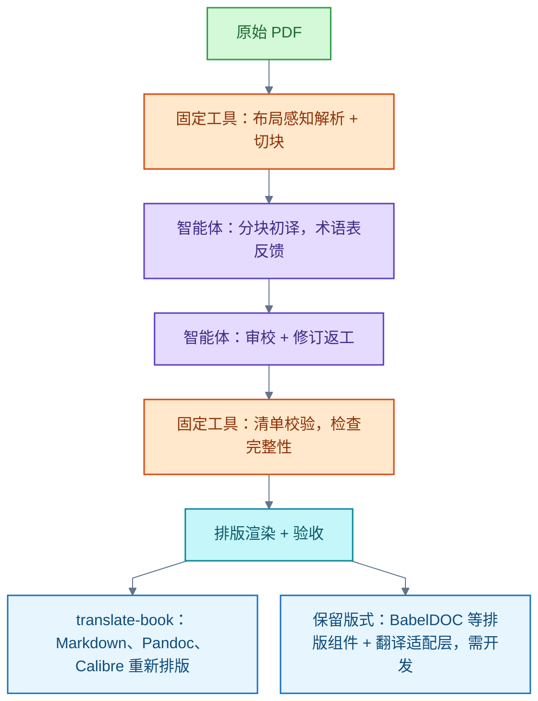

# 机器翻译

本领域收录翻译服务的接入与选型：翻译应用程序接口（Application Programming Interface，API）的免费额度与自托管、英译中服务的评测方法、便携式文档格式（Portable Document Format，PDF）翻译的智能体（Agent）自建流程。额度与条款随时间变动，接入时须重查；商业服务排名与整体流程质量均未核实。

## 免费翻译 API 与自托管引擎

免费额度、限期试用和本地推理属于三种不同的成本模式。历史额度、条款及超额计费在接入时必须重查。

云端免费额度的核实结论（截至 2026-09-27）：

- 国内优先核对百度翻译标准版或个人认证高级版（[百度翻译开通页](https://fanyi-api.baidu.com/access/0)，一手）。
- 国际服务可选 Azure Translator F0，或 Google Cloud Translation 神经机器翻译（Neural Machine Translation，NMT）的月度免费额度（[Azure Translator 定价](https://azure.microsoft.com/en-us/pricing/details/translator/)、[Google Cloud Translation 定价](https://cloud.google.com/products/translate/pricing)，一手）。
- DeepL API Developer 套餐为累计 100 万字符的试用（[DeepL API 套餐说明](https://support.deepl.com/hc/en-us/articles/360021200939-DeepL-API-plans)，一手）。
- 腾讯云旧机器翻译免费包 2026-10-01 起停止续发（[腾讯云下线公告](https://cloud.tencent.com/announce/detail/2448)，一手）。

自托管方案：真正自己部署免费翻译引擎时，可优先试 MTranServer。它无需显卡、提供表述性状态转移（Representational State Transfer，REST）接口，且被 Translate for Zotero 支持（[MTranServer 项目](https://github.com/xxnuo/MTranServer)、[接入代码](https://github.com/windingwind/zotero-pdf-translate/blob/main/src/modules/services/mtranserver.ts)，一手）。LibreTranslate 是另一套本地引擎，基于 Argos Translate（[官方文档](https://docs.libretranslate.com/)，一手）。两者免去第三方的按字符收费，但服务器、模型下载与维护仍有成本。若质量不足，可评估资源需求更高的 Hy-MT2-1.8B 模型（[模型卡](https://huggingface.co/tencent/Hy-MT2-1.8B)，一手）。

DeepLX 的定位：DeepLX 已更名 DLX。它依赖 DeepL 非公开接口，是非官方服务，不提供 DeepL 官方 API 额度；DeepL 免费服务条款禁止未经书面许可使用内部接口（[DLX 仓库](https://github.com/OwO-Network/DLX)、[DeepL 服务条款](https://www.deepl.com/en/terms-of-use)，一手）。因此该方案不能等同官方授权或免费额度。Zotero 翻译插件中的差异：DeepLX 服务直接请求非公开接口；DeepLX(API) 使用自定义地址。两者与 Zotero API 无关（[DeepLX 代码](https://github.com/windingwind/zotero-pdf-translate/blob/main/src/modules/services/deeplx.ts)、[DeepLX(API) 代码](https://github.com/windingwind/zotero-pdf-translate/blob/main/src/modules/services/deeplcustom.ts)，一手）。

## 英译中选型与评测条件

问题背景：截图中 BabelFast (Beta)、DeepSeek-V4.1、Qwen 3.5 Plus、Gemini 3 Flash、GPT-6 Luna、GLM-4.7、DeepL Pro、Claude Haiku 4.5、PLaMo 3.0 Prime、Grok 4.3 十款服务，哪款英译中最好。

结论：目前核实的资料不足以确定第一名。十款服务的完整排名仍未核实。

选型必须核对四项条件：

- 语言方向：英译中与中译英是不同任务，不能互推。
- 内容类型：评测覆盖的文本类型须与实际用途一致。
- 实际模型：服务名不等于模型。DeepL Pro 是订阅服务名（2018 年 3 月推出），不能用它确定底层模型的年份；官方 API 文档说明 DeepL 持续部署新模型、按请求与目标选择，但插件实际调用的模型仍未核实（[DeepL 发布商说明](https://www.deepl.com/zh/publisher)、[Understanding Model Types](https://developers.deepl.com/docs/translate/understanding-model-types)，一手）。
- 评测方法：同系列其他型号的成绩、综合能力榜、对旧型号的评测，均不足以给当前服务排序。

一处已修正的旧结论：此前曾据 DeepL 官方中英专家盲测建议"先试 DeepL Pro"。该发布页标注 2024-07-16，竞争型号为 ChatGPT-4 等旧型号，据此不能支持当前的推荐优先级，已于 2026-10-08 修正（[DeepL：新一代语言模型与专家盲测](https://www.deepl.com/en/blog/next-gen-language-model)，一手、厂商自报）。HardMTBench 提供中英双向专业领域评测，但未覆盖截图中的全部服务，型号也不能直接等同于截图服务（[原始论文](https://arxiv.org/html/2605.28315v1)，一手）。另按官方更新日志，沉浸式翻译于 2026-06-22 将 BabelFast 定位为实验性快速翻译服务（[更新日志](https://immersivetranslate.com/zh-Hans/docs/CHANGELOG/)，一手）。

可行的比较方法：用同一段原文，比较各服务的准确性、漏译与术语一致性。

## PDF 翻译：智能体自建流程

问题最终限定为：基于 Claude Code 等智能体与工具，自建 PDF 翻译流程。商业翻译服务不再作为最终推荐方向。

### 架构：智能体加固定工具

分工原则：智能体负责术语、翻译、审校与修订；固定工具负责解析、排版与完整性检查。

- 个人交互式任务：Claude Code 配合 translate-book 技能（Skill）。translate-book 是可运行于 Claude Code 等宿主的第三方技能，翻译由宿主智能体调度分块子智能体完成。
- 长期程序化批处理：官方 Claude Agent 软件开发工具包（Software Development Kit，SDK），Python 包为 claude-agent-sdk。它提供与 Claude Code 相同的智能体循环、工具、上下文管理、会话、子智能体、hooks 与 MCP 接入，支持 Python 与 TypeScript（[SDK 概览](https://code.claude.com/docs/en/agent-sdk/overview)、[Python SDK](https://github.com/anthropics/claude-agent-sdk-python)，一手）。

此流程是工程组合建议，尚未整体实测；通用最佳或最稳定的结论未核实。

### translate-book 与版式取舍

translate-book 提供分块、术语反馈、清单校验、断点续跑与选择性重译。但它的结果经 Markdown、Pandoc、Calibre 重新生成，不能承诺 PDF 原版式不变；公式和多栏密集 PDF 应先用布局感知解析器提取。其路线图仍保留整书实测质量验证（[translate-book](https://github.com/deusyu/translate-book)，一手）。

需要保留几何版式时，可把 PDFMathTranslate-next 或 BabelDOC 接为排版工具，并开发翻译适配层。注意 BabelDOC 的直接接口被官方标为内部接口，官方推荐经 pdf2zh_next 集成（[BabelDOC](https://github.com/funstory-ai/BabelDOC)、[pdf2zh_next API](https://github.com/PDFMathTranslate/PDFMathTranslate-next/blob/main/docs/en/advanced/API/python.md)，一手）。此路线同样未经整体实测。

### 其他智能体方案的核实边界

- Smartcat Chief of Staff：官方文档列出文档上传导出、译段读写、术语库、翻译记忆与质量工具，并协调 Translator、Reviewer 等协作者；审校能力受套餐限制。其 AI PDF 路线仅支持文字型 PDF，扫描件须另用 PdfImageOnly 路线并手工建项目。不能把不同路线的能力拼成一个已验证的全自动流程（[工具说明](https://help.smartcat.com/getting-started-chief-of-staff/)、[三种 PDF 工作流](https://help.smartcat.com/choosing-the-right-pdf-translation-workflow-in-smartcat/)，一手）。
- DeepTrans Studio：支持 PDF、术语、翻译记忆、多智能体与质量评价；2026-07-25 的 0.6.0 才开始正式可追溯版本管理，句法修订需要人工确认。不应据此宣称无人值守生产成熟（[仓库](https://github.com/hint-lab/deeptrans-studio)、[更新日志](https://github.com/hint-lab/deeptrans-studio/blob/main/CHANGELOG.md)，一手）。
- Andrew Ng translation-agent：初译、反思、改译三阶段演示；作者明确说明未成熟，评测有时优于、有时差于商业方案（[仓库](https://github.com/andrewyng/translation-agent)，一手）。

### 澄清前的传统方案盘点（对照保留）

以下为范围澄清前的原答事实，按公开功能给出选型建议，本次未核实通用第一名；作为最终方向已被 2026-10-15 的范围澄清修正，仅作对照保留。

- 普通 PDF 可先试 DeepL；DeepL PDF API 每文件至少计 50,000 字符（[PDF 翻译说明](https://support.deepl.com/hc/en-us/articles/4411308018450-Translate-PDF-files)、[用量与计费](https://support.deepl.com/hc/en-us/articles/360020685720-Usage-count-and-billing-in-DeepL-API)，一手）。
- 沉浸式翻译 PDF Pro 支持扫描件、公式识别和逐段双语，但多栏会重排为单栏（[PDF Pro](https://app.immersivetranslate.com/pdf-pro/)，一手）。
- Azure Document Translation：2026-03-01 正式版（General Availability，GA）的 Document Intelligence PDF 增强仅适用于批量接口；数学公式上下标仍有已知格式问题；FAQ 保留混合 PDF 只翻译数字文本的限制，新版批量接口是否已移除未明确（[概览](https://learn.microsoft.com/en-us/azure/ai-services/translator/document-translation/latest/overview)、[FAQ](https://learn.microsoft.com/en-us/azure/ai-services/translator/document-translation/faq)、[已知问题](https://learn.microsoft.com/en-us/azure/ai-services/translator/reference/known-issues)，一手）。
- Google：明确不翻译混合 PDF 中的扫描内容；Translation Advanced 的服务等级协议（Service Level Agreement，SLA）月可用性目标至少 99.9%，不代表译文质量（[文档翻译说明](https://docs.cloud.google.com/translate/docs/advanced/translate-documents?hl=en)、[SLA](https://cloud.google.com/translate/sla)，一手）。
- PDFMathTranslate 分支定位：原仓库将原版定位为 stable release、next 定位为开发分支；next 自称 BabelDOC 官方参考实现。两者描述角度不同，不能推出 next 更稳定（[原仓库](https://github.com/PDFMathTranslate/PDFMathTranslate)、[next 仓库](https://github.com/PDFMathTranslate/PDFMathTranslate-next)，一手）。
- PaddleOCR 的 PP-DocTranslation 已提供 PP-StructureV3 与大模型结合的翻译流程，可输出 Markdown，当前版本另支持 DOCX（[官方教程](https://github.com/PaddlePaddle/PaddleOCR/blob/main/docs/version3.x/pipeline_usage/PP-DocTranslation.en.md)，一手）。
- 组件边界：开源方案必须分清整份翻译、光学字符识别／解析与排版组件。Docling、MinerU 是解析组件；PyMuPDF 提供提取、渲染与写入能力，不能单独完成整份文档翻译（[Docling](https://github.com/docling-project/docling)、[MinerU](https://github.com/opendatalab/MinerU)、[PyMuPDF](https://pymupdf.readthedocs.io/en/latest/about.html)，一手）。
- 扫描件、混合 PDF、公式与复杂表格仍需抽检。
