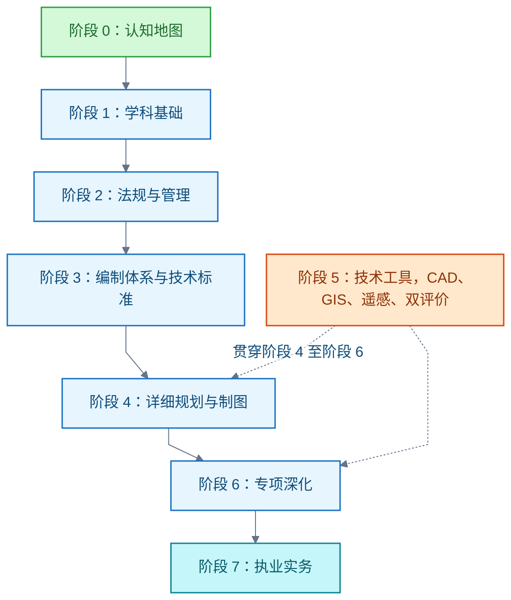

# 城乡规划

城乡规划领域的学习记录。主线：2019 年起主体功能区规划、土地利用规划、城乡规划融合为国土空间规划；学习以新体系为主线、旧原理为根基，从改革脉络推进到执业实务。边界：只收已核实结论，未核实处随文标注。

## 城乡规划的学习路线

**结论**：按阶段 0 至阶段 7 推进：认知地图 → 学科基础 → 法规与管理 → 编制体系与技术标准 → 详细规划与制图 → 技术工具 → 专项深化 → 执业实务。以国土空间规划新体系为主线，用《城市规划原理（第四版）》打原理底。执业目标对应注册城乡规划师四科考试。红线出图位于详细规划与制图阶段。

**推进顺序**（实线为推荐顺序；技术工具贯穿阶段 4 至阶段 6）：

**体系背景（阶段 0）**：2019 年《中共中央 国务院关于建立国土空间规划体系并监督实施的若干意见》（中发〔2019〕18号）将主体功能区规划、土地利用规划、城乡规划融合为国土空间规划，实现"多规合一"。体系概括为"五级三类四体系"：五级＝国家、省、市、县、乡镇；三类＝总体规划、详细规划、相关专项规划；四体系＝编制审批、实施监督、法规政策、技术标准。规划编制与监管由自然资源部主管（由 234 号、43 号文发文单位佐证；机构改革沿革未逐项核实）。学科与教材仍以城乡规划为名：城乡规划学是工学一级学科（0833）。现状入口是国土空间规划"一张图"信息平台（各级自然资源部门门户可见）。

**阶段 1 学科基础**：原理是主干，历史给脉络，支撑学科给解释力。

- 城市规划原理：《城市规划原理（第四版）》（吴志强、李德华，中国建筑工业出版社，2010，22 章），覆盖城市与城市化、规划思想发展、规划体制、各层次规划、专项与实施。
- 规划思想史：霍华德田园城市、雅典宪章、马丘比丘宪章等思想演进（原理书内含）。
- 中外城市建设史：线索为董鉴泓《中国城市建设史》、沈玉麟《外国城市建设史》（教材版本未核实）。
- 支撑学科：城市地理学、城市经济学、城市社会学、城市生态学，各选一本导论教材（版本未核实）。
- 制图基础：工程制图、投影原理、建筑识图（衔接阶段 4 红线出图）。

**阶段 2 法规与管理**：规划是法定行为，脱离法规读不懂流程。

- 城乡规划法：2008-01-01 施行、2019 修正；内容含规划区、规划制定、实施管理、监督检查。
- 一书三证：选址意见书（限划拨用地）、建设用地规划许可证、建设工程规划许可证、乡村建设规划许可证。
- 土地制度：土地管理法关联条款（未逐条核实）；土地所有权、用途管制、征收供地。
- 法规体系：国土空间规划法规政策体系（18 号文第四部分）、地方规划条例。
- 实施监督：规划条件、规划核实、动态监测（18 号文"实施监督体系"）。

**阶段 3 编制体系与技术标准**：新体系的核心，旧教材在此已过时。

- 三区三线：三区＝生态、农业、城镇空间（功能区）；三线＝生态保护红线、永久基本农田、城镇开发边界（底线、用途管制区）。三区范围大于等于三线。源自十九大"三条控制线"要求。
- 用地分类：《国土空间调查、规划、用途管制用地用海分类指南》（自然资发〔2023〕234号，取代 2020 试行版）。分类为三级；试行版为 24 一级、106 二级、39 三级。《城市用地分类与规划建设用地标准》（GB 50137-2011）现行状态未核实。
- 总体规划：市县国土空间总体规划编制；双评价＝资源环境承载能力与国土空间开发适宜性评价（编制指南系列文号未核实，以自然资源部官网为准）。
- 详细规划：自然资发〔2023〕43号把原控制性详细规划整合纳入国土空间详细规划；以国土调查、地籍调查、不动产登记等法定数据为基础。
- 专项规划：交通、市政、生态修复等专项规划服从总体规划。

**阶段 4 详细规划与制图（红线出图所在）**：从原理进入图纸。

- 详细规划编制：单元—地块两级；控制指标为用地性质、容积率、建筑密度、绿地率、建筑高度、配建设施。
- 规划红线：用地红线（地块权属与许可边界）、道路红线（道路用地边界）、建筑红线（退线控制）。具体退让距离依地方标准（未核实，须查当地技术规定）。
- 修建性详细规划：总平面、竖向、管线综合、日照分析（线索性内容）。
- 制图与图则：CAD（Computer-Aided Design，计算机辅助设计）制图规范、控规图则表达、报建图深度。
- 规划条件：以规划条件为核发建设工程规划许可证的依据（衔接阶段 2）。

**阶段 5 技术工具**：与阶段 4 至阶段 6 并行使用。

- CAD：AutoCAD 或国产替代；规划制图、红线标注、出图打印。
- GIS（Geographic Information System，地理信息系统）：ArcGIS 或 QGIS；空间分析、用地统计、一张图（有软件工程背景可较快切入）。
- 遥感与调查：遥感影像判读、国土调查成果使用。
- 数据方法：双评价技术流程、城市大数据与智慧规划、CIM（线索）。

**阶段 6 专项深化**：按目标选学，不设共同必修。分支：城市设计（城市形态、公共空间、设计导则）、交通规划（道路等级、交通影响评价、TOD（Transit-Oriented Development，公共交通导向开发）、线索）、市政基础设施（给排水、电力、通信、综合管廊；原理书内含基础）、更新与保护（城市更新、历史文化名城保护）、乡村振兴（村庄规划编制，市县以下详细规划的重要场景）、国土整治（国土综合整治与生态修复、全域土地综合整治，线索）。

**阶段 7 执业实务**：若目标是注册城乡规划师，四科与各阶段对应如下。

| 考试科目 | 对应阶段 |
| --- | --- |
| 城乡规划原理 | 阶段 1 |
| 城乡规划相关知识 | 阶段 1、5、6 |
| 城乡规划管理与法规 | 阶段 2、3 |
| 城乡规划实务 | 阶段 3、4、6 |

成绩 4 年为一个滚动周期；报名与大纲以中国人事考试网当年通知为准。有软件背景者可另走"规划信息化"路线：一张图平台、CIM、审批系统开发（线索，未核实岗位要求）。

**范围与限制**："完整"指学科主干与当前中国国土空间规划体系的主要分支，不是枚举全部研究专题。上列顺序为教学设计，不是官方统一学制。文中标"未核实"处（GB 50137-2011 现行状态、地方退让标准、中外建设史与支撑学科教材版本、土地管理法条款、双评价编制指南文号、规划信息化岗位要求）在学习该模块前须先核实现行版本。学习目标（执业考试、规划编制或规划信息化）尚未确认。

**信源**（核实日期 2026-10-08）：

- [一手] [中发〔2019〕18号《关于建立国土空间规划体系并监督实施的若干意见》全文（共产党员网）](https://www.12371.cn/2019/05/24/ARTI1558654423262365.shtml)：国土空间规划体系顶层设计。
- [一手] [研究生教育学科专业目录（2022年）· 0833 城乡规划学（中国研究生招生信息网）](https://yz.chsi.com.cn)：一级学科设置。
- [一手] [自然资发〔2023〕234号《国土空间调查、规划、用途管制用地用海分类指南》转发（湖南省人民政府）](http://www.hunan.gov.cn)：现行用地用海分类。
- [一手] [《中华人民共和国城乡规划法（2019 修正）》（国家法律法规数据库）](https://flk.npc.gov.cn)：现行法律文本。
- [一手] [注册城乡规划师职业资格考试（中国人事考试网）](https://www.cpta.com.cn)：考试通知与大纲。
