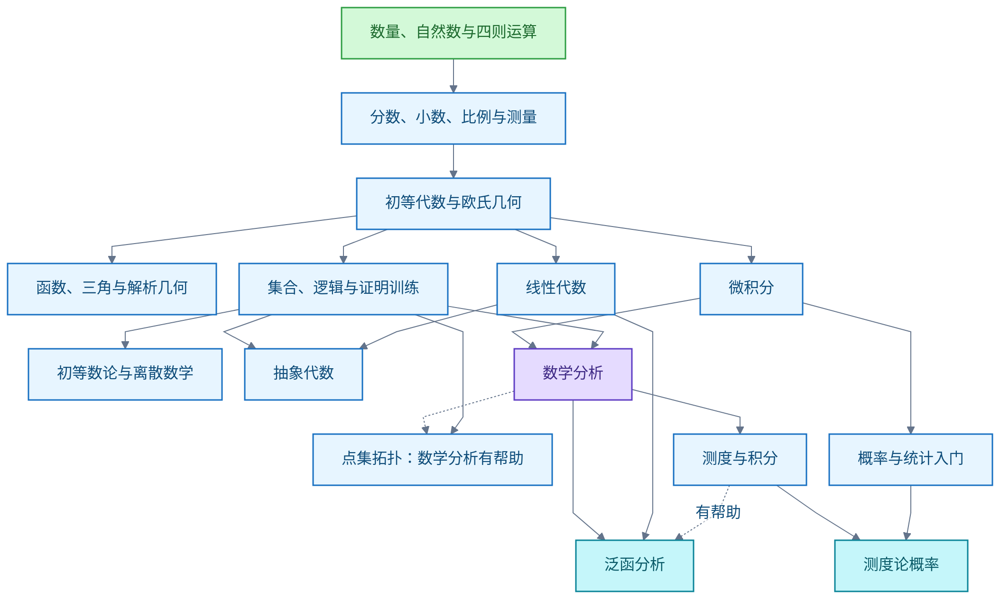

# 数学

数学学习记录。主线：从小学算术重学，先建数量、运算、函数与证明基础，再学大学共同基础，按先修关系选研究分支。进展以独立解题、证明、反例和外部审阅衡量。边界：考试范围须查当地方案与课程标准，不假定存在统一年度考试大纲。

## 从小学算术到数学研究的学习路线

**结论**：学习分三个能力层次——会计算、能证明、能研究。课程知识和研究能力分别验收；读完教材不等于具备原创研究能力。路线：先建数量、运算、函数和证明基础，再并行学分析、代数等大学课程，最后围绕一个方向补研究工具，进论文与原创问题。本科阶段应接触多个领域，不过早只学一个分支。

以下顺序、验收示例和训练安排是基于已核实课程资料的教学设计，不是某所大学规定的统一学制。"完整"指共同主干、主要分支及其连接；细分专题随研究问题继续扩展。

**主干顺序**。实线表示推荐先修；虚线表示有帮助的准备。线性代数与微积分可以并行；初等数论、组合及证明训练不必等微积分学完。

**第一段：从 1+1 到大学入门**，分六步。几何、测量和数据阅读从早期穿插，不必等算术全部结束。

| 阶段 | 按顺序掌握的知识点 | 代表性过关任务 |
| --- | --- | --- |
| 0．数量与自然数 | 一一对应与计数；0 与自然数；大小比较；十进位值；数轴；加减乘除；余数；四则顺序；交换、结合、分配律；估算 | 用实物、图和算式解释 1+1；解释进位、借位及 23÷5 的商和余数；用估算检查答案 |
| 1．分数、比例与测量 | 因数、倍数、质数；最大公因数与最小公倍数；分数的整体、商及数轴意义；约分、通分与四则；小数、百分数；比、比例、单位率；长度、面积、体积及单位换算；简单统计图 | 解释分数加法为什么通分；解释分数除法；区分增加 20% 与增加 20 个百分点；正确换算面积单位 |
| 2．初等代数 | 负数、有理数与实数；绝对值；字母、表达式、等式；一元一次方程；二元一次方程组；不等式；幂和根式；多项式与因式分解；分式；一元二次方程；应用题建模 | 把文字条件写成方程；推导求根公式；解释除以未知式、平方等变形的条件；代回检查增根 |
| 3．欧氏几何（Euclidean Geometry） | 点线面、角、平行与垂直；全等、相似；三角形、四边形、圆；勾股定理；面积体积；基本作图；定义、公理、命题与证明 | 不依赖量图，证明相似关系或简单几何命题；说明每一步所用的条件 |
| 4．函数与高中数学 | 函数（Function）的定义域、值域、图像、复合与反函数；多项式、有理、指数、对数函数；三角函数（Trigonometric Functions）、弧度、单位圆及恒等式；解析几何（Analytic Geometry）、向量、圆锥曲线；数列；排列组合与初等概率 | 在文字、图像、表格与公式之间转换；解释指数与对数的互逆关系；用单位圆解释正弦余弦；处理定义域限制 |
| 5．证明桥梁 | 集合（Set）、映射、关系；命题与量词；必要充分条件；直接证明、逆否证明、反证法；数学归纳法（Mathematical Induction）；构造与反例；等价关系；可数与不可数的初步认识 | 证明奇数平方仍是奇数、素数有无穷多个、√2 无理；正确否定带量词命题；为错误命题找反例 |

条件与例外：

- 阶段 2 与 3 可以交叉；阶段 5 可在阶段 2 后逐步引入，不必等全部高中内容完成。
- 义务教育内容还包括图形与几何、统计与概率及综合实践，不能只补运算。
- 初学 1+1 时先理解数量与运算；自然数公理化的严格构造留到数学基础方向。

**第二段：建立大学共同基础**。分 A、B、C 三个推荐批次。批次不是必须整批完成的学年；满足单门课先修后即可推进。B 中多门可以并行；C 中课程按方向调整深度。对从零重学的成人，建议先用微积分建立直觉，再以证明为中心重学分析；也可以选一套从头强调证明的数学分析教材，把两部分结合。

| 批次 | 课程 | 主要先修 | 必学知识点 |
| --- | --- | --- | --- |
| A | 微积分（Calculus） | 函数、三角与代数运算 | 极限与连续；导数、链式法则、极值、Taylor 展开；定积分与微积分基本定理；级数；多元偏导、全微分、梯度、重积分、曲线与曲面积分 |
| A | 线性代数（Linear Algebra） | 方程组、向量；证明可同步补 | 消元、矩阵；向量空间、子空间、线性相关、基、维数；线性映射、核与像；行列式；特征值、对角化；内积、正交、投影、最小二乘；谱定理入门 |
| A | 离散数学（Discrete Mathematics）与初等数论（Elementary Number Theory） | 初等代数、证明基础 | 计数、递推、容斥、抽屉原理；图、路径、树；整除、Euclid 算法、同余、模逆、中国剩余定理 |
| B | 数学分析（Mathematical Analysis） | 证明基础；微积分直觉 | 实数完备性、上确界；严格极限；数列、级数与函数列；连续、一致连续；微分中值定理；Riemann 积分；一致收敛；度量空间初步 |
| B | 抽象代数（Abstract Algebra） | 证明、线性代数基础 | 群、子群、正规子群、商群、群作用；环、理想、商环；同态与同构；多项式；域扩张、有限域；Galois 理论入门 |
| B | 概率论（Probability Theory）与数理统计（Mathematical Statistics）入门 | 初等计数；连续部分需微积分；回归需线性代数 | 条件概率、独立性、Bayes 公式；随机变量、分布、期望、方差；联合分布；大数定律与中心极限定理；估计、置信区间、假设检验、回归 |
| B | 常微分方程（Ordinary Differential Equations，ODE） | 一元微积分；方程组需线性代数 | 一阶方程、线性方程组、存在唯一性、相图、平衡点与稳定性 |
| C | 复分析（Complex Analysis） | 数学分析、复数、多元微积分 | 全纯函数、Cauchy 理论、幂级数、解析延拓入门、留数、共形映射 |
| C | 点集拓扑（Point-set Topology） | 集合与证明；度量空间经验有帮助 | 开闭集、连续、拓扑空间；紧致、连通、分离性；子空间、积空间、商空间 |
| C | 测度与积分（Measure Theory and Integration） | 数学分析、集合与度量空间基础 | σ-代数、测度、可测函数、Lebesgue 积分；几乎处处；收敛定理；乘积测度、Fubini 定理；Lp 空间 |
| C | 泛函分析（Functional Analysis）入门 | 数学分析、线性代数；测度按所选课程补 | 赋范空间、Banach 空间、Hilbert 空间；有界线性算子、对偶；Hahn–Banach 定理、开映射定理、谱理论入门 |

代表性过关任务：

- 微积分：从变化率理解导数，从累积量理解积分；求解简单最优化与面积问题，并说明条件。
- 线性代数：同时用方程、几何和映射解释 Ax=b；说明解的存在性与唯一性；完成秩与维数相关证明。
- 离散数学与初等数论：独立完成归纳与计数证明；解释 Euclid 算法为什么终止且正确；求解简单同余方程。
- 数学分析：用定义证明极限；指出交换极限、积分或微分所需条件；构造缺少条件时的反例。
- 抽象代数：对整数模 n、置换及矩阵给出具体结构；证明基本同构结论；解释商结构为何定义良好。
- 概率与统计：从模型计算概率与期望；区分独立和不相关；解释估计、检验的假设及不确定性。
- 常微分方程：建立增长或振动模型；既分析解的形式，也分析长期行为。
- 复分析：用复积分解决实积分问题；解释复可微条件带来的结构。
- 点集拓扑：用定义证明连续；区分闭、有界、紧致及其适用空间；判断具体空间的性质。
- 测度与积分：判断何时可以交换极限与积分；使用收敛定理时逐条检查条件。
- 泛函分析：把有限维线性代数的问题转成函数空间的问题；说明无限维新增的困难。

课程名的条件与例外：

- 中文"实变函数"通常进入测度与积分层次；英文入门 Real Analysis 课程也可能主要讲严格的一元分析，应按目录判断。
- 概率入门不需要先完成测度；测度论概率则需要测度基础。
- 离散方向不必把全部连续数学课程作为研究起步门槛；算法主题可按需补足先修，不必等整条路线完成。

**第三段：选择研究分支**。下表是主要方向及代表性入口，不是要求把所有课程学完；"研究主题"列也不是"终极课程"。同一方向包含很多难度和规模不同的问题。

| 方向 | 建议入口路径 | 可走向的研究主题 |
| --- | --- | --- |
| 分析与偏微分方程（Partial Differential Equations，PDE） | 数学分析 > 测度、泛函分析 > Fourier 分析、分布、Sobolev 空间 > 椭圆、抛物、双曲方程；弱解、存在唯一性、正则性 | 非线性 PDE、流体方程、调和分析、几何分析 |
| 代数与表示论（Representation Theory） | 抽象代数 > 模、张量积、群表示与特征标 > 李群与李代数、同调代数 | 表示的分类、几何表示论、与数论的联系 |
| 数论（Number Theory） | 初等数论后分两路：代数路走 Galois 理论、数域、局部域；分析路走复分析、解析数论、ζ 与 L 函数；再按问题学椭圆曲线、模形式 | 算术几何、Langlands 纲领、素数分布、丢番图问题 |
| 代数几何（Algebraic Geometry） | 抽象代数与点集拓扑 > 交换代数、仿射与射影簇 > 层、概形、上同调；按专题补复几何、同调代数 | 模空间、双有理几何、算术几何、Hodge 理论 |
| 微分几何（Differential Geometry） | 多元分析、线性代数、点集拓扑 > 曲线曲面、光滑流形、切空间、微分形式 > 度量、联络、曲率、测地线 | Riemann 几何、几何分析、辛几何；几何分析需深化 PDE |
| 代数拓扑（Algebraic Topology）与几何拓扑 | 点集拓扑与抽象代数 > 基本群、覆盖空间、同调、上同调 > 同伦；几何拓扑另补流形与微分拓扑 | 同伦论、低维拓扑、结与流形、不变量 |
| 现代概率与随机过程（Stochastic Processes） | 初等概率与测度 > 测度论概率、条件期望、鞅、Markov 过程、Brown 运动 > 随机积分与随机微分方程 | 随机分析、渗流、相变、随机几何 |
| 统计与统计学习（Statistical Learning） | 概率、统计、线性代数 > 渐近理论、似然、Bayes 方法、回归、决策理论 > 补优化与高维概率 | 高维推断、因果推断、稳健统计、学习理论 |
| 组合数学（Combinatorics）与图论（Graph Theory） | 离散数学 > 生成函数、匹配、着色、极值、Ramsey 理论；概率法补概率，代数组合补代数 | 极值组合、随机图、加性组合、离散结构 |
| 数理逻辑（Mathematical Logic）与数学基础（Foundations of Mathematics） | 证明语言 > 一阶逻辑、语法与语义、完备性与紧致性 > 集合论、模型论、可计算性或证明论 | 独立性、模型结构、可判定性、形式化数学 |
| 计算理论（Theory of Computation） | 离散数学与证明 > 自动机、形式语言、可计算性、归约、时间与空间复杂性；按方向补概率、代数 | 算法下界、复杂性、随机计算；P 与 NP 是代表性问题 |
| 数值分析（Numerical Analysis）与优化（Optimization） | 微积分、线性代数、分析 > 浮点误差、条件数、稳定性、收敛；插值、积分与方程数值解；凸集、凸函数、对偶与优化算法 | 科学计算、逆问题、大规模优化、计算数学 |
| 动力系统（Dynamical Systems） | ODE、线性代数、分析 > 稳定性、分岔、混沌；按方向补测度、遍历理论、拓扑 | 长期行为、非线性动力学、遍历理论及应用 |
| 数学物理（Mathematical Physics） | 分析、ODE/PDE 并补经典力学、量子力学等物理基础 > 谱理论、变分法、微分几何、统计力学等工具 | 量子场论的数学结构、相变、规范理论、广义相对论相关问题 |

**领域之间的连接**，通过它们解决的问题理解：

| 连接 | 为什么需要结合 |
| --- | --- |
| 代数 ↔ 几何 | 用方程描述图形，用坐标和变换研究空间；代数几何研究多项式方程解集 |
| 线性代数 ↔ 分析 | 多元微分的局部近似是线性映射；泛函分析把线性结构与极限放进函数空间 |
| 分析 ↔ 概率 | 连续分布的期望使用积分；测度与积分提供处理一般随机变量及收敛的共同框架 |
| 代数 ↔ 拓扑 | 基本群、同调等代数对象记录空间性质，使空间问题获得可计算的不变量 |
| 几何 ↔ PDE | 曲率及几何演化产生微分方程；方程的估计反过来帮助理解空间 |
| 数论 ↔ 分析、代数、几何 | 研究整数时分别使用复函数、域扩张和代数曲线等工具；数论并非只研究四则运算 |
| 组合 ↔ 概率、代数 | 概率法研究结构的存在与典型性质；代数工具组织对称性和计数 |

Langlands 纲领连接数论与表示论；镜像对称联系辛几何与代数几何；几何分析把 PDE 用于几何问题。这些是研究网络的实例，没有统一的高低排名。

两点定位：

- 范畴论（Category Theory）研究对象与映射的共同结构；适合在已有代数、拓扑等具体例子后按需学习，不作为开始学数学的前置门槛。
- 承接已有密码学路线：可走"证明与离散数学 > 初等数论、线性代数、概率 > 抽象代数、有限域、复杂性 > 椭圆曲线、格或编码等专题"。先修取决于研究对象；不用先学完整套代数几何才接触椭圆曲线密码。

**第四段：从课程进入研究**，学习方式改变。按下列成果推进：

1. 完成方向核心课程：能独立证明代表性定理，并解释关键假设。
2. 参加读书讨论或寻求指导：讲清一章教材、一个证明及其依赖；按反馈修正。
3. 精读一篇范围较窄的论文：补齐省略步骤，复现例子；区分作者已证结论与猜想。
4. 形成一个小问题：改变假设、研究特殊情形、寻找反例、改进界或算法；先核对已有文献。
5. 完成可审查成果：写清问题、已有工作、新贡献、证明和限制，接受本领域研究者检查。

以数学研究为职业时，把数学专业本科核心训练和研究生培养作为现实参照；自学路线不自动等同于学位或岗位资格。Riemann 假设、Hodge 猜想、Navier–Stokes 问题、P 与 NP 等千禧年问题可用于了解方向，不适合用作刚开始研究时的日常学习清单。

**执行与验收**：

- 每阶段只选一本主教材或一门主课。中文基础按人教版小学 > 初中 > 高中顺序学习；OpenStax 用于补充解释和自测，不要求重复学两套。大学阶段逐渐增加英文术语与原文阅读。
- 首月安排是教学建议，不要求四周内完成小学数学；某周不能解释算法含义并独立解题，就继续该周主题。

| 周次 | 学习任务 | 本周可检查的产物 |
| --- | --- | --- |
| 第 1 周 | 数量、0、位值、数轴、加减、进位借位 | 用实物、图、算式三种方式讲清同一个加减问题；解释算法每一步 |
| 第 2 周 | 乘除、分配律、余数、运算顺序、估算 | 用等量分组解释乘除；用乘法验算除法；建立合理结果范围 |
| 第 3 周 | 因数、倍数、质数；分数的意义与等值分数 | 在数轴标出分数；用图解释约分、通分；解释同一个整体的重要性 |
| 第 4 周 | 根据第 3 周结果练分数加减，再逐步进入乘除、小数和比例 | 独立解决几道未见过的分数应用题；指出错误解法的问题；不通过则继续巩固 |

- 若每天可投入 60 分钟，可试行"10 分钟复习、15 分钟新内容、25 分钟独立练习、10 分钟解释与改错"。时间未确认，不能据此推算总学制。
- 每阶段检查四件事：能算、能解释、能处理新题、能说明条件；从证明阶段起增加完整书面证明与反例。
- 答案核对之后，隔几天独立重做。数值实验支持发现规律，不能自动替代一般性证明。
- 待解：每周可持续时间及后续研究方向。

**信源**：

- [一手] [教育部义务教育课程标准发布页](https://www.moe.gov.cn/srcsite/A26/s8001/202204/t20220420_619921.html)、[人教社教材入口](https://www.pep.com.cn/products/jc/)
- [一手] [OpenStax Prealgebra](https://openstax.org/books/prealgebra-2e/pages/preface)、[Elementary Algebra](https://openstax.org/books/elementary-algebra-2e/pages/preface)、[Algebra and Trigonometry](https://openstax.org/books/algebra-and-trigonometry-2e/pages/preface)、[Book of Proof（作者提供免费 PDF）](https://richardhammack.github.io/BookOfProof/)
- [一手] [MIT 数学专业路线](https://math.mit.edu/academics/undergrad/roadmaps.php)；MIT OCW [18.01SC 一元微积分](https://ocw.mit.edu/courses/18-01sc-single-variable-calculus-fall-2010/)、[18.02SC 多元微积分](https://ocw.mit.edu/courses/18-02sc-multivariable-calculus-fall-2010/)、[18.06SC 线性代数](https://ocw.mit.edu/courses/18-06sc-linear-algebra-fall-2011/)、[18.100A 分析入门](https://ocw.mit.edu/courses/18-100a-real-analysis-fall-2020/)、[18.703 现代代数](https://ocw.mit.edu/courses/18-703-modern-algebra-spring-2013/)、[18.901 拓扑入门](https://ocw.mit.edu/courses/18-901-introduction-to-topology-fall-2004/)、[18.404J 计算理论](https://ocw.mit.edu/courses/18-404j-theory-of-computation-fall-2020/)、[MIT 应用数学课程说明](https://math.mit.edu/academics/undergrad/subjects/183x.php)、[MIT 数论研究介绍](https://math.mit.edu/research/pure/number-theory.php)、[MIT 几何与拓扑研究介绍](https://math.mit.edu/research/pure/geometry.php)
- [一手] [剑桥 Part III 准备要求与自测](https://www.maths.cam.ac.uk/postgrad/part-iii/node/85)、[2026–2027 课程指南](https://www.maths.cam.ac.uk/postgrad/part-iii/part-iii-guide-courses)；剑桥各方向准备页：[分析与 PDE](https://www.maths.cam.ac.uk/postgrad/part-iii/prospective/preparation/resources/analysis)、[统计](https://www.maths.cam.ac.uk/postgrad/part-iii/prospective/preparation/resources/statistics)、[代数](https://www.maths.cam.ac.uk/postgrad/part-iii/prospective/preparation/resources/algebra)、[几何与拓扑](https://www.maths.cam.ac.uk/postgrad/part-iii/prospective/preparation/resources/differential-geometry-and-topology)、[代数几何](https://www.maths.cam.ac.uk/postgrad/part-iii/node/56)、[数论](https://www.maths.cam.ac.uk/postgrad/part-iii/prospective/preparation/resources/number-theory-0)、[逻辑与基础](https://www.maths.cam.ac.uk/postgrad/part-iii/prospective/preparation/resources/foundations)、[理论物理](https://www.maths.cam.ac.uk/postgrad/part-iii/prospective/preparation/resources/particle-physics)、[概率课程](https://www.maths.cam.ac.uk/postgrad/part-iii/probability-and-finance-courses)、[组合课程](https://www.maths.cam.ac.uk/postgrad/part-iii/combinatorics-courses)、[应用与计算分析](https://www.maths.cam.ac.uk/postgrad/part-iii/applied-and-computational-analysis-courses)。数论准备页部分课程说明标注 2024–2025，本路线只引用稳定的先修知识，不把它当作本年度排课表
- [一手] [Stanford 辛几何与拓扑](https://mathematics.stanford.edu/research/symplectic-geometry-topology)、[Stanford 数学博士培养说明](https://mathematics.stanford.edu/academics/graduate-students/phd-program)、[Boyd 与 Vandenberghe 凸优化作者页](https://web.stanford.edu/~boyd/cvxbook/)、[Clay 千禧年问题](https://www.claymath.org/millennium-problems/)

## 苏州中考与江苏高考数学考试范围

**结论**：全国公开统一的是数学课程标准；苏州中考与江苏高考之间没有一份共同的年度数学考试大纲。

- 教育部要求取消中考考试大纲或考试说明。苏州 2026 年中考数学依据义务教育课程标准七至九年级要求和本届所学内容。
- 实施普通高中新课程的省份不再制定高考考试大纲。江苏高考数学按《普通高中数学课程标准（2017 年版 2020 年修订）》命题；苏州没有单独的高考数学大纲。

**信源**：

- [一手] [教育部 2022 年中考命题通知](https://hudong.moe.gov.cn/srcsite/A06/s3321/202204/t20220406_614237.html)
- [一手] [苏州市 2026 年初中学业水平考试方案](https://www.suzhou.gov.cn/szsrmzf/bmwj/202604/b75cb721b3b84ef1a44cde0f060b5e3f.shtml)
- [一手] [义务教育数学课程标准（2022 年版）PDF](https://www.moe.gov.cn/srcsite/A26/s8001/202204/W020220510531636118932.pdf)
- [一手] [国务院办公厅关于新时代推进普通高中育人方式改革的指导意见](https://www.moe.gov.cn/jyb_xxgk/moe_1777/moe_1778/201906/t20190619_386539.html)
- [一手] [普通高中数学课程标准（2017 年版 2020 年修订）PDF](https://jyj.changdu.gov.cn/cdsjyj/c101476/202205/764ee1914e3c45aaba8e372f1b628a34/files/75676dfa9af0442db1457404a884a69f.pdf)
- [一手] [江苏省 2026 年普通高校招生通知](https://jyt.jiangsu.gov.cn/art/2026/4/21/art_58320_11767036.html)、[江苏省 2025 年普通高校招生工作意见 PDF（2026 年沿用有关要求）](https://www.jseea.cn/webfile/upload/2025/03-28/21-01-380982-1996828970.pdf)

## 按学习阶段选数学视频

**结论**：推荐按当前从小学算术重学的阶段匹配频道，是按内容与阶段作的主观匹配，不是质量排名。

- 起步：先用 Math Antics 补数感、算术和分数；再用 Khan Academy 的分级课程与练习做系统主线。
- 代数基础建立后：用 3Blue1Brown 补微积分与线性代数直觉；Professor Leonard 看完整课堂；Michael Penn 学证明写作；The Bright Side of Mathematics 学较严格的大学数学。
- 李永乐老师的中文视频可作数学兴趣补充。

**限制**：兴趣讲解不代替系统训练；视频按当前阶段选择连续课程与习题。

**信源**：

- [一手] [Math Antics 课程目录](https://mathantics.com/)、[Khan Academy 数学课程](https://www.khanacademy.org/mission/math/)
- [一手] [3Blue1Brown 课程目录](https://www.3blue1brown.com/)、[Professor Leonard 微积分课堂](https://www.youtube.com/watch?v=P0ziKHQIsyk)、[Michael Penn 证明写作课程](https://www.youtube.com/watch?v=nGEUOLCYbng)、[The Bright Side of Mathematics 课程目录](https://thebrightsideofmathematics.com/topics/)
- [一手] [李永乐老师频道](https://www.youtube.com/channel/UCSs4A6HYKmHA2MG_0z-F0xw)
