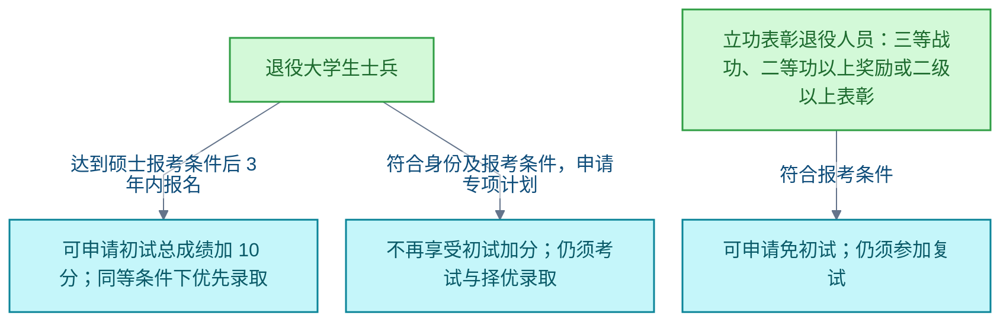

# 研究生考试

<!-- domain: 研究生考试 -->
**范围**：全国硕士研究生招生考试的科目、大纲版本、官方资料出处及退役大学生士兵报考优待。

**综述**：研究生招生考试的科目范围、细目与报考优待必须按对应招生年度核实。2027 年 408 的正式出版物是教育部教育考试院编写、高等教育出版社出版的《2027年全国硕士研究生招生考试计算机学科专业基础考试大纲》，出版时间为 2026 年 9 月，书号为 978-7-04-068451-3；此前已核实出版社书目，但其详情与目录栏目均显示“暂无”，尚未取得可核实的 2027 年版一手正文，不能据二手转录认定具体分值、考点或相对上一年的变动。2027 年招生规定另明确：退役大学生士兵达到硕士报考条件后 3 年内报名，可申请初试总成绩加 10 分；报考退役大学生士兵专项计划须符合身份与报考条件，不再享受初试加分，专项仍须择优录取；达到规定立功表彰条件的退役人员可以申请免初试，但仍须通过复试。
<!-- /domain -->

研究生招生考试的政策核实记录。主线：考试大纲以官方出版物为准，报考优待按招生年度规定核实。边界：未取得一手正文时不认定具体分值与考点，不以二手转录替代。

## 2027 年 408 考试大纲的官方出处

**结论**：全国硕士研究生计算机学科专业基础综合（408）考试 2027 年版大纲（用于 2026 年底初试）的正式版本为：教育部教育考试院编写、高等教育出版社 2026 年 9 月出版的《2027年全国硕士研究生招生考试计算机学科专业基础考试大纲》，书号 978-7-04-068451-3，共 96 页。

**限制**：本次核实只确认了出版社书目；书目详情与目录栏目均显示"暂无"，尚未取得可核实的 2027 年版一手正文。因此 2027 年的具体分值、考点以及相对上一年的变动均未核实，不以往年大纲或二手转录替代认定。

**信源**：

- [一手] [高等教育出版社：2027年全国硕士研究生招生考试计算机学科专业基础考试大纲](https://xuanshu.hep.com.cn/front/book/findBookDetails?bookId=6aa97a0be119ac9729dd09ea)
- [一手] [高等教育出版社官网书目](https://www.hep.com.cn/book/show/2099763850751057921)

### 证据与时效 · q-20261016-002

- **信源**：[一手] [高等教育出版社：2027年全国硕士研究生招生考试计算机学科专业基础考试大纲](https://xuanshu.hep.com.cn/front/book/findBookDetails?bookId=6aa97a0be119ac9729dd09ea)；[一手] [高等教育出版社官网书目](https://www.hep.com.cn/book/show/2099763850751057921)

## 退役大学生士兵考研优待的适用条件

**结论**：依据教育部《2027 年全国硕士研究生招生工作管理规定》（第二十二条至第二十六条、第四十九条），退役大学生士兵的升学优待分三条路径，条件与限制各不相同：

**条件与限制**：

- 加分路径以"达到硕士报考条件后 3 年内报名"为前提；申请初试总成绩加 10 分，同等条件下优先录取。
- 专项计划路径须符合退役大学生士兵身份及报考条件；专项计划不再享受初试加分，录取仍须考试与选拔。
- 免初试路径限于服役期间获得三等战功、二等功以上奖励或二级以上表彰的退役人员；免初试后仍须通过复试。
- 三条路径的资格均须按规定申报并接受审核。

**信源**：

- [一手] [教育部：2027 年全国硕士研究生招生工作管理规定（第二十二条至第二十六条、第四十九条）](https://www.moe.gov.cn/srcsite/A15/moe_778/s3261/202609/t20260923_1451734.html)
- [一手] [北京市退役军人事务局转载教育部规定](https://tyjrswj.beijing.gov.cn/fwzl/jycy/202610/t20261020_4911367.html)

### 证据与时效 · q-20261026-003

- **信源**：[一手] [教育部：2027 年全国硕士研究生招生工作管理规定（第二十二条至第二十六条、第四十九条）](https://www.moe.gov.cn/srcsite/A15/moe_778/s3261/202609/t20260923_1451734.html)；[一手] [北京市退役军人事务局转载教育部规定](https://tyjrswj.beijing.gov.cn/fwzl/jycy/202610/t20261020_4911367.html)

## 提问记录

### q-20261016-002

- **原题**：2026-10-16 · 2027年408考试大纲的官方出处
- **问**：全国硕士研究生计算机学科专业基础综合（408）考试，考试大纲；确认需要 2027 年版（2026 年底初试）。
- **领域**：研究生考试
- **首次**：2026-10-16
- **更新**：2026-10-16
- **正文**：[2027 年 408 考试大纲的官方出处](#2027-年-408-考试大纲的官方出处)

### q-20261026-003

- **原题**：2026-10-26 · 退役大学生士兵考研优待的适用条件
- **问**：参军对升学有什么实际好处，退役大学生士兵考研有哪些条件限制？（关联条目）
- **领域**：研究生考试
- **首次**：2026-10-26
- **更新**：2026-10-26
- **正文**：[退役大学生士兵考研优待的适用条件](#退役大学生士兵考研优待的适用条件)
- **关联**：[2026-10-26 · 在中国当兵的个人好处及制度规则与取舍](../社会与财经/兵役与退役保障.md#q-20261026-011)
