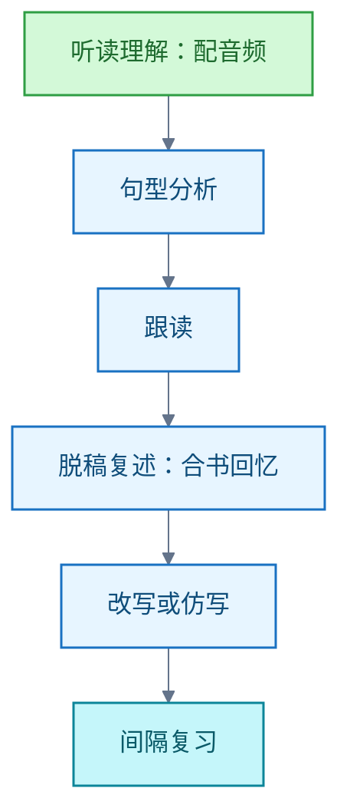

# 英语学习

英语自学方法记录。主线：以《新概念英语》（New Concept English）经典四册精学，同时安排可理解的听读、语言知识学习、口头与书面表达及复习。边界：起点选择与进度是学习安排建议，不是能力等级换算；个人计划待确认水平与目标后制定。

## 新概念英语的自学路径与资源选择

**结论**：把经典四册作为精学主线，按实际听读与表达能力选起点；每课走「理解—跟读—复述—仿写—复习」流程，并配合课外听读；资源优先外研社正版配套，再按缺口补充。

**四册定位**（学习安排建议，不是考试成绩或能力等级换算）：

- 第 1 册：练基本句型与问答。
- 第 2 册：练叙事和句型运用。
- 第 3 册：练篇章与较复杂表达。
- 第 4 册：按阅读写作目标选学。

**起点怎么选**：按实际听读与表达能力选起始册数，不能只按已学年限判断。

**每课流程**：

课外同时安排适合难度的听读材料。

**取舍**：起点按能力判断，不按已学年限判断；主线精学四册，课外听读只选适合难度的材料作为补充。

**间隔复习的依据与边界**：外语词汇的原始实验支持重复提取（Retrieval）对延后记忆的作用；把该原则用于课文复习属于教学应用。具体间隔与每周进度是执行建议，实验未直接给出。

**资源**：

- 主线：外研社正版教材及配套音频、要点视频、自学导读与练习详解。
- 按缺口补充：British Council 分级听力、Cambridge Dictionary（英美发音与音标）、Cambridge Grammar in Use 系列语法练习。

**待确认**：学习者当前水平、主要目标与每天可用时间；确认后再制定个人进度。

**信源**：

- [一手] [外研社：新概念英语智慧版2及数字功能](https://www.fltrp.com/c/2022-10-20/514397.shtml)
- [一手] [外研社：智慧版1的内容与单、双课安排](https://www.fltrp.com/c/2022-10-20/514394.shtml)
- [一手] [外研社2023年目录：四册、自学导读与练习详解](https://www.fltrp.com/ebook/jcjyyjzx/2023_jcjyjxzy/files/basic-html/page186.html)
- [一手] [Karpicke 与 Roediger，2008：The Critical Importance of Retrieval for Learning](https://learninglab.psych.purdue.edu/downloads/2008/2008_Karpicke_Roediger_Science.pdf)
- [一手] [British Council：分级听力自学材料](https://learnenglish.britishcouncil.org/free-resources/listening)
- [一手] [Cambridge Dictionary：英美发音与音标](https://dictionary.cambridge.org/pronunciation/)
- [一手] [Cambridge：Essential Grammar in Use with Answers](https://shop.cambridge.org/english/product/2700140114)
- [一手] [Cambridge：Grammar in Use 系列及适用等级](https://www.cambridge.org/gb/search?iFeelLucky=false&page=1&query=grammar+in+use&site=CE&tab=related)
