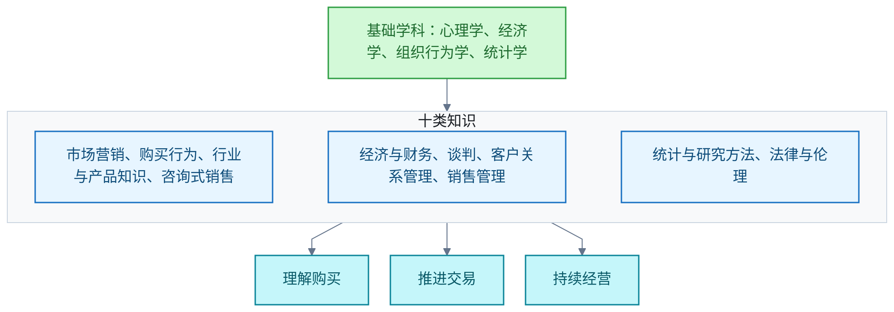

# 销售学

销售作为研究对象的记录。主线：围绕理解购买、推进交易与经营客户关系，整合多学科知识的应用性交叉体系。边界：分类依据高校课程与研究主题综合归纳，不是统一的官方学科目录。

## 销售作为科学的知识构成

**结论**：把销售作为一门科学，可综合归纳为十类知识：市场营销、购买行为、行业与产品知识、咨询式销售、经济与财务、谈判、客户关系管理、销售管理、统计与研究方法、法律与伦理。十类知识分别服务于三条主线：理解购买、推进交易、持续经营。

领域综述把体系分两层。基础学科包括心理学、经济学、组织行为学与统计学；应用知识包括市场营销、消费者与组织购买行为、行业与产品知识、咨询式销售、财务与定价、谈判、客户关系管理、销售管理以及法律与商业伦理。条目把「经济与财务」「统计与研究方法」列入十类知识，综述把经济学与统计学归入基础学科；两处是归纳粒度不同，内容不冲突。

**科学性的含义**。按科学方法研究销售，需要：

- 提出可检验的解释；
- 统一指标；
- 比较不同方法的结果；
- 识别客户、行业和交易条件对结论的限制。

单次成交不能证明某种方法具有普遍效果。销售激励可以通过实际业务干预接受检验，但单一企业的结果不推广到全部销售场景。

**限制**。上述分类是根据高校课程与研究主题作出的综合归纳，不是统一的官方学科目录。

**待解问题**。不同销售场景中，各领域的重要程度与知识深度如何变化。

**信源**：

- [一手] [Kelley：Professional Sales Co-Major，2025—2026 学年课程](https://bulletin.kelley.iu.edu/Undergrad/Plan/Detail?planCode=PRFSALEBSB&year=2025-2026)
- [一手] [休斯敦大学：Sales Leadership 课程说明](https://www.bauer.uh.edu/ms-sales-leadership/documents/MS-Sales-Leadership-at-UH-Bauer-College.pdf)
- [一手] [OpenStax：Steps in the Personal Selling Process](https://openstax.org/books/principles-marketing/pages/15-3-steps-in-the-personal-selling-process)
- [一手] [OpenStax：The Promotion Mix and Its Elements](https://openstax.org/books/principles-marketing/pages/13-1-the-promotion-mix-and-its-elements)
- [一手] [MIT：Negotiation and Conflict Management，Study Materials](https://ocw.mit.edu/courses/15-667-negotiation-and-conflict-management-spring-2001/pages/study-materials/)
- [一手] [OpenStax：Ethical Issues in Personal Selling and Sales Promotion](https://openstax.org/books/principles-marketing/pages/15-7-ethical-issues-in-personal-selling-and-sales-promotion)
- [一手] [Rao 等，2021：Do Activity-Based Incentive Plans Work? 原研究作者所在机构的论文摘要](https://www.isb.edu/faculty-and-research/research-directory/do-activity-based-incentive-plans-work-evidence-from-a-large-scale-field-intervention)

课程资料用于核实知识覆盖范围；Rao 原研究用于说明销售激励可接受实际业务干预的检验。
