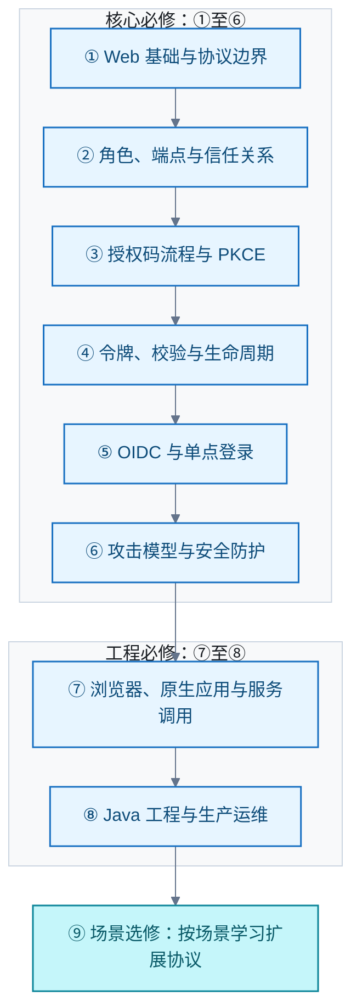
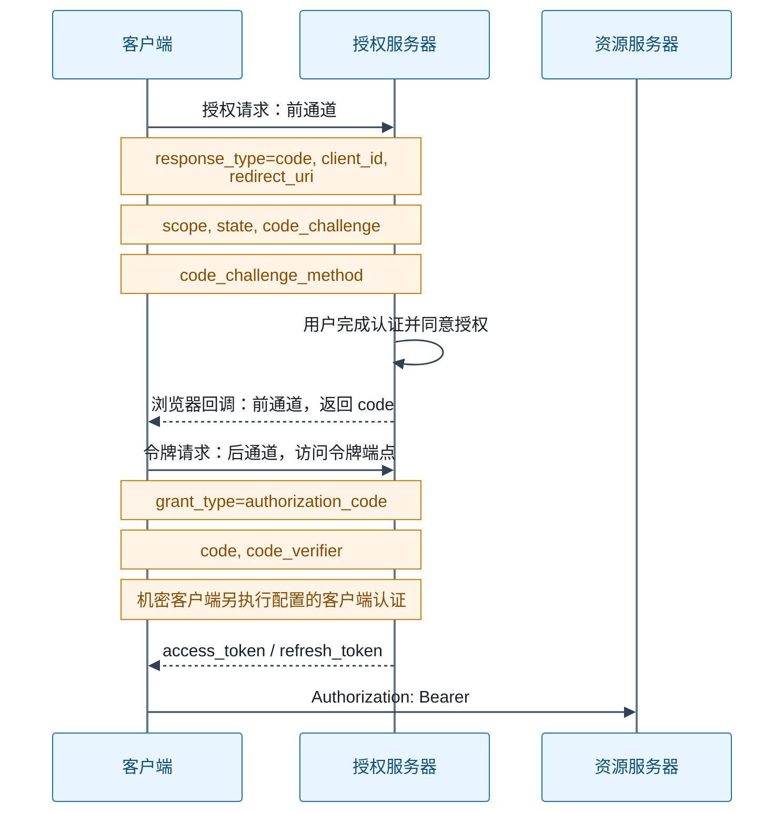

# OAuth

OAuth 2.0 是授权框架：应用不取得用户密码，获得对资源的受限访问。主线为授权码＋PKCE、令牌与生命周期、OIDC 身份层、安全防护、客户端架构与工程运维。OIDC 是身份层，JWT 是数据格式，Bearer 是使用方式。

## 掌握 OAuth 2.0 的学习路线与知识地图

### 范围与标准状态

- 路线覆盖应用开发、企业接入、授权服务建设。扩展协议按实际场景深入，不要求背诵所有注册参数。
- 组织分三档：核心必修为阶段 1 至 6；工程必修为阶段 7 至 8；场景选修为阶段 9。阶段、练习与学习顺序是教学建议；协议事实以各节一手规范为依据。
- OAuth 2.0 的基础规范需结合后续安全更新阅读。按 [RFC 9700](https://www.rfc-editor.org/info/rfc9700/)（一手），资源所有者密码凭据授予禁止使用；隐式授予不应作为新系统方案。
- OAuth 2.1 截至 2026-09-22 仍为草案 draft-ietf-oauth-v2-1-16，不能称为已发布 RFC（一手：[IETF 文档状态](https://datatracker.ietf.org/doc/draft-ietf-oauth-v2-1/)）。
- 浏览器应用指南已于 2026 年 8 月发布为 [RFC 10017](https://www.rfc-editor.org/rfc/rfc10017)（一手），不能继续标作草案。

### 学习路线总览

### 阶段 1：Web 基础与问题边界

- Web 基础：HTTP 请求与响应、重定向、URL 编码、查询参数与片段、表单编码、Cookie 与服务器会话。
- 浏览器安全：同源策略（Same-Origin Policy，SOP）、跨源资源共享（Cross-Origin Resource Sharing，CORS）、跨站请求伪造（Cross-Site Request Forgery，CSRF）、跨站脚本（Cross-Site Scripting，XSS）、Cookie 的 Secure／HttpOnly／SameSite 属性。
- 密码学基础：传输层安全（Transport Layer Security，TLS）、密码学安全随机数、哈希、数字签名与加密、Base64url。编码不提供保密性；签名不等于加密。
- 概念边界：身份认证（Authentication）回答是谁；授权（Authorization）决定能做什么；会话管理延续访问状态。
- 协议边界：OAuth 2.0 管理受限访问；OpenID Connect（OIDC）提供身份层；JSON Web Token（JWT）是声明容器；Cookie 是浏览器状态机制。
- 需求判断：外部 API 授权、跨系统身份接入、机器调用各自解决不同问题。仅有单应用登录需求时，先明确引入 OAuth 的具体收益。
- 验收：用「第三方应用读取用户文件」的例子，解释为什么不应把用户密码交给第三方。
- 信源（一手）：[RFC 6749 §1](https://www.rfc-editor.org/rfc/rfc6749#section-1)、[OIDC Core §1](https://openid.net/specs/openid-connect-core-1_0.html#Introduction)、[RFC 10017](https://www.rfc-editor.org/rfc/rfc10017)、[RFC 7519](https://www.rfc-editor.org/rfc/rfc7519)。

### 阶段 2：角色、端点与信任关系

- 四个角色：资源所有者（Resource Owner，RO）、客户端（Client）、授权服务器（Authorization Server，AS）、资源服务器（Resource Server，RS）。客户端可以是服务端程序。
- 公开客户端（Public Client）与机密客户端（Confidential Client）的区别是能否保护认证凭据。client_id 是标识，不是秘密；普通浏览器代码不能保管 client_secret。
- 端点：授权端点、令牌端点、客户端重定向端点；后续增加撤销、内省、发现与公钥端点。端点路径由部署定义，不要求固定为 /authorize 或 /token。
- 前通道（Front Channel）经浏览器传递；后通道（Back Channel）由组件直接通信。要能标出每个凭证经过哪些边界。
- 区分四个动作：授权授予（Authorization Grant）、用户同意（Consent）、客户端认证、用户认证。用户已登录不代表已同意本次授权。
- 权限范围 scope 描述权限集合；audience 指定接收方。业务仍需检查资源归属、租户和操作条件。
- 客户端注册项：redirect_uri、允许的 grant_type、scope、认证方式、密钥、凭据轮换策略。
- 验收：给四个角色分配部署组件，标出浏览器回调与服务器换令牌两条路径。
- 信源（一手）：[RFC 6749 §§1–3](https://www.rfc-editor.org/rfc/rfc6749)、[RFC 8707](https://www.rfc-editor.org/rfc/rfc8707)、[RFC 9068](https://www.rfc-editor.org/rfc/9068)。

### 阶段 3：授权码流程与 PKCE

优先掌握授权码授予（Authorization Code Grant）加 Proof Key for Code Exchange（PKCE）。

- 客户端产生每次事务独立的 code_verifier。S256 方法计算 code_challenge = BASE64URL(SHA256(ASCII(code_verifier)))，并去掉 Base64url 填充。
- 授权码必须短时、单次使用，并绑定客户端和回调信息。
- PKCE 绑定授权请求与兑换动作；它不负责保护已经签发的访问令牌。
- state、nonce、code_verifier 是三个不同机制：state 关联请求与回调并可防 CSRF；OIDC 的 nonce 关联认证请求与 ID Token；code_verifier 用于授权码兑换证明。
- 强度要求（RFC 9700）：公开客户端必须使用 PKCE；机密客户端推荐使用；AS 必须支持 PKCE。实现优先使用 S256。
- 掌握请求／响应编码与错误响应：识别 access_denied、invalid_request、invalid_client、invalid_grant、invalid_scope、unauthorized_client、unsupported_grant_type。
- 验收：抓包解释每次跳转；篡改 verifier、回调地址，重复兑换 code，确认失败；解释为什么「有 client_secret」仍不等于具备 PKCE 防护。
- 信源（一手）：[RFC 7636](https://www.rfc-editor.org/rfc/rfc7636)、[RFC 6749 §4.1、§5](https://www.rfc-editor.org/rfc/rfc6749)、[RFC 9700 §2.1](https://www.rfc-editor.org/info/rfc9700/)。

### 阶段 4：令牌、校验与生命周期

- 三种令牌不可混用：访问令牌（Access Token）供 RS 接受；刷新令牌（Refresh Token）发给 AS 换新令牌；ID Token 供 OIDC 客户端验证认证结果。
- 区分不透明令牌（Opaque Token）与 JWT。JWT 不必然是 Bearer Token；持有者令牌（Bearer Token）按「持有即可使用」的语义定义，也可以采用不透明格式。
- 密码学构件：JSON Web Signature（JWS）保护完整性；JSON Web Encryption（JWE）提供加密；JSON Web Key（JWK）及 JWK Set 表示密钥。学习 alg、typ、kid 与受信任的 jwks_uri。
- JWT 校验项：受信任的发行者 iss、接收方 aud、签名、算法允许列表、exp、存在时的 nbf、适用的令牌类型及权限；理解 sub、iat、jti 和时间偏差。具体必填声明取决于令牌规范。
- 禁则：不把解码当验签；不接受 ID Token 作为普通 API 的 Access Token；不盲信令牌提供的密钥地址；客户端应按约定使用 Access Token，不依赖其内部格式。
- 本地验证与令牌内省（Token Introspection）的取舍：网络依赖、缓存、撤销生效延迟。JWT 也可以内省；内省不只用于不透明令牌。
- 生命周期：有效期、刷新、轮换、重放检测、授权撤回与令牌撤销（Token Revocation）。公开客户端的刷新令牌必须轮换或绑定发送方。
- 工程策略：刷新并发控制、重试与旧令牌复用、失效后重新授权。本地验签的 JWT 通常不能仅靠 AS 的撤销记录立即停止使用，需短有效期、在线检查或额外撤销机制。
- Bearer 请求通常采用 Authorization: Bearer。学习 WWW-Authenticate、invalid_token、insufficient_scope 与相应 401／403 语义。不在日志或 URL 中泄露令牌。
- 验收：错误 aud、iss、签名、过期时间、scope 均被拒绝；实测撤销后的可访问窗口。
- 信源（一手）：[RFC 6750](https://www.rfc-editor.org/rfc/rfc6750)、[RFC 7519](https://www.rfc-editor.org/rfc/rfc7519)、[RFC 7515](https://www.rfc-editor.org/rfc/rfc7515)、[RFC 7516](https://www.rfc-editor.org/rfc/rfc7516)、[RFC 7517](https://www.rfc-editor.org/rfc/rfc7517)、[RFC 8725](https://www.rfc-editor.org/rfc/8725)、[RFC 9068](https://www.rfc-editor.org/rfc/9068)、[RFC 7662](https://www.rfc-editor.org/rfc/rfc7662)、[RFC 7009](https://www.rfc-editor.org/rfc/rfc7009)、[RFC 9700](https://www.rfc-editor.org/info/rfc9700/)。

### 阶段 5：OIDC、身份与单点登录

- OIDC 在 OAuth 上提供可互操作的认证语义。学习 openid、profile、email、offline_access 等 scope，以及 OpenID Provider（OP）和 Relying Party（RP）两个角色。
- ID Token 声明：iss、sub、aud、exp、iat、nonce，条件适用的 azp、auth_time、acr、amr、at_hash、c_hash。不同流程适用的校验条件不同。
- UserInfo 用 Access Token 调用；其 sub 必须与 ID Token 对应。账号关联以受信任的 iss＋sub 为基础，不仅按 email 自动合并。
- OIDC Discovery 与 OAuth AS Metadata：用途、元数据地址、issuer 校验和密钥发现。二者有关联，但不是同一份规范。
- 认证交互：prompt、max_age、login_hint、重新认证、静默请求失败处理；公共／成对 subject 标识及隐私取舍。
- 单点登录（Single Sign-On，SSO）依赖 AS 会话与各 RP 的本地会话。登录复用不等于各应用共享同一 Cookie。
- 退出方式各管一段：本地退出、RP-Initiated Logout、Front-Channel Logout、Back-Channel Logout、令牌撤销。要区分各自的作用与适用性。
- 验收：接入两个 RP，说明第二个应用为何可以复用登录；实测各类退出影响哪些会话和令牌。
- 信源（一手）：[OIDC Core](https://openid.net/specs/openid-connect-core-1_0.html)、[OIDC Discovery](https://openid.net/specs/openid-connect-discovery-1_0.html)、[RFC 8414](https://www.rfc-editor.org/rfc/rfc8414)、[OIDC RP-Initiated Logout](https://openid.net/specs/openid-connect-rpinitiated-1_0.html)、[OIDC Back-Channel Logout](https://openid.net/specs/openid-connect-backchannel-1_0.html)。

### 阶段 6：攻击模型与防护

- 针对授权响应：授权码截获与注入、登录 CSRF、回调劫持、开放重定向、AS 混淆攻击（Mix-Up Attack）、PKCE 降级。
- 针对令牌：泄漏、重放、JWT 算法混淆、ID Token／Access Token 混用、audience 错配、权限提升、刷新令牌盗用。
- 针对浏览器：XSS、第三方脚本、Referer／历史／日志泄漏、Cookie CSRF。CORS 不替代身份认证或 API 授权。
- 对应措施：回调 URI 精确匹配（原生应用回环端口有规范例外）、事务绑定、PKCE、发行者校验、最小权限、受限接收方、安全传输、令牌生命周期控制。
- state／nonce／PKCE 的 CSRF 防护具有规范条件：不能机械理解为任何流程都必须叠加三者，也不能只传参数而不验证。
- 持有证明（Proof of Possession，PoP）：DPoP 与双向 TLS（Mutual TLS，mTLS）限制令牌发送方。它们不消除浏览器恶意脚本或客户端整体被控制的风险。
- 验收：按「攻击者能力 → 暴露的消息 → 缺少的校验 → 失败用例」解释每个核心防护，而非只记安全配置名称。
- 信源（一手）：[RFC 9700](https://www.rfc-editor.org/info/rfc9700/)、[RFC 9207](https://www.rfc-editor.org/rfc/rfc9207)、[RFC 8725](https://www.rfc-editor.org/rfc/rfc8725)、[RFC 9449](https://www.rfc-editor.org/rfc/rfc9449)、[RFC 8705](https://www.rfc-editor.org/rfc/rfc8705)。

### 阶段 7：按客户端场景选择架构

| 场景 | 学习方案 | 重点 |
|---|---|---|
| 服务端 Web 应用 | 授权码＋PKCE，机密客户端认证 | 后端持有令牌、服务器会话、Cookie 防护 |
| React 等浏览器应用 | 优先评估 Backend for Frontend（BFF）；比较令牌中介后端与浏览器直接持令牌 | 信任边界、XSS、CSRF、存储、刷新与代理成本 |
| 原生应用 | 授权码＋PKCE，外部用户代理 | 应用链接、私有 URI scheme、回环地址、回调截获；不是内嵌 WebView 登录 |
| 机器到机器 | 客户端凭据授予（Client Credentials Grant） | 客户端以自身身份调用；没有终端用户授权上下文 |
| 输入受限设备 | 设备授权授予（Device Authorization Grant） | device_code、user_code、verification_uri、轮询、slow_down、到期与拒绝 |
| 保留用户上下文的服务链 | 受限令牌传递或 Token Exchange | 下游 audience、权限收缩、委托与模拟的区别 |

- RFC 10017 不推荐业务、敏感和处理个人数据的应用采用浏览器直接持令牌架构。BFF 可以减少令牌被脚本取走的机会，但恶意脚本仍可能通过用户浏览器发起操作。
- 隐式授予（Implicit Grant）用于识别旧系统与迁移；资源所有者密码凭据授予（Resource Owner Password Credentials Grant，ROPC）按安全 BCP 禁止使用。
- 刷新是生命周期的一部分，不是替代用户授权的登录方案；客户端凭据授予也不能冒充用户。
- 验收：对同一业务比较 BFF 与纯浏览器方案；说明凭证在哪、浏览器被攻击后的能力、注销及刷新行为。
- 信源（一手）：[RFC 10017](https://www.rfc-editor.org/rfc/rfc10017)、[RFC 8252](https://www.rfc-editor.org/rfc/rfc8252)、[RFC 8628](https://www.rfc-editor.org/rfc/rfc8628)、[RFC 6749 §4.4](https://www.rfc-editor.org/rfc/rfc6749#section-4.4)、[RFC 8693](https://www.rfc-editor.org/rfc/rfc8693)、[RFC 9700](https://www.rfc-editor.org/info/rfc9700/)。

### 阶段 8：Java／React 工程与生产运维

- 先使用标准实现完成接入，再研究 AS 内部。练习以 React＋Spring Boot BFF＋独立 RS＋AS／OP 为主。
- Spring Security 三个角色分开学：OAuth2 Client、OAuth2 Resource Server、OAuth2 Authorization Server。oauth2Login 是 Client 侧能力。
- 客户端组件：ClientRegistration、OAuth2AuthorizedClient、OAuth2AuthorizedClientManager；覆盖认证回调、授权状态和令牌刷新。
- 资源端组件：SecurityFilterChain、JwtDecoder、OpaqueTokenIntrospector、声明到权限的映射、方法级授权；明确配置发行者和接收方校验。
- 授权端组件：RegisteredClientRepository、OAuth2AuthorizationService、OAuth2AuthorizationConsentService；覆盖令牌生成、客户端策略与持久化。
- 生产课题：客户端注册治理、最小 scope、业务权限与租户隔离、会话与授权数据共享、一次性 code 原子消费、刷新轮换并发、密钥与凭据轮换。
- 可用性课题：JWK Set 缓存与更新、未知 kid、密钥泄漏处置、时钟偏差、内省超时、撤销传播、AS 故障、反向代理外部 URL 与回调地址一致性。
- 可观测性：登录／授权／刷新失败分类，关联事务但脱敏日志；错误码、401／403、拒绝授权、重新登录、退出联动。
- 验收项目：实现登录 → 受限 API → 刷新 → 撤销／退出；加机器客户端与第二个 RP，再做错误 aud、授权码重放、刷新令牌复用、密钥轮换、跨租户访问等失败演练。
- 信源（一手）：[Spring OAuth2 总览](https://docs.spring.io/spring-security/reference/servlet/oauth2/)、[Spring JWT 资源服务器](https://docs.spring.io/spring-security/reference/servlet/oauth2/resource-server/jwt.html)、[Spring 授权服务器核心模型](https://docs.spring.io/spring-security/reference/servlet/oauth2/authorization-server/core-model-components.html)。生产演练和实施顺序是基于以上规范整理的教学建议。

### 阶段 9：扩展协议地图

| 问题 | 扩展与重点 | 已核实一手来源 |
|---|---|---|
| 动态发现服务能力 | AS Metadata、Protected Resource Metadata；受信任 issuer 与发现链 | [RFC 8414](https://www.rfc-editor.org/rfc/rfc8414)、[RFC 9728](https://www.rfc-editor.org/rfc/rfc9728) |
| 自动化客户端接入 | Dynamic Client Registration、注册管理、软件声明及注册权限 | [RFC 7591](https://www.rfc-editor.org/rfc/rfc7591)、[RFC 7592](https://www.rfc-editor.org/rfc/rfc7592) |
| 客户端非对称认证 | private_key_jwt、断言的 aud／exp／jti 与重放控制；区分断言认证与断言授权授予 | [RFC 7523](https://www.rfc-editor.org/rfc/rfc7523)、[OIDC Core](https://openid.net/specs/openid-connect-core-1_0.html) |
| 令牌绑定发送方 | mTLS 证书绑定；DPoP 的请求证明、密钥绑定、nonce 与重放检测 | [RFC 8705](https://www.rfc-editor.org/rfc/rfc8705)、[RFC 9449](https://www.rfc-editor.org/rfc/rfc9449) |
| 指定目标 API | Resource Indicators 的 resource 参数与令牌 aud | [RFC 8707](https://www.rfc-editor.org/rfc/rfc8707) |
| 服务间委托 | Token Exchange：subject_token、actor_token、目标 audience、权限收缩、委托与模拟 | [RFC 8693](https://www.rfc-editor.org/rfc/rfc8693) |
| 保护授权请求 | Pushed Authorization Requests（PAR）与 JWT-Secured Authorization Request（JAR） | [RFC 9126](https://www.rfc-editor.org/rfc/rfc9126)、[RFC 9101](https://www.rfc-editor.org/rfc/rfc9101) |
| 保护授权响应 | JWT Secured Authorization Response Mode（JARM） | [JARM（含勘误集 1）](https://openid.net/specs/oauth-v2-jarm.html) |
| 表达细粒度授权 | Rich Authorization Requests（RAR）的 authorization_details 与业务授权语义 | [RFC 9396](https://www.rfc-editor.org/rfc/rfc9396) |
| 高安全要求的 API | Financial-grade API（FAPI）2.0 Security Profile，组合安全要求与互操作 | [FAPI 2.0](https://openid.net/specs/fapi-security-profile-2_0-final.html) |
| 异设备认证 | Client-Initiated Backchannel Authentication（CIBA），解耦客户端与用户认证设备 | [CIBA Core](https://openid.net/specs/openid-client-initiated-backchannel-authentication-core-1_0.html) |

### 练习顺序与掌握标准

1. 画出四角色和完整授权码＋PKCE 请求链路，逐个说明凭证与参数。
2. 接入一个 AS／OP，让 Client 获取令牌，让 RS 校验令牌并执行权限检查。
3. 加入 OIDC、刷新、撤销和退出，区分身份、会话、授权与令牌的生命周期。
4. 实现 React＋BFF，加入第二个 RP 与机器客户端，覆盖用户登录、SSO 和机器调用。
5. 执行失败演练：错误 verifier、回调、issuer、audience、scope，令牌过期／重放／混用，用户拒绝、刷新竞争、跨租户访问、密钥轮换。
6. 根据业务选择至少一个扩展；说明它解决的攻击或互操作问题、增加的状态与部署成本。

每个知识点用三个问题验收：它解决什么问题？省略它会出现什么具体错误或攻击？怎样用一次请求或测试观察结果？

## oauth.net 的定位与系统教程选择

- 结论：oauth.net 是 OAuth 社区（协议项目本身）的官网，不是第三方教程站，也不是 IETF 站点。OAuth 是开放标准，规范权威在 IETF OAuth 工作组发布的 RFC。
- 证据（均一手）：[oauth.net 首页](https://oauth.net/)（社区站点，页面经 GitHub 编辑，源码指向 aaronpk/oauth.net 仓库）；[oauth.net 社区页](https://oauth.net/community/)（自述社区目标，并写明 IETF 邮件列表负责标准化工作）；[IETF OAuth WG](https://datatracker.ietf.org/wg/oauth/about/)（官方渠道为 datatracker、wiki、Zulip 与邮件列表，未链接 oauth.net）。
- 引用规则：协议事实以 RFC 为一手；oauth.net 用作社区第一方参考。
- 实测定位（2026-10-12）：oauth.net/2/ 是概念页＋RFC 链接的导览索引，覆盖核心概念、grant types、令牌管理、发现注册、PAR／DPoP／mTLS、OAuth 2.1，无分步教学。适合起步概览、查扩展对应规范、跟踪 2.1；不作主干教程。
- 系统教程：[OAuth 2.0 Simplified](https://www.oauth.com/)（免费在线书，Aaron Parecki 著）与 [OAuth 2 in Action](https://www.manning.com/books/oauth-2-in-action)（Manning，2017-03 出版，Justin Richer 与 Antonio Sanso 著；中文版《OAuth 2实战》，二手寻源：豆瓣）。该书出版早于 RFC 9700 与 RFC 10017，安全结论需按安全 BCP 与 RFC 10017 校正。
- 主干仍是上一节的 RFC 基线。
