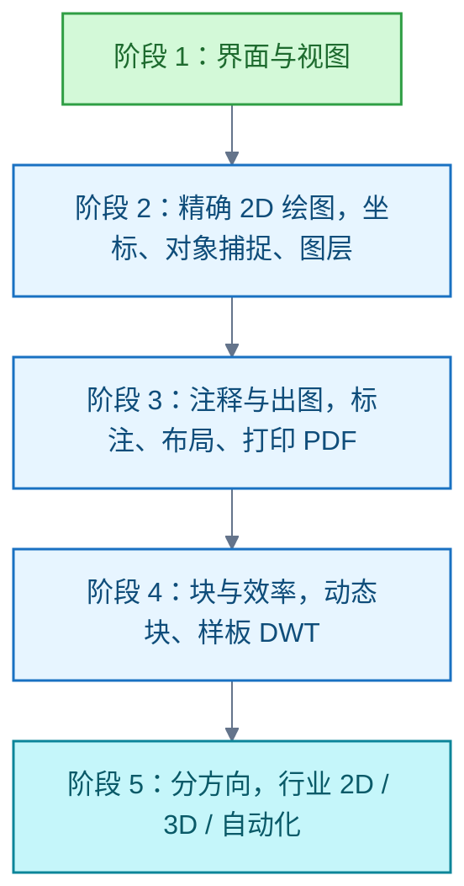
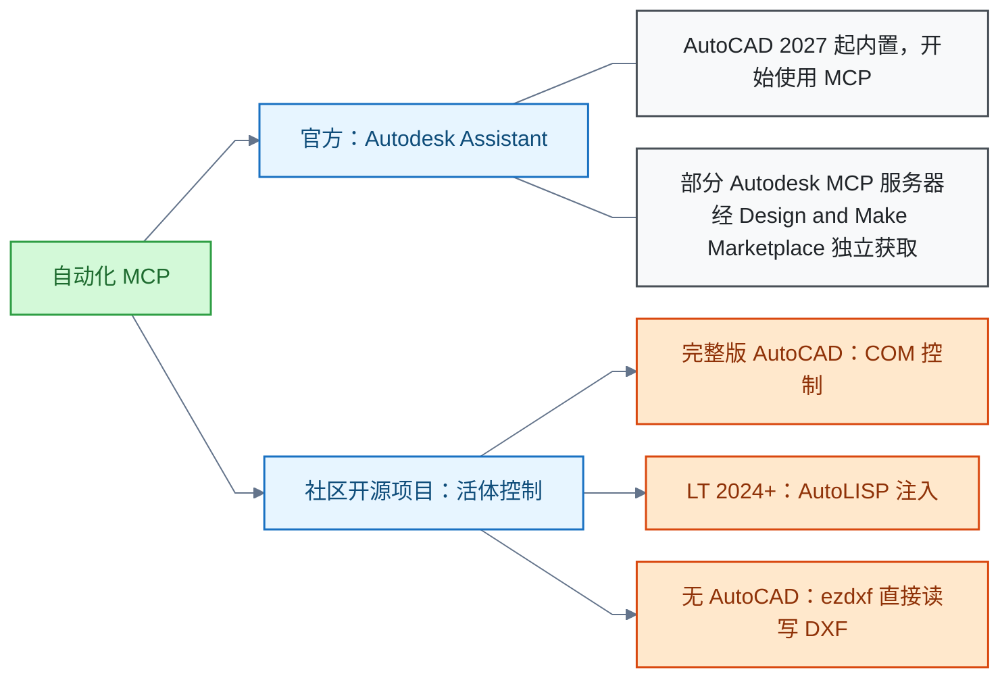
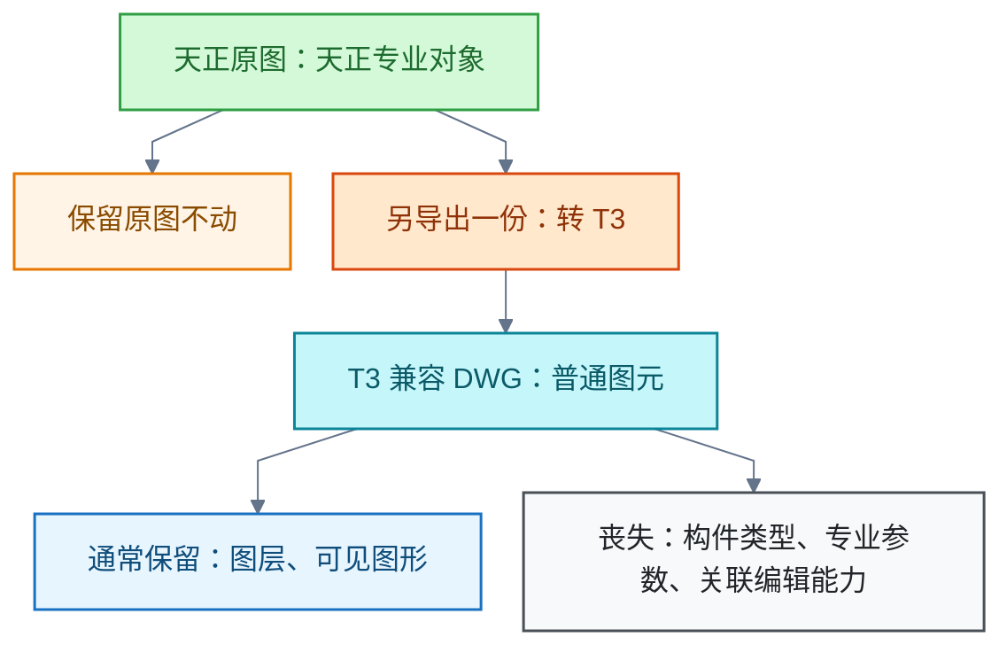

# AutoCAD

<!-- domain: AutoCAD -->
**范围**：AutoCAD 零基础学习路线与官方资源、图形样板（DWT）、试用申请与天正转 T3 的兼容性及信息保留等基础使用，及自动化接口（COM、AutoLISP、ezdxf）与 AI/MCP 接入生态。

**综述**：AutoCAD 自动化按运行中控制与无 AutoCAD 的文件处理区分；COM、AutoLISP 和 ezdxf 的适用产品、版本及格式不同。官方 Assistant/MCP 与社区项目的支持范围分别核实，社区维护状态不能替代本机兼容测试。基础学习先掌握样板、单位、精确绘图、注释出图和块，再选择行业或自动化方向。试用申请曾在中国大陆手机验证与中国区组件处受阻，不能据此推定当前服务状态。天正转 T3 仍产生 DWG；图层与可见图形的保留不等于专业参数和智能编辑能力完整保留。待解：官方 AutoCAD 专属 MCP 条目和配置，以及中文 Windows 下的社区方案兼容性。
<!-- /domain -->

AutoCAD 个人问答合集。入门主线：样板、单位、精确绘图、注释出图与块，官方免费资源足够支撑。自动化按运行中控制与无 AutoCAD 的文件处理区分，官方 Assistant/MCP 与社区项目分别核实。另含天正转 T3 兼容导出与试用申请实测。

## 零基础学习路线与官方免费资源

官方免费资源足够支撑零基础入门。

装软件走三条免费路径：

- 桌面版试用：15 天。
- 教育访问：合格学生或教育者一年免费，可按年续期。
- AutoCAD Web：浏览器版。

学习按五阶段推进：

主线项目用官方教程中心的六部分平面图教程。每天约 1 小时，约 8–10 周可独立出图。

信源：

- [一手] [AutoCAD 官方教程中心（CAD 基础 + 六部分项目 + 初学者必修）](https://www.autodesk.com/solutions/aec/autocad-tutorials)
- [一手] [AutoCAD Quick Start Guide（15 讲入门学习路径）](https://www.autodesk.com/learn/ondemand/curated/autocad-quick-start-guide)
- [一手] [AutoCAD 免费试用页（桌面版 15 天）](https://www.autodesk.com/products/autocad/free-trial)
- [一手] [Autodesk 教育访问总览（一年免费、可年续）](https://www.autodesk.com/support/account/education/students-educators/overview)
- [一手] [教育软件清单（含 AutoCAD）](https://www.autodesk.com/education/edu-software/overview)
- [一手] [AutoCAD Web 官网（浏览器版）](https://web.autocad.com)

### 证据与时效 · q-20261014-004

- **信源**：[一手] [AutoCAD 官方教程中心（CAD 基础 + 六部分项目 + 初学者必修）](https://www.autodesk.com/solutions/aec/autocad-tutorials)；[一手] [AutoCAD Quick Start Guide（15 讲入门学习路径）](https://www.autodesk.com/learn/ondemand/curated/autocad-quick-start-guide)；[一手] [AutoCAD 免费试用页（桌面版 15 天）](https://www.autodesk.com/products/autocad/free-trial)；[一手] [Autodesk 教育访问总览（一年免费、可年续）](https://www.autodesk.com/support/account/education/students-educators/overview)；[一手] [教育软件清单（含 AutoCAD）](https://www.autodesk.com/education/edu-software/overview)；[一手] [AutoCAD Web 官网（浏览器版）](https://web.autocad.com)

## 试用申请的手机验证阻断与出路（中国大陆实测）

2026-10-14 实测：全球站 trial-intake 表单可以完整填写并提交。但最后一步手机验证的短信网关向 +86 号码（实测电信号）发送失败，报"无法向该号码发送验证码"。重试无效，试用不开通。中国区站点的试用组件持续卡在加载。

限制：以上为当日实测，不能据此推定当前服务状态。

三条出路：

- 联系 Autodesk 支持人工处理。
- 改用可接收国际短信的号码。
- 学生或教育者改走教育访问：SheerID 验证，无需手机短信。

信源：

- [一手] 2026-10-14 本机实测 Autodesk trial-intake 流程与 manage.autodesk.com 账户页（浏览器操作记录）
- [一手] [Autodesk 教育访问（无手机验证的替代路径）](https://www.autodesk.com/education/home)

### 证据与时效 · q-20261014-005

- **信源**：[一手] 2026-10-14 实测 Autodesk trial-intake 流程与 manage.autodesk.com 账户页（本机浏览器操作记录）；[一手] [Autodesk 教育访问（无手机验证的替代路径）](https://www.autodesk.com/education/home)

## 图形样板（DWT）的作用与自带样板的区别

新建图形时选择的"样板"是图形样板文件（Drawing Template，DWT）。新图形从它复制单位、图层、标注与文字样式、布局及打印设置。样板本身不被改动。

自带 8 个样板沿四个维度区分：

| 维度 | 取值 |
| --- | --- |
| 单位制 | acad＝英制、acadiso＝公制 |
| 标注标准 | ANSI / ISO |
| 打印样式模式 | 颜色相关 CTB / 命名 STB |
| 初始视图 | 名称带 3D＝初始等轴测 |

国内公制环境通常选 acadiso.dwt。

信源：

- [一手] [About Drawings and Templates（AutoCAD 2026 帮助，样板保存的设置清单）](https://help.autodesk.com/view/ACD/2026/ENU/?caas=caas/documentation/ACDLT/2014/ENU/files/GUID-02979F86-385F-4A53-A3FB-7202F1225CDA-htm.html)
- [一手] [AutoCAD 样板（Autodesk 支持文章，当前版自带样板清单，中文）](https://www.autodesk.com.cn/support/technical/article/caas/tsarticles/ts/a2FplfQ1RO2AiFuw1aeHn.html)
- [一手] [AutoCAD 2022 Templates（acadiso.dwt 属性确认）](https://www.autodesk.com/support/technical/article/caas/tsarticles/ts/3jQpr3507YTptqWwl5ct8a.html)
- [一手] [To Start a New Drawing（AutoCAD LT 2026 帮助）](https://help.autodesk.com/view/ACDLT/2026/ENU/?caas=caas/documentation/ACD/2014/ENU/files/GUID-9836C645-44B4-4EF8-B05A-66EFB2FE0DD2-htm.html)
- [一手] [To Change Template Settings（QNEW 默认样板设置）](https://help.autodesk.com/view/ACDLTM/2026/ENU/?caas=caas/documentation/ACD/2014/ENU/files/GUID-BB840055-4B21-4E4A-9DFC-187D63B44F6D-htm.html)
- [一手] [To Create a Drawing Template（自建样板）](https://help.autodesk.com/view/ACDLTM/2026/ENU/?caas=caas/documentation/ACD/2014/ENU/files/GUID-009D9EB3-DE3E-4107-BE48-56D907A7E9B7-htm.html)

### 证据与时效 · q-20261014-003

- **信源**：[一手] [About Drawings and Templates（AutoCAD 2026 帮助，样板保存的设置清单）](https://help.autodesk.com/view/ACD/2026/ENU/?caas=caas/documentation/ACDLT/2014/ENU/files/GUID-02979F86-385F-4A53-A3FB-7202F1225CDA-htm.html)；[一手] [AutoCAD 样板（Autodesk 支持文章，当前版自带样板清单，中文）](https://www.autodesk.com.cn/support/technical/article/caas/tsarticles/ts/a2FplfQ1RO2AiFuw1aeHn.html)；[一手] [AutoCAD 2022 Templates（acadiso.dwt 属性确认）](https://www.autodesk.com/support/technical/article/caas/tsarticles/ts/3jQpr3507YTptqWwl5ct8a.html)；[一手] [To Start a New Drawing（AutoCAD LT 2026 帮助）](https://help.autodesk.com/view/ACDLT/2026/ENU/?caas=caas/documentation/ACD/2014/ENU/files/GUID-9836C645-44B4-4EF8-B05A-66EFB2FE0DD2-htm.html)；[一手] [To Change Template Settings（QNEW 默认样板设置）](https://help.autodesk.com/view/ACDLTM/2026/ENU/?caas=caas/documentation/ACD/2014/ENU/files/GUID-BB840055-4B21-4E4A-9DFC-187D63B44F6D-htm.html)；[一手] [To Create a Drawing Template（自建样板）](https://help.autodesk.com/view/ACDLTM/2026/ENU/?caas=caas/documentation/ACD/2014/ENU/files/GUID-009D9EB3-DE3E-4107-BE48-56D907A7E9B7-htm.html)

## 自动化操作 MCP：官方与社区两条线

AutoCAD 有自动化操作的模型上下文协议（Model Context Protocol，MCP）方案，分官方与社区两条线。

- 官方线：AutoCAD 2027 起内置 Autodesk Assistant 并开始使用 MCP。官方 FAQ（2026-09 修订）确认：部分 Autodesk MCP 服务器可以作为独立能力，经 Design and Make Marketplace 获取。
- 社区线：多个开源 MCP 项目。控制方式按产品区分：完整版走 COM；LT 2024+ 走 AutoLISP 注入；本机没有 AutoCAD 时，用 ezdxf 直接读写 DXF 文件。

限制：社区项目的维护状态不能替代本机兼容测试。待解：官方 AutoCAD 专属 MCP 的条目和配置；中文 Windows 下社区方案的兼容性。

信源：

- [一手] [Autodesk Assistant 官方页（FAQ：独立 MCP 服务器）](https://www.autodesk.com/solutions/autodesk-assistant)
- [一手] [puran-water/autocad-mcp README](https://github.com/puran-water/autocad-mcp)
- [一手] [U-C4N/Autocad-MCP README](https://github.com/U-C4N/Autocad-MCP)
- [一手] [zh19980811/Easy-MCP-AutoCad README](https://github.com/zh19980811/Easy-MCP-AutoCad)
- [二手·未核实] AutoCAD 2027 产品发布公告（2026-03-25，autodesk.com）：检索摘要称 Assistant "beginning to leverage MCP"，未直接打开原文

### 证据与时效 · q-20261013-004

- **信源**：[一手] [Autodesk Assistant 官方页（FAQ：独立 MCP 服务器）](https://www.autodesk.com/solutions/autodesk-assistant)；[一手] [puran-water/autocad-mcp README](https://github.com/puran-water/autocad-mcp)；[一手] [U-C4N/Autocad-MCP README](https://github.com/U-C4N/Autocad-MCP)；[一手] [zh19980811/Easy-MCP-AutoCad README](https://github.com/zh19980811/Easy-MCP-AutoCad)；二手线索：AutoCAD 2027 产品发布公告（2026-03-25，autodesk.com，检索摘要称 Assistant "beginning to leverage MCP"，未直接打开）

## 天正转 T3：兼容导出的所得与所失

"转 T3"指把天正图纸导出为"天正 3"兼容格式，供缺少天正支持的 CAD 或算量软件读取。结果仍是 DWG 图纸，常见名称如"平面图_t3.dwg"。

- 保留：图层和可见图形通常可以保留。
- 丧失：天正专业对象转成普通图元后，丧失智能化专业特征，不能完整保留原构件类型、专业参数和关联编辑能力。
- 条件：具体图层归属及各项属性，需按转换工具、版本和设置核验。
- 做法：保留原始天正图，另导出一份用于交换。

旁证：原始专利 CN116484482A 权利要求 2 要求，读取天正构件类型、几何及属性数据的翻模流程不转 T3。

信源：

- [一手] [浩辰CAD：如何将 CAD 图纸转换成 T3 格式](https://www.gstarcad.com/cmsDetail/23254/)
- [一手] [浩辰CAD看图王：天正图纸转换为标准 DWG，并说明保留图层与可见内容（针对其产品）](https://yun.gstarcad.com/news/1072/)
- [一手] [CAD快速看图：转 T3 官方教程](https://club.everdrawing.com/question/detail/14389)
- [一手] [浩辰CAD：对象分解后丧失智能化专业特征（同类专业对象分解机制）](https://www.gstarcad.com/cmsDetail/20969/)
- [一手] [北京市建筑工程设计有限责任公司原始专利 CN116484482A](https://patents.google.com/patent/CN116484482A/zh)

### 证据与时效 · q-20261020-004

- **信源**：[一手] [浩辰CAD：如何将CAD图纸转换成T3格式](https://www.gstarcad.com/cmsDetail/23254/)；[一手] [浩辰CAD看图王：天正图纸转换为标准DWG，并说明保留图层与可见内容（针对其产品）](https://yun.gstarcad.com/news/1072/)；[一手] [CAD快速看图：转t3官方教程](https://club.everdrawing.com/question/detail/14389)；[一手] [浩辰CAD：对象分解后丧失智能化专业特征（同类专业对象分解机制）](https://www.gstarcad.com/cmsDetail/20969/)；[一手] [北京市建筑工程设计有限责任公司原始专利CN116484482A，权利要求2：读取天正构件类型、几何及属性数据的翻模流程要求不转T3](https://patents.google.com/patent/CN116484482A/zh)

## 提问记录

### q-20261013-004

- **原题**：2026-10-13 · AutoCAD 自动化操作 MCP 的官方与社区现状
- **问**：AutoCAD 有没有相关自动化操作的 MCP。
- **领域**：AutoCAD
- **首次**：2026-10-13
- **更新**：2026-10-13
- **正文**：[自动化操作 MCP：官方与社区两条线](#自动化操作-mcp官方与社区两条线)
- **关联**：[2026-10-20 · 将 WASM 封装为 MCP 供 Agent 调用的可行性与形态](../AI%20与模型/AI%20编程.md#q-20261020-001)

### q-20261014-003

- **原题**：2026-10-14 · 新建图形选择样板（DWT）的含义与自带样板的区别
- **问**：使用 AutoCAD 新建文件时，让我选择样板是什么意思，选择不同样板有什么区别。
- **领域**：AutoCAD
- **首次**：2026-10-14
- **更新**：2026-10-14
- **正文**：[图形样板（DWT）的作用与自带样板的区别](#图形样板dwt的作用与自带样板的区别)

### q-20261014-004

- **原题**：2026-10-14 · 零基础学习 AutoCAD 的完整路线与官方免费资源
- **问**：零基础学习 AutoCAD 的完整教程。
- **领域**：AutoCAD
- **首次**：2026-10-14
- **更新**：2026-10-14
- **正文**：[零基础学习路线与官方免费资源](#零基础学习路线与官方免费资源)

### q-20261014-005

- **原题**：2026-10-14 · 中国大陆手机号申请 AutoCAD 试用的验证阻断（实测）
- **问**：用中国大陆手机号在官网申请 AutoCAD 免费试用，验证码收不到怎么办。
- **领域**：AutoCAD
- **首次**：2026-10-14
- **更新**：2026-10-14
- **正文**：[试用申请的手机验证阻断与出路（中国大陆实测）](#试用申请的手机验证阻断与出路中国大陆实测)

### q-20261020-004

- **原题**：2026-10-20 · 天正转 T3 的含义与图纸兼容目的
- **问**：天正转T3是什么意思；追问：原图层和对象信息会丢失吗。
- **领域**：AutoCAD
- **首次**：2026-10-20
- **更新**：2026-10-20
- **正文**：[天正转 T3：兼容导出的所得与所失](#天正转-t3兼容导出的所得与所失)
