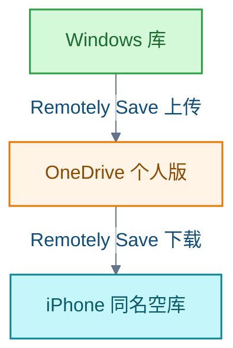
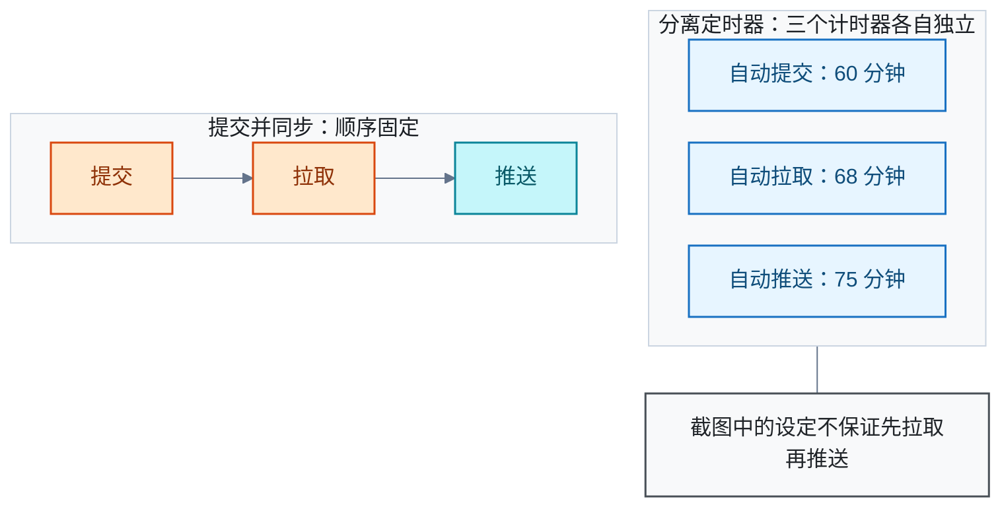

# Obsidian

<!-- domain: Obsidian -->
**范围**：Obsidian 笔记系统、任务管理插件、跨设备同步、Mermaid 图表美化及其工作流。

**综述**：Obsidian Tasks 让任务保留在笔记中并跨库查询，通知需其他组件。Windows 与 iPhone 的私有查阅曾选择 Remotely Save 加 OneDrive；单向下载模式、远端删除与手机编辑的行为不同，iOS 后台和支持边界需核对。同步前备份并避免多个服务同时管理同一库。Obsidian Git 用于版本历史与备份，其提交、拉取和推送顺序不同于实时同步。Mermaid 美化插件按支持图型、主题覆盖、缩放和导出需求比较，安装前核实维护及兼容性。待解：任务插件的具体边界和个人工作流取舍。
<!-- /domain -->

Obsidian 插件使用记录。主线有四条：Tasks 任务管理、Remotely Save 加 OneDrive 的手机查阅、Obsidian Git 版本备份、Mermaid 图表美化。边界：个人配置取舍与已知限制，不覆盖 Obsidian 核心功能本身的用法。

## Tasks 插件：任务留在笔记里，跨库查询

任务插件（Obsidian Tasks）把散落在各笔记中的 Markdown 任务，汇总成可筛选、排序、分组的查询结果。在查询结果中勾选完成，状态会回写源文件。它支持到期日与重复任务。

基本用法分两步：用普通清单项录入任务；在笔记中写 `tasks` 代码块查看待办。

限制：任务通知不内建，需借助其他插件。

信源（一手）：

- [项目 README](https://github.com/obsidian-tasks-group/obsidian-tasks)
- [官方查询示例](https://publish.obsidian.md/tasks/Queries/Examples)
- [官方通知说明](https://publish.obsidian.md/tasks/Advanced/Notifications)

### 证据与时效 · q-20260924-001

- **信源**：[一手] [项目 README](https://github.com/obsidian-tasks-group/obsidian-tasks)；[官方查询示例](https://publish.obsidian.md/tasks/Queries/Examples)；[官方通知说明](https://publish.obsidian.md/tasks/Advanced/Notifications)

## 手机查阅：Windows 库经 OneDrive 供 iPhone 只读

该方案面向免费私有的跨设备同步：电脑端编辑 Windows 上的 Obsidian 库（vault），iPhone 查看。

方案：两端安装同步插件 Remotely Save，连接同一个 OneDrive 个人版应用文件夹。

首次同步流程：先备份；再由电脑完成首次上传；手机从同名空库下载。

成本与容量：

- Remotely Save 基础版免费。
- Microsoft 账户免费云存储共 5 GB，与 OneDrive 中其他文件共享。

手机端只读的行为：

- 可选单向增量下载，只下载、不动远端。
- 若需跟随电脑端的删除，选带删除的下载模式。
- 手机端的修改不会上传，且可能被覆盖。

限制与未核实项：

- iOS 后台不能自动同步。
- 该方案未经 Obsidian 官方支持。
- 不应让其他服务同时同步该库。
- Windows 上用 iCloud Drive 可能导致文件重复或损坏。
- 手机端插件表现与本地网络可达性：未核实。

备选方案（只浏览 Markdown）：GitHub 免费私有仓库。需手动推送；不能完整呈现 Obsidian 功能。

信源（一手）：

- [Obsidian 跨设备同步说明](https://obsidian.md/help/sync-notes)
- [Remotely Save 中文说明](https://github.com/remotely-save/remotely-save/blob/master/README.zh-cn.md)
- [Remotely Save 免费与 PRO 功能对照](https://remotelysave.com/)
- [Microsoft 存储配额](https://support.microsoft.com/en-us/onedrive/microsoft-storage-faqs)
- [Remotely Save 同步方向设置源码](https://github.com/remotely-save/remotely-save/blob/master/src/settings.ts)
- [Remotely Save 同步算法源码](https://github.com/remotely-save/remotely-save/blob/master/pro/src/sync.ts)
- [GitHub 仓库可见性](https://docs.github.com/en/repositories/creating-and-managing-repositories/about-repositories)（备选方案的历史依据）

### 证据与时效 · q-20260924-002

- **信源**：[一手] [Obsidian 跨设备同步说明](https://obsidian.md/help/sync-notes)；[Remotely Save 中文说明](https://github.com/remotely-save/remotely-save/blob/master/README.zh-cn.md)；[Remotely Save 免费与 PRO 功能对照](https://remotelysave.com/)；[Microsoft 存储配额](https://support.microsoft.com/en-us/onedrive/microsoft-storage-faqs)；[Remotely Save 同步方向设置源码](https://github.com/remotely-save/remotely-save/blob/master/src/settings.ts)；[Remotely Save 同步算法源码](https://github.com/remotely-save/remotely-save/blob/master/pro/src/sync.ts)；历史信源：[GitHub 仓库可见性](https://docs.github.com/en/repositories/creating-and-managing-repositories/about-repositories)

## Obsidian Git：定时策略与同步顺序

Obsidian Git 用于版本历史与备份，其提交、拉取、推送的顺序不同于实时同步。配置前先确认四项：Git 仓库、远端、Windows 的 Git Credential Manager、提交作者。

自动策略的核心取舍在顺序保证：

- 分离定时器模式下，自动提交、自动拉取、自动推送独立计时，不保证先拉取再推送。
- 多设备以 Git 同步时：关闭分离定时器，改用定期「提交并同步」（提交 → 拉取 → 推送）；保留错误通知；冲突策略选 Git 默认。
- 若 OneDrive + Remotely Save 已负责跨设备同步：Git 只在桌面端保存历史与备份，避免两个工具同时管理同一文件的双向合并。

信源（一手）：

- [Obsidian Git 官方入门](https://publish.obsidian.md/git-doc/Getting%20Started)
- [官方功能说明](https://publish.obsidian.md/git-doc/Features)
- [官方认证说明](https://publish.obsidian.md/git-doc/Authentication)
- [官方与其他同步工具协同说明](https://publish.obsidian.md/git-doc/Tips-and-Tricks)
- [自动任务源码](https://github.com/Vinzent03/obsidian-git/blob/master/src/automaticsManager.ts)
- [设置源码](https://github.com/Vinzent03/obsidian-git/blob/master/src/setting/settings.ts)

### 证据与时效 · q-20260926-001

- **信源**：[一手] [Obsidian Git 官方入门](https://publish.obsidian.md/git-doc/Getting%20Started)；[官方功能说明](https://publish.obsidian.md/git-doc/Features)；[官方认证说明](https://publish.obsidian.md/git-doc/Authentication)；[官方与其他同步工具协同说明](https://publish.obsidian.md/git-doc/Tips-and-Tricks)；[自动任务源码](https://github.com/Vinzent03/obsidian-git/blob/master/src/automaticsManager.ts)；[设置源码](https://github.com/Vinzent03/obsidian-git/blob/master/src/setting/settings.ts)

## Mermaid 图表美化：三个插件的取舍

按需求选（三者均已列入本次核实时的 Obsidian 官方社区插件目录）：

- Mermaid Boost：以多套配色和图表展示为主。保留标准 Mermaid 代码块；提供缩放、全屏查看与 PNG 导出。
- Slick Mermaid：配色跟随 Obsidian 主题。默认覆盖 `style`／`classDef` 配色；需要时可关闭。
- Auto Beautiful Mermaid：用 beautiful-mermaid 美化流程图、时序图、状态图、类图、实体关系图与 XY 图；其他图表回退到原生渲染器；与 beautiful-mermaid-renderer 冲突。

限制：功能依据为各作者的说明；三者均未在本地 Obsidian 实测。

信源（一手）：

- [Mermaid Boost 作者 README](https://github.com/dreamfarer-space/obsidian-mermaid-boost)
- [Slick Mermaid 作者 README](https://github.com/pasevin/obsidian-slick-mermaid)
- [Auto Beautiful Mermaid 作者 README](https://github.com/rxdxxxx/obsidian-auto-beautiful-mermaid)
- [Obsidian 官方社区插件目录](https://raw.githubusercontent.com/obsidianmd/obsidian-releases/master/community-plugins.json)

### 证据与时效 · q-20261001-001

- **信源**：[一手] [Mermaid Boost 作者 README](https://github.com/dreamfarer-space/obsidian-mermaid-boost)；[Slick Mermaid 作者 README](https://github.com/pasevin/obsidian-slick-mermaid)；[Auto Beautiful Mermaid 作者 README](https://github.com/rxdxxxx/obsidian-auto-beautiful-mermaid)；[Obsidian 官方社区插件目录](https://raw.githubusercontent.com/obsidianmd/obsidian-releases/master/community-plugins.json)

## 提问记录

### q-20260924-001

- **原题**：2026-09-24 · Obsidian Tasks 插件的定位与基本用法
- **问**：介绍一下 https://github.com/obsidian-tasks-group/obsidian-tasks 这个插件。
- **领域**：Obsidian
- **首次**：2026-09-24
- **更新**：2026-09-24
- **正文**：[Tasks 插件：任务留在笔记里，跨库查询](#tasks-插件任务留在笔记里跨库查询)

### q-20260924-002

- **原题**：2026-09-24 · Windows 上的 Obsidian vault 如何免费供 iPhone 私有查阅
- **问**：obsidian 免费的发布方案；电脑上的 Obsidian vault，希望在手机上查阅。澄清后为仅自己看，手机是 iPhone；2026-10-10 追问免费多端同步，主要电脑端编辑、iPhone 查看。
- **领域**：Obsidian
- **首次**：2026-09-24
- **更新**：2026-10-10
- **正文**：[手机查阅：Windows 库经 OneDrive 供 iPhone 只读](#手机查阅windows-库经-onedrive-供-iphone-只读)

### q-20260926-001

- **原题**：2026-09-26 · Obsidian Git 插件设置与自动同步策略
- **问**：根据八张 Obsidian Git 设置截图，详细讲解如何配置。
- **领域**：Obsidian
- **首次**：2026-09-26
- **更新**：2026-09-26
- **正文**：[Obsidian Git：定时策略与同步顺序](#obsidian-git定时策略与同步顺序)

### q-20261001-001

- **原题**：2026-10-01 · Obsidian 中美化 Mermaid 图表的插件选择
- **问**：obsidian中美化mermaid图表的插件。
- **领域**：Obsidian
- **首次**：2026-10-01
- **更新**：2026-10-01
- **正文**：[Mermaid 图表美化：三个插件的取舍](#mermaid-图表美化三个插件的取舍)
