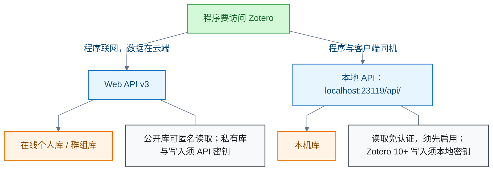

# Zotero

<!-- domain: Zotero -->
**范围**：文献管理库的 Web API 与本地 API、认证和接入方式。

**综述**：Zotero API 是程序访问文献库的接口。Zotero Web API v3 访问在线个人或群组库，公开库可匿名读取，私有库及写入须相应权限的 API 密钥；本地 API 由桌面客户端在 `localhost:23119/api/` 提供，读取本机库无需认证，但须在设置中启用，Zotero 10 及以上版本写入需用户授权的本地密钥。二者面向的程序运行位置与数据来源不同，选用时先确定程序运行地点。Translate for Zotero 插件的 DeepLX 是翻译服务选项，与 Zotero 自身 API 分属不同用途。
<!-- /domain -->

Zotero API 是程序访问文献库的接口。主线：Web API v3 与本地 API（Local API）的分工、认证与写入授权。边界：Translate for Zotero 插件的 DeepLX 是翻译服务选项，与 Zotero 自身 API 分属不同用途。

## Zotero API 是什么：两套接口的选用

**结论**：Zotero API 让程序以 HTTP 请求读取或修改文献条目、分类与标签等资料。接口分两套：

- **Web API v3**：访问在线个人库或群组库。公开库可匿名读取；私有库及写入须相应权限的 API 密钥（API Key）。
- **本地 API**：由桌面客户端在 `localhost:23119/api/` 提供，读取本机库无需认证，可离线使用。读取前必须在客户端设置中启用本地接口；Zotero 10 及以上版本写入还需用户授权的本地密钥。

**原因与取舍**：两套接口面向的程序运行位置与数据来源不同。Web API 面向联网程序与在线库；本地 API 面向同机程序与本机库。选用时先确定程序运行地点，再选接口。

**边界**：Translate for Zotero 插件中的 DeepLX 是翻译服务选项，请求的是翻译接口，与 Zotero 自身 API 无关。

**信源**：

- [一手] [Zotero Web API v3 总览](https://www.zotero.org/support/dev/web_api/v3/start)
- [一手] [Web API 基础与认证](https://www.zotero.org/support/dev/web_api/v3/basics)
- [一手] [本地 API](https://www.zotero.org/support/dev/web_api/v3/local_api)
- [一手] [写入请求](https://www.zotero.org/support/dev/web_api/v3/write_requests)

### 证据与时效 · q-20260926-003

- **信源**：[一手] [Zotero Web API v3 总览](https://www.zotero.org/support/dev/web_api/v3/start)；[Web API 基础与认证](https://www.zotero.org/support/dev/web_api/v3/basics)；[本地 API](https://www.zotero.org/support/dev/web_api/v3/local_api)；[写入请求](https://www.zotero.org/support/dev/web_api/v3/write_requests)

## 提问记录

### q-20260926-003

- **原题**：2026-09-26 · Zotero API 是什么
- **问**：ZOTERO API 是什么
- **领域**：Zotero
- **首次**：2026-09-26
- **更新**：2026-09-26
- **正文**：[Zotero API 是什么：两套接口的选用](#zotero-api-是什么两套接口的选用)
- **关联**：[2026-09-26 · 目前免费的翻译 API 接入方案](../AI%20与模型/机器翻译.md#q-20260926-002)
