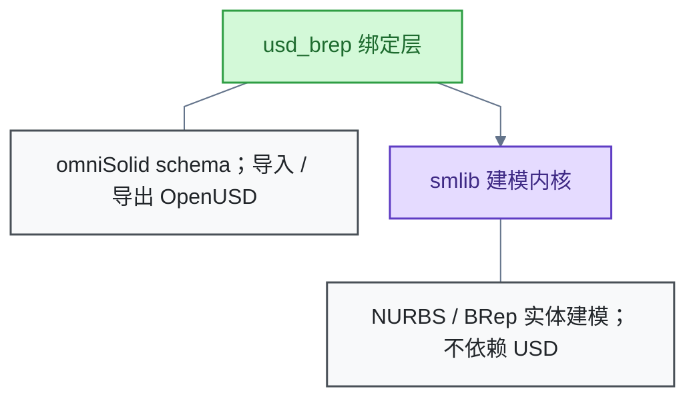

# 三维建模

三维建模关注精确几何的软件表示与交换。主线：NVIDIA usd-brep——基于 NURBS 的边界表示建模库，把 CAD 精确几何原生编码进 OpenUSD；边界：目前仅覆盖该项目。

## NVIDIA usd-brep：把 CAD 精确几何带进 OpenUSD

**是什么**：NVIDIA Omniverse 于 2026 年 10 月开源的 C++/Python 库，许可证 Apache-2.0，暂不接受社区贡献。它做基于非均匀有理 B 样条（Non-Uniform Rational B-Splines，NURBS）的边界表示（Boundary Representation，BRep）实体建模，并原生导入导出 OpenUSD（Universal Scene Description，USD）。

**动机**：OpenUSD 以网格几何为主，缺精确 BRep 表示。CAD 数据进 USD 通常需曲面细分，且细分有损。usd-brep 让计算机辅助设计（Computer-Aided Design，CAD）的精确几何不经有损转换即可进入 USD。

**架构**：分两层，上层依赖下层。

- **smlib 内核**：建模内核，不依赖 USD。
- **usd_brep 绑定层**：基于 omniSolid schema，把几何编码进 OpenUSD。

**功能与限制**：

- 支持与 OpenCASCADE 互转。
- 支持 USD 文件修复（heal_file）与曲面细分。
- 待解（记录未核实）：omniSolid schema 细节；smlib 与 OpenCASCADE 的能力差异与互补关系。

**信源**：

- [一手] [usd-brep README](https://github.com/NVIDIA-Omniverse/usd-brep)
- [一手] [USD BRep 官方文档站](https://nvidia-omniverse.github.io/usd-brep/latest/)
- [一手] [Examples README（API 分层说明）](https://github.com/NVIDIA-Omniverse/usd-brep/blob/main/Examples/README.md)
