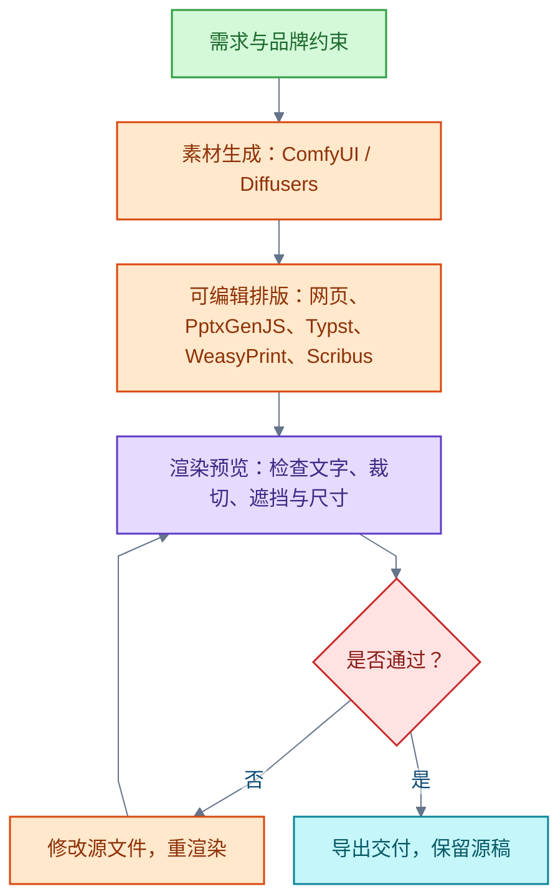

# 平面设计

智能体（AI Agent）驱动平面设计的主线：需求与品牌约束、素材生成、可编辑排版、渲染检查、局部修订与交付。目标场景限定为软件产品功能介绍页；图片与文字分开制作，网页加 Playwright 交付，整页生图不作主流程。

## 软件功能介绍页的制作路线

**结论**：把真实界面截图、技术示意图、文字与版式分开制作，再由智能体统一排版。图片和 PDF 交付用网页加 Playwright；需要在演示软件中改字、换图时用 PptxGenJS。不以整页生图作为主流程。先做概览页与功能分解页两种母版，再复用于其他模块。此优先级是工程判断，未做组合实测。

参考图的两页结构（据图片观察得出；不能据此确认原作者使用的软件或生图方式）：

- 左页为概览：主标题、地形主视觉、软件菜单截图、三步示意与成果列表。
- 右页为功能分解：数据准备、模型构建、场地分析。
- 两页复用页眉页脚、颜色、字号、边距、分隔线与编号样式。

落地步骤：整理功能名称与实际截图 → 选取产品真实渲染图或制作带说明的示意图 → 建立两种母版 → 填充文字、图标与图片 → 检查截图可读性、中文换行、遮挡与功能对应关系 → 导出并保留源文件。

**PptxGenJS 的可编辑边界**：MIT 许可。支持原生文字、形状、图片、母版与自定义页尺寸。可编辑性取决于对象类型；插入的截图内部文字仍属于图片。中文可指定 fontFace 与 lang，交付前应在目标软件复查字体和换行。指定字体名称不等于嵌入字体。

信源：

- [Playwright 页面 PDF API（一手）](https://playwright.dev/docs/api/class-page#page-pdf)
- [PptxGenJS 官方仓库（一手）](https://github.com/gitbrent/PptxGenJS)
- [PptxGenJS 文字 API（一手）](https://gitbrent.github.io/PptxGenJS/docs/api-text/)
- [PptxGenJS 图片 API（一手）](https://gitbrent.github.io/PptxGenJS/docs/api-images/)
- [W3C SVG 规范：形状、图片与文字对象（一手）](https://www.w3.org/TR/SVG2/intro.html)

## 开源工具的分工与边界

按交付条件选工具；表中信息于 2026-10-22 核实。

| 工具 | 许可 | 用途与边界 |
| --- | --- | --- |
| Playwright | Apache-2.0 | 用真实浏览器渲染网页、截图并导出 PDF。保留网页源文件才能持续编辑结构。PDF 默认用打印样式，不代表自动符合印厂规范。 |
| Satori | MPL-2.0 | 用 JSX 或对象树加 CSS 转 SVG。仅实现 CSS 的一定范围；默认将文字转为路径，应保留源文件。当前 main 与旧缓存的布局和字体支持说明不同，使用时锁定发行版。 |
| sharp / resvg-js | Apache-2.0 / MPL-2.0 | sharp 处理图片并可将 SVG 转图片；resvg-js 是另一种 SVG 光栅化选择，不必同时引入。两者均不替代多页排版。 |
| Fabric.js / Konva.js | MIT / MIT | 自建画布编辑器的基础库，自身不提供完整设计智能体。Fabric 支持 JSON 和 SVG；SVG 往返并非完全无损。Konva 的常规 PDF 示例是将画布图片嵌入 PDF。 |
| Typst | Apache-2.0（开源编译器） | 代码化多页排版，支持中文字体和 CMYK。当前 PDF 导出规范列表未列 PDF/X；在线编辑器不属于同一开源范围。 |
| WeasyPrint | BSD-3-Clause | 网页代码分页为 PDF。70.0 稳定版列出 PDF/X-1a、X-3、X-4、X-5g，支持色彩配置和出血；官方不保证仅选选项即可合规。 |
| Scribus | GPL-2.0-or-later | 桌面出版应用。通过 Python Scripter 填充模板并导出 PDF；支持 PDF/X-4、字体嵌入及出血设置，适合结合人工印前复查。 |
| ComfyUI / Diffusers | GPL-3.0 / Apache-2.0 | 分别提供节点化图像工作流及 Python 生成管线；智能体可调用 ComfyUI 本地 API。负责素材生成，不替代排版。模型权重的许可和资源需求需另查。 |
| LangGraph | MIT | 可选的任务编排库。可保存状态、返工与暂停等待人工输入；本身不是排版或绘图库。 |
| Penpot | MPL-2.0 | 设计工具，官方模型上下文协议（Model Context Protocol，MCP）提供画布自动化；导出格式与 PDF 有限制。 |
| OpenPencil | 未核实 | 提供画布自动化，发布 MCP 服务文档。 |
| Poster Maker | 未核实 | 展示代码排版的闭环。 |
| Paper2Poster / PosterGen | 未核实 | 学术海报研究实现，不能直接视为商业宣传册的成熟成品。 |

信源：

- [Penpot 官方 MCP 当前文档（一手）](https://github.com/penpot/penpot/blob/develop/docs/mcp/index.md)
- [Penpot MPL-2.0 许可证（一手）](https://github.com/penpot/penpot/blob/develop/LICENSE)
- [Penpot 导出格式与 PDF 限制（一手）](https://help.penpot.app/user-guide/export-import/exporting-layers/)
- [OpenPencil 官方仓库（一手）](https://github.com/open-pencil/open-pencil)
- [OpenPencil MCP 文档（一手）](https://openpencil.dev/programmable/mcp-server)
- [Poster Maker 官方仓库（一手）](https://github.com/dabodamjan/poster-maker)
- [Paper2Poster 官方仓库（一手）](https://github.com/Paper2Poster/Paper2Poster)
- [Paper2Poster 原始论文（一手）](https://arxiv.org/abs/2505.21497)
- [PosterGen 官方仓库（一手）](https://github.com/Y-Research-SBU/PosterGen)
- [PosterGen 原始论文（一手）](https://arxiv.org/abs/2508.17188)
- [Satori 当前 README（一手）](https://raw.githubusercontent.com/vercel/satori/main/README.md)
- [sharp 输出能力（一手）](https://sharp.pixelplumbing.com/api-output/)
- [resvg-js 官方仓库（一手）](https://github.com/thx/resvg-js)
- [Fabric.js 核心概念（一手）](https://www.fabricjs.com/docs/core-concepts/)
- [Konva 序列化（一手）](https://konvajs.org/docs/data_and_serialization/Serialize_a_Stage.html)
- [Konva Canvas 转 PDF 示例（一手）](https://konvajs.org/docs/sandbox/Canvas_to_PDF.html)
- [Typst 开源范围（一手）](https://typst.app/open-source/)
- [Typst PDF 导出（一手）](https://typst.app/docs/reference/pdf/)
- [WeasyPrint PDF/X 说明与合规限制（一手）](https://doc.courtbouillon.org/weasyprint/stable/common_use_cases.html#pdf-x-graphics-exchange)
- [WeasyPrint 70.0 发行记录（一手）](https://doc.courtbouillon.org/weasyprint/stable/changelog.html#version-70-0)
- [Scribus Scripter PDFfile API（一手）](https://github.com/scribusproject/scribus/blob/master/doc/en/scripterapi-PDFfile.html)
- [ComfyUI 本地服务 API（一手）](https://docs.comfy.org/development/comfyui-server/comms_routes)
- [Diffusers 官方仓库（一手）](https://github.com/huggingface/diffusers)
- [LangGraph 编排能力（一手）](https://docs.langchain.com/oss/python/langgraph/overview)
- [LangGraph 中断与恢复（一手）](https://docs.langchain.com/oss/python/langgraph/interrupts)

## 三条工作流：电子、多页与印刷

以下为工程建议，未做端到端实测。

1. **电子海报与封面**：明确用途、尺寸、文字和品牌约束 → 规划视觉方向 → 生成或选取主图 → 用网页或矢量源文件独立排文字和标志 → 渲染预览 → 检查文字、裁切、遮挡与尺寸 → 修改源文件后重渲染 → 导出并保留源稿。文字与主图分离，便于校对和局部修改。
2. **多页宣传册**：先定内容提纲和每页任务 → 固定母版、字体、栅格、页码与图片规则 → 用 Typst 或 WeasyPrint 排版 → 渲染全部页面并查看整册缩略图和逐页详情 → 修复缺字、溢出、分页与风格不一致 → 再导出。
3. **印刷宣传册与完整书封**：先取得印厂交付规格和封面模板 → 智能体准备素材与版式数据 → Scribus 脚本填充 → 逐页复查 → 按指定色彩、出血与 PDF 规范导出 → 印前检查和打样。封面包含封底、书脊和封面时，书脊尺寸依据最终页数、纸张与装订确定；不能统一套用出血量、裁切标记或 PDF/X 版本。

信源：

- [IngramSpark 印厂文件要求（一手）](https://www.ingramspark.com/hubfs/downloads/Print-Book-File-Guidelines.pdf)
- [IngramSpark 书脊计算器（一手）](https://myaccount.ingramspark.com/Portal/Tools/SpineCalculator)

## 核实范围与限制

- 本次仅核实一手文档与仓库；未安装、未做端到端或质量排名实测。
- 制作路线的优先级属于工程判断。
- 项目代码、模型和字体素材的许可应分别核实。
