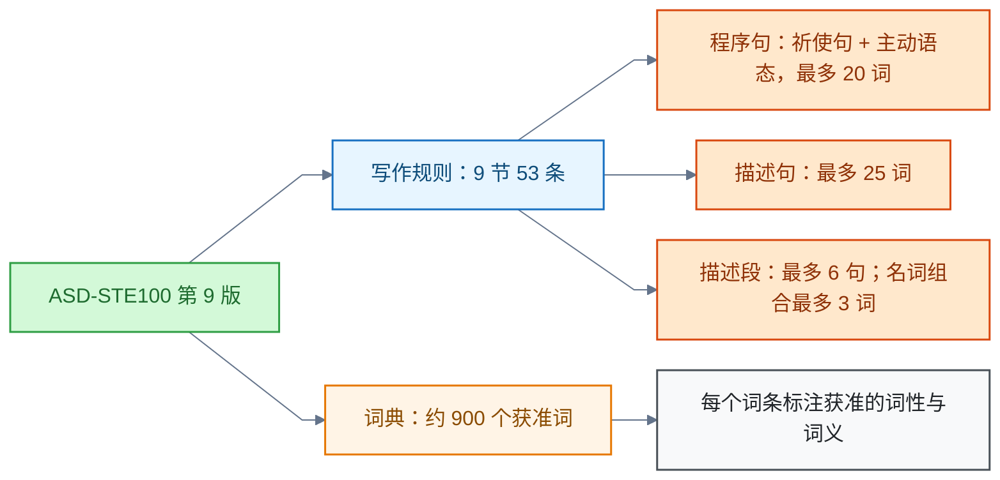
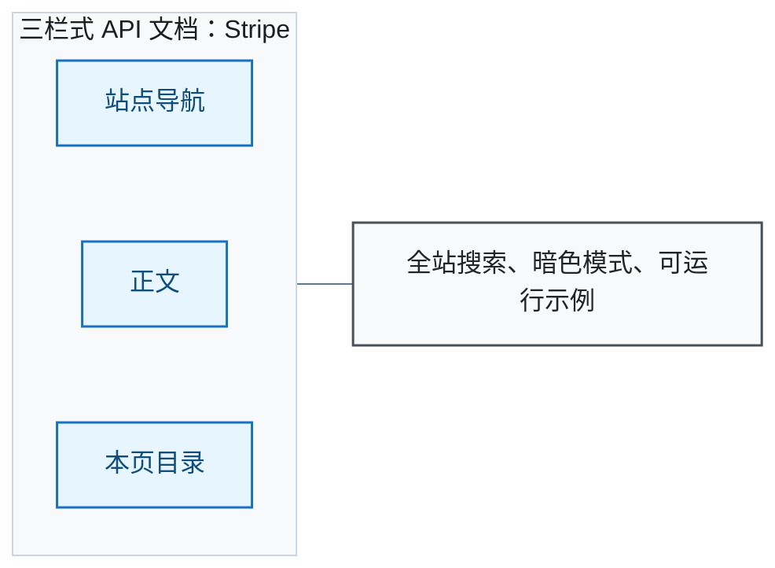

# 技术写作

<!-- domain: 技术写作 -->
**范围**：技术文档的受控表达、ASD-STE100 规则与术语管理及文档视觉风格与建站工具选型。

**综述**：技术文档分文字规范与视觉风格两条线。文字线：简化技术英语（Simplified Technical English，STE）以受控词汇与简化语法降低歧义，ASD-STE100 第 9 版（2025-01-15）含 9 节 53 条规则与约 900 个获准词；主要限制：程序句最多 20 词、描述句最多 25 词、描述段最多 6 句、名词组合不超过 3 词，程序用祈使句与主动语态；必须按官方词典判词性与词义，"词越短越合规"不成立。尚未逐条学习完整标准与词典。视觉线：标杆分三式——三栏 API 文档（Stripe）、教学式教程（React、Vue）、极简工具文档（Tailwind CSS）；自建选 VitePress、Nextra、Docusaurus、Astro Starlight 或 Material for MkDocs（2027-05-05 停止维护，继任 Zensical，未核实）。文字风格规范可参照 Google 开发者文档风格指南。
<!-- /domain -->

技术文档分文字与视觉两条线。文字线以简化技术英语（Simplified Technical English，STE）的受控词汇与语法降低歧义；视觉线分三栏 API 文档、教学式教程、极简工具文档三式，自建文档站按技术栈选生成器。

## 简化技术英语：ASD-STE100 的规则与词表

**结论**：ASD-STE100 第 9 版（2025-01-15）由写作规则与词典两部分构成，主线是用固定术语、短句和明确指令减少误解。判词必须按官方词典的词性与词义，"词越短越合规"不成立。

概览图把标准分为六个区域：两部分结构、程序／安全／描述三类句子、允许的动词形式、词典条目、长度与结构限制、历史和应用领域。依据官方第 9 版，更正图中两项词表错误并补充两点：

- TEST 只获准作名词。
- APPROXIMATELY 是获准副词；ABOUT 不能表示"约"。
- 描述文本只在施事者未知时可用被动语态。
- 获准的非动词词项也可能以 -ing 结尾。

限制：尚未逐条学习完整标准与词典。文字风格规范（非 STE 场景）可参照 Google 开发者文档风格指南，覆盖可访问性、主动语态、代码呈现与词汇表。

信源：

- [ASD-STE100 官方首页（一手）](https://www.asd-ste100.org/)
- [About ASD-STE100（一手）](https://www.asd-ste100.org/about_STE.html)
- [官方 FAQ（一手）](https://www.asd-ste100.org/STE_faq.html)
- [ASD-STE100 Issue 9 标准原文（一手）](https://www.asd-ste100.org/assets/files/ASD-STE100_ISSUE9.pdf)：Part 1 Section 3、5、6，及 Part 2 的 TEST／test 与 ABOUT 词条
- [Google 开发者文档风格指南（一手）](https://developers.google.com/style)

### 证据与时效 · q-20261006-001

- **信源**：[一手] [ASD-STE100 官方首页](https://www.asd-ste100.org/)；[一手] [About ASD-STE100](https://www.asd-ste100.org/about_STE.html)；[一手] [官方 FAQ](https://www.asd-ste100.org/STE_faq.html)；[一手] [ASD-STE100 Issue 9 标准原文](https://www.asd-ste100.org/assets/files/ASD-STE100_ISSUE9.pdf)，Part 1 Section 3、5、6，以及 Part 2 的 TEST／test 和 ABOUT 词条。

## 视觉标杆：三种文档风格

**结论**：业界标杆归为三种视觉风格，各自服务不同读者与产品形态。

- **三栏式 API 文档**：左侧站点导航、中间正文、右侧本页目录；配全站搜索、暗色模式与可运行示例。代表：[Stripe 文档（一手）](https://docs.stripe.com/)，按产品分区，含按用例导览与快速开始。
- **教学式教程**：按学习者组织，先 Learn 后 Reference；配插图、渐进式示例与彩色代码高亮。代表：[React 官网（一手）](https://react.dev/)（官网自述每月 200 万开发者访问文档）、[Vue 官网（一手）](https://vuejs.org/)（VitePress 默认主题代表，另提供 /llms.txt 供程序化获取）。
- **极简设计系统文档**：强排版、少装饰、搜索优先，工具类库常用。代表：[Tailwind CSS 文档（一手）](https://tailwindcss.com/docs)，极简排版风，安装指南按框架分支。

## 文档站生成器选型

**结论**：自建文档站按技术栈选型；站点状态截至 2026-10-28，版本号随时点。

- [VitePress（一手）](https://vitepress.dev/)：Vite 与 Vue 驱动，Markdown 生成文档站；1.6.4 稳定、2.0.0-alpha 预发布。Vue 技术栈或要轻量时选它。
- [Nextra（一手）](https://nextra.site/)：Next.js 与 MDX；构建时 Shiki 高亮、Pagefind 零配置搜索、暗色模式；4.0 已发布。React 栈、要博客感时选它。
- [Docusaurus（一手）](https://docusaurus.io/)：Meta 出品，MDX 与 React，版本管理、国际化、Algolia 搜索；当前 v3.10。要版本化、国际化时选它。
- [Astro Starlight（一手）](https://starlight.astro.build/)：框架无关、无障碍优先；OpenAI、GitHub、Microsoft、freeCodeCamp 采用。
- [Material for MkDocs（一手）](https://squidfunk.github.io/mkdocs-material/)：纯 Markdown 免前端知识，浏览器端搜索；适合 Python 与 MkDocs 生态。官网公告 2027-05-05 停止维护，由同团队继任产品 Zensical 接替；Zensical 发布日期 2026-11-05 来自二手来源（[LinkedIn 帖（二手）](https://www.linkedin.com/posts/data-science-dojo_designsystems-frontenddevelopment-aicoding-activity-7480712845756825600-IfP4)），其官网 zensical.net 从本网络无法访问，未核实。新项目建议关注 Zensical。

- **选型速查**：Vue 技术栈或要轻量 → VitePress；React → Nextra（博客感）或 Docusaurus（版本化、国际化）；框架无关 → Astro Starlight（无障碍默认）；Python 与 MkDocs 生态 → Material for MkDocs（新项目建议关注 Zensical）。

### 证据与时效 · q-20261028-003

- **信源**：- [一手] [Stripe 文档](https://docs.stripe.com/)——三栏 API 文档标杆，按产品分区，含按用例导览与快速开始。
  - [一手] [React 官网](https://react.dev/)——教学式文档，彩色代码高亮与图解；官网自述每月 200 万开发者访问文档。
  - [一手] [Vue 官网](https://vuejs.org/)——Vue 3 文档，VitePress 默认主题代表；另提供 /llms.txt 供程序化获取。
  - [一手] [Tailwind CSS 文档](https://tailwindcss.com/docs)——极简排版风，当前 v4.3，安装指南按框架分支。
  - [一手] [VitePress 官网](https://vitepress.dev/)——Vite 与 Vue 驱动，Markdown 生成文档站；1.6.4 稳定、2.0.0-alpha 预发布。
  - [一手] [Nextra 官网](https://nextra.site/)——Next.js 与 MDX，构建时 Shiki 高亮、Pagefind 零配置搜索、暗色模式；4.0 已发布。
  - [一手] [Docusaurus 官网](https://docusaurus.io/)——Meta 出品，MDX 与 React，版本管理、国际化、Algolia 搜索；当前 v3.10。
  - [一手] [Astro Starlight 官网](https://starlight.astro.build/)——无障碍优先，OpenAI、GitHub、Microsoft、freeCodeCamp 采用。
  - [一手] [Material for MkDocs 官网](https://squidfunk.github.io/mkdocs-material/)——纯 Markdown 免前端知识，浏览器端搜索；官网公告 2027-05-05 停止维护，由 Zensical 接替。
  - [一手] [Google 开发者文档风格指南](https://developers.google.com/style)——文字风格规范：可访问性、主动语态、代码呈现、词汇表。
  - [二手] [LinkedIn 帖：Zensical 于 2026-11-05 发布](https://www.linkedin.com/posts/data-science-dojo_designsystems-frontenddevelopment-aicoding-activity-7480712845756825600-IfP4)——发布日期佐证。
- **核实**：2026-10-28；逐站抓取核实可达性与官网自述（版本、特性、停止维护公告）。Zensical 官网 zensical.net 从本网络无法访问（TLS 连接被重置），未核实。适用范围：站点状态截至 2026-10-28。

## 提问记录

### q-20261006-001

- **原题**：2026-10-06 · ASD-STE100 概览图的结构、规则与词表更正
- **问**：详细总结这张图中的内容。
- **领域**：技术写作
- **首次**：2026-10-06
- **更新**：2026-10-06
- **正文**：[简化技术英语：ASD-STE100 的规则与词表](#简化技术英语asd-ste100-的规则与词表)

### q-20261028-003

- **原题**：2026-10-28 · 漂亮的编程文档风格推荐与代表站点
- **问**：推荐漂亮的编程文档风格，可以推荐相关网站或博客地址供查看。
- **领域**：技术写作
- **首次**：2026-10-28
- **更新**：2026-10-28
- **正文**：[文档站生成器选型](#文档站生成器选型)
- **关联**：[2026-10-06 · ASD-STE100 概览图的结构、规则与词表更正](技术写作.md#q-20261006-001)——视觉风格之外，文字受控表达见该条。
