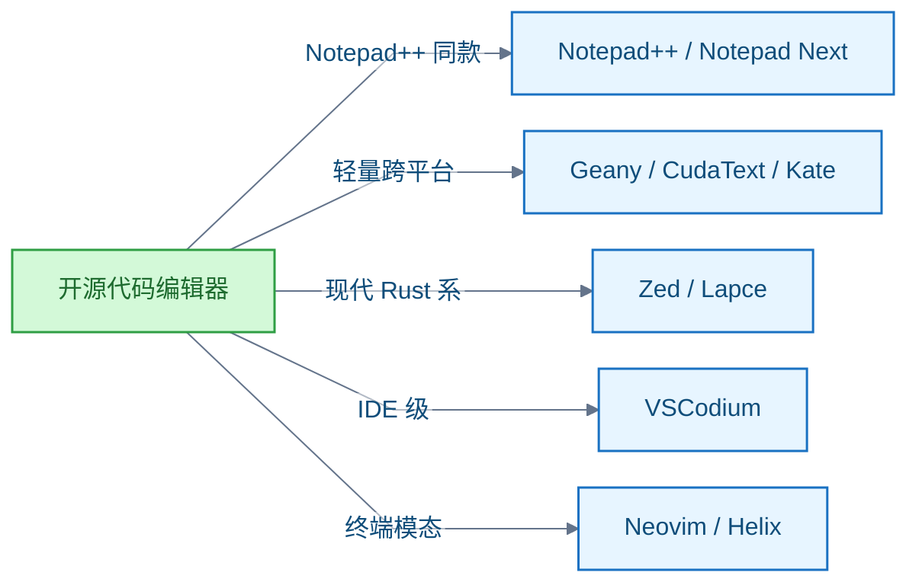

# 文本编辑器

<!-- domain: 文本编辑器 -->
**范围**：桌面代码/文本编辑器（Notepad++ 类）的开源项目考察与选型。

**综述**：桌面代码编辑器选型：GitHub 组织 storytold（ArtCraft）没有 Notepad++ 式代码编辑器。可直接采用的开源选择按需求分组——Notepad++ 同款体验：Notepad++（Windows 本尊）、Notepad Next（跨平台复刻）；轻量跨平台：Geany、CudaText、Kate（均覆盖 Win/Linux/macOS）；现代 Rust 系：Zed、Lapce；IDE 级：VSCodium（VS Code 去遥测构建）；终端模态：Neovim、Helix。上述 10 个项目在 2026-10-12 核实时全部活跃维护。
<!-- /domain -->

桌面代码编辑器选型。主线：找一个类似 Notepad++ 的、带代码高亮（syntax highlighting）的开源编辑器——先查指定 GitHub 组织有无现成项目，再整理可直接采用的开源选择。边界：选型结论与活跃度数据，不涉及各编辑器的配置细节。

## storytold（ArtCraft）组织仓库构成

GitHub 组织 storytold（即 ArtCraft）截至 2026-10-12 共 58 个公开仓库，其中没有代码或文本编辑器项目。

仓库主体是纯 Rust 的 "craft" 创意应用套件：photocraft、filmcraft、pdfcraft、wordcraft、gridcraft、cadcraft、deckcraft、soundcraft 等，以及配套仓库。

最接近的 wordcraft 是 Microsoft Word 的净室重实现（clean-room reimplementation），属于字处理器，不是代码编辑器；其是否附带代码高亮功能未核实。

信源（一手）：

- [GitHub API · storytold 组织档案](https://api.github.com/users/storytold)
- [GitHub API · storytold 仓库列表](https://api.github.com/users/storytold/repos?per_page=100)

### 证据与时效 · q-20261012-004

- **信源**：[一手] [GitHub API · storytold 组织档案](https://api.github.com/users/storytold)；[一手] [GitHub API · storytold 仓库列表](https://api.github.com/users/storytold/repos?per_page=100)
- 原记录资料（未在迁移时复核）：[资料](https://github.com/storytold)

## 可直接采用的开源代码编辑器

Notepad++ 同类按需求分五组，共 10 个项目：

- **Notepad++ 同款**：Notepad++（Windows 本尊）、Notepad Next（跨平台复刻，Win/Linux/macOS）。
- **轻量跨平台**：Geany、CudaText、Kate（均覆盖 Win/Linux/macOS）。
- **现代 Rust 系**（GPU 渲染、启动快）：Zed、Lapce（均已官方支持 Win/Linux/macOS）。
- **IDE 级**：VSCodium（VS Code 去遥测（telemetry）的自由构建）。
- **终端模态**：Neovim、Helix。

活跃度：10 个项目在 2026-09-29 至 2026-10-12 间均有代码推送，全部活跃维护。

星标（star）数（2026-10-12）：Neovim 103k、Zed 91.6k、Helix 46.6k、Lapce 38.9k、VSCodium 33.6k、Notepad++ 29.5k、Notepad Next 14.7k、Geany 3.7k、CudaText 3.2k、Kate 1.1k（GitHub 镜像）。

信源（一手）：

- [Notepad++ 仓库](https://github.com/notepad-plus-plus/notepad-plus-plus)
- [Notepad Next README](https://github.com/dail8859/NotepadNext)
- [Geany 官网](https://www.geany.org/)
- [Kate 官网](https://kate-editor.org/)
- [Zed README](https://github.com/zed-industries/zed)
- [Lapce README](https://github.com/lapce/lapce)

其余仓库星标与活跃数据来自 GitHub REST API（2026-10-12 查询，一手）。

### 证据与时效 · q-20261012-005

- **信源**：[一手] [Notepad++ 仓库](https://github.com/notepad-plus-plus/notepad-plus-plus)；[一手] [Notepad Next README](https://github.com/dail8859/NotepadNext)；[一手] [Geany 官网](https://www.geany.org/)；[一手] [Kate 官网](https://kate-editor.org/)；[一手] [Zed README](https://github.com/zed-industries/zed)；[一手] [Lapce README](https://github.com/lapce/lapce)；其余仓库星标与活跃数据来自 GitHub REST API（2026-10-12 查询）

## 提问记录

### q-20261012-004

- **原题**：2026-10-12 · storytold（ArtCraft）组织有没有 Notepad++ 式带代码高亮的文本编辑器项目
- **问**：https://github.com/storytold 下的仓库中，有没有类似 Notepad++ 的、带代码高亮的文本编辑器项目？
- **领域**：文本编辑器
- **首次**：2026-10-12
- **更新**：2026-10-12
- **正文**：[storytold（ArtCraft）组织仓库构成](#storytoldartcraft组织仓库构成)

### q-20261012-005

- **原题**：2026-10-12 · 支持代码高亮的开源文本编辑器项目推荐
- **问**：推荐一些支持代码高亮的编辑器项目（Notepad++ 那种）。
- **领域**：文本编辑器
- **首次**：2026-10-12
- **更新**：2026-10-12
- **正文**：[可直接采用的开源代码编辑器](#可直接采用的开源代码编辑器)
