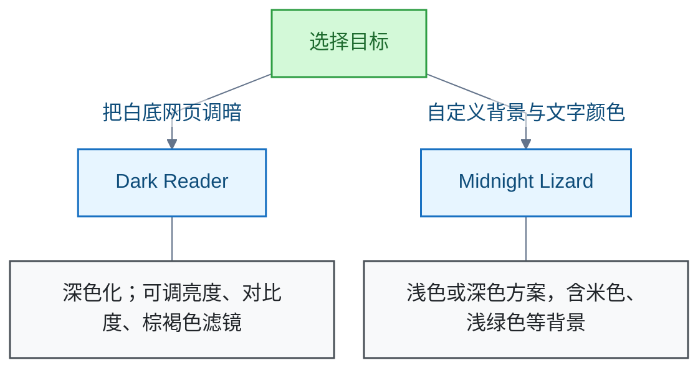

# 浏览器扩展

Chrome 网页配色扩展的选型记录。主线：按目标在 Dark Reader 与 Midnight Lizard 之间选择。边界：扩展受浏览器权限限制，不能修改浏览器自身页面；具体网站效果需实测。

## 按目标选择护眼配色扩展

**结论**：若要把白底网页调暗，优先试 Dark Reader；若想设置米色、浅绿色等背景，可选支持自定义背景与文字颜色的 Midnight Lizard。

**使用条件**：

- 先只启用一个同类扩展。
- 两者都支持按网站设置；网站显示异常时，可只对该网站停用。

**限制**：扩展受浏览器权限限制，不能修改 Chrome 设置页或 Chrome 网上应用店页面。具体网站的显示效果仍需实际确认。

**信源**：

- [一手] [Dark Reader 官方 Chrome 商店页](https://chromewebstore.google.com/detail/dark-reader/eimadpbcbfnmbkopoojfekhnkhdbieeh)
- [一手] [Dark Reader 官方说明](https://darkreader.org/help/zh-CN/)
- [一手] [Midnight Lizard 官方 Chrome 商店页](https://chromewebstore.google.com/detail/midnight-lizard/pbnndmlekkboofhnbonilimejonapojg)
