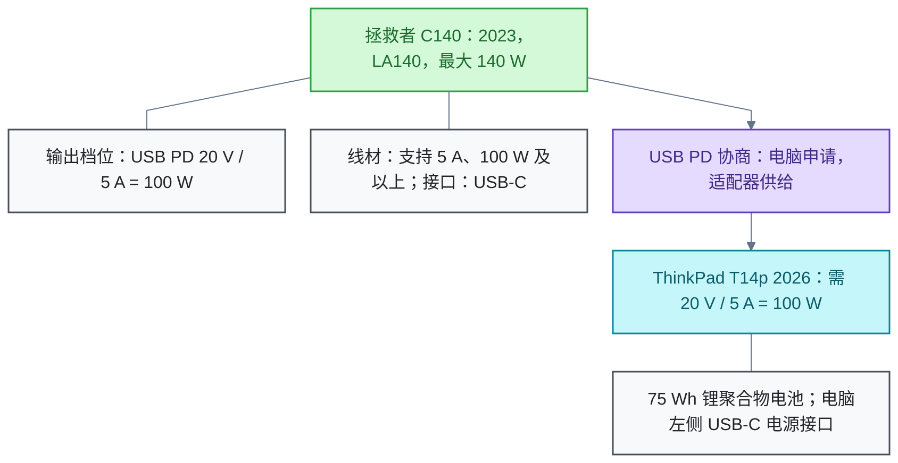

# 电脑供电

<!-- domain: 电脑供电 -->
**范围**：笔记本电源适配器的接口、协议、功率与线材兼容性。

**综述**：笔记本电源适配器的兼容性取决于充电接口、供电协议、输出电压与可供电流，以及线材的承载能力。适配器标称功率表示其最大供电能力，USB Power Delivery（USB PD）设备通过协商获得所需供电，不会因适配器功率较大就被强制输入最大功率。ThinkPad T14p 2026（Gen 4）用户指南列出 100 W／140 W、20 V 直流电及 5 A／7 A；2023 款拯救者 C140（LA140）的原始实测确认支持 USB PD 的 20 V、5 A 档位。因此，从规格判断，C140 可以满足原配 100 W 的 T14p 2026 的供电需求，应使用原装双 USB-C 线或支持 5 A、100 W 及以上的合格线材，连接电脑左侧 USB-C 电源接口。尚未实测用户的具体设备；用户表示 C140「应该是 2023 款」，其具体型号仍需确认。本结论不保证该组合能协商到 140 W。
<!-- /domain -->

本领域研究笔记本电脑的供电兼容性：充电接口、供电协议、电压、电流与线材共同决定一个适配器能否为某台电脑供电。主线是判断第三方适配器能否替换原配电源；结论止于规格推断，不含实测。

## 用拯救者 C140 为 ThinkPad T14p 2026 供电

**结论**：从已核实的规格判断，2023 款拯救者 C140（LA140）氮化镓（Gallium Nitride，GaN）适配器可以为原配 100 W 适配器的 ThinkPad T14p 2026（Gen 4）供电。

**理由**：

- T14p 2026 用户指南列出 100 W／140 W 两种适配器规格：20 V 直流电、5 A／7 A。官方产品参数确认该机配 75 Wh 锂聚合物电池与 100 W 适配器。
- ChargerLAB 拆解实测确认 2023 款 C140（LA140）支持 USB Power Delivery（USB PD）的 20 V、5 A 档位，与 T14p 原配 100 W 的需求一致。
- USB PD 设备通过协议协商获得供电：电脑按需申请，适配器按需供给。适配器标称功率只表示最大供电能力，电脑不会因适配器功率较大就被强制输入最大功率。

供电链路如下：

**使用条件**：

- 线材：使用 C140 原装双 USB-C 线，或支持 5 A、100 W 及以上的合格线材。5 A 线缆依靠 E-Marker 芯片标识承载能力。
- 接口：连接电脑左侧的 USB-C 电源接口。

**限制与未核实项**：

- 该组合未经实测，结论来自双方规格的比对。
- 用户称 C140「应该是 2023 款」，具体型号未确认；上述 C140 规格仅对应 2023 款（LA140）。
- 本结论不保证该组合能协商到 140 W。140 W 是适配器的最大供电能力，不是保证输出。

**信源**：

- [联想 ThinkPad T14p Gen 4 用户指南入口（21XN、22A6），所链 V1.0 PDF 第 4、13 页已读取](https://www.lenovo.com.cn/wiki/article-440194.html)（一手）
- [联想 T14p 2026 官方产品参数：75 Wh、100 W](https://b.lenovo.com.cn/product/1055126.html)（一手）
- [ChargerLAB：2023 款 C140（LA140）拆解，20 V／5 A 档位及原装线 E-Marker 实测](https://www.chargerlab.com/teardown-of-lenovo-legion-140w-pd3-1-usb-c-gan-laptop-charger-la140/)（一手：原作者拆解与协议实测）
- [USB-IF：USB Power Delivery 官方说明](https://www.usb.org/usb-charger-pd)（一手）

### 证据与时效 · q-20261010-002

- **信源**：[一手] [联想 ThinkPad T14p Gen 4 用户指南入口（21XN，22A6），所链 V1.0 PDF 第 4、13 页已读取](https://www.lenovo.com.cn/wiki/article-440194.html)；[一手] [联想 T14p 2026 官方产品参数：75 Wh、100 W](https://b.lenovo.com.cn/product/1055126.html)；[一手：原作者拆解与协议实测] [ChargerLAB：2023 款 C140（LA140）拆解，20 V／5 A 档位及原装线 E-Marker 实测](https://www.chargerlab.com/teardown-of-lenovo-legion-140w-pd3-1-usb-c-gan-laptop-charger-la140/)；[一手] [USB-IF：USB Power Delivery 官方说明](https://www.usb.org/usb-charger-pd)

## 提问记录

### q-20261010-002

- **原题**：2026-10-10 · ThinkPad T14p 能否使用拯救者 C140 氮化镓适配器供电
- **问**：ThinkPad T14p 的电池为 75 Wh 锂聚合物电池，原配 100 W 适配器，能否使用拯救者 C140 氮化镓适配器供电？补充：T14p 为 2026 款，C140 应该为 2023 款。
- **领域**：电脑供电
- **首次**：2026-10-10
- **更新**：2026-10-10
- **正文**：[用拯救者 C140 为 ThinkPad T14p 2026 供电](#用拯救者-c140-为-thinkpad-t14p-2026-供电)
- **关联**：[2026-10-21 · ThinkPad T14p 网友使用感受与口碑汇总](笔记本电脑.md#q-20261021-001)
