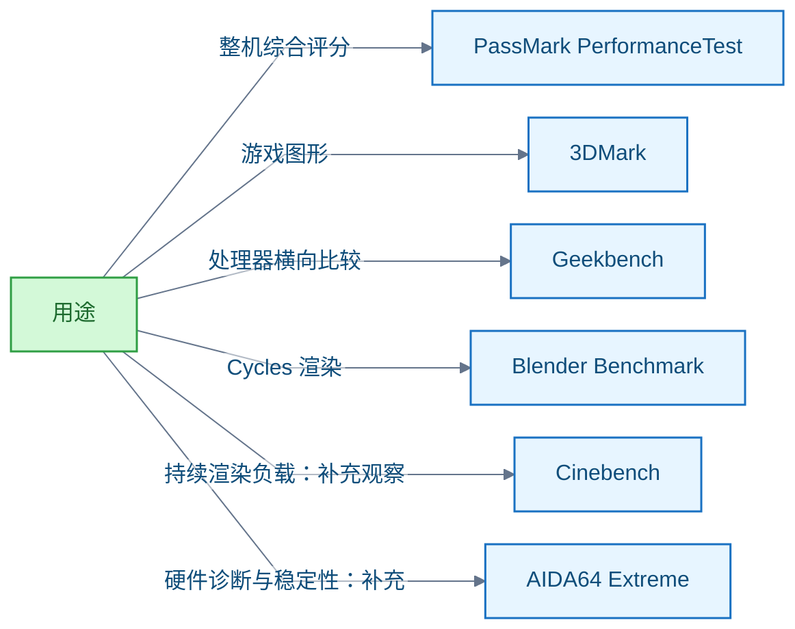
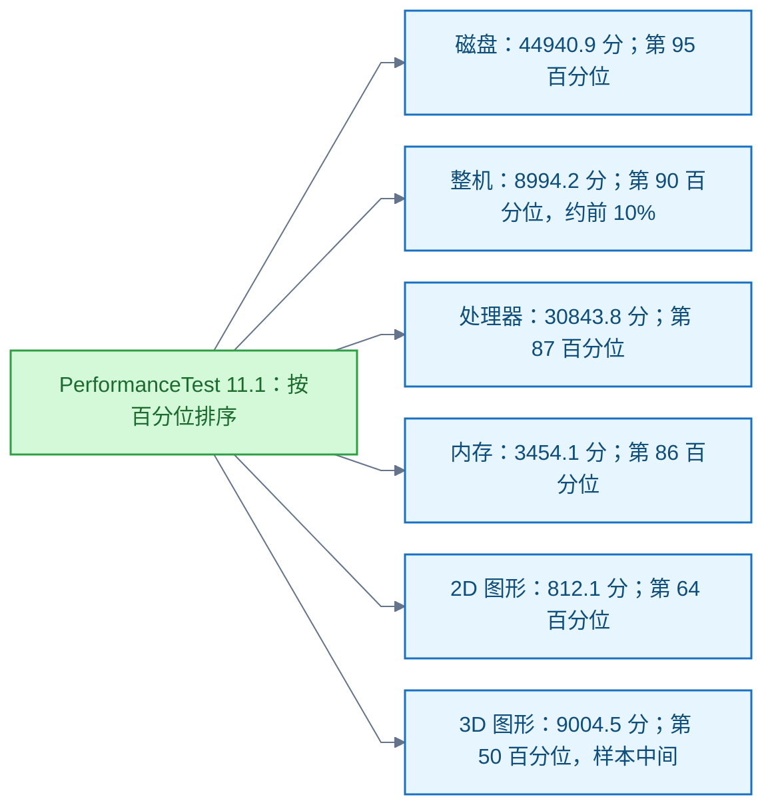

# 电脑性能测试

<!-- domain: 电脑性能测试 -->
**范围**：电脑整机与部件的基准测试工具、中文支持、评分、官方排行榜、跑分解读及成绩比较条件。

**综述**：电脑性能应按负载选择基准测试，综合总分不能代替具体用途的表现。PassMark PerformanceTest 提供整机与部件评分、官方成绩库及榜单；3DMark 侧重游戏图形性能，提供分项目排行榜和相同硬件配置的成绩对照。两者均支持简体中文，符合“中文友好、专业、有评分和排名”的优先条件，但在线成绩库部分页面仍为英文。AIDA64 Extreme 也支持简体中文，可补充硬件诊断、内存与缓存测试、温度监控及稳定性测试。Geekbench 提供处理器单核、多核与显卡计算评分及官方榜单；Blender Benchmark 提供 Cycles 渲染评分、设备中位数和样本数；Cinebench 可补充观察持续渲染负载下的性能。比较成绩时应核对工具版本、测试项目、设置、供电和温度条件，并区分型号汇总成绩与个别用户的最高成绩。PassMark 的百分位表示本次比较样本内的位置，不能直接代表当年新电脑的排名；用户提供的 PerformanceTest 11.1 截图中，整机处于第 90 百分位，处理器、内存和磁盘成绩靠前，3D 图形成绩处于样本中间，尚不能仅据此判断具体硬件档次或是否正常发挥。
<!-- /domain -->

电脑基准测试（Benchmark）工具的选用与成绩解读。主线：按负载选工具，按比较样本读成绩位置。边界：综合总分不能代替具体用途的表现。

## 按负载选择基准测试工具

**结论**：应按负载选择工具。整机综合用 PassMark PerformanceTest；游戏图形用 3DMark；处理器横向比较用 Geekbench；Cycles 渲染用 Blender Benchmark；持续渲染负载可补充 Cinebench。

**中文友好条件下的取舍**。要求「中文友好、专业、有评分和排名」时，优先推荐支持简体中文的 PerformanceTest 和 3DMark。AIDA64 Extreme 也支持简体中文，可补充硬件诊断、内存与缓存测试、温度监控及稳定性测试。限制：两者的在线成绩库部分页面仍为英文。

**各工具的评分与排名口径**。

- PassMark PerformanceTest 提供整机与部件评分、官方成绩库及榜单。
- 3DMark 侧重游戏图形性能，提供分项目排行榜和相同硬件配置的成绩对照。
- Geekbench 提供处理器单核、多核与显卡计算评分及官方榜单。
- Blender Benchmark 提供 Cycles 渲染评分、设备中位数和样本数。

**排名的边界**。排名只代表对应负载与提交样本。比较成绩时应核对工具版本、测试项目、设置、供电和温度条件，并区分型号汇总成绩与个别用户的最高成绩。Cinebench 2026 的分数不能直接与旧版比较。

**信源**：

- [一手] [PassMark PerformanceTest](https://www.passmark.com/products/performancetest/)
- [一手] [PassMark 中文官网与简体中文支持说明](https://www.passmark.com/chinese/)
- [一手] [PassMark 整机成绩库](https://www.pcbenchmarks.net/)
- [一手] [3DMark 中文官网](https://benchmarks.ul.com/zh-hans/3dmark)
- [一手] [3DMark Hall of Fame](https://www.3dmark.com/hall-of-fame-2/)
- [一手] [Geekbench 处理器榜单与统计口径](https://browser.geekbench.com/processor-benchmarks)
- [一手] [Blender Open Data 评分说明](https://opendata.blender.org/about/)
- [一手] [Blender 设备成绩汇总](https://opendata.blender.org/benchmarks/query/?group_by=device_name)
- [一手] [Cinebench 技术说明](https://www.maxon.net/en/tech-info-cinebench)
- [一手] [UL 基准测试操作指南](https://benchmarks.ul.com/support/how-to-benchmark)
- [一手] [AIDA64 Extreme 功能及支持语言](https://www.aida64.com/products/aida64-extreme)

### 证据与时效 · q-20261026-005

- **信源**：[一手] [PassMark PerformanceTest](https://www.passmark.com/products/performancetest/)；[一手] [PassMark 整机成绩库](https://www.pcbenchmarks.net/)；[一手] [3DMark](https://benchmarks.ul.com/3dmark)；[一手] [3DMark Hall of Fame](https://www.3dmark.com/hall-of-fame-2/)；[一手] [Geekbench](https://www.geekbench.com/)；[一手] [Geekbench 处理器榜单与统计口径](https://browser.geekbench.com/processor-benchmarks)；[一手] [Blender Open Data 评分说明](https://opendata.blender.org/about/)；[一手] [Blender 设备成绩汇总](https://opendata.blender.org/benchmarks/query/?group_by=device_name)；[一手] [Maxon Cinebench](https://www.maxon.net/en/cinebench)；[一手] [Cinebench 技术说明](https://www.maxon.net/en/tech-info-cinebench)；[一手] [UL 基准测试操作指南](https://benchmarks.ul.com/support/how-to-benchmark)。
  追问补充：[一手] [PassMark 中文官网与简体中文支持说明](https://www.passmark.com/chinese/)；[一手] [3DMark 中文官网](https://benchmarks.ul.com/zh-hans/3dmark)；[一手] [3DMark 界面语言设置](https://support.benchmarks.ul.com/support/solutions/articles/44002126273-options-screen)；[一手] [AIDA64 Extreme 功能及支持语言](https://www.aida64.com/products/aida64-extreme)。

## PassMark 整机 8994.2 分的解读

**结论**：整机 8994.2 分，处于第 90 百分位（Percentile），即本次参考样本约前 10%。整体表现较好；图形性能相对其他分项不突出。

**限制**：

- 百分位只表示本次比较样本内的位置，不能直接代表 2026 年新电脑的排名。
- 缺少处理器、显卡型号和具体测试条件时，不能判断硬件是否正常发挥。
- 整机总分不能保证具体游戏或应用的表现。

**信源**：

- [一手] 用户提供的 PerformanceTest 11.1 完整跑分截图。
- [一手] [PassMark 管理员对百分位及同型号比较的说明](https://forums.passmark.com/pc-hardware-and-benchmarks/37035-cpu-benchmark-low)
- [一手] [PassMark 成绩含义与应用场景限制](https://www.passmark.com/support/performancetest_faq/understanding-results.php)
- [一手] [PassMark 整机成绩的数据来源与比较限制](https://www.pcbenchmarks.net/)

### 证据与时效 · q-20261026-006

- **信源**：[一手] 用户提供的 PerformanceTest 11.1 完整跑分截图；[一手] [PassMark 管理员对百分位及同型号比较的说明](https://forums.passmark.com/pc-hardware-and-benchmarks/37035-cpu-benchmark-low)；[一手] [PassMark 成绩含义与应用场景限制](https://www.passmark.com/support/performancetest_faq/understanding-results.php)；[一手] [PassMark 整机成绩的数据来源与比较限制](https://www.pcbenchmarks.net/)。

## 提问记录

### q-20261026-005

- **原题**：2026-10-26 · 有评分和排名的电脑性能测试工具
- **问**：电脑性能测试相关权威工具，最好有评分和排名；追问：中文友好、专业的。
- **领域**：电脑性能测试
- **首次**：2026-10-26
- **更新**：2026-10-26
- **正文**：[按负载选择基准测试工具](#按负载选择基准测试工具)

### q-20261026-006

- **原题**：2026-10-26 · PassMark 整机 8994.2 分的水平与分项解读
- **问**：这算什么水平？（提供 PerformanceTest 11.1 完整跑分截图。）
- **领域**：电脑性能测试
- **首次**：2026-10-26
- **更新**：2026-10-26
- **正文**：[PassMark 整机 8994.2 分的解读](#passmark-整机-89942-分的解读)
