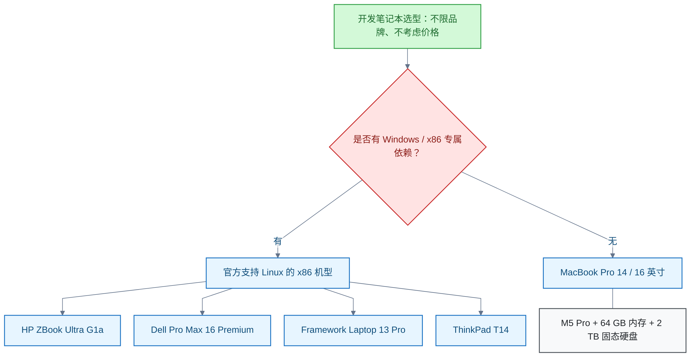

# 笔记本电脑

<!-- domain: 笔记本电脑 -->
**范围**：笔记本整机的选购、产品系列定位、程序开发适用性、口碑与使用体验。

**综述**：开发笔记本先核对操作系统、处理器架构、容器和原生依赖，再比较内存、持续负载、屏幕及携带需求。2026-10-25 用户主要做 Java／后端／全栈，选型不限品牌且不考虑价格；既有 MacBook Pro 与 x86 Linux 机型候选属于条件建议，未经同条件实测。Apple Silicon 原生开发支持与 Linux 容器的虚拟化、跨架构模拟分别评估，公司依赖兼容性仍待确认。ThinkPad 系列定位与扩展方式按代际和具体配置核对；历史 T14p 口碑与价格不自动代表当前产品，“E 系列底子”的血缘说法未获官方确认。
<!-- /domain -->

本领域研究开发用笔记本电脑的选型。主线：先核对操作系统、处理器架构、容器与原生依赖，再比较内存、持续负载、屏幕与携带需求；重点记录 ThinkPad T14p 口碑与全品牌选型。边界：结论来自记录时的资料核实，不含同条件实测。

## ThinkPad T14p 口碑：性能与扩展强，模具与品控留疑

网友对 ThinkPad T14p 的长期使用评价汇总如下。历史口碑与价格不自动代表当前产品；「E 系列底子」的血缘说法未获官方确认。

**好评点**：

- 性能释放强：Gen3 持续 55 W。网友称 "blazing fast"、"an absolute beast"。
- 屏幕素质高：Gen3 为 3K 120 Hz；200% 缩放下可读性佳。
- 扩展性与可维护性为同尺寸罕见：双 SO-DIMM 最高 128 GB、双 M.2 固态位；键盘、外壳、电池可自购更换。
- 键盘手感延续 ThinkPad 传统：键程略缩，仍保留小红点（TrackPoint）与独立方向键。
- Gen3 续航好；Linux 全套支持；国补后性价比高。

**吐槽点**：

- B 面／C 面用聚苯硫醚（Polyphenylene Sulfide，PPS）塑料；摔落时边角碎裂。社区共识为「本质 E 系列底子＋加强散热」。
- 1.5 kg 在 14 英寸机型中偏重。
- D 壳卡扣易断；二号固态仓挤压导致键盘微凸；触摸板涂层易脱落；2024 款刘海凸起。
- 定价被指无性价比。
- 2026 款模具进步小；二手源给出推荐指数 7/10。
- 存在零星品控个案与退货案例；具体原因未核实。

**信源**：

- [plumz.me：有得亦有失——ThinkPad T14P Gen3 入手半年感受](https://plumz.me/archives/14252)（一手：个人长期使用报告）
- [Reddit AMA：I purchased a T14p G3, then returned it](https://www.reddit.com/r/thinkpad/comments/1ow3smk/i_purchased_a_t14p_g3_then_returned_it_ama/)（一手）
- [Reddit：China-Exclusive T14p Gen 2 — The Hidden Gem?](https://www.reddit.com/r/thinkpad/comments/1fwlr1v/chinaexclusive_thinkpad_t14p_gen_2_the_hidden_gem)（一手）
- [Reddit：T14p Gen 2 with RTX 4050](https://www.reddit.com/r/thinkpad/comments/1hdbkm3/t14p_gen2_145inch_thinkpad_with_rtx4050)（一手）
- [知乎专栏：【评测】ThinkPad T14p 上手体验（Gen1）](https://zhuanlan.zhihu.com/p/634907290)（一手）
- [V2EX：ThinkPad 用来工作编程推荐哪一款？](https://www.v2ex.com/t/1208154)、[准备 618 买台 ThinkPad T14P 64G 版本](https://www.v2ex.com/t/1129499)、[出 T14p gen2 2024](https://www.v2ex.com/t/1112902)（一手）
- [知乎：2026 年 ThinkPad 选购指南简明版](https://zhuanlan.zhihu.com/p/110780004)（二手；推荐指数 7/10 出处）
- B 站《售后小哥吐槽 T14/T14p 2025》、《T14p 到手五天真实感受：系统严重卡顿》（二手：视频，内容未核实）

### 证据与时效 · q-20261021-001

- **信源**：[一手：个人长期使用报告] [plumz.me：有得亦有失——ThinkPad T14P Gen3 入手半年感受](https://plumz.me/archives/14252)；[一手] [Reddit AMA：I purchased a T14p G3, then returned it](https://www.reddit.com/r/thinkpad/comments/1ow3smk/i_purchased_a_t14p_g3_then_returned_it_ama/)；[一手] [Reddit：China-Exclusive T14p Gen 2 — The Hidden Gem?](https://www.reddit.com/r/thinkpad/comments/1fwlr1v/chinaexclusive_thinkpad_t14p_gen_2_the_hidden_gem)；[一手] [Reddit：T14p Gen 2 with RTX 4050](https://www.reddit.com/r/thinkpad/comments/1hdbkm3/t14p_gen2_145inch_thinkpad_with_rtx4050)；[一手] [知乎专栏：【评测】ThinkPad T14p 上手体验（Gen1）](https://zhuanlan.zhihu.com/p/634907290)；[一手] [V2EX：ThinkPad 用来工作编程推荐哪一款？](https://www.v2ex.com/t/1208154)、[准备 618 买台 ThinkPad T14P 64G 版本](https://www.v2ex.com/t/1129499)、[出 T14p gen2 2024](https://www.v2ex.com/t/1112902)；[二手] [知乎：2026 年 ThinkPad 选购指南简明版（T14p 2026 推荐 7/10）](https://zhuanlan.zhihu.com/p/110780004)；[二手：视频，内容未核实] B 站《售后小哥吐槽 T14/T14p 2025》、《T14p 到手五天真实感受：系统严重卡顿》

## T14p Gen 4（2026 款）：规格变化与口碑

ThinkPad T14p Gen 4 延续 Gen3 模具微调，不是全新模具；评测实测确认这一点。该代回归日本大和团队主导设计。

**规格变化**：

- 处理器改用 Intel Panther Lake（第三代酷睿 Ultra，Intel 18A 制程）。核芯显卡（integrated GPU，核显）版最高 Ultra X9-388H，配 12Xe 核显 Arc B390。独立显卡（discrete GPU，独显）版用 U7-356H 加 RTX 5060（85 W、8 GB GDDR7）；该版 2026-07-27 首销，定价 19999 元。
- 内存从双 SO-DIMM 改为 LPCAMM2 单模块，可更换。实测机为 32 GB 长鑫颗粒；标准速率 8533 MT/s，被限制在 7467 MHz；评测称最高可扩至 96 GB。
- 硬盘主位为 M.2 2242；另预留 PCIe 5.0 的 2280 位。
- 屏幕升级为 3K 120 Hz 可变刷新率（Variable Refresh Rate，VRR）、标称 500 nit、100% DCI-P3、出厂硬件校色；实测 ΔE 0.51、约 460 nit。

**好评**：

- 核显性能较 Gen3 提升约 49%；游戏提升 58.5%，可胜过满血 RTX 3050。
- 续航大幅增长：PCMark 10 现代办公 23 至 25.5 小时（PSR LCD）。
- 噪音下降：平衡／能效模式 40.1／34.7 dB；上代为 46.7／39.3 dB。
- R23 跑 30 轮循环，成绩仅回落 2.5%。
- 键盘改为可快拆模块；USB-C 口可换模组。
- 评测称「性能小钢炮地位毋庸置疑」「变相提高性价比」。核显版首发 10999 元；2026-06 国补后 8999 元。

**吐槽**：

- 内存限频 7467 MHz，低于 8533 MT/s 的标准潜力；游戏损失约 7%。评测作者公开呼吁 BIOS 解锁。
- 更重更厚：1.6 kg，厚度 +0.5 至 1 mm，D 壳 190 g 换料。
- 单烤时键盘均温 38.6 °C；双烤时 Fn 区接近 50 °C。
- 性能模式风扇策略异常（工程机现象）。
- 预装 PM9C1b 系统盘性能差：3DMark 存储 2017 分。
- 无线网卡板载，不可更换；2280 位无散热片。

**行情**：内存涨价推动 2026-10 到手价回升至约 1.1 万元。Reddit 网友吐槽 RTX 5060 版约 3500 美元，称「定价疯狂」。独显版知乎推荐 4.5 星，但样本少。

供电兼容（能否用拯救者 C140 适配器供电）见「电脑供电」领域。

**信源**：

- [知乎专栏：【评测】联想 ThinkPad T14p Gen4 上手体验](https://zhuanlan.zhihu.com/p/2048940231966172586)（一手：工程机深度评测）
- [联想社区：ThinkPad T14p 2026 测评——RTX5060 独显小屏高性能商务本](https://club.lenovo.com.cn/forum.php?mod=viewthread&tid=9531689)（一手：量产机测评）
- [smzdm：换小黑的人付定金前先把底价、货架、退路这三本账对完](https://post.smzdm.com/p/anv9x527)、[T14p 2026 四版本价格梯](https://post.smzdm.com/p/awwk4q4g)（一手：价格对账）
- [Reddit：T14p Gen 4 comes with RTX 5060 options...at 3.5K USD](https://www.reddit.com/r/thinkpad/comments/1tmnjv9/t14p_gen_4_comes_with_rtx_5060_optionsat_35k_usd)（一手）
- [IT之家：2026 款 T14p 新增 Ultra 7 356H＋RTX 5060 版，19999 元](https://www.ithome.com/0/979/087.htm)（二手）
- [知乎：如何评价 ThinkPad T14P 2026 独显版](https://www.zhihu.com/question/2062671178213365082)（二手）

### 证据与时效 · q-20261021-002

- **信源**：[一手：工程机深度评测] [知乎专栏：【评测】联想 ThinkPad T14p Gen4 上手体验](https://zhuanlan.zhihu.com/p/2048940231966172586)；[一手：量产机测评] [联想社区：ThinkPad T14p 2026 测评——RTX5060 独显小屏高性能商务本](https://club.lenovo.com.cn/forum.php?mod=viewthread&tid=9531689)；[一手：价格对账] [smzdm：换小黑的人付定金前先把底价、货架、退路这三本账对完](https://post.smzdm.com/p/anv9x527)、[T14p 2026 四版本价格梯](https://post.smzdm.com/p/awwk4q4g)；[一手] [Reddit：T14p Gen 4 comes with RTX 5060 options...at 3.5K USD](https://www.reddit.com/r/thinkpad/comments/1tmnjv9/t14p_gen_4_comes_with_rtx_5060_optionsat_35k_usd)；[二手] [IT之家：2026 款 T14p 新增 Ultra 7 356H＋RTX 5060 版，19999 元](https://www.ithome.com/0/979/087.htm)；[二手] [知乎：如何评价 ThinkPad T14P 2026 独显版](https://www.zhihu.com/question/2062671178213365082)

## 程序员选型：先筛系统与架构

2026-10-25 已确认：主要做 Java／后端／全栈；选型不限品牌、不考虑价格，只考虑适配。

**结论**：

- 「优先 T 系列」的原结论仅限 ThinkPad 范围内。
- 扩展到全品牌后，先按系统与架构筛选：

- 无 Windows／x86 专属依赖时：MacBook Pro 14／16 英寸、M5 Pro、64 GB 内存、2 TB 固态硬盘可作综合推荐。
- 依赖 x86 Linux 容器或原生库时：优先官方支持 Linux 的 x86 机型，如 HP ZBook Ultra G1a、Dell Pro Max 16 Premium、Framework Laptop 13 Pro、ThinkPad T14。

**理由**：

- 主流 JDK 与 IntelliJ 原生支持 Apple Silicon。
- Mac 上的 Linux 容器通过 Linux 虚拟机运行；跨架构模拟可能减速。

**限制**：

- 上述为条件建议，未经同条件实测，不构成全品牌实测排名。
- 公司依赖的兼容性仍待确认。

**信源**：

- [联想 ThinkPad 产品线总览](https://www.lenovo.com/es/es/c/laptops/thinkpad/)（一手）
- [Ubuntu 认证机型查询](https://ubuntu.com/certified/search?category=Laptop&offset=0&q=ThinkPad)（一手）
- [Apple MacBook Pro 当前规格](https://www.apple.com/macbook-pro/specs/)（一手）
- [Oracle JDK 25 的 macOS 与 Apple Silicon 支持](https://docs.oracle.com/en/java/javase/25/install/installation-jdk-macos.html)（一手）
- [IntelliJ IDEA 安装与系统支持](https://www.jetbrains.com/help/idea/installation-guide.html)（一手）
- [Docker 多平台镜像及模拟限制](https://docs.docker.com/build/building/multi-platform/)（一手）
- [Docker Desktop 的 Linux 虚拟机](https://docs.docker.com/desktop/features/vmm/)（一手）
- [WSL 2 架构及文件系统注意事项](https://learn.microsoft.com/en-us/windows/wsl/compare-versions)（一手）
- [HP ZBook Ultra G1a 官方规格](https://support.hp.com/lv-en/document/ish_11944615-11944684-16)（一手；搜索索引已核实，正文抓取返回 403）
- [Dell Pro Max 16 Premium 支持系统](https://www.dell.com/support/manuals/en-us/dell-pro-max-ma16250-laptop/dell-pro-max-16-ma16250-owners-manual/operating-system?guid=guid-7b81d002-0a69-4d28-9c38-bbcdf7051010&lang=en-us)（一手）
- [Framework Laptop 13 Pro 规格](https://frame.work/laptop13pro?slug=laptop13pro-amd-ai300&tab=specs)、[Framework 官方系统安装指南](https://guides.frame.work/c/Framework_Laptop_13_Pro)（一手）

### 证据与时效 · q-20261025-002

- **信源**：[一手] [联想 ThinkPad 产品线总览](https://www.lenovo.com/es/es/c/laptops/thinkpad/)；[一手] [联想 2026 T 系列发布说明](https://news.lenovo.com/pressroom/press-releases/trusted-ai-powered-business-computing-modular-enterprise-mwc/)；[一手] [联想 2026 X13 与 L 系列发布说明](https://news.lenovo.com/pressroom/press-releases/lenovo-completes-2026-thinkpad-portfolio-with-expanded-ai-pcs-for-mainstream-enterprise-computing/)；[一手] [联想 2026 X1 与 X9 15p 发布说明](https://news.lenovo.com/pressroom/press-releases/lenovo-at-ces-2026-smarter-ai-meets-purposeful-business-innovation/)；[一手] [ThinkPad 中国官网商城](https://thinkpad.lenovo.com.cn/)；[一手] [T14p 2026 企业购官方配置列表](https://s.lenovo.com.cn/search/?key=%E4%BC%81%E4%B8%9Athinkpad+thinkpad_T%E7%B3%BB%E5%88%97_ThinkPad_%E7%AC%94%E8%AE%B0%E6%9C%AC&source=&type=home)；[一手] [T14 Gen 7 Intel 规格](https://psref.lenovo.com/syspool/Sys/PDF/ThinkPad/ThinkPad_T14_Gen_7_Intel/ThinkPad_T14_Gen_7_Intel_Spec.pdf)；[一手] [T14s Gen 7 Intel 规格](https://psref.lenovo.com/syspool/Sys/PDF/ThinkPad/ThinkPad_T14s_Gen_7_Intel/ThinkPad_T14s_Gen_7_Intel_Spec.pdf)；[一手] [P14s Gen 7 Intel 规格](https://psref.lenovo.com/syspool/Sys/PDF/ThinkPad/ThinkPad_P14s_Gen_7_Intel/ThinkPad_P14s_Gen_7_Intel_Spec.pdf)；[一手] [P1 Gen 9 规格](https://psref.lenovo.com/syspool/Sys/PDF/ThinkPad/ThinkPad_P1_Gen_9/ThinkPad_P1_Gen_9_Spec.pdf)；[一手] [P16 Gen 3 规格](https://psref.lenovo.com/syspool/Sys/PDF/ThinkPad/ThinkPad_P16_Gen_3/ThinkPad_P16_Gen_3_Spec.pdf)；[一手] [T1g Gen 9 规格](https://psref.lenovo.com/syspool/Sys/PDF/ThinkPad/ThinkPad_T1g_Gen_9/ThinkPad_T1g_Gen_9_Spec.pdf)；[一手] [T16g Gen 3 规格](https://psref.lenovo.com/syspool/Sys/PDF/ThinkPad/ThinkPad_T16g_Gen_3/ThinkPad_T16g_Gen_3_Spec.pdf)；[一手] [Ubuntu 认证机型查询](https://ubuntu.com/certified/search?category=Laptop&offset=0&q=ThinkPad)。；[一手] [Apple MacBook Pro 当前规格](https://www.apple.com/macbook-pro/specs/)；[一手] [Oracle JDK 25 的 macOS 与 Apple Silicon 支持](https://docs.oracle.com/en/java/javase/25/install/installation-jdk-macos.html)；[一手] [IntelliJ IDEA 安装与系统支持](https://www.jetbrains.com/help/idea/installation-guide.html)；[一手] [Docker 多平台镜像及模拟限制](https://docs.docker.com/build/building/multi-platform/)；[一手] [Docker Desktop 的 Linux 虚拟机](https://docs.docker.com/desktop/features/vmm/)；[一手] [WSL 2 架构及文件系统注意事项](https://learn.microsoft.com/en-us/windows/wsl/compare-versions)；[一手] [HP ZBook Ultra G1a 官方规格（搜索索引已核实，正文抓取返回 403）](https://support.hp.com/lv-en/document/ish_11944615-11944684-16)；[一手] [Dell Pro Max 16 Premium 支持系统](https://www.dell.com/support/manuals/en-us/dell-pro-max-ma16250-laptop/dell-pro-max-16-ma16250-owners-manual/operating-system?guid=guid-7b81d002-0a69-4d28-9c38-bbcdf7051010&lang=en-us)；[一手] [Framework Laptop 13 Pro 规格](https://frame.work/laptop13pro?slug=laptop13pro-amd-ai300&tab=specs)；[一手] [Framework 官方系统安装指南](https://guides.frame.work/c/Framework_Laptop_13_Pro)

## 提问记录

### q-20261021-001

- **原题**：2026-10-21 · ThinkPad T14p 网友使用感受与口碑汇总
- **问**：搜集网友关于 ThinkPad T14p 的使用感受和评价。
- **领域**：笔记本电脑
- **首次**：2026-10-21
- **更新**：2026-10-21
- **正文**：[ThinkPad T14p 口碑：性能与扩展强，模具与品控留疑](#thinkpad-t14p-口碑性能与扩展强模具与品控留疑)
- **关联**：[2026-10-10 · ThinkPad T14p 能否使用拯救者 C140 氮化镓适配器供电](电脑供电.md#q-20261010-002)

### q-20261021-002

- **原题**：2026-10-21 · ThinkPad T14p Gen 4（2026 款）专项口碑与规格变化
- **问**：聚焦 ThinkPad T14p Gen 4（2026 款）这一代的规格变化与网友评价。
- **领域**：笔记本电脑
- **首次**：2026-10-21
- **更新**：2026-10-21
- **正文**：[T14p Gen 4（2026 款）：规格变化与口碑](#t14p-gen-42026-款规格变化与口碑)
- **关联**：[2026-10-10 · ThinkPad T14p 能否使用拯救者 C140 氮化镓适配器供电](电脑供电.md#q-20261010-002)

### q-20261025-002

- **原题**：2026-10-25 · ThinkPad 各系列定位、细分型号与程序员选型
- **问**：ThinkPad 各个系列介绍，生成详细介绍表格整理，最后总结程序员最适合哪个系列。追问：不限联想或 ThinkPad，不考虑价格，只考虑适配；已确认主要做 Java／后端／全栈。
- **领域**：笔记本电脑
- **首次**：2026-10-25
- **更新**：2026-10-25
- **正文**：[程序员选型：先筛系统与架构](#程序员选型先筛系统与架构)
