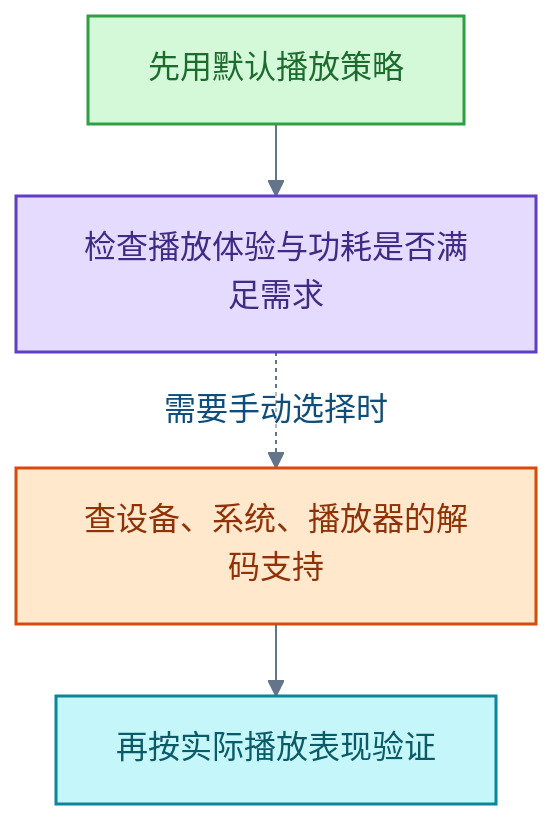

# 视频技术

<!-- domain: 视频技术 -->
**范围**：视频编码、解码与播放策略的原理和取舍。

**综述**：视频播放策略涉及编码压缩效率、解码支持和实际播放体验。AV1（AOMedia Video 1）、高效视频编码（High Efficiency Video Coding，HEVC／H.265）和高级视频编码（Advanced Video Coding，AVC／H.264）是不同的视频编码；较高压缩效率可以用较少数据维持相近画质，但实际画质还受片源、码率和编码参数影响。硬件解码通常比软件解码省电，支持情况取决于设备、系统和播放器；不能仅按编码新旧判断流畅度和功耗。“默认”的具体选择与回退规则由平台实现，当前尚未确认用户所指的平台。
<!-- /domain -->

本领域讨论视频播放策略：AV1、HEVC 与 AVC 三种编码在压缩效率、解码支持与播放体验上的主线与取舍；具体平台的默认规则实现暂未核实。

## 默认、AV1、HEVC 与 AVC 播放策略的区别

播放器中的“默认、AV1、HEVC、AVC”选项对应不同的视频编码：

- 高级视频编码（Advanced Video Coding，AVC／H.264）
- 高效视频编码（High Efficiency Video Coding，HEVC／H.265）
- AV1（AOMedia Video 1）

三者的主要取舍是压缩效率、兼容性和解码功耗：

- 较新的编码通常能用较少数据维持相近画质（压缩效率更高）。
- 实际画质不能只看编码名称，还受片源、码率和编码参数影响。
- 硬件解码通常比软件解码省电；解码支持取决于设备、系统和播放器。
- 因此不能仅按编码新旧判断流畅度和功耗。

选择建议：

**限制**：“默认”的具体选择与回退规则由平台实现决定；具体平台的规则尚未核实。

### 关键信源

- [AOMedia：AV1 Video Codec](https://aomedia.org/specifications/av1/)（一手）
- [ITU-T H.264：Advanced video coding](https://www.itu.int/rec/T-REC-H.264)（一手）
- [ITU-T H.265：High efficiency video coding](https://www.itu.int/rec/T-REC-H.265)（一手）
- [Meta、Vodafone 与 YouTube：Video Streaming with the AV1 Video Codec in Mobile Devices（2025-09）](https://engineering.fb.com/wp-content/uploads/2025/09/Meta-AV1-White-Paper-FINAL.pdf)（一手）
- [Chromium：Audio/Video，编码支持及 HEVC 硬件要求](https://www.chromium.org/audio-video/)（一手）

### 证据与时效 · q-20261016-001

- **信源**：[一手] [AOMedia：AV1 Video Codec](https://aomedia.org/specifications/av1/)；[一手] [ITU-T H.264：Advanced video coding](https://www.itu.int/rec/T-REC-H.264)；[一手] [ITU-T H.265：High efficiency video coding](https://www.itu.int/rec/T-REC-H.265)；[一手] [Meta、Vodafone 与 YouTube：Video Streaming with the AV1 Video Codec in Mobile Devices（2025-09）](https://engineering.fb.com/wp-content/uploads/2025/09/Meta-AV1-White-Paper-FINAL.pdf)；[一手] [Chromium：Audio/Video，编码支持及 HEVC 硬件要求](https://www.chromium.org/audio-video/)

## 提问记录

### q-20261016-001

- **原题**：2026-10-16 · 默认、AV1、HEVC 与 AVC 视频播放策略有什么区别
- **问**：播放器中的“默认、AV1、HEVC、AVC”几种视频播放策略有什么区别？
- **领域**：视频技术
- **首次**：2026-10-16
- **更新**：2026-10-16
- **正文**：[默认、AV1、HEVC 与 AVC 播放策略的区别](#默认av1hevc-与-avc-播放策略的区别)
