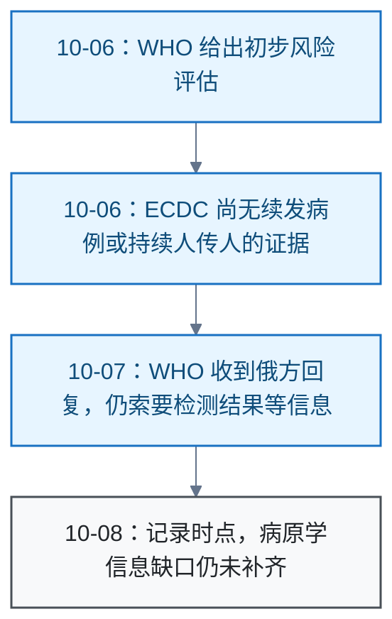

# 传染病

<!-- domain: 传染病 -->
**范围**：传染病疫情通报、传播风险与防控依据。

**综述**：判断疫情必须区分疑似事件、确诊病例与持续传播，并保留官方通报日期。俄罗斯伊尔库茨克研究所工作人员死亡事件截至 2026-10-08 仍存在病原学信息缺口：WHO 10 月 7 日确认收到俄方关于近期未报告当地鼠疫病例、约 200 名接触者被隔离的回复，但仍要求检测结果、接触者健康状况及第二名员工不明原因肺炎报道的核实信息。ECDC 10 月 6 日称尚无续发病例报告或持续人传人的证据；WHO 10 月 6 日的风险判断为初步评估，10 月 7 日强调资料不足，无法完成全面风险评估。
<!-- /domain -->

传染病领域的疫情核实记录。主线：判断疫情时区分疑似事件、确诊病例与持续传播，并保留官方通报日期。边界：只收已核实的一手通报；资料不足时写明缺口，不代替官方下结论。

## 俄罗斯鼠疫传闻的核实

**结论**：截至 2026-10-08，已核实的一手资料不能确认俄罗斯发生鼠疫（Plague）暴发。事件为伊尔库茨克（Irkutsk）一名研究所工作人员因重症肺炎住院后死亡。俄方向世界卫生组织（World Health Organization，WHO）表示，当地近期未报告鼠疫病例，并隔离约 200 名接触者。同时，现有资料不能认定已排除鼠疫。

**时间线**：

**原因与缺口**：

- WHO 于 10 月 7 日确认收到俄方回复：近期未报告当地鼠疫病例、约 200 名接触者被隔离。WHO 仍要求检测结果、接触者健康状况，以及第二名员工不明原因肺炎报道的核实信息。
- WHO 10 月 6 日的风险判断为初步评估；10 月 7 日强调资料不足，无法完成全面风险评估。
- 欧洲疾病预防控制中心（European Centre for Disease Prevention and Control，ECDC）10 月 6 日称，尚无续发病例报告或持续人传人的证据。

**限制**：结论只代表截至 2026-10-08 的核实结果。病原学信息缺口补齐之前，任何暴发与否的定性都超出本记录的证据范围。

**信源**：

- [一手] [WHO 总干事 2026-10-07 记者会讲话](https://www.who.int/news-room/speeches/item/who-director-general-s-opening-remarks-at-the-media-briefing---7-october-2026)
- [一手] [ECDC 2026-10-06：监测俄罗斯不明原因肺炎事件](https://www.ecdc.europa.eu/en/news-events/ecdc-closely-monitoring-situation-following-case-pneumonia-unknown-origin-russia)
- [一手] [联合国日内瓦 2026-10-06 记者会摘要及实录](https://www.unognewsroom.org/teleprompter/en/3288/un-geneva-press-briefing-06-october-2026/9744)

### 证据与时效 · q-20261008-005

- **信源**：[一手] [WHO 总干事 2026-10-07 记者会讲话](https://www.who.int/news-room/speeches/item/who-director-general-s-opening-remarks-at-the-media-briefing---7-october-2026)；[一手] [ECDC 2026-10-06：监测俄罗斯不明原因肺炎事件](https://www.ecdc.europa.eu/en/news-events/ecdc-closely-monitoring-situation-following-case-pneumonia-unknown-origin-russia)；[一手] [联合国日内瓦 2026-10-06 记者会摘要及实录](https://www.unognewsroom.org/teleprompter/en/3288/un-geneva-press-briefing-06-october-2026/9744)

## 提问记录

### q-20261008-005

- **原题**：2026-10-08 · 俄罗斯鼠疫的最新情况
- **问**：俄罗斯鼠疫的最新情况
- **领域**：传染病
- **首次**：2026-10-08
- **更新**：2026-10-08
- **正文**：[俄罗斯鼠疫传闻的核实](#俄罗斯鼠疫传闻的核实)
