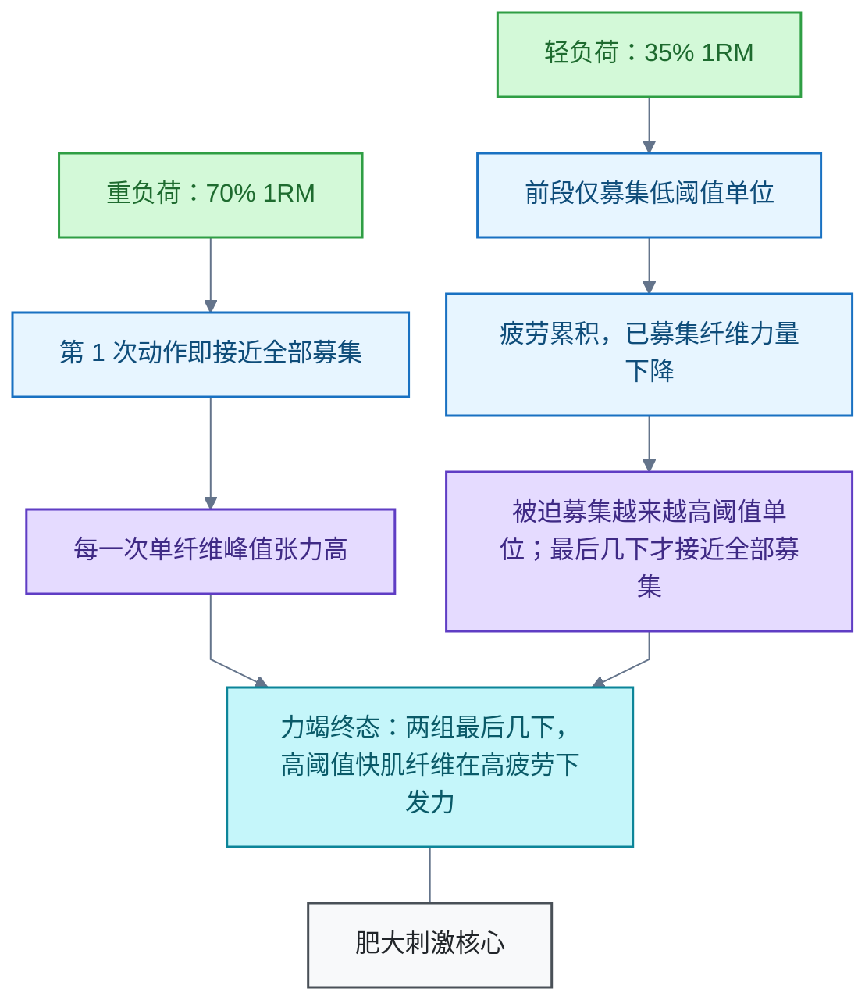

# 力量训练

阻力训练领域。主线：机械张力驱动肌肥大，张力作用于肌纤维而非杠铃重量；负荷轻重与距力竭程度共同决定刺激。边界：结论限于健康成年人的常规阻力训练，极端轻负荷与特殊人群未核实。

## 轻负荷与重负荷都力竭时，增肌效果是否相同

**问题**：同一动作，20 kg × 12 次与 10 kg × 30 次都做到力竭，产生的机械张力效果和增肌效果一样吗？

**结论**：机械张力效果不一样——每一下的单纤维张力、募集路径、时间历程都不同。但两个负荷分别约为 35% 与 70% 的一次重复最大重量（One-Repetition Maximum，1RM），都在有效区间内且都到力竭，肌肥大（Muscular Hypertrophy）效果在现有证据下相近。最大力量增长与时间效率明显偏向重负荷。

### 机制：力竭把募集终态拉近，但"张力配方"不同

机械张力的肥大刺激作用在肌纤维上，不等于杠铃重量。按运动单位大小原则（Size Principle，Henneman 1957；综述见 [Gordon et al. 2004（二手）](https://pubmed.ncbi.nlm.nih.gov/15523522/)），运动单位按阈值从小到大依次募集：

两组每一下的张力、张力-时间积分与代谢应激都不同。它们不是同一种刺激，只是汇入同一类适应结果。

### 证据

- [一手] [Morton et al. 2016, J Appl Physiol](https://pubmed.ncbi.nlm.nih.gov/27174923/)：30% 与 80% 1RM 均做至自主力竭、容量匹配，训练有素者 12 周肥大无显著差异；1RM 力量增长 80% 组更大。
- [一手] [Lasevicius et al. 2018, Eur J Sport Sci](https://pubmed.ncbi.nlm.nih.gov/29564973/)：20/40/60/80% 1RM 容量匹配、做到力竭，20% 组（约 33 次/组）肥大接近为零，40% 起相近——有效负荷下限约 30-40% 1RM。
- [一手] [Lopez et al. 2021, Med Sci Sports Exerc](https://pubmed.ncbi.nlm.nih.gov/33433148/)（网络荟萃）：肥大在 <60% 与 ≥60% 1RM 间无显著差异；最大力量显著偏向高负荷。
- [一手] [Refalo et al. 2021](https://pubmed.ncbi.nlm.nih.gov/33874848/)（负荷荟萃）：负荷对肥大影响小，对最大力量影响大。
- [一手] [Refalo et al. 2022, Sports Med](https://pubmed.ncbi.nlm.nih.gov/36334240/)（荟萃）：距力竭程度相近时肥大相似；不必每组真力竭，接近力竭（约 0-3 次储备）即可。

### 本例换算

- 20 kg × 12 次 → 1RM ≈ 28 kg（12RM ≈ 70% 1RM）；同一动作 10 kg ≈ 35% 1RM。
- 两组均 ≥30% 1RM 且都到力竭 → 预期肌肥大相近。
- 限制：次数-负荷换算公式（如 Epley）在 >12 次时不可靠；此处用同一动作两个负荷互相校合估计。

### 取舍

- **力量增长**：重负荷优。最大力量依赖负荷特异的神经适应。
- **效率**：轻负荷组做一组耗时约 2.5 倍，代谢疲劳与不适更高。
- **敏感性**：轻负荷刺激对距力竭更敏感。10 kg 组若提前 5 次停止，高阈值单位募集不足，刺激骤降；重负荷留 2-3 次储备刺激仍足。

### 限制与待解

- 结论适用于健康成年人、单关节与多关节动作混合的常规阻力训练；极端轻负荷（<30% 1RM）与特殊人群不在核实范围。
- 运动单位大小原则仅核实到综述层。
- 待解：动作类型、训练年限与肌纤维构成对负荷响应的调节。
