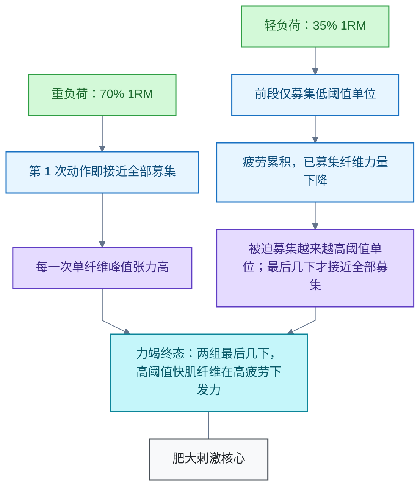

# 力量训练

<!-- domain: 力量训练 -->
**范围**：阻力训练的负荷、力竭与机械张力和增肌效果。

**综述**：阻力训练的肌肥大刺激以机械张力为核心，但张力作用于肌纤维而非杠铃重量。按运动单位大小原则，重负荷（约 ≥60% 1RM）第 1 次动作即接近全部募集；轻负荷靠疲劳累积逐步募集高阈值单位，力竭使两者募集终态接近。负荷在约 30% 至 85% 1RM 间、接近力竭（0-3 次储备）且容量匹配时，肥大大体相近（Morton 2016、Lopez 2021、Refalo 2021/2022）；20% 1RM 即使力竭也几乎无效（Lasevicius 2018），有效下限约 30-40% 1RM。最大力量增长显著偏向重负荷。轻负荷组耗时与代谢成本高约 2-3 倍，且对距力竭程度更敏感。力竭次数与 %1RM 的换算仅在约 5-10 次区间可靠；60% 附近力竭次数约 15-20 次，公式、个体与动作差异大，宜先估 1RM 再换算。待解：动作类型、训练年限与肌纤维构成对负荷响应的调节。
<!-- /domain -->

阻力训练领域。主线：机械张力驱动肌肥大，张力作用于肌纤维而非杠铃重量；负荷轻重与距力竭程度共同决定刺激。边界：结论限于健康成年人的常规阻力训练，极端轻负荷与特殊人群未核实。

## 负荷轻重与力竭对增肌效果的影响

机械张力的肥大刺激作用在肌纤维上，不等于杠铃重量。负荷轻重决定每一次动作的张力"配方"——单纤维张力、募集路径与时间历程都不同；力竭程度决定高阈值运动单位最终是否被募集。负荷在约 40% 至 85% 一次重复最大重量（One-Repetition Maximum，1RM）之间、接近力竭且容量匹配时，肌肥大（Muscular Hypertrophy）效果在现有证据下相近；最大力量增长与时间效率明显偏向重负荷。

### 机制：力竭把募集终态拉近，但"张力配方"不同

按运动单位大小原则（Size Principle，Henneman 1957；综述见 [Gordon et al. 2004（二手）](https://pubmed.ncbi.nlm.nih.gov/15523522/)），运动单位按阈值从小到大依次募集：

以 20 kg × 12 次与 10 kg × 30 次两个力竭组为例：

- 重负荷组（20 kg，12RM ≈ 70% 1RM）：第 1 次动作即接近全部募集，**每一次的单纤维峰值张力高**。
- 轻负荷组（10 kg，30RM ≈ 35% 1RM）：前段只募集低阈值运动单位；随疲劳累积，已募集纤维力量下降，为继续移动 10 kg，神经系统被迫募集越来越高阈值的单位，**最后几下才接近全部募集**。
- 力竭使两组的**终态**接近：最后几下都是高阈值快肌纤维在高疲劳状态下发力，这是肥大刺激的核心来源。

两组每一下的张力、张力-时间积分与代谢应激都不同。它们不是同一种刺激，只是汇入同一类适应结果。

### 证据

- [一手] [Morton et al. 2016, J Appl Physiol](https://pubmed.ncbi.nlm.nih.gov/27174923/)：30% 与 80% 1RM 均做至自主力竭、容量匹配，训练有素者 12 周肥大无显著差异；1RM 力量增长 80% 组更大。
- [一手] [Lasevicius et al. 2018, Eur J Sport Sci](https://pubmed.ncbi.nlm.nih.gov/29564973/)：20/40/60/80% 1RM 容量匹配、做到力竭，20% 组（约 33 次/组）肥大接近为零，40% 起相近——有效负荷下限约 30-40% 1RM。
- [一手] [Lopez et al. 2021, Med Sci Sports Exerc](https://pubmed.ncbi.nlm.nih.gov/33433148/)（网络荟萃）：肥大在 <60% 与 ≥60% 1RM 间无显著差异；最大力量显著偏向高负荷。
- [一手] [Refalo et al. 2021](https://pubmed.ncbi.nlm.nih.gov/33874848/)（负荷荟萃）：负荷对肥大影响小，对最大力量影响大。
- [一手] [Refalo et al. 2022, Sports Med](https://pubmed.ncbi.nlm.nih.gov/36334240/)（荟萃）：距力竭程度相近时肥大相似；不必每组真力竭，接近力竭（约 0-3 次储备）即可。
- [二手] [Gordon et al. 2004, 大小原则综述](https://pubmed.ncbi.nlm.nih.gov/15523522/)。
- **核实**：2026-10-30；经 PubMed 核实五篇原始研究与荟萃的标题、期刊与结论要点（Morton/Lasevicius 的 PMID 与页码经 PubMed 页面直接确认），大小原则仅核实到综述层。结论适用于健康成年人、单关节与多关节动作混合的常规阻力训练；极端轻负荷（<30% 1RM）与特殊人群不在本次核实范围。

### 本例换算

- 20 kg × 12 次 → 1RM ≈ 28 kg（12RM ≈ 70% 1RM）；同一动作 10 kg ≈ 35% 1RM。
- 两组均 ≥30% 1RM 且都到力竭 → 预期肌肥大相近。
- 限制：次数-负荷换算公式（如 Epley）在 >12 次时不可靠；此处用同一动作两个负荷互相校合估计。

### 20 次与 12 次力竭组的增肌预期

20 次力竭约 60% 1RM，12 次力竭约 70% 1RM（换算依据见[力竭次数与 %1RM 的换算](#力竭次数与-1rm-的换算)）。两者都在已核实的有效区间（约 40-85% 1RM）且都力竭，预期肌肥大大体相近；最大力量增长与时间效率仍偏向 12 次组（见[取舍](#取舍)）。

- 20 次 → 60% 只是粗定位：Brzycki 已超适用区，荟萃实测 60% 个体 SD 约 ±4.4 次。但个体偏到约 55% 或 65% 都稳在有效区间内，结论不受换算误差影响。
- 组耗时按次数比例约 20/12 ≈ 1.7 倍（30 次 vs 12 次有实测约 2.5 倍，此处按次数比例估计，未核实）。
- 核实：2026-11-02；复用本节证据（Lasevicius 2018、Lopez 2021、Refalo 2022）与换算章节已核实来源，无新增一手核实。

### 取舍

- **力量增长**：重负荷优。最大力量依赖负荷特异的神经适应。
- **效率**：轻负荷组做一组耗时约 2.5 倍，代谢疲劳与不适更高。
- **敏感性**：轻负荷刺激对距力竭更敏感。10 kg 组若提前 5 次停止，高阈值单位募集不足，刺激骤降；重负荷留 2-3 次储备刺激仍足。

### 限制与待解

- 结论适用于健康成年人、单关节与多关节动作混合的常规阻力训练；极端轻负荷（<30% 1RM）与特殊人群不在核实范围。
- 运动单位大小原则仅核实到综述层。
- 待解：动作类型、训练年限与肌纤维构成对负荷响应的调节。

## 力竭次数与 %1RM 的换算

力竭次数与 %1RM 的换算仅在约 5-10 次力竭区间可靠：力竭 5 次约 85-90% 1RM，力竭 10 次约 75% 1RM——教材表、Epley 与 Brzycki 公式和荟萃实测在此区间收敛。60% 1RM 对应的力竭次数约 15-20 次，公式间、个体间与动作间差异都大。不要用"能做约 17 次"确认 60%；先用力竭 5-10 次的重量估出 1RM，再乘 60%。

### 换算表与公式

换算以"做到力竭"为前提。次数为 n、重量为 w 时：

- Epley（1985，磅数表，非同行评审）：1RM = w × (1 + n/30)，即 w = 30/(30+n) × 1RM。
- Brzycki（1993，JOPERD）：1RM = w × 36/(37−n)，即 w = (37−n)/36 × 1RM。
- 教材表（NSCA，Baechle & Earle）：按次数直接查 %1RM。

| 力竭次数 | Epley | Brzycki | 教材表 | 荟萃实测（Nuzzo 2024） |
| --- | --- | --- | --- | --- |
| 5 | 86% | 89% | 87% | ≈90%（90% 实测约 5 次） |
| 8 | 79% | 81% | 80% | — |
| 10 | 75% | 75% | 75% | 75-80%（80% 实测卧推约 9 次、腿举约 13 次） |
| 12 | 71% | 69% | 67-70% | — |
| 15 | 67% | 61% | — | ≈70%（70% 实测约 15 次） |
| 20 | 60% | 47%（超出适用范围） | — | 60% 实测约 20 次 |

两个公式在 ≤10 次时结果几乎相同；次数越多分歧越大。

### 60% 附近反推不可靠的原因

- **公式分歧**：60% 处 Epley 给 20 次，Brzycki 给 15 次。
- **个体方差**：荟萃（Nuzzo 2024，269 项研究、7289 人）显示个体间标准差在 60% 处约 ±4.4 次，在 80% 处约 ±2.5 次。负荷越轻，方差越大。
- **动作差异**：动作类型是唯一的显著调节因子。同一 80% 1RM，卧推约 9 次，腿举约 13 次。
- **训练背景**：腿举 70% 1RM 力竭次数，举重训练者 17.9±2.8 次，耐力跑者 39.9±17.6 次（Richens & Cleather 2014）。耐力项目者远多于换算表。

### 实操

1. 选一个能做 5-10 次就力竭的重量。此区间三种来源收敛、方差最小。
2. 套 Epley 或 Brzycki 估 1RM。
3. 训练重量 = 60% × 估出的 1RM。
4. 若留有次数储备，则实际负荷高于次数对应的百分比。

例：20 kg × 12 次力竭。Epley：1RM ≈ 20 × (1 + 12/30) = 28 kg，60% ≈ 17 kg。

### 证据

- **核实**：2026-11-02；Nuzzo 荟萃与 Richens 原文经 PMC 全文核对（次数均值、标准差、调节因子、公式出处性质）；教材表数值经二手转引，未核对原书逐行数值；两公式百分比由公式定义直接计算。
- [一手] [Nuzzo et al. 2024, Sports Medicine 54(2):303-321](https://pubmed.ncbi.nlm.nih.gov/37792272/)：荟萃 269 项研究；90% ≈ 5 次、80% ≈ 9-13 次、70% ≈ 15 次；性、年龄、训练状态影响小，动作类型是主要调节因子；传统表在轻负荷处低估次数。
- [一手] [Richens & Cleather 2014, Biol Sport 31(2):157-161](https://pmc.ncbi.nlm.nih.gov/articles/PMC4042664/)：腿举 70%/80%/90% 力竭次数在举重与耐跑选手间差异显著；其表 1 记录传统换算表的原始出处（Epley 磅数表、Brzycki 1993 JOPERD 64:88-90）多为非同行评审资料。
- [二手] NSCA 教材表（Baechle & Earle, Essentials of Strength Training and Conditioning）：5RM ≈ 87%、10RM ≈ 75%，经 Nuzzo 2024 与 NSCA 1RM 测试规程转引。

## 提问记录

### q-20261030-003

- **原题**：2026-10-30 · 轻重负荷都力竭时机械张力与增肌效果是否相同
- **问**：20 kg × 12 次与 10 kg × 30 次都做到力竭，产生的机械张力效果和肌肉增长效果一样吗？追问：每组 20 次力竭与 12 次力竭，对肌肥大影响是否相近？
- **领域**：力量训练
- **首次**：2026-10-30
- **更新**：2026-11-02
- **正文**：[负荷轻重与力竭对增肌效果的影响](#负荷轻重与力竭对增肌效果的影响)

### q-20261102-001

- **原题**：2026-11-02 · 如何用力竭次数反推 1RM 的百分比
- **问**：如何通过做多少次来确认 60% 1RM？做 5 次、做 10 次各是百分之多少？
- **领域**：力量训练
- **首次**：2026-11-02
- **更新**：2026-11-02
- **正文**：[力竭次数与 %1RM 的换算](#力竭次数与-1rm-的换算)
- **关联**：[负荷轻重与力竭对增肌效果的影响](#负荷轻重与力竭对增肌效果的影响)
