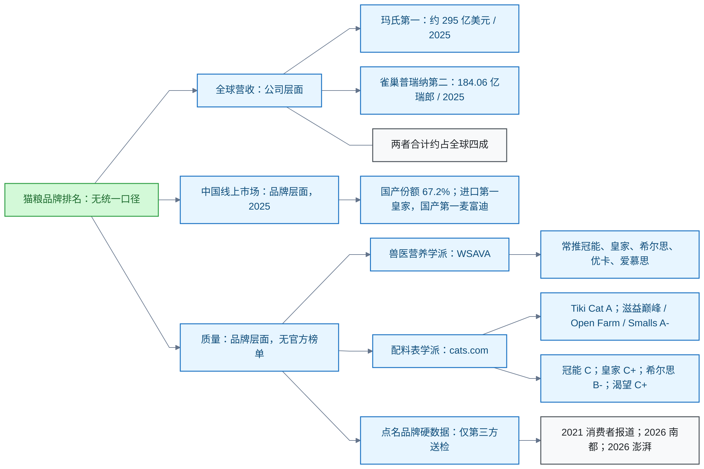

# 宠物食品

<!-- domain: 宠物食品 -->
**范围**：猫粮等宠物食品的品牌排名口径、市场格局与营养标准。

**综述**：猫粮"排名"没有统一口径：全球营收排名是公司层面（玛氏第一、雀巢普瑞纳第二，合计约占全球四成）；中国市场份额排名是品牌线上层面（2025 年国产占 67.2%，进口第一皇家、国产第一麦富迪）。**质量排名（2026-10-23 深化）无官方榜单，两个评价学派结论几乎相反**：兽医营养学派按 WSAVA 评估问题常推冠能、皇家、希尔思、优卡、爱慕思（WSAVA 官方不认证品牌，且三大厂资助研究有利益关联争议）；配料表学派 cats.com 评分中 Tiki Cat 为 A、滋益巅峰/Open Farm/Smalls 为 A-，而冠能 C、皇家 C+、希尔思 B-、渴望 C+。点名品牌的硬数据只有第三方送检：2021《消费者报道》（珍宝、信元发育宝、伟嘉/力狼等有问题记录）、2026 南都鉴定（哈迪贝尔蛋白虚标、5 款检出玉米赤霉烯酮）、2026-07 澎湃报道伯纳天纯/弗列加特涉投诉。待解：具体产品维度的干湿粮与营养指标对比、浙江省消保委 41 款结果明细。
<!-- /domain -->

猫粮品牌"排名"的口径辨析记录。主线：区分公司营收、品牌市场份额与质量评价三种口径。边界：质量无官方榜单，点名品牌只采信第三方送检。

## 猫粮品牌排名的三种口径

**结论**：猫粮品牌排名没有统一定义，按口径分三种。全球营收排名看公司：玛氏第一、雀巢普瑞纳第二，合计约占全球四成。中国市场份额排名看品牌：2025 年国产占线上 67.2%，进口第一皇家、国产第一麦富迪。质量排名无官方榜单，两个评价学派结论几乎相反。

**口径一：全球营收（公司层面）**。玛氏第一，约 295 亿美元（2025 年，行业媒体估算，二手）。雀巢普瑞纳第二，184.06 亿瑞郎（2025 年，官方财报，一手）。两者合计约占全球市场四成。

**口径二：中国线上市场（品牌层面）**。2025 年国产份额 67.2%；进口第一为皇家，国产第一为麦富迪（行业报告，二手）。

**口径三：质量（品牌层面）**。无官方排名，两个学派结论几乎相反：

- 兽医营养学派：按世界小动物兽医协会（World Small Animal Veterinary Association，WSAVA）营养指南评估品牌，常推冠能、皇家、希尔思、优卡、爱慕思。限制：WSAVA 官方不认证品牌；三大厂资助研究存在利益关联争议。
- 配料表学派：cats.com 六维评分。Tiki Cat 为 A；滋益巅峰、Open Farm、Smalls 为 A-；冠能 C、皇家 C+、希尔思 B-、渴望 C+。该评分对 cats.com 自家为一手。推荐名单与兽医学派几乎相反。

**点名品牌的送检数据**。排名之外，点名品牌的硬数据只有第三方送检：

- 2021 年《消费者报道》14 款测试：珍宝粗蛋白不达标；皇家、冠能、喜跃钙磷比欠佳；信元发育宝菌落超标 7.7 倍；伟嘉、力狼检出呕吐毒素（转引，二手）。
- 2026 年 3 月南都鉴定 8 款：哈迪贝尔粗蛋白实测 14.26%，宣称值不低于 28.1%，粗灰分超标；5 款检出玉米赤霉烯酮（一手媒体）。
- 2026 年 7 月澎湃报道：伯纳天纯、弗列加特涉猫咪后肢无力投诉；投诉不等于定论（一手媒体）。

**限制与待解**。质量口径只覆盖品牌层面；具体产品的干湿粮与营养指标对比待补。浙江省消保委 41 款宠物食品比较试验（2023）的结果明细待查。

**信源**：

- [一手] [雀巢 2025 全年业绩](https://www.nestle.com/media/pressreleases/allpressreleases/full-year-results-2025)
- [一手] [GB/T 31217-2014 标准信息](https://openstd.samr.gov.cn/bzgk/std/newGbInfo?hcno=9496ABE283E8EB1FF58DF961B2DBAC9B)
- [一手] [WSAVA 全球营养指南](https://wsava.org/global-guidelines/global-nutrition-guidelines)
- [一手媒体] [南都鉴定 8 款猫粮（2026-03）](https://ipaper.oeeee.com/ipaper/A/html/2026-03/20/content_2291.htm)
- [一手媒体] [澎湃：伯纳天纯、弗列加特投诉报道（2026-07）](https://www.thepaper.cn/newsDetail_forward_33544984)
- [一手官方] [浙江省消保委 41 款宠物食品比较试验（2023）](https://www.zj315.org/News/ArticleDetail.aspx?iIY2ISQvqOCvTQDgRnw41A==)
- [对其评分为一手] [cats.com 品牌评分 A–Z](https://cats.com/cat-food-reviews)、[评分方法](https://cats.com/how-we-rate-cat-food)
- [二手] [PetfoodIndustry 北美前十](https://www.petfoodindustry.com/regions/us-and-canada/article/15832036/us-home-to-all-top-10-north-american-pet-food-companies-by-2025-revenue)、[炼丹炉：宠物品牌竞争格局](https://www.fxbaogao.com/detail/5185582)、[知乎转引《消费者报道》14 款测试](https://zhuanlan.zhihu.com/p/360809384)、[时代周报：信元/伟嘉测试](https://www.time-weekly.com/post/279871)

### 证据与时效 · q-20261023-002

- **信源**：[一手] [雀巢 2025 全年业绩](https://www.nestle.com/media/pressreleases/allpressreleases/full-year-results-2025)；[一手] [GB/T 31217-2014 标准信息](https://openstd.samr.gov.cn/bzgk/std/newGbInfo?hcno=9496ABE283E8EB1FF58DF961B2DBAC9B)；[一手] [WSAVA 全球营养指南](https://wsava.org/global-guidelines/global-nutrition-guidelines)；[一手媒体] [南都鉴定 8 款猫粮（2026-03）](https://ipaper.oeeee.com/ipaper/A/html/2026-03/20/content_2291.htm)；[一手媒体] [澎湃：伯纳天纯、弗列加特投诉报道（2026-07）](https://www.thepaper.cn/newsDetail_forward_33544984)；[一手官方] [浙江省消保委 41 款宠物食品比较试验（2023）](https://www.zj315.org/News/ArticleDetail.aspx?iIY2ISQvqOCvTQDgRnw41A==)；[对其评分为一手] [cats.com 品牌评分 A–Z](https://cats.com/cat-food-reviews)、[评分方法](https://cats.com/how-we-rate-cat-food)；[二手] [PetfoodIndustry 北美前十](https://www.petfoodindustry.com/regions/us-and-canada/article/15832036/us-home-to-all-top-10-north-american-pet-food-companies-by-2025-revenue)、[炼丹炉：宠物品牌竞争格局](https://www.fxbaogao.com/detail/5185582)、[知乎转引《消费者报道》14 款测试](https://zhuanlan.zhihu.com/p/360809384)、[时代周报：信元/伟嘉测试](https://www.time-weekly.com/post/279871)

## 提问记录

### q-20261023-002

- **原题**：2026-10-23 · 猫粮品牌排名有哪些口径
- **问**：猫粮品牌排名是怎样的？（追问：不是公司层面，要具体品牌的**质量**排名）
- **领域**：宠物食品
- **首次**：2026-10-23
- **更新**：2026-10-23
- **正文**：[猫粮品牌排名的三种口径](#猫粮品牌排名的三种口径)
- **关联**：无
