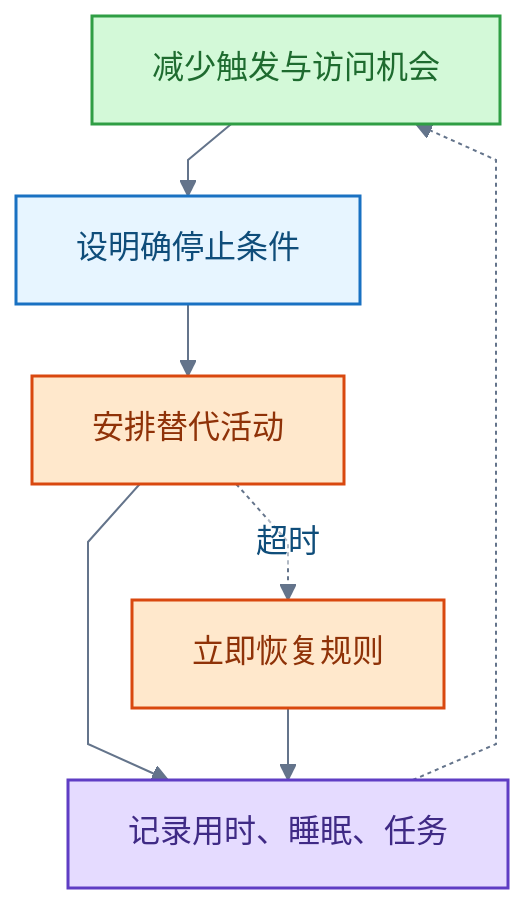

# 数字使用与自控

<!-- domain: 数字使用与自控 -->
**范围**：短视频、手机与社交媒体的使用控制、行为干预及功能损害识别。

**综述**：控制短视频使用，应同时减少触发与访问机会、设置明确的停止条件，并安排能够满足休息、社交等需要的替代活动。评估问题严重程度时，应关注失控和睡眠、学习、工作等功能损害，不能仅凭使用时长判断成瘾。手机与社交媒体的一手干预研究支持组合环境调整和有计划的暂停使用，但不能据此宣称特定方案能够治愈抖音成瘾；固定天数和分钟数只能作为试行参数。若反复限制仍失控且生活明显受损，应接受专业评估；认知行为治疗在更广义的互联网与游戏成瘾中有随机临床试验证据，其效果不能直接等同于短视频专项疗效。待解问题是个人的使用时长、触发情境、功能损害及是否存在工作使用需求。
<!-- /domain -->

数字使用与自控领域的问答记录。主线：控制短视频使用要同时减少触发与访问机会、设置停止条件、安排替代活动；判断严重程度看失控与功能损害，不看时长。边界：干预数字只是试行参数，不据此诊断或宣称疗效。

## 短视频使用的自控干预

**结论**：建议先试行 14 天。记录使用基线，按工作需要选择卸载或固定时段使用，关闭非必要通知，学习和睡觉时把手机放远，并为常见触发情境安排替代活动。每天记录全部短视频用时及睡眠、任务完成情况；超时后立即恢复规则。若反复限制仍失控，且生活明显受损，应到精神心理科或成瘾门诊接受专业评估。

**试行循环**：

**判断严重程度**：关注失控，以及睡眠、学习、工作等功能损害；不能仅凭使用时长判断成瘾。

**原因与证据**：

- 手机使用的随机对照试验（Randomised Controlled Trial，RCT，N=70）支持组合干预：减少触发、限制访问与替代活动共同生效，但不能分离每项措施的独立效果。
- 社交媒体研究（65 人对照）显示，有计划的短期暂停使用可能改善幸福感；该结果不能视为抖音成瘾的疗效证据。
- 认知行为治疗（Cognitive Behavioral Therapy，CBT）在更广义的互联网与游戏成瘾中有随机临床试验证据（143 名男性）；其效果不能直接等同于短视频专项疗效。

**限制与例外**：14 天等固定天数与分钟数只是执行建议，不是治疗或诊断阈值。存在工作使用需求时，选固定时段而非卸载。反复失控且生活明显受损时，自控方案让位于专业评估。

**待解**：个人的使用时长、触发情境、功能损害程度，以及是否存在工作使用需求。

**信源**：

- [一手] [A Nudge-Based Intervention to Reduce Problematic Smartphone Use: Randomised Controlled Trial](https://link.springer.com/article/10.1007/s11469-022-00826-w)（2022 年在线发表）
- [一手] [Cognitive Behavioral Therapy-Based Short-Term Abstinence Intervention for Problematic Social Media Use](https://link.springer.com/article/10.1007/s11126-020-09852-0)（2020 年在线发表）
- [一手] [Efficacy of Short-term Treatment of Internet and Computer Game Addiction: A Randomized Clinical Trial](https://jamanetwork.com/journals/jamapsychiatry/fullarticle/2737418)（2019 年）

### 证据与时效 · q-20261026-004

- **信源**：[一手] [A Nudge-Based Intervention to Reduce Problematic Smartphone Use: Randomised Controlled Trial](https://link.springer.com/article/10.1007/s11469-022-00826-w)（2022 年在线发表；随机试验部分 N=70，支持组合干预，不能分离每项措施的独立效果）；[一手] [Cognitive Behavioral Therapy-Based Short-Term Abstinence Intervention for Problematic Social Media Use: Improved Well-Being and Underlying Mechanisms](https://link.springer.com/article/10.1007/s11126-020-09852-0)（2020 年在线发表；65 人对照研究，支持有计划暂停使用的可能收益，不能视为抖音成瘾疗效证据）；[一手] [Efficacy of Short-term Treatment of Internet and Computer Game Addiction: A Randomized Clinical Trial](https://jamanetwork.com/journals/jamapsychiatry/fullarticle/2737418)（2019 年；143 名男性，研究对象为更广义的互联网与游戏成瘾，限制其对短视频问题的直接外推）。

## 提问记录

### q-20261026-004

- **原题**：2026-10-26 · 如何戒除抖音等短视频成瘾
- **问**：如何戒除抖音等短视频成瘾。
- **领域**：数字使用与自控
- **首次**：2026-10-26
- **更新**：2026-10-26
- **正文**：[短视频使用的自控干预](#短视频使用的自控干预)
