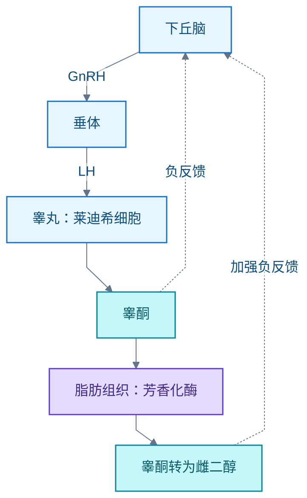

# 男性健康

睾酮（Testosterone）随年龄缓慢下降的领域。主线：30 岁以上男性先修可逆因素——减脂、睡眠、纠正缺乏——再谈年龄与医学路线。边界：结论限于 30 岁以上男性；训练容量、热量缺口与酒精的阈值效应待解。

## 30 岁+男性如何科学提高睾酮

**问题**：30 岁以上男性，有哪些有科学证据支持的提高睾酮的方式。

**结论**：按证据强度分三层。

- **确定有效**：肥胖者减重；保证睡眠；纠正锌或维生素 D 缺乏（仅缺乏者有效，充足者补无用）。
- **方向正确但幅度有限**：抗阻训练（急性升高，静息水平变化小且不一致）。
- **无效**：蒺藜（Tribulus terrestris）等市售"睾酮促升"补剂。

医学路线为睾酮替代治疗（Testosterone Replacement Therapy，TRT）：须同时满足症状与两次晨间总睾酮偏低方可诊断，由医生实施；无症状健康男性不应筛查或用药。

### 分层总览

| 干预 | 证据 | 幅度与条件 |
| --- | --- | --- |
| 减脂 | 一手 meta（Corona 2013） | 肥胖者最强杠杆；减重越多升幅越大 |
| 睡眠 ≥7 h | 一手 RCT 交叉实验（Leproult 2011） | 还债可逆；昼夜节律紊乱同样有害 |
| 纠正锌/维 D 缺乏 | 二手（待核原文） | 仅缺乏者有效，不能超正常范围 |
| 抗阻训练 | 二手综述 | 急性升高数分钟至 1 h；静息水平约不变 |
| 蒺藜类补剂 | 一手系统综述 | 无效 |
| TRT | 一手指南（Endocrine Society 2018） | 仅确诊性腺功能减退者；须医生处方与随访 |

### 机制：为什么减脂和睡眠最有效

睾酮由下丘脑-垂体-性腺轴（Hypothalamic-Pituitary-Gonadal Axis，HPG 轴）脉冲式调控：

- **脂肪越多，芳香化酶越多，越多睾酮转为雌二醇，负反馈越强，睾酮越低**。这是肥胖与低睾酮互为因果的核心通路，也是减脂有效的机制。
- **睡眠剥夺抑制垂体 LH 的脉冲分泌幅度**（Leproult 2011 的解释框架）。睾酮主要在睡眠期分泌，上午达到峰值。
- **年龄衰减不可逆但缓慢**：30 岁后总睾酮平均每年 -0.124 nmol/L（Harman 2001）。30 至 50 岁的理论降幅，远小于肥胖或睡眠剥夺造成的急性压低。先修可逆因素，再谈年龄。

### 证据

- [一手] [Harman 2001，BLSA 纵向队列（JCEM 86(2):724-731，PMID 11158037）](https://pubmed.ncbi.nlm.nih.gov/11158037/)：30 岁后总睾酮平均每年 -0.124 nmol/L，游离睾酮指数每年 -0.0049；摘要为绝对值，常引的"约 1%/年"是二手换算。
- [一手] [Corona 2013 系统综述与 meta 分析（Eur J Endocrinol 168(6):829-843，PMID 23482592）](https://pubmed.ncbi.nlm.nih.gov/23482592/)：减重逆转肥胖相关的低促性腺激素性性腺功能减退；减重更多、更年轻、非糖尿病、更胖者升幅越大。
- [一手] [Leproult & Van Cauter 2011（JAMA 305(21):2173-4）](https://jamanetwork.com/journals/jama/fullarticle/1029127)：10 名年轻健康男性每晚睡 5 h、连续 1 周，日间睾酮降 10% 至 15%（小样本）。
- [一手] [Endocrine Society 睾酮治疗临床实践指南（2018）](https://www.endocrine.org/clinical-practice-guidelines/testosterone-therapy)：诊断须症状加至少两次不同日晨间（必要时空腹）总睾酮偏低；不建议对无症状健康男性检测和治疗。
- [一手] [蒺藜系统综述（PMID 24559105）](https://pubmed.ncbi.nlm.nih.gov/24559105/)：现有证据不支持蒺藜提升人睾酮，营销主张无依据。
- [二手·待核原文] 维生素 D（Pilz 2011 RCT，3332 IU/日，缺乏者睾酮升约 30%）与锌（Prasad 系列）仅缺乏者有效——经检索摘要确认，未核对原文。
- [二手·未定位一手] 抗阻训练静息睾酮：急性升高明确，长期静息水平变化小且不一致。力量训练对增肌有效，但对静息睾酮的提升是另一回事（另见「力量训练」篇）。

### 限制与待解

- 酒精、极端节食、过量耐力训练对睾酮的抑制未单独核实。
- 训练容量、热量缺口与酒精对睾酮的阈值效应待解。
