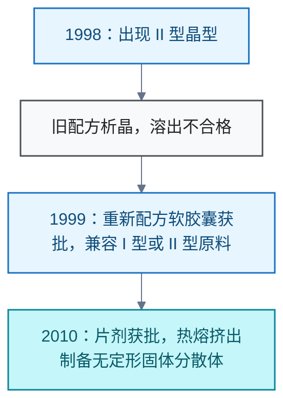
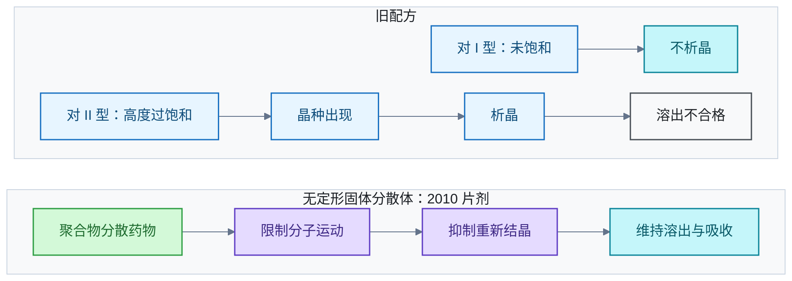

# 药物制剂

<!-- domain: 药物制剂 -->
**范围**：药物的晶型、溶解与溶出、制剂稳定性及生物利用度。

**综述**：药物的化学结构相同，固态排列仍可改变溶解度、溶出行为与口服吸收。利托那韦的 1998 年事件说明：热力学稳定性决定晶型的相对自由能，成核与生长的动力学决定晶型何时出现；旧配方对 I 型未饱和，却对更难溶的 II 型高度过饱和，出现晶种后可析晶并导致溶出不合格。该制剂问题已通过重新配方，以及后续热熔挤出制备无定形固体分散体得到解决；无定形制剂通过聚合物分散和限制分子运动来抑制重新结晶，须在规定条件与有效期内维持稳定性。
<!-- /domain -->

药物制剂领域的案例记录。同一化学结构的药物，固态排列仍可改变溶解度、溶出与口服吸收。主线：晶型转变引发的制剂事故及其解决。边界：只收已核实一手来源的个案结论。

## 利托那韦晶体问题的解决与原理

**结论**：利托那韦（Ritonavir）的制剂生产与吸收问题已解决。1998 年出现的 II 型晶型具有更稳定的氢键网络、更低的自由能和更低的溶解度。旧配方对 I 型未饱和，却对更难溶的 II 型高度过饱和；出现晶种后药物析晶，造成溶出不合格。1999 年重新配方的软胶囊获批，配方允许使用 I 型或 II 型原料。2010 年获批的片剂采用热熔挤出（Hot-Melt Extrusion，HME）制备无定形固体分散体（Amorphous Solid Dispersion，ASD）：药物分散在聚合物中，分子运动受限，重新结晶被抑制，从而维持可接受的稳定性与生物利用度。

**时间线**：

**原理**：热力学稳定性决定晶型的相对自由能，成核与生长的动力学决定晶型何时出现。

**限制**：无定形制剂须在规定条件与有效期内维持稳定性；本节结论限于上述一手文件的记载范围。

**信源**：

- [一手] [Bauer 等，Ritonavir: An Extraordinary Example of Conformational Polymorphism，2001，原始论文全文](https://www.cmbe.engr.uga.edu/bche4520/Other/Ch9/Bauer%202001.pdf)
- [一手] [FDA，1999 年 Norvir 软胶囊审评文件：重新配方兼容 I 型与 II 型](https://www.accessdata.fda.gov/drugsatfda_docs/nda/99/20-945.pdf_Ritonovir_Admindocs.pdf)
- [一手] [FDA，2017 年审评文件，第 6 页列明软胶囊与片剂首次批准日期](https://www.accessdata.fda.gov/drugsatfda_docs/nda/2017/209512Orig1s000OtherR.pdf)
- [一手] [AbbVie 研发人员等，Development and Palatability Assessment of Norvir® (Ritonavir) 100 mg Powder for Pediatric Population，2019](https://pmc.ncbi.nlm.nih.gov/articles/PMC6479559/)
- [一手] [Effect of Span 20 Feeding Zone in the Twin Screw Extruder on the Properties of Amorphous Solid Dispersion of Ritonavir，2023，原始研究](https://pmc.ncbi.nlm.nih.gov/articles/PMC9960583/)

### 证据与时效 · q-20261006-002

- **信源**：[一手] [Bauer 等，Ritonavir: An Extraordinary Example of Conformational Polymorphism，2001，原始论文全文](https://www.cmbe.engr.uga.edu/bche4520/Other/Ch9/Bauer%202001.pdf)；[一手] [FDA，1999 年 Norvir 软胶囊审评文件：重新配方兼容 I 型与 II 型](https://www.accessdata.fda.gov/drugsatfda_docs/nda/99/20-945.pdf_Ritonovir_Admindocs.pdf)；[一手] [FDA，2017 年审评文件，第 6 页列明软胶囊与片剂首次批准日期](https://www.accessdata.fda.gov/drugsatfda_docs/nda/2017/209512Orig1s000OtherR.pdf)；[一手] [AbbVie 研发人员等，Development and Palatability Assessment of Norvir® (Ritonavir) 100 mg Powder for Pediatric Population，2019](https://pmc.ncbi.nlm.nih.gov/articles/PMC6479559/)；[一手] [Effect of Span 20 Feeding Zone in the Twin Screw Extruder on the Properties of Amorphous Solid Dispersion of Ritonavir，2023，原始研究](https://pmc.ncbi.nlm.nih.gov/articles/PMC9960583/)

## 提问记录

### q-20261006-002

- **原题**：2026-10-06 · 利托那韦晶体问题是否解决及其原理
- **问**：利托那韦艾滋病晶体问题解决了吗，是什么原理？
- **领域**：药物制剂
- **首次**：2026-10-06
- **更新**：2026-10-06
- **正文**：[利托那韦晶体问题的解决与原理](#利托那韦晶体问题的解决与原理)
