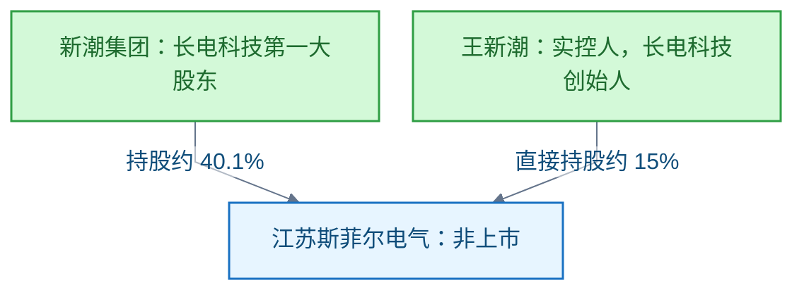

# 公司调研

本领域考察具体公司的业务、股权与资本运作。已调研一家：江苏斯菲尔电气。主线为公司画像、新潮系股权与两度 IPO 折戟；财务数据等待解项未核实。

## 斯菲尔电气公司画像：智能电网用户端厂商、新潮系与两度 IPO 折戟

结论：江苏斯菲尔电气股份有限公司（Jiangsu Sfere Electric Co., Ltd.）是江阴的智能电网用户端设备厂商，非上市。控股股东为新潮集团（约 40.1%），实际控制人王新潮（长电科技创始人）。2012 年创业板过会后于 2013 年终止审查；2019 年初再报创业板后无公开进展。

业务与资质：

- 产品线：智能测控仪表、电能质量治理、电气安全、能源管理软件；海外品牌 ELECNova 延伸至储能。
- 客户领域：轨道交通、市政建筑、信息通信、商业地产、教育医疗。
- 资质：高新技术企业、国家火炬计划重点高新技术企业、设博士后科研工作站；GB/T 22264-2008 与 GB/T 18216.12 起草单位。
- 1998 年成立于江阴（二手：百科与企业信息平台，未直接核实）。

股权与控制（设立时注册资本 3750 万元来自招股书）：

- 当前工商登记法定代表人为张凤雏（二手：爱企查，经职友集转载）。
- 王新潮是否仍任董事长未核实。

两度 IPO：

- 2012-04-24 创业板（ChiNext）过会，拟发行 1250 万股（二手：中新网）。
- 2013 年终止审查。撤回主因为业绩下滑（二手：中新网，新潮集团回应）；另有独立性举报传闻（传闻，未核实）。
- 2019 年初再报创业板，此后无公开进展。

人员规模与组织：

- 500 至 999 人区间（二手：职友集）；参保约 598 人（二手：企业信息平台经百科转述，未直接核实）。
- 组织为营销、研发、行政、制造四个中心。
- 在招职位分布：无锡 47、南京 12、上海 6、苏州 1（二手：职友集）。
- 官方社招页岗位发布于 2020-10，未标薪资（一手）。

薪资待遇（均为二手，样本小，职级与学历条件一并保留）：

- 职友集汇总的在招月薪：嵌入式软件（硕士及以上）10–13K、电子软件（本科）6–10K、海外技术工程师 12–20K、测试（大专）6–11K。
- 猎聘在招：储能海外销售 15–20K·13 薪、能源优化算法 17–30K、嵌入式硬件 10–20K。
- 职友集统计：61.4% 岗位 10–30K／月、应届生平均约 12.5K、行业对比 +25%（算法统计，可靠性一般）。
- 2020 届校招（信息已旧）：基础薪资 4000+ 提成、五险一金、节假日与生日福利、差旅补贴。
- 与上市公司对标安科瑞相比，薪资无明显优势。

冲突与未核实项：

- 注册资本不一致：百科记 4500 万元，爱企查（经职友集转载）记 4125 万元，招股书记设立时 3750 万元；未核实，并列存疑。
- 员工评价（看准网）未检索到足够样本。
- 待解：财务数据、王新潮卸任长电科技董事长时间、现任董事长、2019 年申报结局。

信源：[一手：斯菲尔官方网站](https://www.sfere-elec.com)、[一手：关于我们页](https://www.sfere-elec.com/index.php/gywm/gywm.html)、[一手：官网社会招聘页](https://www.sfere-elec.com/index.php/jrwm/shzp.html)、[一手：ELECNova 海外站](https://www.elecnovapower.com)、[一手：UN Global Compact 公司页](https://unglobalcompact.org)、[一手文件·转载：创业板招股说明书申报稿（东方财富 PDF 存档）](http://pdf.dfcfw.com)、[二手：中新网·新潮集团回应斯菲尔电气 IPO](https://www.chinanews.com/stock/2013/08-12/5148720.shtml)、[二手：中新网·7 家企业 IPO 审查终止](https://www.chinanews.com.cn/stock/)。
