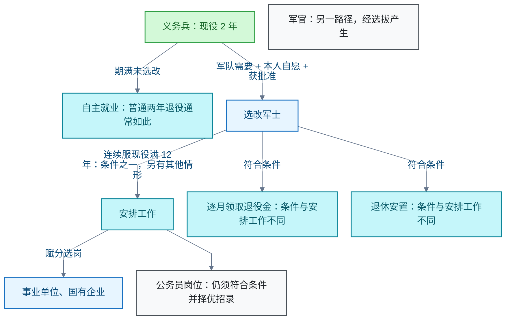

# 兵役与退役保障

<!-- domain: 兵役与退役保障 -->
**范围**：中国大陆参军路径、服役待遇、教育就业优待、退役安置规则与个人取舍。

**综述**：中国大陆参军的个人收益须沿义务兵、军士、军官三条路径分别判断，区分依法可享待遇、需选拔审批的机会及地方补助。义务兵现役期为 2 年，期满选改军士须符合军队需要、本人自愿并获批准；普通两年退役通常自主就业。军士连续服现役满 12 年是政府安排工作的条件之一，安排工作主要采用赋分选岗进入事业单位、国有企业，公务员岗位仍须符合条件并择优招录；逐月领取退役金、退休又有不同条件。教育资助按入伍或复学时间、实际费用及学制核算，现行本专科、研究生年上限分别为 20000 元、25000 元；考研加分与士兵专项计划不可叠加。个人决策须同时计算原有读书、工作的机会成本，不能将长期留队、提干、特定岗位或补助上限视为确定所得；应征地和安置地政策须另核实。
<!-- /domain -->

中国大陆参军的个人收益沿义务兵（Conscript）、军士（Non-Commissioned Officer，NCO）、军官（Officer）三条路径分别判断；须区分依法可享待遇、需选拔审批的机会与地方补助，并计入原有读书、工作路径的机会成本。

## 参军的个人收益与制度取舍

**结论**：参军的制度性收益包括四类：服役期间的生活与医疗保险保障；津贴或工资；符合条件时的家庭优待金与退役补助；教育资助及升学就业优待。具体收益取决于六个变量：身份、学历、年限、贡献、应征地、安置方式。普通两年义务兵退役通常自主就业；军士连续服现役满 12 年等情形可由政府安排工作；长期留队、军官选拔和具体岗位须另满足条件。

### 三条路径与退役去向

- 义务兵：现役期 2 年。期满选改军士须同时满足三个条件：军队需要、本人自愿、获批准。
- 军士：长期服役路径。连续服现役满 12 年是政府安排工作的条件之一；安排工作还可能覆盖其他情形。
- 军官：经选拔产生，属另一路径。

### 退役安置方式

- **自主就业**：普通两年义务兵退役的通常去向。
- **安排工作**：主要采用赋分选岗，进入事业单位、国有企业。公务员岗位不因安排工作直接获得，仍须符合条件并择优招录。
- **逐月领取退役金与退休**：条件与安排工作不同；记录未展开具体条件，须按《退役军人逐月领取退役金安置办法》等文件核实。

### 教育资助与升学优待

- **资助上限**：本专科每年 20000 元，研究生每年 25000 元。
- **资助核算**：按入伍或复学时间、实际费用及学制核算。
- **考研加分**：退役大学生士兵达到硕士报考条件后 3 年内报名，可申请初试总成绩加 10 分，同等条件下优先录取。
- **专项计划**：符合身份及报考条件者可申请退役大学生士兵专项计划；专项计划不再享受初试加分。加分与专项计划不可叠加。
- **免初试**：服役期间获得三等战功、二等功以上奖励或二级以上表彰且符合报考条件的退役人员，可申请免初试，仍须参加复试。
- 上述资格均须按规定申报并接受审核。
- 专升本招录、公务员报考、自主就业退役士兵创业就业税收优惠也属升学就业优待渠道；记录未展开其具体条件，须按当年文件核实。

### 个人决策的取舍

- 须同时计算原有读书、工作路径的收益：参军占用的时间是机会成本。
- 不能把长期留队、提干、特定岗位或补助上限视为确定所得。
- 比较时另计三个隐性维度：自主安排时间、健康、转轨成本。
- 应征地和安置地政策有地方差异，判断前须另行核实。

**信源**：

- [一手] [中华人民共和国兵役法（2021 年修订）](https://www.mod.gov.cn/gfbw/fgwx/flfg/4892491.html)
- [一手] [中华人民共和国军人地位和权益保障法](https://www.beijing.gov.cn/zhengce/zhengcefagui/202106/t20210611_2411278.html)
- [一手] [中华人民共和国退役军人保障法](https://www.mod.gov.cn/gfbw/fgwx/16048590.html)
- [一手] [退役军人安置条例（2024 年施行）](https://www.mee.gov.cn/zcwj/gwywj/202408/t20240802_1083259.shtml)
- [一手] [退役军人事务部：连续服现役满 12 年的答复](https://www.mva.gov.cn/hudong/bzxx/hfxd/202410/t20241008_446802.html)
- [一手] [退役军人逐月领取退役金安置办法](https://www.mva.gov.cn/gongkai/zfxxgkpt/zhengce/gfxwj/202209/t20220902_65211.html)
- [一手] [财政部等：关于调整完善国家助学贷款有关政策的通知（财教〔2024〕188 号）](https://nmg.mof.gov.cn/tongzhitonggao/202412/t20241204_3948955.htm)
- [一手] [山东省学生资助管理中心：服兵役国家教育资助](https://sdxszz.sdei.edu.cn/Show/7573)
- [一手] [2027 年全国硕士研究生招生工作管理规定](https://www.moe.gov.cn/srcsite/A15/moe_778/s3261/202609/t20260923_1451734.html)
- [一手] [北京市退役军人事务局转载教育部规定](https://tyjrswj.beijing.gov.cn/fwzl/jycy/202610/t20261020_4911367.html)
- [一手] [湖北省教育厅：2026 年专升本招生要求](https://jyt.hubei.gov.cn/zfxxgk/zc_GK2020/qtzdgkwj_GK2020/202601/t20260123_5862335.shtml)
- [一手] [中央机关及其直属机构 2027 年度考试录用公务员报考指南](https://shanghai.chinatax.gov.cn/xxgk/rsxx/202610/t481764.html)
- [一手] [自主就业退役士兵创业就业税收政策（2023 年第 14 号公告）](https://app.www.gov.cn/govdata/gov/202308/04/505983/article.html)

### 证据与时效 · q-20261026-011

- **信源**：[一手] [中华人民共和国兵役法（2021 年修订）](https://www.mod.gov.cn/gfbw/fgwx/flfg/4892491.html)；[一手] [中华人民共和国军人地位和权益保障法](https://www.beijing.gov.cn/zhengce/zhengcefagui/202106/t20210611_2411278.html)；[一手] [退役军人安置条例（2024 年施行）](https://www.mee.gov.cn/zcwj/gwywj/202408/t20240802_1083259.shtml)；[一手] [退役军人事务部：连续服现役满 12 年的答复](https://www.mva.gov.cn/hudong/bzxx/hfxd/202410/t20241008_446802.html)；[一手] [退役军人逐月领取退役金安置办法](https://www.mva.gov.cn/gongkai/zfxxgkpt/zhengce/gfxwj/202209/t20220902_65211.html)；[一手] [财政部等：关于调整完善国家助学贷款有关政策的通知（财教〔2024〕188 号）](https://nmg.mof.gov.cn/tongzhitonggao/202412/t20241204_3948955.htm)；[一手] [山东省学生资助管理中心：服兵役国家教育资助](https://sdxszz.sdei.edu.cn/Show/7573)；[一手] [2027 年全国硕士研究生招生工作管理规定](https://www.moe.gov.cn/srcsite/A15/moe_778/s3261/202609/t20260923_1451734.html)；[一手] [湖北省教育厅：2026 年专升本招生要求](https://jyt.hubei.gov.cn/zfxxgk/zc_GK2020/qtzdgkwj_GK2020/202601/t20260123_5862335.shtml)；[一手] [中央机关及其直属机构 2027 年度考试录用公务员报考指南](https://shanghai.chinatax.gov.cn/xxgk/rsxx/202610/t481764.html)；[一手] [自主就业退役士兵创业就业税收政策（2023 年第 14 号公告）](https://app.www.gov.cn/govdata/gov/202308/04/505983/article.html)；[一手] [中华人民共和国退役军人保障法](https://www.mod.gov.cn/gfbw/fgwx/16048590.html)

## 提问记录

### q-20261026-011

- **原题**：2026-10-26 · 在中国当兵的个人好处及制度规则与取舍
- **问**：在中国，当兵对自身有什么好处，解析整个规则和逻辑。
- **领域**：兵役与退役保障
- **首次**：2026-10-26
- **更新**：2026-10-26
- **正文**：[参军的个人收益与制度取舍](#参军的个人收益与制度取舍)
- **关联**：[2026-10-26 · 退役大学生士兵考研优待的适用条件](../学习与人文/研究生考试.md#q-20261026-003)
