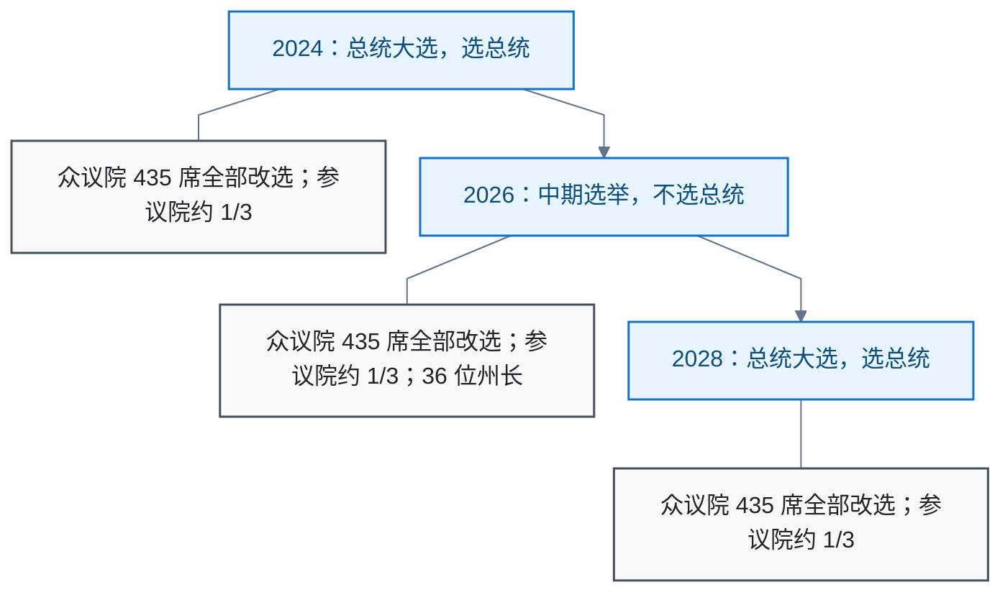

# 美国政治

美国全国选举与国会政治的核实记录。主线：中期选举（midterm election）不换总统，而是重新决定国会控制权，制衡现任总统。边界：选举制度事实以官方一手来源核实。

## 中期选举的意义：不换总统，换国会

**结论**：中期选举不选总统。总统任期 4 年（宪法第二条），仅由 4 年一次的总统大选产生。中期选举是任期中点的全国选举：改选众议院（House of Representatives）全部 435 席、参议院约 1/3 席位（2026 年为 33 席常规改选加 2 席补选）及多数州长。其意义在于：选民在两次大选之间重新决定国会控制权，从而制衡现任总统。

**选举节律**：美国全国选举每两年一次，固定在偶数年 11 月第一个周一后的周二。每次都改选国会，但只有 4 年一次的总统大选才选总统。

**意义详解**：

1. **决定国会控制权，直接制衡总统。** 立法、拨款、高级官员任命确认（参议院）都在国会。如果总统的政党丢掉一院或两院，后半任期立法议程受阻，只能更多依靠行政命令和外交等受国会制约较小的手段，即分裂政府（divided government）。
2. **对总统政党的期中民意检验。** 总统不在选票上，但选民常把国会票当作对总统的态度来投。结果呈稳定的中期惩罚：1934–2022 年 23 次中期选举中，总统政党 20 次失去众议院席位；例外仅 1934（+9）、1998（+4）、2002（+8）。1946–2022 平均每次失去约 25 席（据 UCSB APP 数据表计算，非来源直接给出）。
3. **制衡工具实体化。** 众议院独占弹劾发起权，参议院独占弹劾审判权；国会多数还决定对行政部门的调查与听证力度。
4. **州层面长尾影响。** 州长和州议会控制州政策，并主导国会选区地图的绘制，即选区重划（redistricting）。每十年普查后重划一次，影响此后十年国会选举版图。

**2026 年看点**（均为二手来源）：投票日 2026-11-03（Ballotpedia）；民主党净增 3 席即可重夺众议院多数（NBC News）；参议院 35 席改选（33 常规加 2 补选，Ballotpedia）。

**限制与未核实项**：

- 2026 年 36 个州长职位改选为媒体汇总口径，未在一手来源核实。
- 2026-11-03 投票结果待解。

**信源**：

- [一手] [USA.gov · Midterm elections](https://www.usa.gov/midterm-elections)：中期选举改选全部众议院席位与 1/3 参议院席位，不选总统；众议员任期 2 年，参议员 6 年交错改选。
- [一手] [美国国家档案馆 · Constitution Transcript](https://www.archives.gov/founding-docs/constitution-transcript)：第二条第一款总统任期 4 年；第一条第二款众议院独占弹劾发起权、第三款参议院独占弹劾审判权。
- [一手] [UCSB American Presidency Project · 总统政党中期席位得失](https://www.presidency.ucsb.edu/statistics/data/seats-congress-gainedlost-the-presidents-party-mid-term-elections)：1934–2022 各次中期选举众议院席位变化表。
- [二手] [Ballotpedia · United States Congress elections, 2026](https://ballotpedia.org/United_States_Congress_elections,_2026)：2026-11-03 投票，33 席常规改选加 2 席补选。
