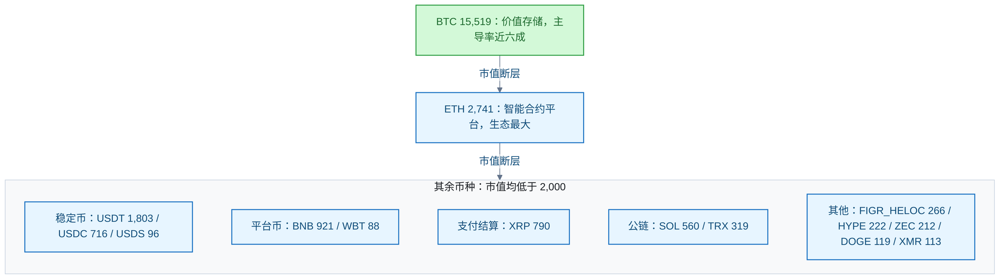

# 虚拟货币

<!-- domain: 虚拟货币 -->
**范围**：主流币种、市值格局、分类与监管定位。

**综述**：加密货币的主流格局由市值、流动性与生态采用界定。2026-10-30 前列：BTC（约 1.55 万亿美元，占比近六成，定位数字黄金）、ETH（约 2741 亿美元，最大智能合约平台）、稳定币 USDT/USDC/USDS、平台币 BNB、支付结算 XRP、公链 SOL/TRX、DeFi 衍生品 HYPE、隐私币 ZEC/XMR、Meme 币 DOGE。BTC 与 ETH 断层领先其余币种。稳定币是交易计价与结算基础设施，不是投资资产。中国大陆按银发〔2026〕42 号通知（2026-02-06 施行，废止 2021 年 237 号）将虚拟货币相关业务定性为非法金融活动。待解：FIGR_HELOC 等 RWA 代币的兴起背景与合规状态。
<!-- /domain -->

虚拟货币（加密货币）领域的主流格局记录。主线：按市值、流动性与生态采用界定主流币种，解释分类逻辑与中国大陆监管定性。边界：行情数据有时效；不含投资建议。

## 主流虚拟货币的格局与分类

**结论**：「主流」由市值、流动性与生态采用共同界定。2026-10-30 按市值前 8 名依次为 BTC、ETH、USDT、BNB、XRP、USDC、SOL、TRX。比特币（Bitcoin，BTC）市值约 1.55 万亿美元，占全市场近六成（主导率，Dominance）；以太坊（Ethereum，ETH）约 2,741 亿美元。两者断层领先其余币种。稳定币（Stablecoin）是交易计价与结算的基础设施，不是投资资产。

**梯队图**（市值单位：亿美元，2026-10-30）：

**市值前 15**（CoinGecko，2026-10-30）：

| # | 币种 | 类别 | 市值（亿美元） | 价格（美元） |
| --- | --- | --- | --- | --- |
| 1 | BTC Bitcoin | 价值存储 | 15,519 | 77,189 |
| 2 | ETH Ethereum | 智能合约平台 | 2,741 | 2,244 |
| 3 | USDT Tether | 美元稳定币 | 1,803 | 1.00 |
| 4 | BNB | 交易所平台币 | 921 | 700.75 |
| 5 | XRP | 支付结算 | 790 | 1.25 |
| 6 | USDC | 美元稳定币 | 716 | 1.00 |
| 7 | SOL Solana | 智能合约平台 | 560 | 94.84 |
| 8 | TRX TRON | 智能合约平台 | 319 | 0.34 |
| 9 | FIGR_HELOC Figure Heloc | RWA（房产净值代币） | 266 | 1.03 |
| 10 | HYPE Hyperliquid | DeFi（衍生品链） | 222 | 92.77 |
| 11 | ZEC Zcash | 隐私币 | 212 | 1,246.31 |
| 12 | DOGE Dogecoin | Meme 币 | 119 | 0.08 |
| 13 | XMR Monero | 隐私币 | 113 | 597.60 |
| 14 | USDS | 美元稳定币 | 96 | 1.00 |
| 15 | WBT WhiteBIT Coin | 交易所平台币 | 88 | 74.26 |

**分类逻辑**：

- **价值存储**：BTC 是第一条区块链，总量上限 2100 万枚，定位「数字黄金」。
- **智能合约（Smart Contract）平台**：ETH 首创图灵完备合约，生态最大；SOL、TRX 以低费用高吞吐竞争。
- **稳定币**：USDT、USDC、USDS 锚定美元，功能是交易计价与跨境结算，无价格波动，不是投资资产。
- **平台币**：BNB（币安）、WBT（WhiteBIT）绑定中心化交易所权益。
- **支付结算**：XRP 面向银行间跨境支付。
- **其他梯队**：去中心化金融（Decentralized Finance，DeFi）衍生品（HYPE）、隐私币（ZEC、XMR）、Meme 币（DOGE）、真实世界资产（Real-World Asset，RWA）代币（FIGR_HELOC）。

**监管定位（中国大陆）**：

- 现行依据为《关于进一步防范和处置虚拟货币等相关风险的通知》（银发〔2026〕42 号，八部门，落款 2026-02-06）：虚拟货币相关业务活动属于非法金融活动；法币兑换、代币发行融资等「一律严格禁止，坚决依法取缔」。该通知同时废止银发〔2021〕237 号通知。
- 虚拟货币不具有与法定货币等同的法律地位。

**限制**：市值、价格与主导率随行情波动，实际使用时须重新拉取 API。FIGR_HELOC 的业务细节未核实；FIGR_HELOC 等 RWA 代币的兴起背景与合规状态为待解问题。

**信源**：

- [一手] [CoinGecko API · markets 市值排名](https://api.coingecko.com/api/v3/coins/markets?vs_currency=usd&order=market_cap_desc&per_page=15&page=1)（第一方 API 实时数据）
- [二手] [《关于进一步防范和处置虚拟货币等相关风险的通知》全文转载（shanghaiinvest）](https://www.shanghaiinvest.com/cn/viewfile.php?id=21619)（银发〔2026〕42 号官方原文待定位；转载全文经与多来源摘要交叉一致）

- **价值存储**：BTC 是第一条区块链，总量 2100 万枚上限，定位「数字黄金」，市值占比（主导率）近六成。

### 证据与时效 · q-20261030-005

- **信源**：- [一手] [CoinGecko API · markets 市值排名](https://api.coingecko.com/api/v3/coins/markets?vs_currency=usd&order=market_cap_desc&per_page=15&page=1)（第一方 API 实时数据）
  - [二手] [《关于进一步防范和处置虚拟货币等相关风险的通知》全文转载（shanghaiinvest）](https://www.shanghaiinvest.com/cn/viewfile.php?id=21619)（银发〔2026〕42 号官方原文待定位；转载全文经与多来源摘要交叉一致）
- **核实**：2026-10-30。核实了市值前 15 排名与价格（CoinGecko API 实时返回）；核实了 42 号文的名称、发文机关（八部门）、落款日期、废止 237 号文及「非法金融活动」定性（转载全文）。市值、价格、主导率随行情波动，实际使用时需重新拉取 API。FIGR_HELOC 的业务细节未核实。

## 提问记录

### q-20261030-005

- **原题**：2026-10-30 · 目前主流的虚拟货币
- **问**：目前主流的虚拟货币有哪些？
- **领域**：虚拟货币
- **首次**：2026-10-30
- **更新**：2026-10-30
- **正文**：[主流虚拟货币的格局与分类](#主流虚拟货币的格局与分类)
