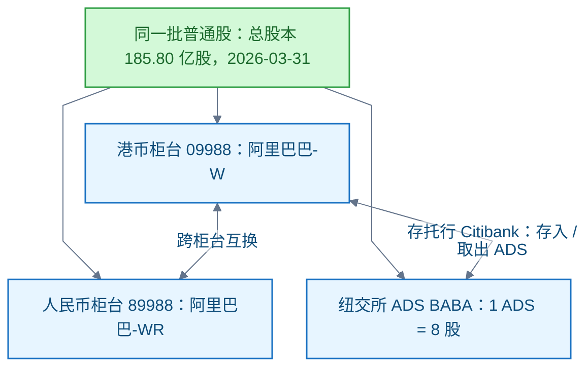

# 证券市场

<!-- domain: 证券市场 -->
**范围**：港股上市地位、股份简称标记与港币-人民币双柜台机制。

**综述**：港股股份简称的字母标记是交易所规则的产物：W＝不同投票权架构，S＝第二上市，R＝人民币买卖。阿里巴巴为港纽双重主要上市（2024-08-28 起）：港股 09988 港币柜台（2019-11-26 上市，时为第二上市）、89988 人民币柜台（2023-06-19 增设），美股 BABA 为 ADS（1 ADS＝8 股）。三种凭证对应同一批普通股、可互相转换，全公司市值唯一＝总股本（约 185.8 亿股，2026-03）× 任一市场股价，经汇率折算各市场报价一致，不可相加。双柜台价格不挂钩，由供求形成、庄家套利收敛，涨跌幅因汇率与独立撮合小幅不一致；官方市值与指数以港币柜台收市价为准。人民币柜台截至 2026-10 未入港股通，港证监目标 2027-07-01 前落地。待解：人民币柜台纳入港股通的实施规则。
<!-- /domain -->

本领域记录证券市场机制问题。主线：港股股份简称字母标记、港币-人民币双柜台与多市场上市的市值口径，以阿里巴巴为案例。边界：官方市值与指数以港币柜台收市价为准。待解：人民币柜台纳入港股通的实施规则。

## 阿里巴巴-W 与 阿里巴巴-WR：同一股份的港币与人民币柜台

结论：两者是阿里巴巴集团同一类普通股在香港联合交易所（联交所）主板的两个柜台。09988 阿里巴巴-W 以港币交易与结算；89988 阿里巴巴-WR 以人民币交易与结算。两柜台同股同权、可跨柜台互换；实际差别只有币种、代码与流动性。

简称字母标记出自香港交易所（Hong Kong Exchanges and Clearing，HKEX，港交所）命名规则，2012-05-23 起生效：

- W＝不同投票权架构（Weighted Voting Rights，WVR）
- S＝第二上市
- R＝人民币买卖标记；并非双柜台专属，自 2012 年起即标识人民币买卖的证券

演变：

- 2019-11-26：阿里以第二上市方式在港挂牌，简称阿里巴巴-SW（09988）。
- 2023-06-19：港交所推出港币-人民币双柜台模式，阿里增设人民币柜台 89988（阿里巴巴-SWR）；两柜台每手均 100 股。
- 2024-08-28：转为港交所与纽交所双重主要上市，S 标记去掉。
- 2024-09-10：港币柜台 09988 纳入港股通（Stock Connect）（二手）。
- 截至 2026-10：人民币柜台 89988 尚未纳入港股通；香港证监会目标 2027-07-01 前落地（二手）。

细节：

- 跨柜台转换经券商办理；股份权利不变，仅计价货币改变。
- 港币柜台流动性显著高于人民币柜台；人民币柜台成交占比很小（二手，2025-06 双柜台两周年报道）。

## 双柜台价格：不挂钩，靠庄家套利收敛

结论：两柜台独立报价，之间没有价格挂钩。89988 价格约等于 09988 价格按港元兑人民币汇率折算；经汇率调整后仍可能有价差，由双柜台庄家跨柜台套利收窄。港币柜台为主柜台；人民币柜台为次柜台，庄家义务所在。

涨跌幅会小幅不一致，三个原因：

1. 计价汇率本身变动：人民币柜台涨跌幅＝股价变动叠加汇率变动。
2. 两柜台独立撮合、独立收市价；人民币柜台流动性低，买卖价差与日内噪音更大。
3. 套利收敛有边界。

实例（2026-10-28 于 Yahoo Finance 查看最近收盘，二手）：09988＝97.35 港元（+0.36%）；89988＝82.80 人民币（+0.55%）；隐含 1 港元≈0.85 人民币。

## 美股与市值：三个代码、一个市值

结论：阿里仍在纽约证券交易所（New York Stock Exchange，NYSE，纽交所）上市。美股代码 BABA 是美国存托股份（American Depositary Shares，ADS），1 ADS＝8 股普通股，2014-09-19 起在纽交所交易；2024-08-28 起阿里为港交所与纽交所双重主要上市公司。BABA、09988、89988 三个代码是同一批普通股的三个交易通道，凭证可互相转换：ADS 可注销取出港股普通股，港股普通股可存入存托行（Citibank）换成 ADS。

市值只有一个：公司市值＝总股本 × 任一市场股价。BABA ADS 对应的普通股同样计入总股本（FY2026 年报：2026-03-31 总股本 185.80 亿股普通股，约合 23.23 亿份 ADS）。把「美股市值＋港股市值」相加会把同一股份重复计算。港交所按「已发行证券总数 × 港币柜台收市价」计算双柜台证券市值，不以人民币柜台价格另算；官方市值与指数以港币柜台收市价为准。

换算演示（2026-10-28 于 Yahoo Finance 查看最近收盘，二手）：

- 09988＝97.35 港元 → 市值约 1.81 万亿港元。
- BABA＝100.24 美元 → 市值约 2330 亿美元。
- 隐含 1 美元≈7.77 港元；两者折算后几乎相等。
- 公式：BABA 价格 ≈ 09988 价格 × 8 ÷ 美元兑港元汇率。

信源（适用范围：香港联交所主板，截至 2026-10-28）：

- [一手：阿里巴巴集团·在港增设人民币柜台（2023-06-19）](https://www.alibabagroup.com/zh-HK/document-1607442761408053248)
- [一手：港交所·港币-人民币双柜台模式](https://www.hkex.com.hk/services/trading/securities/overview/trading-mechanism/hkd-rmb-dual-counter-model?sc_lang=zh-HK)
- [一手：港交所·股份简称命名规则](https://www.hkex.com.hk/Products/Securities/Naming-Conventions-of-Stock-Short-Name-by-Product-Types?sc_lang=zh-HK)
- [一手：港交所·双柜台模式 FAQ](https://www.hkex.com.hk/-/media/HKEX-Market/Services/Trading/Securities/Overview/Trading-Mechanism/HKDRMB-Dual-Counter/Dual-Counter-Model-FAQ_E.pdf)——所见版本日期 2023-06-09；该页另列 2026-01-26 版 FAQ，未能取得，所引均为机制性条款（Q5/Q6/Q21/Q25）
- [一手：阿里巴巴集团·香港双重主要上市（2024-08-28）](https://www.alibabagroup.com/document-1765436812471304192)
- [一手：阿里巴巴 FY2026 年报 20-F（SEC EDGAR，2026-05-20 递交）](https://www.sec.gov/Archives/edgar/data/1577552/000119312526231755/baba-20260331.htm)——上市地位与代码、ADS 8:1 比例与转换机制、总股本
- [二手：新浪财经·阿里证券简称去掉 S](https://cj.sina.cn/articles/view/1393100891/5309085b0270197zc)
- [二手：21 财经·阿里巴巴纳入港股通（2024-09-10）](https://www.21jingji.com/article/20240910/herald/e4f0aff91807fb2f91d4534bdf43ddea.html)
- [二手：经济通·香港证监会称人民币柜台纳入港股通目标 2027-07-01 前落地（2026-09-23）](https://www.etnet.com.hk/www/tc/stocks/realtime/quote_news_detail.php?code=388&newsid=20260923559&section=related)
- [二手：证券时报·双柜台运行两周年、人民币柜台成交占比很小（2025-06-17）](https://www.stcn.com/article/detail/2070722.html)
- [二手：Yahoo Finance·9988.HK](https://finance.yahoo.com/quote/9988.HK)、[二手：Yahoo Finance·89988.HK](https://finance.yahoo.com/quote/89988.HK)（BABA 行情同源）

- **跨柜台转换**：投资者经券商办理，股份权利不变，仅计价货币改变。

- **R 标记并非双柜台专属**：港交所自 2012 年起即以 R 标识以人民币买卖的证券；双柜台证券的人民币柜台沿用此标记。

- **信源（本次核实）**：[一手] [港交所：双柜台模式 FAQ](https://www.hkex.com.hk/-/media/HKEX-Market/Services/Trading/Securities/Overview/Trading-Mechanism/HKDRMB-Dual-Counter/Dual-Counter-Model-FAQ_E.pdf)（抓取所见版本日期 2023-06-09；双柜台模式页另列 2026-01-26 版 FAQ，本次未能取到该新版，所引均为机制性条款）Q5/Q6/Q21/Q25；行情数据（二手）：[Yahoo Finance 9988.HK](https://finance.yahoo.com/quote/9988.HK)、[89988.HK](https://finance.yahoo.com/quote/89988.HK)。

- **信源（本次核实）**：[一手] [阿里巴巴 FY2026 年报 20-F（SEC EDGAR，2026-05-20 递交）](https://www.sec.gov/Archives/edgar/data/1577552/000119312526231755/baba-20260331.htm)——上市地位与代码（封面及 Item 9）、ADS 8:1 比例与转换机制（Item 12）、总股本（封面）；[一手] [港交所双柜台模式 FAQ](https://www.hkex.com.hk/-/media/HKEX-Market/Services/Trading/Securities/Overview/Trading-Mechanism/HKDRMB-Dual-Counter/Dual-Counter-Model-FAQ_E.pdf) Q6（市值口径）；行情数据（二手）：Yahoo Finance BABA／9988.HK。

### 证据与时效 · q-20261028-002

- **信源**：- [一手] [阿里巴巴集团：在港增设人民币柜台（2023-06-19）](https://www.alibabagroup.com/zh-HK/document-1607442761408053248)——当时简称阿里巴巴-SW（09988）／阿里巴巴-SWR（89988），同日生效，两柜台每手均 100 股。
  - [一手] [港交所：港币-人民币双柜台模式](https://www.hkex.com.hk/services/trading/securities/overview/trading-mechanism/hkd-rmb-dual-counter-model?sc_lang=zh-HK)——2023-06-19 推出；不同柜台证券一般属同一类别、持有人权利相同、柜台间完全互换；配套双柜台庄家计划。
  - [一手] [港交所：股份简称命名规则](https://www.hkex.com.hk/Products/Securities/Naming-Conventions-of-Stock-Short-Name-by-Product-Types?sc_lang=zh-HK)——S＝第二上市，W＝不同投票权架构，R＝人民币买卖代表符号（该规则自 2012-05-23 生效，早于双柜台机制）。
  - [一手] [阿里巴巴集团：香港双重主要上市（2024-08-28）](https://www.alibabagroup.com/document-1765436812471304192)——第二上市转双重主要上市于 2024-08-28 生效。
  - [二手] [新浪财经：阿里证券简称去掉 S](https://cj.sina.cn/articles/view/1393100891/5309085b0270197zc)；[21 财经：阿里巴巴纳入港股通（2024-09-10）](https://www.21jingji.com/article/20240910/herald/e4f0aff91807fb2f91d4534bdf43ddea.html)；[经济通：香港证监会称人民币柜台纳入港股通目标 2027-07-01 前落地（2026-09-23）](https://www.etnet.com.hk/www/tc/stocks/realtime/quote_news_detail.php?code=388&newsid=20260923559&section=related)；[证券时报：双柜台运行两周年、人民币柜台成交占比很小（2025-06-17）](https://www.stcn.com/article/detail/2070722.html)。
- **核实**：2026-10-28；核实了字母标记释义、两柜台代码、双柜台推出日期与互换原则（一手）；转双重主要上市生效日期为阿里公告（一手）；简称去 S、入港股通日期（2024-09-10）、流动性差异与人民币柜台入港股通进度为二手媒体及港证监表态。适用范围：香港联交所主板，截至 2026-10-28。

## 提问记录

### q-20261028-002

- **原题**：2026-10-28 · 阿里巴巴-W 与 阿里巴巴-WR：同一股份的港币与人民币柜台
- **问**：阿里巴巴W 和 阿里巴巴WR 有什么区别？
- **领域**：证券市场
- **首次**：2026-10-28
- **更新**：2026-10-28
- **正文**：[美股与市值：三个代码、一个市值](#美股与市值三个代码一个市值)
- **关联**：首次写入“证券市场”领域，暂无。
