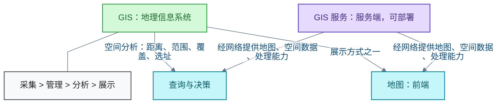

# GIS

地理信息系统（Geographic Information System，GIS）采集、管理、分析与展示位置相关数据，核心是把位置与属性连接起来。地图只是 GIS 的展示方式之一；GIS 服务通过网络向其他程序提供地图、数据与处理能力。主线：概念边界与免费私有化部署选型。

## GIS 是什么：与地图、GIS 服务的关系

**结论**：GIS 用于采集、管理、分析和展示与地理位置有关的数据。核心是把位置与描述对象的属性连接起来，再通过空间关系支持距离、范围、覆盖和选址等空间分析与查询。

地图不等于 GIS。地图是 GIS 的展示方式之一；GIS 服务是通过网络向其他程序提供地图、空间数据或处理能力的服务端部分。分工是：地图前端负责显示与交互，服务端负责提供地图或数据。

**限制**：该领域尚待确认实际需求——是发布自有空间数据，还是需要底图、地址搜索及路线规划等服务。需求不同，选型方向不同。

**信源**：

- [一手] [Esri：What is GIS?](https://www.esri.com/en-us/what-is-gis/overview)
- [一手] [USGS：What is a geographic information system (GIS)?](https://www.usgs.gov/faqs/what-a-geographic-information-system-gis)
- [一手] [GeoServer 官方介绍](https://geoserver.org/about/)

## 免费私有化部署的 GIS 服务选型

**结论**：有可免费私有化部署的 GIS 服务。GeoServer、QGIS Server、GeoNode 和 Martin 均可免费自行部署。按用途选择：

- 通用空间数据发布（自有地图、矢量数据与影像）：GeoServer
- 沿用 QGIS 项目制图效果：QGIS Server
- 完整团队数据门户（数据上传、检索、分享、用户权限管理）：GeoNode
- 主要向网页地图提供矢量瓦片：Martin

**取舍**：地图与数据发布可优先评估 GeoServer；其余三者各覆盖一块专用场景。地图前端负责显示与交互，服务端负责提供地图或数据，两端软件分开选型。

**限制**：软件许可免费不等于完全免费——机器、存储、运维和外部数据不在免费范围内。若目的是发布自己的地图或空间数据，可先评估 GeoServer。

**信源**：

- [一手] [GeoServer 官方介绍](https://geoserver.org/about/)
- [一手] [GeoServer 许可证](https://geoserver.org/license/)
- [一手] [GeoServer 官方 Docker 部署](https://github.com/geoserver/docker)
- [一手] [QGIS 官方仓库](https://github.com/qgis/QGIS)
- [一手] [QGIS Server 3.44 介绍](https://docs.qgis.org/3.44/en/docs/server_manual/introduction.html)
- [一手] [GeoNode 官网](https://geonode.org/)
- [一手] [Martin 官方仓库](https://github.com/maplibre/martin)
- [一手] [Martin 官方文档](https://maplibre.org/martin/)
