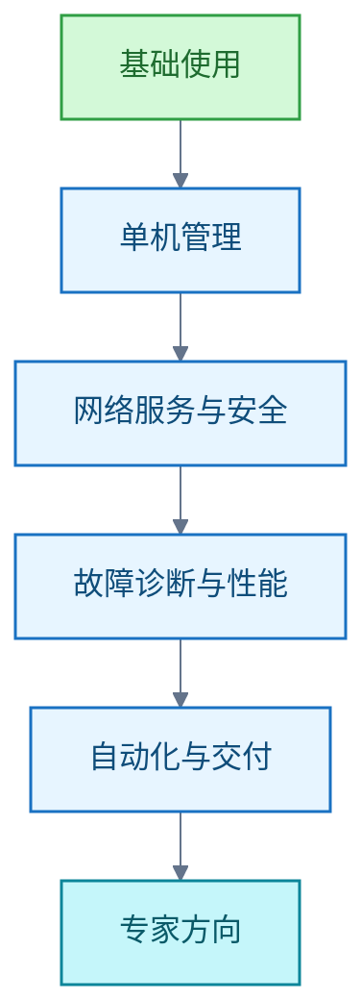
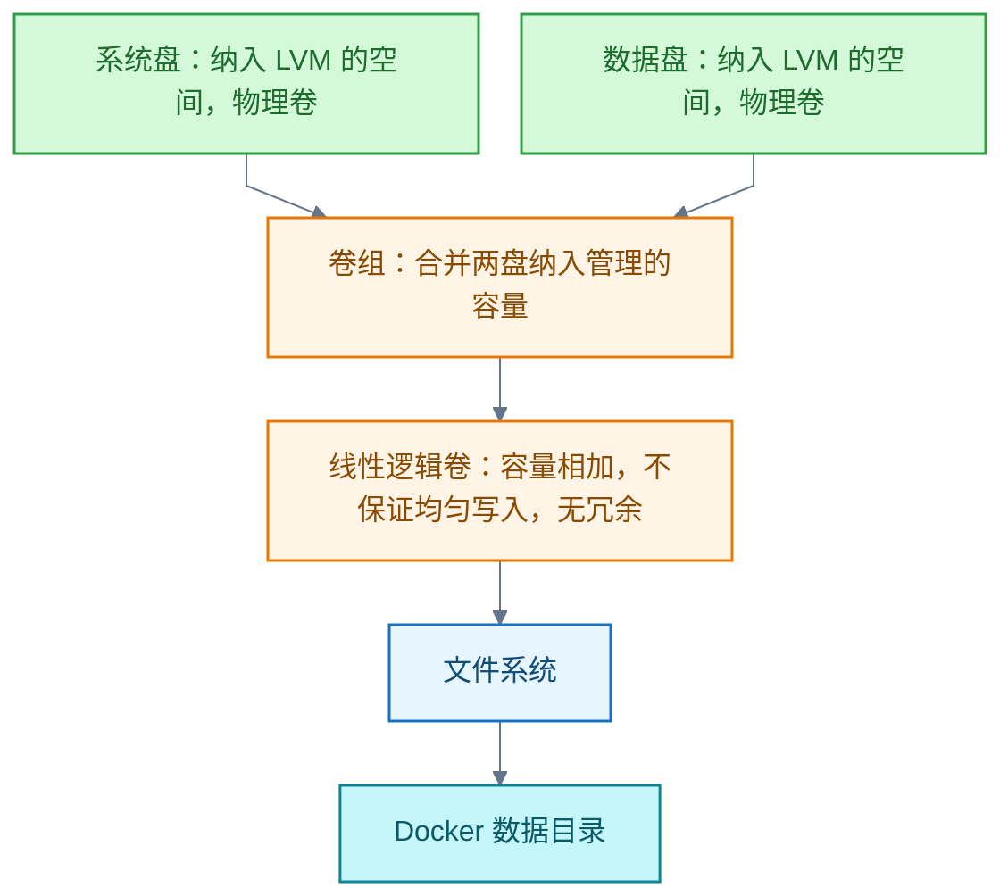

# Linux

本领域记录 Linux 学习与实践：主线从命令行、文件权限、进程与启动进入存储、网络、安全、诊断与自动化，掌握程度以隔离环境中的部署、故障定位和恢复验证。

## 学习路线：从零基础到独立管理服务器

**结论**：按"基础使用 → 单机管理 → 网络服务与安全 → 故障诊断和性能 → 自动化与交付 → 专家方向"推进，每阶段以可复现实验验收。专家要求能跨层定位复杂故障、解释机制和取舍，并在至少一个方向深入；不是背完所有工具，也不是取得某张证书。



路线横向覆盖启动、进程、内存、文件系统、存储、网络、权限、安全、可观测性和容器等主要机制。

零基础的节奏与资源组合：

- 时间：每天约 1 小时，动手时间过半。
- 第 0 天：`wsl --install` 安装适用于 Linux 的 Windows 子系统（Windows Subsystem for Linux，WSL）的 WSL 2 环境。
- 第 1–4 周：命令行基础。Ubuntu 官方命令行教程通读后，精读《The Linux Command Line》（TLCL）第 1–11 章；中文用鸟哥对应章节；练习 OverTheWire Bandit。
- 第 5–8 周：单机系统管理。鸟哥或 LFS101，辅以 21 天的 Linux Upskill Challenge。
- 第 9–12 周：Bash 脚本与工具链。TLCL 脚本部分＋MIT Missing Semester。
- 第 4–6 月：在真实 VPS 上部署、加固并守护一个自有服务。

里程碑：三个月达日常命令行熟练；四至六个月能独立管理一台服务器。时间估计不保证能力，每阶段以动手任务验收。

资源纪律：只选一条主线——一本书、一门课、一个练习场加一台真实环境。备注：linuxjourney.com 已 301 重定向至 labex.io/linuxjourney，后者内容现状未核实，不入主线。

信源：

- [LPI：Linux Essentials 目标（一手）](https://www.lpi.org/our-certifications/exam-010-objectives/)
- [LPI：LPIC-1 目标（一手）](https://www.lpi.org/our-certifications/exam-101-102-objectives/)
- [LPI：LPIC-2 目标（一手）](https://www.lpi.org/our-certifications/exam-201-202-objectives/)
- [LPI：LPIC-3 方向（一手）](https://www.lpi.org/our-certifications/lpic-3-303-overview/)
- [Linux 内核文档（一手）](https://docs.kernel.org/)
- [GNU Bash 手册（一手）](https://www.gnu.org/software/bash/manual/bash.html)
- [Debian 管理员手册（一手）](https://www.debian.org/doc/manuals/debian-handbook/)
- [Ansible 入门（一手）](https://docs.ansible.com/projects/ansible/latest/getting_started/index.html)
- [Kubernetes 概念（一手）](https://kubernetes.io/docs/concepts/)
- [微软 WSL 安装文档（一手）](https://learn.microsoft.com/en-us/windows/wsl/install)
- [Ubuntu 命令行入门教程（一手）](https://ubuntu.com/tutorials/command-line-for-beginners)
- [LFS101 Introduction to Linux（一手）](https://training.linuxfoundation.org/training/introduction-to-linux/)
- [The Linux Command Line 免费版（一手）](https://linuxcommand.org/tlcl.php)
- [鸟哥的 Linux 私房菜（一手）](https://linux.vbird.org/)
- [OverTheWire Bandit（一手）](https://overthewire.org/wargames/bandit/)
- [Linux Upskill Challenge（一手）](https://linuxupskillchallenge.org/)
- [MIT Missing Semester（一手）](https://missing.csail.mit.edu/)

## LVM 合并两块盘供 Docker 使用

**结论**：可以用逻辑卷管理器（Logical Volume Manager，LVM）把两块盘上纳入管理的空间组成跨盘线性逻辑卷，在其文件系统上存放 Docker 数据，以使用分配给该卷的合并容量。



限制与例外：

- 仅创建卷组或挂载数据盘，不会自动合并 Docker 可用容量。
- 线性卷不保证均匀或并行读写，也无冗余；任一盘故障可能使跨盘文件系统不可用。
- 已有非 LVM 系统分区需规划迁移。

替代方案：若只想减轻系统盘占用，可以保持两盘独立并迁移 Docker 存储。注意：使用 containerd 镜像存储时，须分别考虑 Docker 的 data-root 与 containerd 的 root。

信源：

- [Red Hat：LVM 逻辑卷创建与扩容（一手）](https://docs.redhat.com/en/documentation/red_hat_enterprise_linux/10/html/configuring_and_managing_logical_volumes/basic-logical-volume-management)
- [Linux 内核：dm-linear 映射机制（一手）](https://www.kernel.org/doc/html/latest/admin-guide/device-mapper/linear.html)
- [Red Hat：RAID 与线性存储的容量、性能和冗余（一手）](https://docs.redhat.com/en/documentation/red_hat_enterprise_linux/10/html/configuring_and_managing_logical_volumes/configuring-raid-logical-volumes)
- [Red Hat：LVM 物理卷初始化（一手）](https://docs.redhat.com/en/documentation/red_hat_enterprise_linux/10/html/configuring_and_managing_logical_volumes/managing-lvm-physical-volumes)
- [Docker：守护进程存储目录配置（一手）](https://docs.docker.com/engine/daemon/)

## rg 不可用是什么意思

**结论**：`rg` 是文本搜索工具 ripgrep 的命令名。"rg 不可用"表示当前环境找不到或无法运行该命令；搜索没有匹配不表示命令不可用。

四种情况分别判断：

- 找不到命令：例如未安装，或可执行文件所在目录未列入环境变量 `PATH`。Bash 通常报告 `command not found`，退出状态为 127。
- 找到但无法执行：Bash 退出状态为 126，具体原因必须依据实际报错判断。
- 搜索没有匹配：ripgrep 正常完成搜索，退出状态为 1。
- 文件未进入搜索范围：默认忽略规则可能跳过目标文件。

不能把所有非零退出状态视为工具故障。

默认行为：递归搜索目录、遵守忽略规则、跳过隐藏文件和二进制文件。示例：

```bash
rg -n '关键词' 提问记录/
```

实测（2026-11-01）：本次代理 Bash 会话可运行 `rg`，版本 ripgrep 15.2.0。本机可用性只代表该次会话，不代表其他终端、容器或远程环境。

信源：

- [ripgrep 官方说明（一手）](https://github.com/BurntSushi/ripgrep#ripgrep-rg)
- [Bash 命令查找与执行（一手）](https://www.gnu.org/software/bash/manual/html_node/Command-Search-and-Execution.html)
- [ripgrep 手册源文件：退出状态（一手）](https://github.com/BurntSushi/ripgrep/blob/master/crates/core/flags/doc/template.rg.1)
