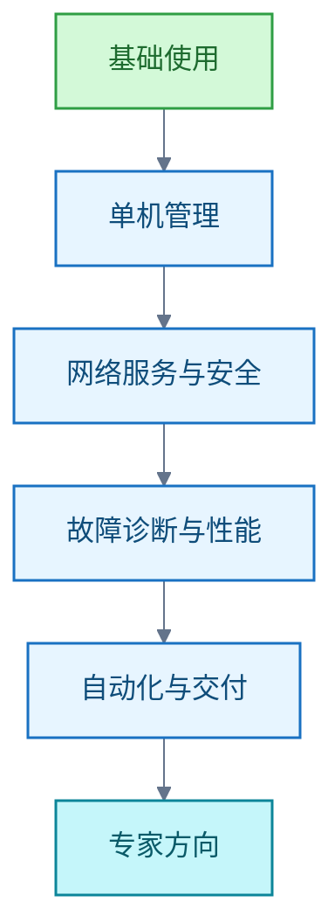
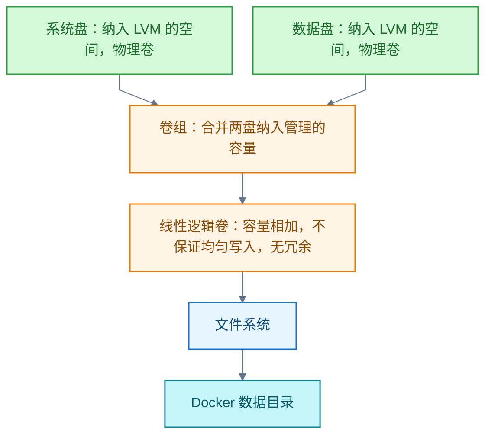

# Linux

<!-- domain: Linux -->
**范围**：Linux 命令行、系统管理、网络安全、故障性能、自动化与专家方向的学习路线（含零基础计划与资源组合），及 WSL 桌面、本机核验、内存回收与开发容器按需启动。

**综述**：Linux 学习从命令行、文件权限、进程和启动进入存储、网络、安全、诊断与自动化，再选择专项；掌握程度以隔离环境中的部署、故障定位和恢复验证。LVM 跨盘合并容量不自动提供均匀写入或冗余，Docker 数据迁移需结合实际布局。入门采用一条学习主线并持续动手，时间估计不保证能力。WSLg 应用窗口与完整 Linux 桌面分开理解；本机 Xfce／xrdp 尚未完成安装登录验证。2026-10-27 的 WSL 配置与容器停止记录只代表当时状态：开发服务改为按需启动并保留数据，gradual 回收仍待 WSL 重启验证。WSL 软件包版本、WSL 1／2 架构、发行版版本分别理解；应用内存、缓存和宿主工作集分别诊断。Windows 与 WSL 文件互通是同一存储的跨系统访问（`\\wsl$` 路径与 `/mnt/c` 挂载，走 9P 协议），即写即见而非两份拷贝；项目文件应与工具同侧存放，Windows 侧修改不触发 Linux inotify 事件；Windows 下载文件经资源管理器拖入 `\\wsl$` 会把 MOTW 的 Zone.Identifier 流物化成独立文件（WSL #4609 bug），删除无害、加入 `.gitignore` 防入库。文本搜索工具 ripgrep 使用命令 `rg`；命令不可用、搜索无匹配和文件被过滤需分别判断。
<!-- /domain -->

本领域记录 Linux 学习与实践：主线从命令行、文件权限、进程与启动进入存储、网络、安全、诊断与自动化，掌握程度以隔离环境中的部署、故障定位和恢复验证。

## 学习路线：从零基础到独立管理服务器

**结论**：按"基础使用 → 单机管理 → 网络服务与安全 → 故障诊断和性能 → 自动化与交付 → 专家方向"推进，每阶段以可复现实验验收。专家要求能跨层定位复杂故障、解释机制和取舍，并在至少一个方向深入；不是背完所有工具，也不是取得某张证书。



路线横向覆盖启动、进程、内存、文件系统、存储、网络、权限、安全、可观测性和容器等主要机制。

零基础的节奏与资源组合：

- 时间：每天约 1 小时，动手时间过半。
- 第 0 天：`wsl --install` 安装适用于 Linux 的 Windows 子系统（Windows Subsystem for Linux，WSL）的 WSL 2 环境。
- 第 1–4 周：命令行基础。Ubuntu 官方命令行教程通读后，精读《The Linux Command Line》（TLCL）第 1–11 章；中文用鸟哥对应章节；练习 OverTheWire Bandit。
- 第 5–8 周：单机系统管理。鸟哥或 LFS101，辅以 21 天的 Linux Upskill Challenge。
- 第 9–12 周：Bash 脚本与工具链。TLCL 脚本部分＋MIT Missing Semester。
- 第 4–6 月：在真实 VPS 上部署、加固并守护一个自有服务。

里程碑：三个月达日常命令行熟练；四至六个月能独立管理一台服务器。时间估计不保证能力，每阶段以动手任务验收。

资源纪律：只选一条主线——一本书、一门课、一个练习场加一台真实环境。备注：linuxjourney.com 已 301 重定向至 labex.io/linuxjourney，后者内容现状未核实，不入主线。

信源：

- [LPI：Linux Essentials 目标（一手）](https://www.lpi.org/our-certifications/exam-010-objectives/)
- [LPI：LPIC-1 目标（一手）](https://www.lpi.org/our-certifications/exam-101-102-objectives/)
- [LPI：LPIC-2 目标（一手）](https://www.lpi.org/our-certifications/exam-201-202-objectives/)
- [LPI：LPIC-3 方向（一手）](https://www.lpi.org/our-certifications/lpic-3-303-overview/)
- [Linux 内核文档（一手）](https://docs.kernel.org/)
- [GNU Bash 手册（一手）](https://www.gnu.org/software/bash/manual/bash.html)
- [Debian 管理员手册（一手）](https://www.debian.org/doc/manuals/debian-handbook/)
- [Ansible 入门（一手）](https://docs.ansible.com/projects/ansible/latest/getting_started/index.html)
- [Kubernetes 概念（一手）](https://kubernetes.io/docs/concepts/)
- [微软 WSL 安装文档（一手）](https://learn.microsoft.com/en-us/windows/wsl/install)
- [Ubuntu 命令行入门教程（一手）](https://ubuntu.com/tutorials/command-line-for-beginners)
- [LFS101 Introduction to Linux（一手）](https://training.linuxfoundation.org/training/introduction-to-linux/)
- [The Linux Command Line 免费版（一手）](https://linuxcommand.org/tlcl.php)
- [鸟哥的 Linux 私房菜（一手）](https://linux.vbird.org/)
- [OverTheWire Bandit（一手）](https://overthewire.org/wargames/bandit/)
- [Linux Upskill Challenge（一手）](https://linuxupskillchallenge.org/)
- [MIT Missing Semester（一手）](https://missing.csail.mit.edu/)

### 证据与时效 · q-20260923-009

- **信源**：[一手] [Linux Essentials 目标](https://www.lpi.org/our-certifications/exam-010-objectives/)；[一手] [LPIC-1 目标](https://www.lpi.org/our-certifications/exam-101-102-objectives/)；[一手] [LPIC-2 目标](https://www.lpi.org/our-certifications/exam-201-202-objectives/)；[一手] [LPIC-3 方向](https://www.lpi.org/our-certifications/lpic-3-303-overview/)；[一手] [Linux 内核文档](https://docs.kernel.org/)；[一手] [GNU Bash 手册](https://www.gnu.org/software/bash/manual/bash.html)；[一手] [Debian 管理员手册](https://www.debian.org/doc/manuals/debian-handbook/)；[一手] [Ansible 入门](https://docs.ansible.com/projects/ansible/latest/getting_started/index.html)；[一手] [Kubernetes 概念](https://kubernetes.io/docs/concepts/)

### 证据与时效 · q-20261023-001

- **信源**：[一手] [微软 WSL 安装文档](https://learn.microsoft.com/en-us/windows/wsl/install)；[一手] [Ubuntu 命令行入门教程](https://ubuntu.com/tutorials/command-line-for-beginners)；[一手] [LFS101 Introduction to Linux](https://training.linuxfoundation.org/training/introduction-to-linux/)；[一手] [The Linux Command Line 免费版（TLCL 25.12）](https://linuxcommand.org/tlcl.php)；[一手] [鸟哥的 Linux 私房菜](https://linux.vbird.org/)；[一手] [OverTheWire Bandit](https://overthewire.org/wargames/bandit/)；[一手] [Linux Upskill Challenge](https://linuxupskillchallenge.org/)；[一手] [MIT Missing Semester](https://missing.csail.mit.edu/)。备注：linuxjourney.com 已 301 重定向至 labex.io/linuxjourney，后者内容现状未核实，不入主线。

## LVM 合并两块盘供 Docker 使用

**结论**：可以用逻辑卷管理器（Logical Volume Manager，LVM）把两块盘上纳入管理的空间组成跨盘线性逻辑卷，在其文件系统上存放 Docker 数据，以使用分配给该卷的合并容量。



限制与例外：

- 仅创建卷组或挂载数据盘，不会自动合并 Docker 可用容量。
- 线性卷不保证均匀或并行读写，也无冗余；任一盘故障可能使跨盘文件系统不可用。
- 已有非 LVM 系统分区需规划迁移。

替代方案：若只想减轻系统盘占用，可以保持两盘独立并迁移 Docker 存储。注意：使用 containerd 镜像存储时，须分别考虑 Docker 的 data-root 与 containerd 的 root。

信源：

- [Red Hat：LVM 逻辑卷创建与扩容（一手）](https://docs.redhat.com/en/documentation/red_hat_enterprise_linux/10/html/configuring_and_managing_logical_volumes/basic-logical-volume-management)
- [Linux 内核：dm-linear 映射机制（一手）](https://www.kernel.org/doc/html/latest/admin-guide/device-mapper/linear.html)
- [Red Hat：RAID 与线性存储的容量、性能和冗余（一手）](https://docs.redhat.com/en/documentation/red_hat_enterprise_linux/10/html/configuring_and_managing_logical_volumes/configuring-raid-logical-volumes)
- [Red Hat：LVM 物理卷初始化（一手）](https://docs.redhat.com/en/documentation/red_hat_enterprise_linux/10/html/configuring_and_managing_logical_volumes/managing-lvm-physical-volumes)
- [Docker：守护进程存储目录配置（一手）](https://docs.docker.com/engine/daemon/)

### 证据与时效 · q-20261002-002

- **信源**：[一手] [Red Hat：LVM 逻辑卷创建与扩容](https://docs.redhat.com/en/documentation/red_hat_enterprise_linux/10/html/configuring_and_managing_logical_volumes/basic-logical-volume-management)；[一手] [Linux 内核：dm-linear 映射机制](https://www.kernel.org/doc/html/latest/admin-guide/device-mapper/linear.html)；[一手] [Red Hat：RAID 与线性存储的容量、性能和冗余](https://docs.redhat.com/en/documentation/red_hat_enterprise_linux/10/html/configuring_and_managing_logical_volumes/configuring-raid-logical-volumes)；[一手] [Red Hat：LVM 物理卷初始化](https://docs.redhat.com/en/documentation/red_hat_enterprise_linux/10/html/configuring_and_managing_logical_volumes/managing-lvm-physical-volumes)；[一手] [Docker：守护进程存储目录配置](https://docs.docker.com/engine/daemon/)

## rg 命令的用途与不可用判断

**结论**：`rg` 是文本搜索工具 ripgrep 的命令名。"rg 不可用"表示当前环境找不到或无法运行该命令；搜索没有匹配不表示命令不可用。

四种情况分别判断：

- 找不到命令：例如未安装，或可执行文件所在目录未列入环境变量 `PATH`。Bash 通常报告 `command not found`，退出状态为 127。
- 找到但无法执行：Bash 退出状态为 126，具体原因必须依据实际报错判断。
- 搜索没有匹配：ripgrep 正常完成搜索，退出状态为 1。
- 文件未进入搜索范围：默认忽略规则可能跳过目标文件。

不能把所有非零退出状态视为工具故障。

默认行为：递归搜索目录、遵守忽略规则、跳过隐藏文件和二进制文件。示例：

```bash
rg -n '关键词' 站点/docs/
```

实测（2026-11-01）：本次代理 Bash 会话可运行 `rg`，版本 ripgrep 15.2.0。本机可用性只代表该次会话，不代表其他终端、容器或远程环境。

信源：

- [ripgrep 官方说明（一手）](https://github.com/BurntSushi/ripgrep#ripgrep-rg)
- [Bash 命令查找与执行（一手）](https://www.gnu.org/software/bash/manual/html_node/Command-Search-and-Execution.html)
- [ripgrep 手册源文件：退出状态（一手）](https://github.com/BurntSushi/ripgrep/blob/master/crates/core/flags/doc/template.rg.1)

### 工具用途

ripgrep 搜索文件中的文本。默认递归搜索目录，并遵守忽略规则。默认还会跳过隐藏文件和二进制文件。

此命令在指定目录搜索关键词，并显示命中行的行号。依据：[一手] [ripgrep 官方说明](https://github.com/BurntSushi/ripgrep#ripgrep-rg)。核实日期：2026-11-01。

### 不可用与没有匹配

命令查找依据：[一手] [Bash 命令查找与执行](https://www.gnu.org/software/bash/manual/html_node/Command-Search-and-Execution.html)。搜索状态依据：[一手] [ripgrep 手册源文件](https://github.com/BurntSushi/ripgrep/blob/master/crates/core/flags/doc/template.rg.1)。核实日期：2026-11-01。上述退出状态适用于所述命令和条件，不能把所有非零状态视为工具故障。

### 本次实测

这是本次环境实测的一手证据。其他会话是否可用，必须在对应环境中验证。本次未收到具体故障命令和报错，因此未进行故障修复。

```bash
command -v rg
rg --version
```

### 证据与时效 · q-20261101-002

- **信源**：[一手] [ripgrep 官方说明](https://github.com/BurntSushi/ripgrep#ripgrep-rg)；[一手] [Bash 命令查找与执行](https://www.gnu.org/software/bash/manual/html_node/Command-Search-and-Execution.html)；[一手] [ripgrep 手册源文件：退出状态](https://github.com/BurntSushi/ripgrep/blob/master/crates/core/flags/doc/template.rg.1)。
- **核实**：2026-11-01；已核实命令名称、默认检索规则、Bash 命令查找机制和 ripgrep 退出状态。官方说明适用于当前文档；本机可用性只代表本次代理 Bash 会话，不代表其他终端、容器或远程环境。


## 提问记录

### q-20260923-009

- **原题**：2026-09-23 · 从零基础到 Linux 专家的完整学习路线与知识地图
- **问**：整理从零基础到linux专家的完整学习路线，整理需要学习的全部完整知识点
- **领域**：Linux
- **首次**：2026-09-23
- **更新**：2026-09-23
- **正文**：[学习路线：从零基础到独立管理服务器](#学习路线从零基础到独立管理服务器)
- **关联**：[2026-09-21 · k8s 和 Docker 的关系（承接上条）](容器编排.md#q-20260921-004)

### q-20261002-002

- **原题**：2026-10-02 · 系统盘与数据盘合并后供 Docker 使用的方式与取舍
- **问**：linux中一块系统盘和一块数据盘。能不能将它们合成一个整体，我装docker容器时，自然的同时用到这两块盘
- **领域**：Linux
- **首次**：2026-10-02
- **更新**：2026-10-02
- **正文**：[LVM 合并两块盘供 Docker 使用](#lvm-合并两块盘供-docker-使用)
- **关联**：[2026-10-02 · Docker 存储目录与系统盘、数据盘合并的关系](容器编排.md#q-20261002-001)

### q-20261023-001

- **原题**：2026-10-23 · 零基础学习 Linux 的学习计划与资源组合
- **问**：零基础学习linux，最好的学习计划、学习路线和相关资源
- **领域**：Linux
- **首次**：2026-10-23
- **更新**：2026-10-23
- **正文**：[学习路线：从零基础到独立管理服务器](#学习路线从零基础到独立管理服务器)
- **关联**：[2026-09-23 · 从零基础到 Linux 专家的完整学习路线与知识地图](Linux.md#q-20260923-009)（路线与阶段验收承接）；[2026-10-10 · 全球优质稳定的 VPS 提供商如何选择](VPS.md#q-20261010-003)（第 4–6 月真实服务器选型）

### q-20261101-002

- **原题**：2026-11-01 · rg 不可用是什么意思
- **问**：rg 不可用是什么？
- **领域**：Linux
- **首次**：2026-11-01
- **更新**：2026-11-01
- **正文**：[rg 命令的用途与不可用判断](#rg-命令的用途与不可用判断)
