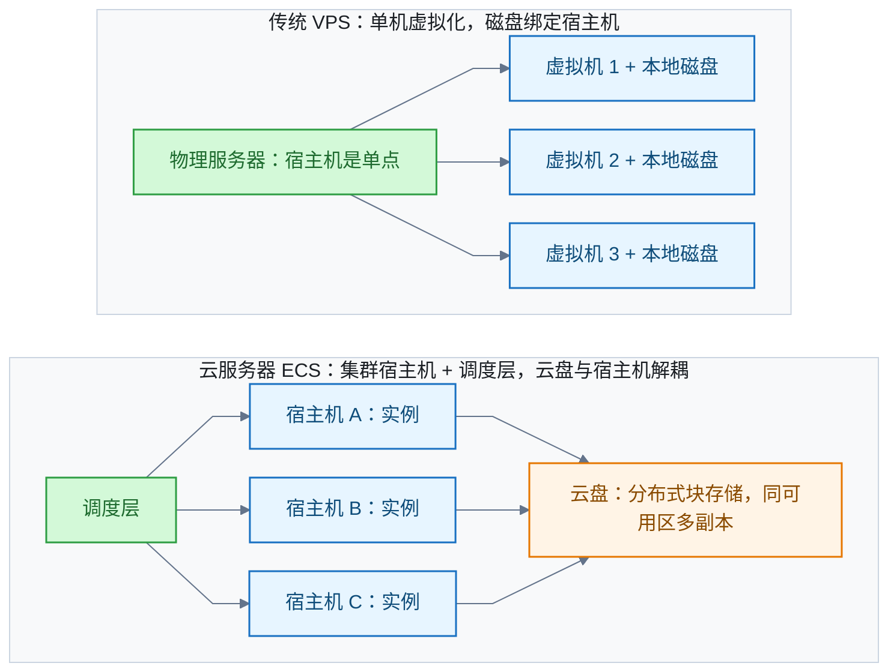
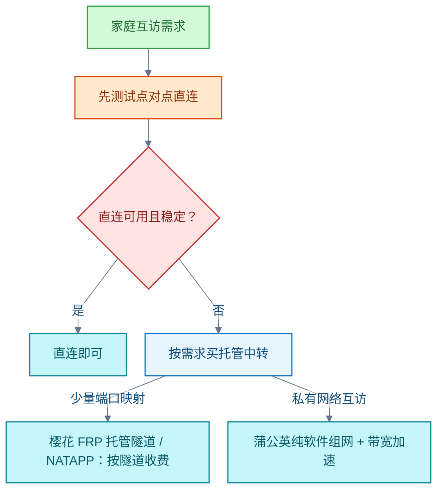

# VPS

<!-- domain: VPS -->
**范围**：VPS（虚拟专用服务器）概念、虚拟化原理与云服务器 ECS 对比，提供商选择、实例性能、网络线路与可用性及 DDNS 动态域名。

**综述**：VPS 选型应分别考察虚拟化与存储架构、资源争用、服务承诺和用户到机房的网络；产品名称和 SLA 百分比不能直接代表实际稳定性。通用云主机、中国方向线路及家庭流量中转是不同需求，历史候选、价格、库存、条款和测试条件分别留在问题中，实际购买前重查。用户一项用途为苏州电信接入；家庭服务器问题仅确认苏州、自己和家人使用、允许客户端且只需中转，家宽运营商和上行尚未确认，不能沿用另一问题的网络条件。家庭互访可先测试点对点直连，再按端口映射或私有组网比较托管中转；这些是需求匹配建议，未经苏州线路实测。中继限速、共享带宽、流量配额和保证带宽必须区分；增加云端带宽不能消除家庭上行瓶颈。家宽动态公网 IP 可用 DDNS 让域名跟随 IP 变化，实现走 RFC 2136 或服务商 HTTP API；前提是有公网 IP，NAT 后无公网 IP 则 DDNS 无效，仍需中转或组网。
<!-- /domain -->

虚拟专用服务器（Virtual Private Server，VPS）把一台物理服务器切分成多台虚拟机出租。本领域记录 VPS 的原理与形态、与阿里云云服务器的异同、按用途选提供商，以及家庭服务器内网穿透与动态域名方案。

## VPS 是什么，与云服务器有何区别

**结论**：VPS 是把一台物理服务器经虚拟机监控器（Hypervisor）切分成多台虚拟机后出租的形态。每台份额专用、租户隔离，有独立操作系统与 root 权限，可独立重启。它定位介于共享主机与独立服务器之间；阿里云弹性计算服务（Elastic Compute Service，ECS）等云服务器是它的云时代形态。

VPS 与 ECS 本质同类：都是 Hypervisor 切出的虚拟机加 root 权限。区别在架构与管理层：

- **传统 VPS**：单机虚拟化。磁盘绑定宿主机，宿主机是单点。
- **ECS**：实例跑在集群宿主机加调度层之上。云盘为分布式块存储，同可用区多副本、与宿主机解耦，数据可靠性标称 99.9999999%；支持升降配、在线扩容与五种计费模式。

**判断标准**：看实质不看名称——存储是否解耦、能否弹性、计费是否按量。"VPS"与"云服务器"的名称边界属营销。

信源：

- [DigitalOcean – VPS Hosting（一手）](https://www.digitalocean.com/solutions/vps-hosting)
- [IBM – What is a VPS?（一手）](https://www.ibm.com/topics/vps)
- [阿里云 ECS 文档中心（一手）](https://help.aliyun.com/product/25365.html)
- [阿里云块存储产品页（一手）](https://www.alibabacloud.com/product/block-storage)

### 证据与时效 · q-20261010-004

- **信源**：[一手] [DigitalOcean – VPS Hosting](https://www.digitalocean.com/solutions/vps-hosting)；[一手] [IBM – What is a VPS?](https://www.ibm.com/topics/vps)

### 证据与时效 · q-20261010-005

- **信源**：[一手] [阿里云 ECS 文档中心](https://help.aliyun.com/product/25365.html)；[一手] [阿里云块存储 Block Storage 产品页](https://www.alibabacloud.com/product/block-storage)；[一手] [IBM – What is a VPS?](https://www.ibm.com/topics/vps)

## 按用途选 VPS 提供商

**结论**：按用途分流。通用建站可优先比较 DigitalOcean 与 Akamai（Linode）。苏州电信翻墙场景应优先筛选中国方向优化线路：可考察搬瓦工（BandwagonHost）的香港、日本 CN2 GIA/CTGNet 节点；洛杉矶节点作为预算折中。

**限制**：产品名称与服务等级协议（Service Level Agreement，SLA）百分比不能直接代表实际稳定性；具体延迟与晚高峰丢包必须在用户自己的网络实测；SLA 不保证 IP 在中国大陆长期可达。历史候选、价格、库存与条款随时间变化，实际购买前重查。

信源（关键）：

- [DigitalOcean CPU Droplet SLA（一手）](https://www.digitalocean.com/sla/cpu-droplets)
- [Akamai Compute Service Level Addenda（一手）](https://www.akamai.com/legal/sla-compute)
- [BandwagonHost CN2 GIA/CTGNet 线路说明（一手）](https://bandwagonhost.com/cn2gia-vps.php)
- [BandwagonHost Service Level Agreement（一手）](https://bandwagonhost.com/service-level-agreement.php)

### 证据与时效 · q-20261010-003

- **信源**：[一手] [DigitalOcean CPU Droplet SLA](https://www.digitalocean.com/sla/cpu-droplets)；[一手] [DigitalOcean Droplet Features](https://docs.digitalocean.com/products/droplets/details/features/)；[一手] [DigitalOcean Status](https://status.digitalocean.com/)；[一手] [Akamai Compute Service Level Addenda](https://www.akamai.com/legal/sla-compute)；[一手] [Akamai CPU 产品与选型](https://www.akamai.com/products/cpu)；[一手] [Linode Status](https://status.linode.com/)；[一手] [Hetzner Cloud and vServer Service Agreement](https://www.hetzner.com/legal/cloud-server/)；[一手] [Hetzner Cloud 产品与地区](https://www.hetzner.com/cloud/)；[一手] [Hetzner Price Adjustment 15 June 2026](https://docs.hetzner.com/general/infrastructure-and-availability/price-adjustment/)；[一手] [Hetzner 实例供应受限通知](https://status.hetzner.com/incident/0a75c7ae-3377-41dc-aabe-601063724d24)；[一手] [Vultr Server Status 与节点](https://status.vultr.com/)；[一手] [OVHcloud VPS 产品](https://www.ovhcloud.com/en/vps/)；[一手] [Amazon Lightsail Instance and Block Storage SLA](https://aws.amazon.com/lightsail/sla-lightsail-instances-and-block-storage/)；[一手] [Lightsail instance bundles](https://docs.aws.amazon.com/lightsail/latest/userguide/amazon-lightsail-bundles.html)；[一手] [BandwagonHost CN2 GIA/CTGNet 线路说明](https://bandwagonhost.com/cn2gia-vps.php)；[一手] [BandwagonHost 官方套餐目录](https://bandwagonhost.com/cart.php)；[一手] [BandwagonHost Service Level Agreement](https://bandwagonhost.com/service-level-agreement.php)；[一手] [BandwagonHost Terms of Service](https://bandwagonhost.com/tos-frame.php)；[一手] [BandwagonHost 官方镜像链接说明](https://bandwagonhost.com/kb.php?action=displayarticle&id=28)；[一手] [BandwagonHost 网络排障与双向路由说明](https://bandwagonhost.com/kb.php?action=displayarticle&id=26)；[一手] [BandwagonHost Status](https://bwhstatus.com/)
- 原记录资料（未在迁移时复核）：[资料](https://bwh89.net/index.php)

## 家庭服务器内网穿透：先测直连，再选中转

**适用条件**：苏州；只供自己和家人使用；允许安装客户端；只需中转流量。家宽运营商与上行带宽尚未确认，不能沿用「苏州电信翻墙」问题的网络条件。

**结论**：家庭自用可以先测试点对点直连（直连与中继状态可按 Tailscale 文档的方法判断）。只需购买中转流量时，按需求选托管方案：少量端口映射先考察樱花 FRP 托管隧道，NATAPP 是按隧道收费的另一候选；私有网络互访考察蒲公英纯软件组网及带宽加速。

**比较维度**：套餐限速、流量配额、托管中继费用须分别比较；共享带宽不等于持续保证；增加云端带宽不能消除家庭上行瓶颈。以上是需求匹配建议，本次没有苏州实际线路的稳定性排名。

信源（关键）：

- [frp 概览（一手）](https://gofrp.org/zh-cn/docs/overview/)
- [Tailscale 连接类型与直连状态判断（一手）](https://tailscale.com/docs/reference/connection-types)
- [樱花 FRP 官方定价（一手）](https://www.natfrp.com/)
- [樱花 FRP 共享带宽与流量计费说明（一手）](https://doc.natfrp.com/faq/network.html)
- [NATAPP 隧道定价（一手）](https://natapp.cn/tunnel/buy)
- [蒲公英软件加软件组网（一手）](https://service.oray.com/question/10258)
- [蒲公英转发带宽加速（一手）](https://pgy.oray.com/parts/bandwidth)

### 证据与时效 · q-20261013-001

- **信源**：[一手] [frp 概览](https://gofrp.org/zh-cn/docs/overview/)；[一手] [Tailscale 连接类型与直连状态判断](https://tailscale.com/docs/reference/connection-types)；[一手] [Tailscale 个人套餐](https://tailscale.com/pricing)；[一手] [Tailscale Peer Relays](https://tailscale.com/docs/features/peer-relay)；[一手] [Tailscale 中继吞吐限制与性能排查](https://tailscale.com/docs/reference/troubleshooting/poor-performance-tailnet)；[一手] [Tailscale IPv6 支持](https://tailscale.com/docs/concepts/ipv6)；[一手] [腾讯云 CVM 地域与可用区](https://cloud.tencent.cn/document/product/213/6091)；[一手] [阿里云 ECS 地域与可用区](https://help.aliyun.com/zh/ecs/user-guide/regions-and-zones)；[一手] [腾讯云轻量实例套餐及使用须知](https://cloud.tencent.com/document/product/1207/44755)；[一手] [阿里云轻量使用须知](https://help.aliyun.com/zh/simple-application-server/product-overview/usage-notes)；[一手] [腾讯云 CVM 公网带宽上限](https://cloud.tencent.com/document/product/213/12523)；[一手] [阿里云 ECS 网络带宽](https://help.aliyun.com/zh/ecs/user-guide/network-bandwidth/)；[一手] [腾讯云 CVM 公网网络费用](https://cloud.tencent.com/document/product/213/113026)；[一手] [樱花 FRP 官方定价](https://www.natfrp.com/)；[一手] [樱花 FRP 共享带宽与流量计费说明](https://doc.natfrp.com/faq/network.html)；[一手] [樱花 FRP 客户端部署](https://doc.natfrp.com/launcher/usage.html)；[一手] [NATAPP 隧道定价](https://natapp.cn/tunnel/buy)；[一手] [NATAPP 服务承诺 FAQ](https://natapp.cn/article/faq)；[一手] [蒲公英软件加软件组网](https://service.oray.com/question/10258)；[一手] [蒲公英官方套餐](https://pgy.oray.com/price/)；[一手] [蒲公英转发带宽加速](https://pgy.oray.com/parts/bandwidth)

## 家宽动态 IP 与 DDNS

**结论**：动态域名系统（Dynamic DNS，DDNS）解决「IP 会变、域名固定」的矛盾：客户端检测到公网 IP 变化，就自动更新 DNS 的 A/AAAA 记录，使域名始终指向当前 IP。

实现有两条路：

- **标准协议**：RFC 2136 的 DNS UPDATE（1997 年）。客户端向权威服务器原子增删资源记录。
- **商用 HTTP API**：如 Cloudflare 的 `PUT /zones/{zone_id}/dns_records/{record_id}`。客户端定时检测，变化即调用。

**前提与例外**：设备必须有公网 IP，动态亦可。运营商 NAT（Carrier-Grade NAT，CGNAT）后无公网 IP 时 DDNS 无效；此时需改用内网穿透或私有组网（见上文「家庭服务器内网穿透」）。

信源：

- [RFC 2136: Dynamic Updates in the DNS (DNS UPDATE)（一手）](https://datatracker.ietf.org/doc/html/rfc2136)
- [Cloudflare API · Update DNS Record（一手）](https://developers.cloudflare.com/api/resources/dns/subresources/records/methods/update/)

### 证据与时效 · q-20261101-001

- **信源**：[一手] [RFC 2136: Dynamic Updates in the Domain Name System (DNS UPDATE)](https://datatracker.ietf.org/doc/html/rfc2136)；[一手] [Cloudflare API · Update DNS Record](https://developers.cloudflare.com/api/resources/dns/subresources/records/methods/update/)

## 提问记录

### q-20261010-003

- **原题**：2026-10-10 · 全球优质稳定的 VPS 提供商如何选择
- **问**：目前全球优质稳定的vps提供商。追问：https://bwh89.net/index.php 怎么样，主要用于翻墙，看重低延迟与稳定；补充：江苏苏州，电信。
- **领域**：VPS
- **首次**：2026-10-10
- **更新**：2026-10-10
- **正文**：[按用途选 VPS 提供商](#按用途选-vps-提供商)

### q-20261010-004

- **原题**：2026-10-10 · VPS 是什么
- **问**：vps 是什么
- **领域**：VPS
- **首次**：2026-10-10
- **更新**：2026-10-10
- **正文**：[VPS 是什么，与云服务器有何区别](#vps-是什么与云服务器有何区别)
- **关联**：[2026-09-29 · Windows Server 更换 Linux 时用云盘快照恢复数据](云存储.md#q-20260929-001)；[2026-09-23 · 美国住宅 IP 远程电脑如何订阅与选择](远程办公.md#q-20260923-007)

### q-20261010-005

- **原题**：2026-10-10 · VPS 与阿里云 ECS 有何区别
- **问**：VPS 和阿里云的 ECS 云服务器有什么区别
- **领域**：VPS
- **首次**：2026-10-10
- **更新**：2026-10-10
- **正文**：[VPS 是什么，与云服务器有何区别](#vps-是什么与云服务器有何区别)

### q-20261013-001

- **原题**：2026-10-13 · 家庭服务器内网穿透如何选择云节点与直连方案
- **问**：我希望为我的家庭服务器做内网穿透，走 frp 那种，有没有配置要求不高但网速快且稳定的云服务器，或者更优方案？补充：江苏省苏州市；只供自己和家人使用，可以安装客户端。追问：有没有专门的云中转业务，我其实不需要一个完整的服务器，只需要中转流量。
- **领域**：VPS
- **首次**：2026-10-13
- **更新**：2026-10-13
- **正文**：[家庭服务器内网穿透：先测直连，再选中转](#家庭服务器内网穿透先测直连再选中转)

### q-20261101-001

- **原题**：2026-11-01 · 什么是 DDNS
- **问**：什么是 ddns？
- **领域**：VPS
- **首次**：2026-11-01
- **更新**：2026-11-01
- **正文**：[家宽动态 IP 与 DDNS](#家宽动态-ip-与-ddns)
