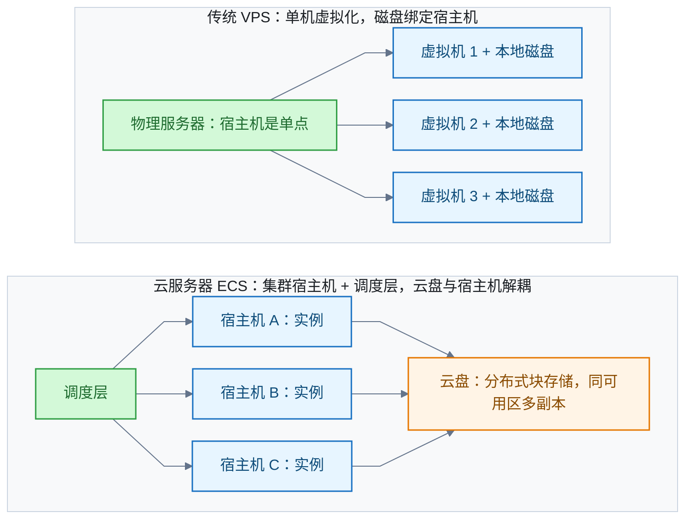
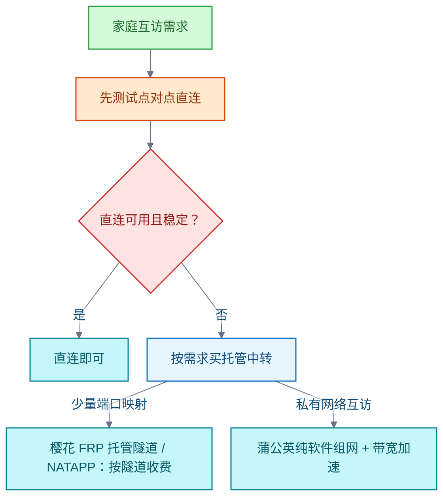

# VPS

虚拟专用服务器（Virtual Private Server，VPS）把一台物理服务器切分成多台虚拟机出租。本领域记录 VPS 的原理与形态、与阿里云云服务器的异同、按用途选提供商，以及家庭服务器内网穿透与动态域名方案。

## VPS 是什么，与云服务器有何区别

**结论**：VPS 是把一台物理服务器经虚拟机监控器（Hypervisor）切分成多台虚拟机后出租的形态。每台份额专用、租户隔离，有独立操作系统与 root 权限，可独立重启。它定位介于共享主机与独立服务器之间；阿里云弹性计算服务（Elastic Compute Service，ECS）等云服务器是它的云时代形态。

VPS 与 ECS 本质同类：都是 Hypervisor 切出的虚拟机加 root 权限。区别在架构与管理层：

- **传统 VPS**：单机虚拟化。磁盘绑定宿主机，宿主机是单点。
- **ECS**：实例跑在集群宿主机加调度层之上。云盘为分布式块存储，同可用区多副本、与宿主机解耦，数据可靠性标称 99.9999999%；支持升降配、在线扩容与五种计费模式。

**判断标准**：看实质不看名称——存储是否解耦、能否弹性、计费是否按量。"VPS"与"云服务器"的名称边界属营销。

信源：

- [DigitalOcean – VPS Hosting（一手）](https://www.digitalocean.com/solutions/vps-hosting)
- [IBM – What is a VPS?（一手）](https://www.ibm.com/topics/vps)
- [阿里云 ECS 文档中心（一手）](https://help.aliyun.com/product/25365.html)
- [阿里云块存储产品页（一手）](https://www.alibabacloud.com/product/block-storage)

## 按用途选 VPS 提供商

**结论**：按用途分流。通用建站可优先比较 DigitalOcean 与 Akamai（Linode）。苏州电信翻墙场景应优先筛选中国方向优化线路：可考察搬瓦工（BandwagonHost）的香港、日本 CN2 GIA/CTGNet 节点；洛杉矶节点作为预算折中。

**限制**：产品名称与服务等级协议（Service Level Agreement，SLA）百分比不能直接代表实际稳定性；具体延迟与晚高峰丢包必须在用户自己的网络实测；SLA 不保证 IP 在中国大陆长期可达。历史候选、价格、库存与条款随时间变化，实际购买前重查。

信源（关键）：

- [DigitalOcean CPU Droplet SLA（一手）](https://www.digitalocean.com/sla/cpu-droplets)
- [Akamai Compute Service Level Addenda（一手）](https://www.akamai.com/legal/sla-compute)
- [BandwagonHost CN2 GIA/CTGNet 线路说明（一手）](https://bandwagonhost.com/cn2gia-vps.php)
- [BandwagonHost Service Level Agreement（一手）](https://bandwagonhost.com/service-level-agreement.php)

## 家庭服务器内网穿透：先测直连，再选中转

**适用条件**：苏州；只供自己和家人使用；允许安装客户端；只需中转流量。家宽运营商与上行带宽尚未确认，不能沿用「苏州电信翻墙」问题的网络条件。

**结论**：家庭自用可以先测试点对点直连（直连与中继状态可按 Tailscale 文档的方法判断）。只需购买中转流量时，按需求选托管方案：少量端口映射先考察樱花 FRP 托管隧道，NATAPP 是按隧道收费的另一候选；私有网络互访考察蒲公英纯软件组网及带宽加速。

**比较维度**：套餐限速、流量配额、托管中继费用须分别比较；共享带宽不等于持续保证；增加云端带宽不能消除家庭上行瓶颈。以上是需求匹配建议，本次没有苏州实际线路的稳定性排名。

信源（关键）：

- [frp 概览（一手）](https://gofrp.org/zh-cn/docs/overview/)
- [Tailscale 连接类型与直连状态判断（一手）](https://tailscale.com/docs/reference/connection-types)
- [樱花 FRP 官方定价（一手）](https://www.natfrp.com/)
- [樱花 FRP 共享带宽与流量计费说明（一手）](https://doc.natfrp.com/faq/network.html)
- [NATAPP 隧道定价（一手）](https://natapp.cn/tunnel/buy)
- [蒲公英软件加软件组网（一手）](https://service.oray.com/question/10258)
- [蒲公英转发带宽加速（一手）](https://pgy.oray.com/parts/bandwidth)

## 家宽动态 IP 与 DDNS

**结论**：动态域名系统（Dynamic DNS，DDNS）解决「IP 会变、域名固定」的矛盾：客户端检测到公网 IP 变化，就自动更新 DNS 的 A/AAAA 记录，使域名始终指向当前 IP。

实现有两条路：

- **标准协议**：RFC 2136 的 DNS UPDATE（1997 年）。客户端向权威服务器原子增删资源记录。
- **商用 HTTP API**：如 Cloudflare 的 `PUT /zones/{zone_id}/dns_records/{record_id}`。客户端定时检测，变化即调用。

**前提与例外**：设备必须有公网 IP，动态亦可。运营商 NAT（Carrier-Grade NAT，CGNAT）后无公网 IP 时 DDNS 无效；此时需改用内网穿透或私有组网（见上文「家庭服务器内网穿透」）。

信源：

- [RFC 2136: Dynamic Updates in the DNS (DNS UPDATE)（一手）](https://datatracker.ietf.org/doc/html/rfc2136)
- [Cloudflare API · Update DNS Record（一手）](https://developers.cloudflare.com/api/resources/dns/subresources/records/methods/update/)
