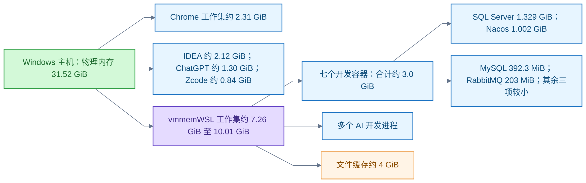
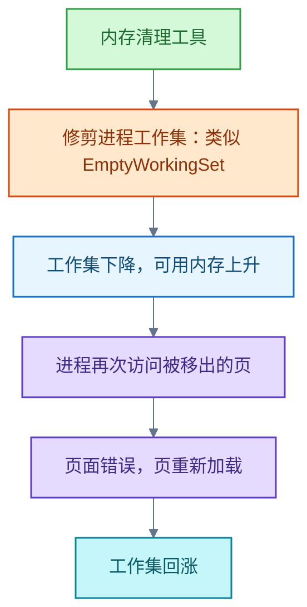

# Windows

本领域记录 Windows 11 使用中的三类判断：家庭版与专业版选型、清理与优化工具选择、内存占用与 WSL 常驻服务诊断。主线是按需求与实测做选择；不覆盖系统安装与硬件维修。

## 专业版与家庭版：按需求选择

**结论**：普通办公、游戏和一般编程通常可选家庭版；专业版为安全管理、远程接入、虚拟化和组织接入增加功能，按实际需求选择。

专业版比家庭版增加：

- BitLocker 驱动器加密管理。
- 远程桌面（Remote Desktop，RDP）主机：被其它设备远程连接的能力。
- Hyper-V 虚拟化。
- Windows 沙盒（Windows Sandbox）。
- 企业组织接入，例如 Microsoft Entra 加入设备。
- 物理内存上限由家庭版的 128 GB 提高到 2 TB。

限制：上述功能仍需满足硬件与配置条件；具体功能及容量上限按版本核对。

家庭版的能力边界，容易误判的三点：

- 家庭版提供设备加密。
- 家庭版可以充当远程桌面客户端。
- 家庭版可以运行适用于 Linux 的 Windows 子系统（Windows Subsystem for Linux，WSL）的 WSL 2。

本机案例：用 mstsc 连接 WSL 内的 xrdp 服务时，RDP 服务端位于 Linux，Windows 只充当客户端。无须为此升级专业版。

信源：

- [微软 Windows 11 版本比较（一手）](https://www.microsoft.com/zh-cn/windows/compare-windows-11-home-vs-pro-versions)
- [Windows 设备加密（一手）](https://support.microsoft.com/en-us/windows/security/encryption/device-encryption-in-windows)
- [远程桌面的使用条件（一手）](https://support.microsoft.com/en-us/windows/experience/connectivity-networking/how-to-use-remote-desktop)
- [Hyper-V 安装与版本要求（一手）](https://learn.microsoft.com/en-us/windows-server/virtualization/hyper-v/get-started/install-hyper-v?pivots=windows)
- [Windows 沙盒（一手）](https://learn.microsoft.com/en-us/windows/security/application-security/application-isolation/windows-sandbox/)
- [Microsoft Entra 加入设备（一手）](https://learn.microsoft.com/en-us/entra/identity/devices/concept-directory-join)
- [Windows 物理内存上限（一手）](https://learn.microsoft.com/en-us/windows/win32/memory/memory-limits-for-windows-releases#physical-memory-limits-windows-11)
- [WSL 常见问题（一手）](https://learn.microsoft.com/en-us/windows/wsl/faq#is-wsl-2-available-on-windows-10-home-and-windows-11-home)
- [xrdp 官方项目：Linux 服务端与 Windows mstsc 客户端（一手）](https://github.com/neutrinolabs/xrdp)

## 清理与优化工具：按用途选择

**结论**：按用途选工具，系统文件先用 Windows 内置功能；释放空间与改善性能分别判断，清理文件数量不能证明提速。

工具与用途：

- 系统文件：先用内置存储感知（Storage Sense）或清理建议。
- 应用缓存与临时文件：BleachBit。
- 定位大文件：WizTree。
- 批量卸载并检查残留：BCUninstaller。
- 管理自启动：Autoruns。
- 集中日常维护：微软电脑管家。

操作纪律：

- 清理前预览删除项。
- 自启动项优先禁用，随后验证影响。
- 避免全选清理。
- 避免批量修改不理解的服务。
- 释放空间与减少后台负载分别诊断。

信源：

- [BleachBit 官方文档（一手）](https://docs.bleachbit.org/)
- [BleachBit 功能说明（一手）](https://www.bleachbit.org/features)
- [BleachBit Windows 下载与兼容要求（一手）](https://www.bleachbit.org/download/windows)
- [WizTree 官方说明与个人使用许可（一手）](https://diskanalyzer.com/)
- [BCUninstaller 官方项目（一手）](https://github.com/BCUninstaller/Bulk-Crap-Uninstaller)
- [微软 Autoruns（一手）](https://learn.microsoft.com/en-us/sysinternals/downloads/autoruns)
- [微软电脑管家（一手）](https://pcmanager.microsoft.com/zh-cn)
- [微软释放磁盘空间指南（一手）](https://support.microsoft.com/en-us/windows/experience/storage-filemanagement/free-up-drive-space-in-windows)
- [微软性能优化指南（一手）](https://support.microsoft.com/en-us/windows/experience/performance-optimization/tips-to-improve-pc-performance-in-windows)

## 内存回涨与 WSL 常驻服务：诊断与按需启动

**结论**：实测 WSL 是最大的单项物理内存使用者；清理后回涨符合工作集被修剪后重新加载的机制；七个开发容器仅开发时需要，已改为按需启动并正常停止；回收配置生效仍待验证。

2026-10-27 本机实测的占用结构（物理内存 31.52 GiB）：

诊断要点：

- 内存需区分工作集（Working Set）、提交量（Commit Charge）与缓存。
- 清理后回涨的机制：清理工具修剪工作集，进程再次访问被移出的页时重新加载。回涨本身不能单独证明内存泄漏。
- 电脑管家的具体实现未核实；内存泄漏也未核实。
- 进程族工作集相加会重复计算共享页。
- 提交量约 39.7 GiB，上限 55.52 GiB；工作集波动时，提交量在短时采样中基本稳定。
- 采样后段 Pages Output/sec 为 0；开机以来未发现资源耗尽事件 2004。不能据此排除长期泄漏。
- 页面文件（paging file）当前使用约 14.75 GiB，开机以来峰值约 23.83 GiB；该数字不等于实时换页速率。

清理后回涨的机制：

容器处置（2026-10-27 已执行）：

- 七个容器及两处 Compose 配置的重启策略由 `unless-stopped` 改为 `"no"`，并正常停止全部容器。
- 停止后核验：七容器 `running=false`、`restart=no`、`oom=false`；SQL Server 退出码 0，Nacos 与 Qdrant 退出码 143（收到 SIGTERM）。
- SQL Server 容器的 PID 1 为 `launch_sqlservr`，该脚本无信号转发；已向其直接子进程 sqlservr 发送 TERM，完成正常退出。
- 两处 Compose 经 `docker compose config --quiet` 校验，核对只有目标服务的 restart 字段变化；原配置备份后缀 `.backup-on-demand-20261027-135940`。
- 数据保留；WSL 的 `gradual` 回收设置与系统管理的页面文件保留。
- 提供按需启停脚本 `开发服务.ps1`：`-Action Start`、`-Action Stop`、`-Action Status`，可选 `-Group Infra` 或 `-Group SqlServer`。

容器内存口径：

- SQL Server 原无容器内存硬上限；其他六容器已有 1 GiB 至 4 GiB 上限。
- 硬上限不表示预先占用。
- 本地 Docker 上下文为 `unix:///var/run/docker.sock`。

停止容器前后的对比：

- Windows 可用内存 7.57 GiB 升至 8.31 GiB；提交量 37.47 GiB 降至 35.15 GiB；WSL 工作集 8.65 GiB 降至 7.87 GiB。
- WSL `free` 已用从约 7.1 GiB 降至约 3.0 GiB；Cached 仍有 4488728 KiB。
- 期间其他 AI 进程仍在变化：全部差额不能只归因于容器。

限制与待验证：

- WSL 当前启动于 08:38:06，回收配置修改于 13:46:19，尚未重启。`gradual` 回收是否生效与长期走势仍需后续验证。
- 首次采样可用 8.77 GiB（使用率 72.2%），后续可用在 5.59 GiB 至 8.31 GiB 间波动；长期走势仍需后续验证。

信源：

- 本机实测（一手·实测，2026-10-27）：Windows CIM 与进程采样、`docker stats`、停止前后对比，数据如上。
- [微软：工作集、页面错误与修剪（一手）](https://learn.microsoft.com/en-us/windows/win32/memory/working-set)
- [微软：EmptyWorkingSet（一手）](https://learn.microsoft.com/en-us/windows/win32/api/psapi/nf-psapi-emptyworkingset)
- [微软：WSL 内存上限、回收设置与重启生效（一手）](https://learn.microsoft.com/en-us/windows/wsl/wsl-config)
- [Docker：restart 策略（一手）](https://docs.docker.com/reference/compose-file/services/#restart)
- [Docker：内存资源限制（一手）](https://docs.docker.com/engine/containers/resource_constraints/)
- [Docker：stats 的缓存扣除口径（一手）](https://docs.docker.com/reference/cli/docker/container/stats/)
- [微软：提交量与内存泄漏诊断（一手）](https://learn.microsoft.com/en-us/troubleshoot/windows-server/performance/troubleshoot-application-service-memory-leaks)
- [Linux 内核：手动丢弃缓存的性能代价（一手）](https://docs.kernel.org/admin-guide/sysctl/vm.html#drop_caches)
- [SQL Server 容器入口未转发终止信号的问题（一手·原报告）](https://github.com/microsoft/mssql-docker/issues/968)
